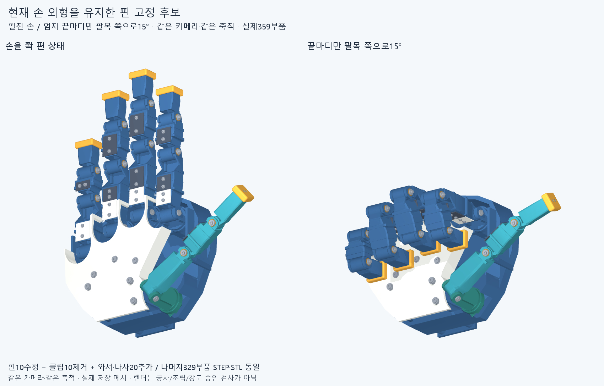

# Robot Hand

**사람의 손과 팔 움직임을 빠르게 따라 하는 3D 프린트 로봇을 만드는 프로젝트입니다.** 손의 비율과 마디 형태를 유지하면서 움직이는 부분을 가볍게 하기 위해, 모터를 어디에 두고 구동력을 어떻게 전달할지 설계하고 있습니다.

## 개발 목표

손가락 20축 독립 제어를 기본안으로 검토합니다. 지연 목표는 **50 ms 이하**, 정해진 시험 범위에서 유효하게 측정한 사건의 최대 목표는 **100 ms 이하**입니다. 로봇 제어부가 목표 각도를 받은 뒤의 추종을 평가합니다. 시험별 도달 기준과 지연의 중앙값·95백분위·최대, 미도달 횟수를 함께 기록합니다. 카메라·인식·장갑 지연과 90° 전체 이동 시간은 별도 지표입니다. [요구사항과 평가 방법](docs/REMOTE_DRIVE_PLAN.md)

## 현재 확인한 범위

- **손 자세.** 기존 손의 형상을 유지한 CAD에서 **지름 25 mm 고정 구에 손끝을 모았다가 푸는 경로**를 확인했습니다. 33개 표본에서 보고 기준 이상의 관통은 없었습니다. [자세와 검사 조건](cad/object_pinch_v2/README.md)
- **일부 조립 경로.** 손가락 모듈의 삽입·공구 접근 및 일부 팔 조립 순서를 CAD로 검사했습니다. 전체 모터·구동줄·배선의 통합과 실제 지연 시험이 남아 있습니다. [손쪽 통합 상태](docs/HAND_INTEGRATION_STATUS.md) · [팔 조립의 최신 저장 검사](cad/dogleg_electrical_entry_v1/README.md)

## 설계 자료

- [외형 기준](cad/accepted_form_v1/README.md) · [손 전체 STEP 압축](cad/motion_clearance_v2/generated/hand.step.zip) · [부품 목록](cad/motion_clearance_v2/generated/assembly_catalog.json)
- [설계 전환점](PROGRESS.md) · [현행 체크포인트](CHECKPOINT.json) · [동결 감사 근거](AUDIT_EVIDENCE_INDEX.json)

제조사 CAD와 문서의 출처 및 이용 범위는 [가져온 자료 목록](docs/IMPORT_SCOPE.json)과 각 CAD 자료의 출처 기록에 있습니다.
