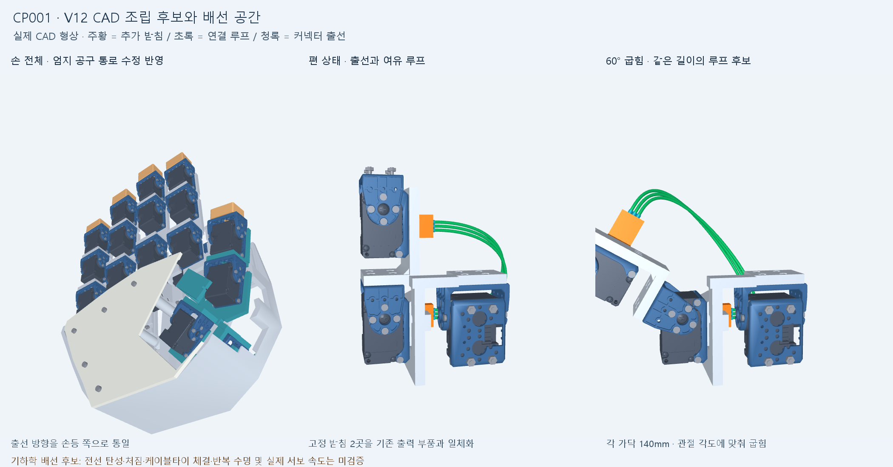

# Robot hand — CAD 검토와 체크포인트

사람의 손과 팔 동작을 빠르게 따라 하는 3D 프린트 로봇 손을 설계하는 저장소입니다. 손가락 20축과 팔 4축을 검토합니다. **현재는 조립·배선·구동 검토용 후보이며, 제작 승인이나 실시간 추종 성능을 검증한 완성품이 아닙니다.**

## 지금 볼 것

- [CP001 감사 대응과 남은 문제](checkpoints/CP001.md)
- [V12 손 전체 CAD](cad/audit_fixes_v12/V12_hand_packaging.FCStd) — FreeCAD 1.0에서 열기. 현재 손 후보이며 팔 전체 조립 파일은 아닙니다.
- [V9 손+전완 전체 CAD](cad/modular_roots_v9/hand_forearm_v9.FCStd) / [STEP](cad/modular_roots_v9/hand_forearm_v9.step) — 독립 감사를 받은 동결 기준본.
- [V12 엄지 수정 부품 STEP](cad/audit_fixes_v12/parts/Thumb_metacarpal_tool_access.step)
- [독립 V9 감사 보고서](cad/audit_fixes_v12/received_audit/V9_audit_package/V9_audit_report.md)
- [커밋 후 재검토 절차](docs/CHECKPOINT_WORKFLOW.md)

## 버전 구분

| 폴더 | 역할 | 현재 해석 |
| --- | --- | --- |
| cad/modular_roots_v9 | 동결된 감사 기준본 | 해시 222개 보존. 팔 모터 부족 등 알려진 미달 항목 포함 |
| cad/wiring_access_v10 | 고정 출선과 엄지 채널 후보 | 완성된 전기 배선 아님 |
| cad/service_loops_v11 | 새끼손가락 가이드·기하 루프 후보 | 실제 전선 유연체/수명 시뮬레이션 아님 |
| cad/audit_fixes_v12 | 현재 감사 대응 후보 | 엄지 공구 통로 수정, 오차 여유 및 구동 대안 검토 |

V9 손은 약 1.335 kg이며, 손바닥 폭 232 mm인 큰 직결 구동 구조입니다. 이전 소형 상자 모델의 속도·토크 결과는 이 CAD에 적용하지 않습니다. XL330-M077이 목표 속도를 충족한다는 실측 근거는 아직 없습니다.

## 검토 환경과 빠른 확인

분석 환경: Python 3.12, requirements-audit.txt의 버전. CAD 검사는 FreeCAD 1.0에 포함된 별도 Python 환경에서 실행합니다. Windows에서는 pythonw.exe와 숨김 실행을 사용합니다. FreeCADCmd 창을 열지 않습니다.

명령을 실행할 환경이 준비되었다면 다음 읽기 전용 검사부터 시작합니다.

~~~text
python verify_audit_evidence.py --full
python cad/modular_roots_v9/kinematics_numpy.py
python tools/check_checkpoint.py
~~~

이 검사는 저장된 증거의 보존·일관성과 일부 형상을 확인합니다. 전체 동역학, 모든 조립 순서, 모든 연속 자세의 충돌을 승인하는 검사는 아닙니다. 정확한 CAD 재검사와 깨끗한 커밋 사본 검토는 docs/CHECKPOINT_WORKFLOW.md를 따릅니다.

## 다음 설계 우선순위

1. 팔 구동: 실제 관성·속도·열·추가 부품 질량을 포함해 감속/중력 보상/모터 교체 중 선택.
2. 대표 손가락 실측: 정지 처짐, 실제 하중에서의 속도, 전류 제한과 전선 저항 토크.
3. 동시에 변하는 벌림 관절의 오차 여유 확보와 전체 관절 한계 작성.
4. 20개 모터 전체 배선·너트 유지·공구 접근·FDM 동하중 검토.

500만 원 목표 예산은 유지하지만, 수정된 구동계를 포함한 최종 BOM은 아직 확정하지 않았습니다.

제조사 CAD와 규격의 출처는 각 sources 폴더에 보존합니다. 이 저장소에 별도의 일괄 라이선스를 부여하지 않습니다. [최초 가져오기 범위](docs/IMPORT_SCOPE.json)를 참고하세요.
