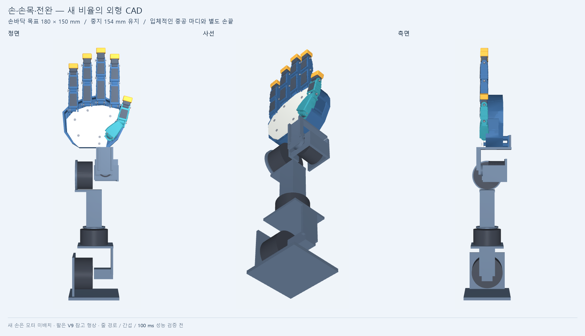

# Robot Hand

**사람의 손과 팔 움직임을 빠르게 따라 하는 3D 프린트 로봇을 만드는 프로젝트입니다.**

현재는 **원래 손의 비율·마디·손끝·엄지 형태를 유지하면서** 움직이는 손가락을 가볍게 하는 구조를 개발합니다. 손가락20축의 독립 제어를 기본으로 검토하며, 모터 배치와 내부 구조를 바꿔 저지연을 목표로 합니다. 크기 확대나 손가락만의 축소를 먼저 확정하지 않습니다.

목표는 **로봇 자체의 추종 지연 50ms 이하, 정해진 시험 범위의 최대 지연 100ms 이하**입니다. 로봇 제어부가 목표 각도를 받은 뒤 실제 관절이 따라오는 과정이 대상입니다. 카메라·인식·장갑의 입력 지연은 이번 평가에서 제외합니다. 추종 지연은 90° 회전 전체를 끝내는 시간과 다릅니다.

*손바닥을 줄이고 마디·엄지 형태를 새로 만든 외형 기준입니다. 위 그림은 외형만 보여 주며 팔은 V9 참고 형상입니다. 이 비율을 유지한 [새 모터 배치와 전달 설계](cad/form_drive_v1/README.md)를 진행 중입니다. [손 확대](cad/form_candidate_v1/README.md)*

> CAD와 시뮬레이션을 반복 개선하는 단계입니다. 제작 승인과 실제 하드웨어의 100ms 이하 성능 검증은 아직 완료하지 않았습니다.

[현재 설계](#현재-설계) · [자료 살펴보기](#자료-살펴보기) · [성능 확인 방법](#성능-확인-방법) · [다음 개발 과제](#다음-개발-과제) · [개정 이력](#개정-이력)

## 현재 설계

| 항목 | 개발 방향 |
| --- | --- |
| 손 크기·형태 | 손바닥180×150mm 후보, 중지154mm 유지. 손가락을 더 줄이지 않고 전체 비율부터 검토. [외형 기준](docs/FORM_REFERENCE.md) |
| 손가락 | 20축 독립 제어 기본안. 16축 연동은 별도 비교 옵션 |
| 모터 배치 | 실제 크기20개: 손바닥6, 손목 뒤 구역4, 전완 뒤10. 뒤쪽14개는 전완 랙에 고정하는 후보이며 전체 체결은 미완성 |
| 전달 구조 | 원격 줄 구동의 실제 경로와 관절 간 영향을 재설계. 새 외피 질량·관성을 연결했고, 움직이는 전달 부품의 질량은 후속 반영 필요 |
| 손목·팔 | 연결 형상을 고려하되 손 단독 성능 평가와 구분. 팔 통합 검증은 후속 과제 |
| 모터·예산 | XL330과 과거 약500만원 예산은 비교 기준이며 고정 제약이 아님 |

모터 수 감소와 소형화가 저지연의 필수조건은 아닙니다. 같은 길이와 표현 자유도에서 원위 질량을 줄이는 효과를 먼저 확인합니다. 줄의 마찰·늘어남·예압과 인접 관절이 움직일 때의 줄 길이 변화도 함께 설계합니다.

이전 재배치 후보는 큰 손바닥과 직선 링크, 엄지 외부 모터 때문에 외형 기준을 충족하지 못했습니다. 해당 CP007은 보존하고, 손바닥 폭·길이를 약22~23% 줄인 새 중공 형상에서 개선을 재개했습니다. 모터 배치·지지 랙과 새20축 동역학을 연결하되, 전체 전달계가 완성되지 않았으므로 이전 후보의 무게·지연 결과를 새 형상의 성능으로 쓰지 않습니다.

## 자료 살펴보기

| 자료 | 위치 | 범위 |
| --- | --- | --- |
| 개발 기준 | [요구사항과 반복 순서](docs/REMOTE_DRIVE_PLAN.md) | 측정 경계, 설계 방향, 미확정 항목 |
| 새 외형 CAD | [손 확대·설명](cad/form_candidate_v1/README.md) · [STEP](cad/form_candidate_v1/generated/hand_form_candidate.step) | 새 비율의 손 외피·관절 형상. 내부 모터와 전달계 미완성 |
| 새 구동 CAD | [모터 배치·줄 경로](cad/form_drive_v1/README.md) | 새 외형을 유지한20개 모터·받침·후면 랙과 중지 줄 끝단 검토 |
| 새 형상 동역학 | [form_drive_v1](sim/form_drive_v1/README.md) | 실제 외형 BRep 질량·관성에 가정 전달계를 연결한20축 선별 계산 |
| 이전 구동 CAD | [전체 STEP 압축 파일](cad/remote_drive_v1/assembly.step.zip) · [GLB](cad/remote_drive_v1/assembly.glb) · [입력·설명](cad/remote_drive_v1/) | 보류한 CP006/CP007 방향의 구동·체결 검토 자료 |
| 이전 후보 동역학 | [remote_drive_v1 시뮬레이션](sim/remote_drive_v1/) | 이전 형상 계산. 고정 커밋의 힘·평가 코드만 새 어댑터에서 분리 재사용 |
| 이전 후보 움직임 | [오프라인 HTML](sim/remote_drive_v1/results/viewer.html) | 내려받아 브라우저에서 열기. 요청 자세·구동 목표·응답 비교 |
| 진행 상황 | [PROGRESS.md](PROGRESS.md) | 회차별 변경·검사·다음 작업 |
| 이전 직접 구동 구조 | [보존 브랜치](https://github.com/ckh7488/robot_hand/tree/archive/direct-drive-v13) | V9~V13 방향을 중단 상태로 보존 |

이전 V9~V13 파일은 비교·감사 추적을 위해 main에도 보존합니다. 외형 기준은 form_candidate_v1, 현재 구동 개선은 form_drive_v1이며, remote_drive_v1의 미완성 개선은 보류했습니다. 과거 보고서의 통과 판정은 새 구조에 승계되지 않습니다. V9의 [설계 입력](cad/modular_roots_v9/design.json)은 원형 치수·자세의 출처입니다.

## 성능 확인 방법

입력 장치 없이 목표 관절각을 재생해 작은 왕복, 빠른 굽힘·펴기, 급반전, 여러 관절의 동시 움직임을 비교합니다.

- 모든 축·방향의 추종 지연을 집계하고 목표에 도달하지 못한 사례를 누락시키지 않습니다.
- 원래 시간축의 각도 오차, 지연 보정 후 모양 오차, 정착시간·오버슈트를 별도로 기록합니다.
- 작은 동작은 진폭에 비례한 임시 정확도 기준도 확인합니다. 시작부터 임계각을 지난 상태와 실제 미도달을 구분합니다.
- 가운데·끝마디를 독립적으로 움직여 16축 연동 구조의 자세 표현 손실과 동역학 오차를 나눠 비교합니다.
- 현재는 중력·마찰·탄성·예압·질량·축간 경로 계수·내부 통신 조건을 바꾼 민감도를 확인합니다. 풀리 반경 전달비와 모터 속도·토크·출력 상승률의 비교는 다음 과제입니다.
- CAD의 형상·질량·관성과 동역학 입력을 대조하고, 중력·반전·에너지 일관성과 시간간격 수렴을 검사합니다.
- 체크포인트마다 커밋·푸시 후 같은 SHA의 깨끗한 사본에서 핵심 검사를 재실행합니다. [검토 절차](docs/CHECKPOINT_WORKFLOW.md)

시뮬레이션은 명시한 모델과 시험 범위에서만 유효합니다. 실제 서보 제어, 줄 마찰, 열, 조립 공차를 실측하기 전에는 물리 성능 통과로 표시하지 않습니다. 실제 손가락 관절각은 줄을 감는 모터 축의 각도와 구분하여 측정해야 합니다.

이전 CP006의 체결·샘플 간섭·기본29건 동역학과 엄지 진단은 [해당 기록](checkpoints/CP006.md)에 남깁니다. 새 형상에서는 실제 질량·관성의20축 모델과 모터 배치를 연결했습니다. 전체 가동 범위·줄 감김·체결·강성·실제 구동계 보정은 남아 있습니다. **100ms 목표 달성을 주장하지 않습니다.**

## 다음 개발 과제

| 과제 | 확인할 내용 |
| --- | --- |
| 외형과 내부 배치 | 손바닥6·후면14 모터의 실제 고정, 후면 돌출 축소, 엄지 연결과 정비 접근 |
| 전달 구조 | 풀리·스풀 반경, 양쪽 줄 고정·예압 조절, 동시 관절 운동의 보상 속도 |
| 모터 성능 | 부하가 있는 속도·토크, 급반전, 출력 상승, 전류·열·전원 여유 |
| CAD·조립 | 새 관절·모터 고정부의 지지, 전 가동 범위 간섭, 체결·공구 접근과 강도 |
| 자세 표현 | 20축 유지안과 16축 연동안의 대표 자세 오차 |
| 실물 시험 | 손가락 하나의 실제 관절각·장력·전류·지연 측정 후 전체 손으로 확장 |
| 손목·팔 | 손의 변경된 질량·관성으로 구동계와 통합 추종 재평가 |

## 자료 출처와 이용 범위

제조사 CAD와 규격 출처는 루트 및 각 CAD 폴더의 sources에 보존합니다. 별도의 일괄 라이선스는 부여하지 않았습니다. [최초 가져오기 범위](docs/IMPORT_SCOPE.json)와 [동결 증거 해시](AUDIT_EVIDENCE_INDEX.json)를 함께 관리합니다.

## 개정 이력

| 버전·날짜 | 주요 변경 | 기록 |
| --- | --- | --- |
| 새 형상 구동 재개 · 2026-10-24 | 실제 모터20개 배치, 새 외형 질량·관성의20축 모델, 중지 줄 끝단 검토 | [DRIVE001](checkpoints/DRIVE001.md) |
| 손 비율 재설계 · 2026-10-24 | 손바닥180×150mm, 중지154mm 유지와 새 중공 마디. 내부 배치·성능 미검증 | [외형 CAD](cad/form_candidate_v1/README.md) |
| 모터 체결·엄지 진단 · 2026-10-24 | 손바닥 모터 8개 브래킷·어댑터, 샘플 간섭과 급반전 원인 분리 | [CP006](checkpoints/CP006.md) |
| 연결부·평가 보완 · 2026-10-24 | 엄지 실제 연결축, 손바닥 모터 배치, 작은 동작 정확도와 독립 자세 비교 | [CP005](checkpoints/CP005.md) |
| 원위 모터 재배치 · 2026-10-24 | main을 저관성 구조 개발로 전환. 로봇 자체 50ms 목표·100ms 상한, 기존 크기·20축 기본안 | [개발 기준](docs/REMOTE_DRIVE_PLAN.md) |
| README 정리 · 2026-10-24 | 소개와 CAD 안내를 앞에, 개정 이력을 마지막에 배치 | [CP003](checkpoints/CP003.md) |
| V13 | 덮개 나사 5개 매립과 제한된 오프라인 자세 검사 | [CP002](checkpoints/CP002.md) · [재검토](docs/reviews/CP002_f4739db.md) |
| V12 | 엄지 공구 통로, 벌림 오차 여유와 구동 대안 | [CP001](checkpoints/CP001.md) · [재검토](docs/reviews/CP001_c738a40.md) |
| V11 | 전선 가이드와 관절 사이 여유 루프 | [기록](cad/service_loops_v11/README.txt) |
| V10 | 모터 고정 출선 경로와 엄지 배선 채널 | [기록](cad/wiring_access_v10/README.txt) |
| V9 | 손·전완 감사 기준 동결, 해시222개 보존 | [기존 독립 감사](cad/audit_fixes_v12/received_audit/V9_audit_package/V9_audit_report.md) |

기존 직접 구동 방향은 accd6c8d8d9791828233e9461ef1b1e8dccc8b0b에서 [보존 브랜치](https://github.com/ckh7488/robot_hand/tree/archive/direct-drive-v13)로 남겼습니다.
