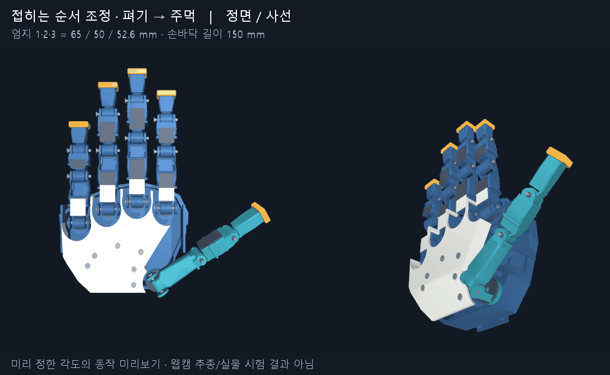

# FORM002 — 현재 수용한 손 형상 / CAD 인계 기준

2026-10-25 사용자가 비율과 주먹 초안을 수용하고 현재 모양의 커밋을 요청했다. 이전 `anatomy_candidate_v1` 초안은 반려됐으며 이 폴더가 최신 **외형·관절·주먹 동작 기준**이다. 웹캠 추종의 떨림/전환은 아직 반려 상태다.

## CAD 작업이 이어받을 내용

- 손바닥 외곽 목표 180×150 mm, 엄지 뿌리부터 세 링크 65 / 50 / 52.6033 mm. 나머지 네 손가락 링크·뿌리 좌표와 엄지 축 기준은 `design.json`의 정확한 수치를 사용한다.
- `preview.xml`은 20개 회전축, 부모 프레임, 관절 범위, 124개 부품의 배치를 담는다. STL은 mm 단위 **관절 로컬 프레임**이다. XML 배치 좌표는 m이며 메시 scale=0.001이다. 세계 좌표 STL로 오인해 두 번 변환하지 않는다. `parts.json`은 부품명과 부모 프레임이다.
- `motion.json`은 사용자가 확인한 편 손→주먹 33개 자세다. `fraction`은 경로 비율이며 실측 시간/속도가 아니다. 손가락을 먼저 접고 엄지 말단을 뒤따르게 한 작성 동작이다. 실제 웹캠 입력이나 모든 자세의 자연스러움 검증 자료가 아니다.
- 원본 CAD 기반 메시를 늘이거나 줄여 비율을 맞춘 **시각적 기준**이다. 변형된 구멍·핀·외피를 그대로 제작하지 않는다. 제작 CAD/STEP, 간섭 제거, 체결·구동 설계는 CAD 전용 작업에서 이 형태를 기준으로 재구성한다. 현재 모델은 충돌 계산을 꺼 놓았다.
- 사용자 요청에 따라 이 회차에서 충돌 절삭·제작성 수정을 하지 않았다. 이전 CAD 후보의 검사 결과를 이 형상에 승계하지 않는다. CAD 작업이 별도 후보를 만들더라도 이 폴더의 수용한 기준은 보존한다.

## 재현

Python 환경에 numpy, scipy, mujoco, Pillow를 설치한 뒤 저장소 루트에서 `python cad/accepted_form_v1/verify.py --output <별도 결과 폴더>`를 실행한다. Windows 자동 실행은 저장소 규칙대로 숨김 pythonw/로그를 사용한다.

검사는 모든 상대경로/해시, 20축 범위, 33자세의 기구학과 렌더 모델 일치를 확인하고 정면·사선 이미지를 다시 만든다. 이는 제조·충돌·강도·제어 성능 검사가 아니다. `manifest.json`은 원본 입력과 참고 이미지의 해시이며 자체 파일과 검사 결과는 제외한다. 사람 웹캠 영상과 개인 원시 좌표는 포함하지 않았다.
