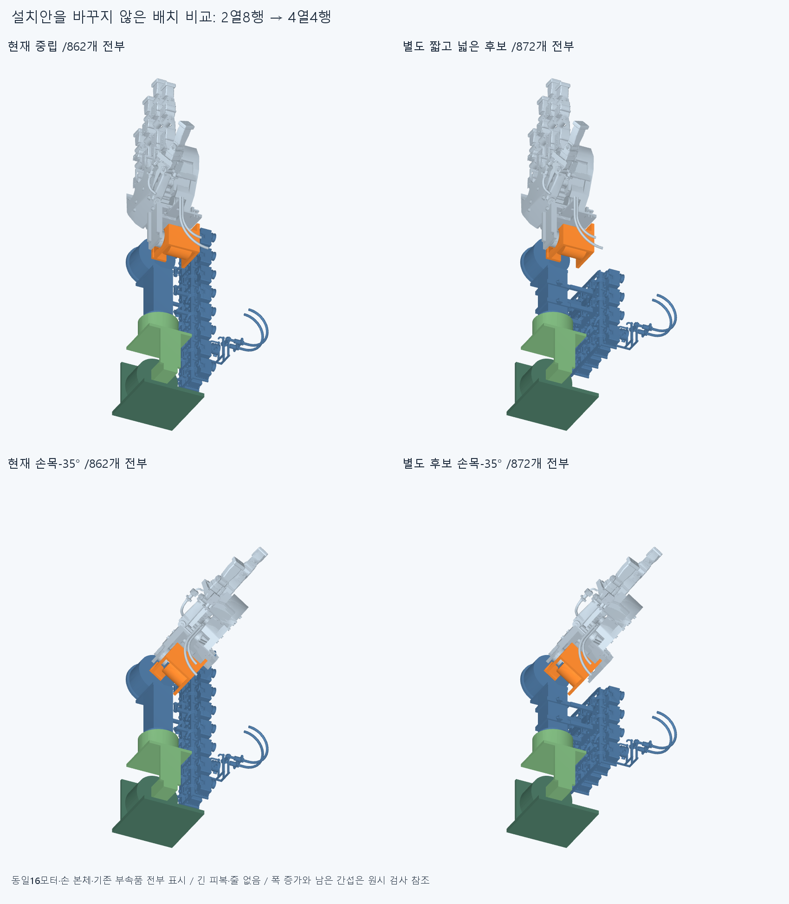
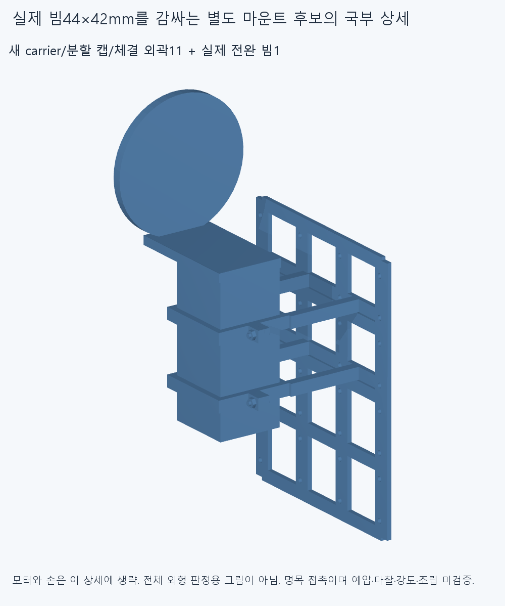
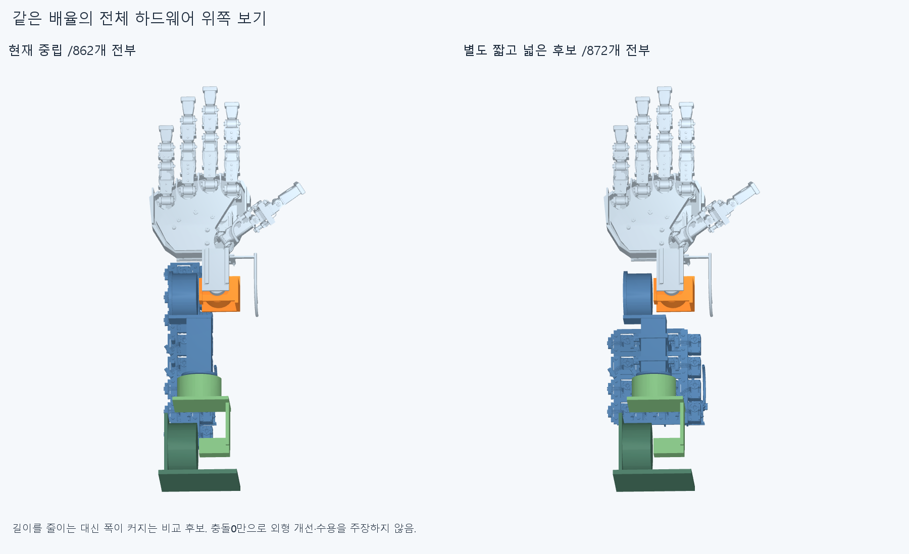
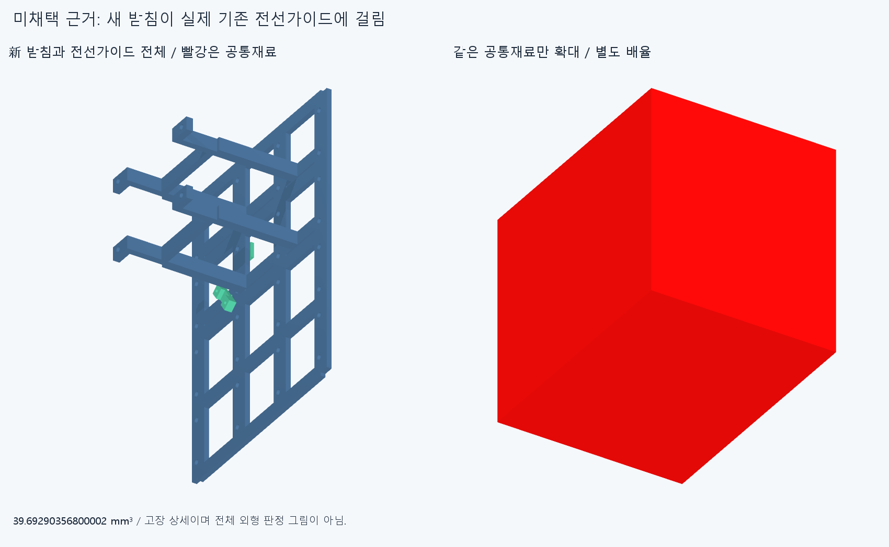

# ARM052 짧고 넓은 별도 모터배치 후보, 미채택

**현재 설치 후보는 그대로 두었다. 같은16모터를2열8행에서4열4행으로 옮긴 별도 안은 검사한 팔 자세의 큰 막힘을 피하지만 폭이80mm 커지고 새 받침이 실제 전선 부품과 겹쳐 채택하지 않았다.** 손 본체/축/길이는 유지했다. 더 넓은 모터 다발을 사람다운 외형 개선으로 밀지 않는다.

각 왼쪽은 현재862개, 오른쪽은 별도 후보872개를 모두 불투명 표시한다. 같은 손 본체와 기존 부속품을 표시했으며 긴 피복/줄은 양쪽 모두 없다. 아래는 손목−35°의 독립 진단 자세다. 전체 구동이나 중간 경로 통과 영상이 아니다.

## 무엇을 비교했는가

실제 원격16모터와 부속409행을 강체 묶음으로 평행이동했다. 일반15묶음은 각24행, 대표 thumb_ip 묶음은49행이다. 기존 전기64행과 전선가이드·리드·체결품도 같이 옮겼다. 대표 모터의 두 피복 고정부와 두 R40굽힘관은 한 thumb_ip 모터의 두 선이며 두 모터로 세지 않는다. 나머지15출력에 이 대표 전달계를 복제하지 않았다.

별도 후보의 중심 X는−55/−15/25/65mm, Y는−274/−232/−190/−148mm, Z는−95mm다. 실제 설치 회전행렬과 출력축 방향은 그대로이며 **모터 명령각 변경0/설치축 회전 변경0**이다.16설치 중심을 옮기는 별도 제안이지 현재 위치를 몰래 바꾼 것이 아니다. 행별 실제 소속과 원래/새 변환은 [proposal.json](reviews/proposal.json)에 저장했다.

현재 Forearm_twenty_axis_module_rack 하나만 빼는 제안이다. 손397/손바닥 모터4/팔10/손목 가이드6은 현재 위치와 형상을 유지한다. 기존861개 중409행의 제안 위치만 다르고452행은 그대로다. 새 carrier1/분할캡2/명목M3×12볼트4·너트4의11개를 더해 제안872행이다. 현재862설치 후보와 모든 이전 CAD는 보존했다. 고정부 신규 STEP/STL11개만 만들었고 기존409형상은 원본 STEP에 명시한 강체 변환을 적용했다. 공급 모터를 축소하지 않았다.

## 실제 빔에 어디로 붙는가

기존 받침이 빔에서23~33.53mm 떨어졌던 ARM051과 달리, 이 별도 안은 실제 전완 빔의44×42mm 직사각 단면을 Y−202/−160mm에서 나뉜 collar로 감싼다. 양쪽 위캡은 분리된 부품이고 각 두M3 체결 외곽이 있다. carrier와 두캡 각각의 native 빔 최근접 거리3개는0이며 같은 새부품 대 기존부품 재료 검사에 빔도 포함된다. 최근접0은 모든 접촉면의 공차·균일압착이나 유지력 승인과 다르다.

명목 반력 경로는 기존 모터 어댑터/각 두M3 → 새 rail/crossbar → 일체 측면기둥4 → 실제 빔 collar/두캡/명목M3 → Forearm_box_beam → 기존 Roll_output_flange다. 축방향 미끄럼과 전단 유지에는 미검증 예압·마찰이 필요하다. 실제 조립 진입/공구/나사산·토크/공차/강성·피로·하중을 풀지 않았고 CAD 접촉을 실제 고정력으로 쓰지 않는다. 새 고정부는 연구 후보이며 제작 확정품이 아니다.

[attachment.json](reviews/attachment.json)은 carrier/두캡의 실제3거리를 담는다. 최초 new[:3] 선택은 carrier/첫캡/볼트를 골랐고 원래 이름·볼트거리6.15mm를 proposal.json에 그대로 남겼다. 미선택 두번째 캡만1거리 추가 측정했다. 이미 측정한2접촉이나 전체 native를 반복하지 않았다.

## 길이를 줄인 대가

| 원격 모터·고정부 묶음 상자 | 현재 | 별도 후보 |
| --- | ---: | ---: |
| X폭 |94.81mm|174.81mm|
| Y방향 길이 |338mm|176mm|
| Z높이 |185.5000001mm|254.5000001mm|

폭은80mm 증가하고 길이는162mm 감소한다. 높이69mm 증가는 실제 빔 위까지 감싼 새 고정부를 포함한 값이다. 두 상자는 같은 원격 하드웨어 범위이며 현재 상자 min[−67.1,−339,−229.5000001]/max[27.71,−1,−44], 후보 min[−87.1,−299,−229.5000001]/max[87.71000000000001,−123,25]mm다. 전체 팔 실루엣, 필요한 최소 폭/공차/절삭 길이, 외형 수용 기준이 아니다. 전완 둘레 분포를 검토하지 않고 평면에서 폭만 늘리면 여전히 큰 외부 모터 다발이 된다.

## 새 native 검사와 남은 실제 간섭

[proposal.json](reviews/proposal.json)의 새138그룹은647994쌍/320AABB 후보/5재료겹침 기록/연산실패0이다. 보고기준0.001mm³ 초과/Boolean허용오차1e−6mm/OCC풀1을 유지했다.

409이동행 대452유지행의 중립은0이다.16묶음 사이 새 상대관계120그룹도 모두0이고 새11부품 내부55쌍도0이다. 같은 묶음 내부는 강체 상대기하가 변하지 않아 재실행하지 않았다. 이를 기존 묶음 자체/토크 연결 전체의 승인으로 쓰지 않는다.

추가로 전완+40°는 변경420행 대 고정/팔꿈치, 손목−35°는 대 손목/손, 편위+20°는 대 손, 팔꿈치110°는 대 고정몸체를 검사해6그룹 모두0이었다. 변하지 않은 관계와 기존 손/팔 내부쌍을 재실행하지 않았다.4개는 독립 유한 자세이며 연속·복합운동/자연스러운 전체 범위가 아니다. ARM051의 기존 팔꿈치 캐리어/시험대 고정받침110° 충돌은 이 제안으로 해결되지 않았다. 시험대 받침은 실제 상완이 아니다.

새 carrier 대 기존861행에는 다음5기록이 남는다.

- middle_dip 전선가이드 본체:39.69290356800002mm³.
- 같은 모터 lead1:11.193272423778136mm³, lead2:0.6508902407940056mm³.
- middle_dip/middle_spread의 rack_nut_1:각0.12730573435111736/0.1273057343547343mm³.

5기록을5개의 독립 설계 결함으로 세지 않는다. [conflict_detail.json](reviews/conflict_detail.json)의 별도 원래 랙/그5원래 부품만 native5쌍은0이며 새 받침에서 생긴 충돌이다. 전체 ARM051이나 기존 랙 내부를 다시 검사한 것은 아니다. 이 보조1그룹/5쌍과 본138그룹을 구별한다. 실패를 지우거나 검사에서 빼거나 작은 너트 겹침만 깎아 통과로 만들지 않았다.

같은 공통재료 min[−39.94049701864,−206,−76]/max[−35.94049701864,−202.692258036,−73]mm를 STEP/STL로 저장했다. 왼쪽 두 부품 전체/오른쪽 빨강 공통재료는 별도 배율이며 증거는 설치물이 아니다. 전체 설치/외형 그림은 앞의 불투명 전후 그림이다.

## 입력·오류 보존과 재현 계획

초기 module_survey.json은 각 부품의 실제 bbox409개를 저장했지만 Nx2x3 배열을 Nx6처럼 합쳐 묶음 요약이 잘못됐다. 원본 코드/결과를 그대로 두고 recover_survey.py가 저장한409개 경계만 다시 집계한 [module_survey_corrected.json](reviews/module_survey_corrected.json)을 만들었다. 원래 잘못된 요약을 형상/공간 근거로 쓰지 않고 CAD 로드·경계·native·export 재실행0인 메타데이터 복구와 구별한다.

정확 대상 SHA의 새 깨끗한 사본에서는 새11기하 source/STEP의epsilon1e−10 적응 측정/절대1e−5 서명,16묶음409행의 실제 변환/소속,두 중립그룹/새carrier내부/6변경몸체 자세그룹,4행의 첫 인접묶음 그룹 및 모든 원래 양성/실패 묶음 그룹,원래 랙5쌍/접촉3거리를 비교한다. 서명은 모든 곡면식/trim/일치경계면 Boolean 동등성 증명이 아니다. 같은 에이전트의 재현이며 독립 감사가 아니다. 실제 완료/대상은 CHECKPOINT.json,docs/reviews/ARM052와 외부 logs/arm052-finish.json에 남긴다.

## 다음 범위

이 후보는 미채택이다. 현재 랙을 최종으로 고정하거나 이 넓은4열 묶음을 외형 개선으로 채택하지 않는다. 실제 공급 모터 외곽·빔/출력면·전달 방향을 출발점으로 전완 둘레/길이 방향의 분포 대안을 먼저 비교한다. 필요한 설치축 변경과 모터 목표각 변경을 구별하고, 실제 부착·반력/팔 운동 공간·손목을 건너는 전달계까지 설명한 뒤 현재 후보를 교체할 범위를 판단한다.

수용한 손 본체/비율/축/길이와16구동원은 유지한다. 한 안의5충돌은 모든 배치 불가능의 증명이 아니다. 전체 긴 피복·줄/가동 전선·실제 결합 하네스/나머지 토크 연결/힘·장력/예압·마찰/연속·복합 팔/실물·제조·외형은 미승인이다. 옮긴64전기행은 기존 국부 형상이며 새 위치의 결합·배선/운동 검사를 승계하지 않는다. LINK050 재시작·팔꿈치 전기버스·옛 최적화/막대/가상지지·없는 텐셔너·손 절삭/각도제한은 하지 않았다. 기존 모든 native 재현false와 곡면/포함관계 보류는 유지한다.

원래 전체그림 렌더 도중 추가 고장그림 코드를 편집해 종료시 입력가드가false였다. 원래 실행 코드를 결과에 먼저 기록된 SHA와 바이트 단위로 같게 복원하고 원래3그림·모든 입력 해시를 확인한 evidence_guard_recovery.json을 별도로 남겼다. 원래 false 보고서는 수정하지 않았고 그림/native/export 재실행0이다. 추가 고장 그림은 별도 render_conflict.py로만 생성했다. 첫 게시 준비는 이 false를 감지해 문서/manifest/commit 변경 전 중단했으며 오류를 history에 보존했다.
