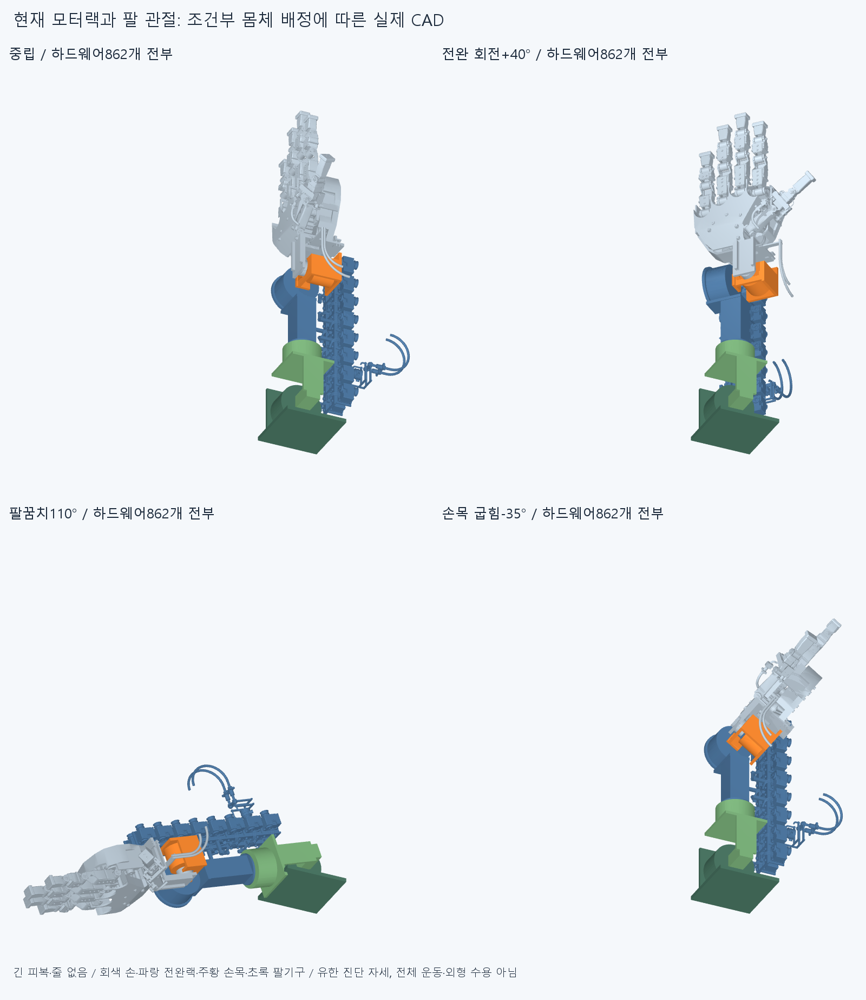
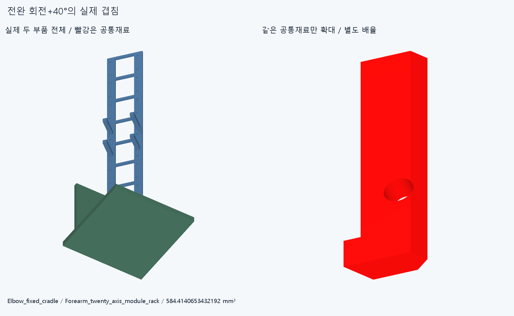
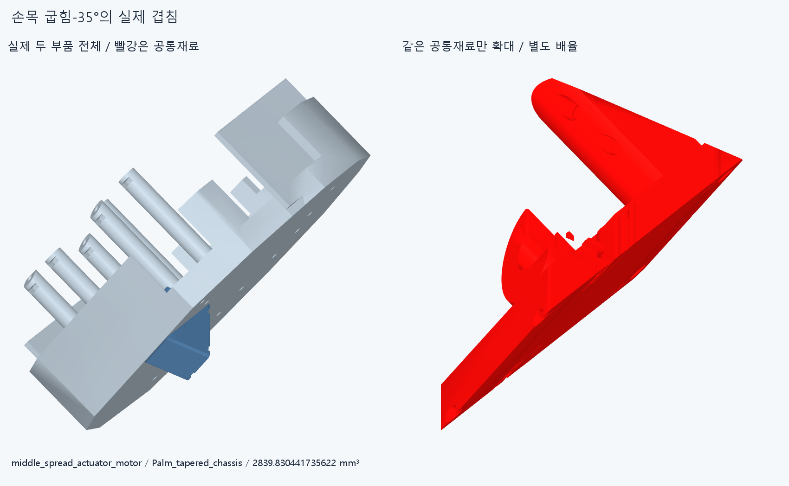

# ARM051 모터랙과 팔 전체 운동의 조건부 진단

**현재 배치는 손목−35°와 전완 회전+40°에서 실제 하드웨어가 겹친다. 긴 피복·줄을 빼도 남는 문제이며, 모터랙을 고정한 국부 선 경로 확장은 중단한다.** 수용한 손 본체·관절축/길이와16원격 구동원은 유지했다. 모터 재배치·손 절삭·각도 제한·새 고정부를 적용하지 않았다.

네 패널은 모두 실제 현재 하드웨어862개를 불투명 표시한다. 손397/포장385/전기64/팔10/손목가이드6이다. 긴 피복·줄은 전부 없는 조건이며, 이를 외형 개선·전체 구동 승인으로 쓰지 않는다. 시험대 팔꿈치 받침은 실제 상완 모델이 아니다.

## 저 모양이 생긴 이유

기존 손 안에서 검지/새끼 MCP 모터가 부딪혀 손바닥4·원격16 배치 후보로 옮겼다. 그 뒤 이 미확정 배치와 모터랙·배선 위치를 국부 연구에서 계속 고정하면서 모터출구·손목 가이드·큰 외부 루프를 덧붙였다. 전체 팔 관절의 부착 몸체와 운동 공간 검토가 앞서지 못했다. PALM014/MOUNT015의 일부 끝자세와 대표 엄지 전달계 검사는 현재 모터 집중 배치 전체의 수용 근거가 아니다.

원격16개는 두 열·여덟 위치, 모듈 중심Y−22/−64/−106/−148/−190/−232/−274/−316mm에 놓여 있다. 이름이 Forearm_twenty_axis_module_rack인 기존 부품에는 현재16원격 모듈이 걸려 있으며20개 원격모터라는 뜻이 아니다. 랙Y−339~−1mm는 회전 출력면Y−230mm의 앞뒤에 걸친다. 이 좌표 사실만으로 못 돈다고 단정하지 않고 실제 움직인 재료를 검사했다.

## 몸체를 어떻게 가정했는가

현재 명목 랙의 네 받침이 Y−148/−190mm에 있어, 원격16모터·랙과 전기64행 전부를 전완 회전 출력 몸체에 붙인다는 **조건부 가정**으로 검사했다. 실제 유효 체결/강성은 없다. [attachment.json](reviews/attachment.json)은 실제 랙6×6mm 받침 윗면4개와 현재 Forearm_box_beam 사이의 native 최근접 거리다. X−49.4/Y−190은33.53147774852758mm, X−49.4/Y−148은28.42534080710379mm, X−9.4의 두 받침은 각각23mm 떨어져 있다. 명목Z−44면을 실제 빔 접촉·완성된 고정으로 승계하지 않는다. 이 거리를 그대로 새 연결재 길이로 정한 것은 아니다.

기존 팔의 실제 변환 순서와 축을 유지했다. 팔꿈치E는 X/(0,−360,0), 전완회전F는 Y/(0,−230,0), 손목굽힘P는 X/(0,−80,0), 손목편위Y는 Z/(32,−65,0)이다. 고정2행=I, 팔꿈치출력2행=E, 전완413행=E@F, 손목2행=E@F@P, 손443행=E@F@P@Y다. 손가락20목표각은 편손0으로 고정했다. 손443행을 이 진단 중 같은 변환으로 옮겼다는 것이 모든 손 부품이 물리적으로 한 강체라는 뜻은 아니다.

## 실제 확인한 막힘

| 진단 자세 | 실제 겹친 대표 재료 | 체적 mm³ | 기록 수 |
| --- | --- | ---: | ---: |
| 전완회전+40° | 랙 / 팔꿈치 고정받침 | 584.4140653432192 | 11 |
| 손목굽힘−35° | middle_spread 모터 / 손바닥 본체 | 2839.830441735622 | 111 |
| 손목편위+20° | index_spread 전선가이드 덮개 / 손목받침 | 115.63847177640491 | 10 |
| 팔꿈치110° | 기존 팔꿈치 출력캐리어 / 고정받침 | 3917.220460261501 | 1 |

기록133개는133개의 독립 설계 결함이 아니다. 전완회전11개에는 같은 고정받침에 걸린 랙·어댑터·체결품·전선가이드/리드가 포함된다. 팔꿈치110°는 기존 팔 참고 구조끼리의 막힘이며 새 모터랙 때문이라고 바꾸지 않는다. 손목−35°에서 손바닥에 걸린 것은 큰 모터 외곽 자체이므로 피복/줄만 다시 돌리는 것으로 이 하드웨어 겹침을 없앨 수 없다. 손을 깎거나 해당 각도를 금지한 해결은 하지 않았다.

전완+80° 끝자세는 이 범위에서 겹침0이지만 +40° 중간 자세가 막힌다. 따라서 끝자세가 비었다는 이유로0→80° 통과를 승인하지 않는다.

두 부품 전체와 같은 빨간 공통재료 확대는 별도 배율이다. 빨강은 실제 겹친 재료이며 손 전체나 큰 절삭 지시가 아니다. [팔꿈치 참고 구조의 별도 막힘](images/elbow_actual_block.png)도 보존한다.

[audit.json](reviews/audit.json)은 중립1, 팔꿈치55/110°2, 전완−80/−40/+40/+80°4, 손목굽힘−35/+55°2, 손목편위−20/+20°2의 **11유한 자세**다. 이전 robot_config의 선언 각도 값만 진단 표본으로 읽었고 현재 축/길이는 modular_roots_v9를 썼다. 그 설정의 옛 손·팔 길이나 축 부호를 가져오지 않았다. 새 가동 제한이나 자연스러운 전범위 수용 판정이 아니다.

서로 다른 몸체 사이의 변환이 실제 달라진 쌍만 중립과 비교했다. 같은 변환을 받는 쌍/같은 몸체 내부는 강체 상대기하가 그대로라 재실행하지 않았다. 새62 native그룹,947639쌍 범위/487AABB 후보/133겹침 기록/연산실패0이며 rawfalse다. 중립10그룹의 겹침은0이고 기존 겹침을 분류로 제외하거나 문턱을 바꾸지 않았다. 보고기준0.001mm³ 초과/Boolean1e−6mm/OCC1이다. 그림용 공통재료3쌍은 별도 생성했으며62그룹을 다시 계산하지 않았다.

## 확인하지 않은 것과 다음

긴 피복/줄·가동 전선의 변형/당김·실제20모터 출력/전체 손동작·복합 팔 관절 경로·모든 중간각·상완/몸통·공구·하중/강성/마찰/장력/예압·실물/제조/외형은 승인하지 않았다. 특정 가정과 자세의 실패이며 모든 배치나 자연스러운 대안의 불가능 증명이 아니다. arm10도 명목 포장 구조이며 실제 공급 모터/플랜지 체결 완성이 아니다.

LINK050의 두 초기 충돌과 후속 중단 연구는 [원본 설명](../compact_material_link_v1/README.md)과 함께 보존한다. completed=false 후속 결과를 이번 팔 운동 성공으로 바꾸지 않았고 재시작하지 않았다. MOTION047/SLIDE045/CORD043/BIARC039의 재현false, PAIR034 포함관계·OFFSET024 곡면 비교 및 모든 이전 보류는 유지한다.

다음은 실제 랙 윗면/현재 빔과 막힌 재료 위치를 출발점으로, 어느 부품이 어떤 회전 출력에 붙고 어디로 반력을 전달할지 먼저 정하는 배치 대안 검토다. 기존 긴 랙의 위치를 최종안으로 고정하지 않는다. 수용한 손과16구동원을 보존하고, 움직임 공간·부착·전달계까지 함께 설명하는 별도 대안을 준비한 뒤 필요한 CAD 변경 범위를 판단한다. 끝낸11진단/62그룹·국부 선 최적화를 자동 반복하지 않는다.

## 정확 SHA 검토

대상 커밋의 새 깨끗한 별도 사본에서 원본 팔 FK의11자세×10팔부품 행렬,5몸체 목록862행,받침 실제4거리와 미리 정한19native그룹을 비교한다.19그룹에는133개 겹침 기록 전부와 일부 빈 그룹이 포함되지만 나머지43그룹·그림·곡면 Boolean 전체동등성·LINK050은 재실행하지 않는다. 비교 문턱 절대1e−5는 수치 재현 문턱이며 새 기계 여유가 아니다. 같은 에이전트의 검토이며 독립 감사가 아니다. 실제 완료 상태는 CHECKPOINT.json,docs/reviews/ARM051,외부 logs/arm051-finish.json을 따른다.
