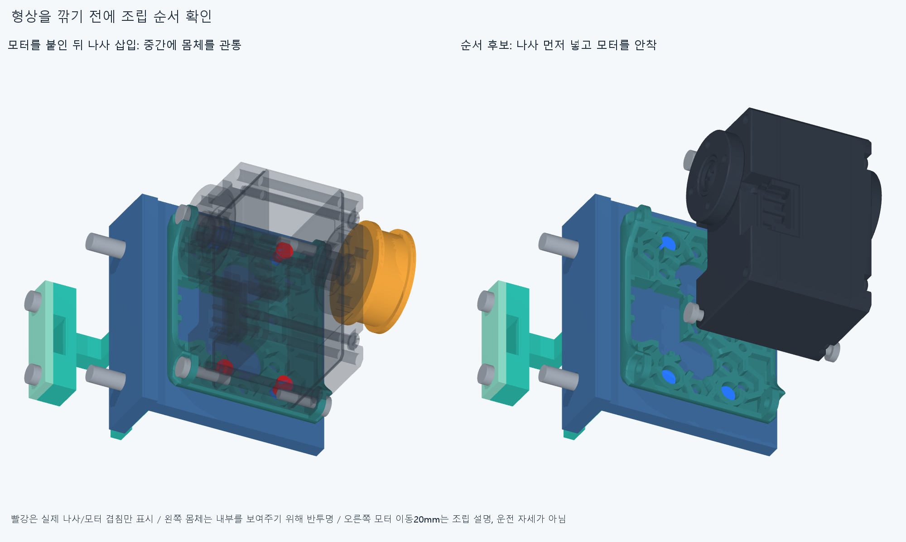
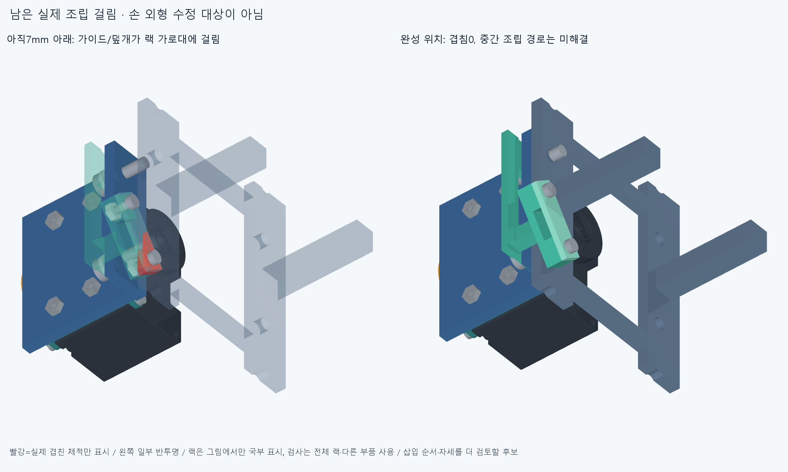

# 모터 묶음의 조립 순서 · ASSEMBLY012

손364부품·모터·랙·전선48경로·가이드160부품의 형상은 바꾸지 않았다. 기존 부품의 조립 순서를 검사했다. 후보 순서는 **미해결 표본이 있어 채택하지 않음**이다. 전체20모터 설치나 실물 조립 승인은 아니다.

**남은 실제 걸림:** 중지PIP/DIP 두 대표 모듈은 완성 위치에서 겹침0이어도,아래7mm의 삽입 중 가이드/덮개가 랙 가로대와 겹친다. 중지PIP의 가이드 바닥/랙 공통 체적은41.3701616368mm³다. 오른쪽 열 먼저만으로 해결되지 않았다. 아래 순서 전체를 채택하거나 전체 설치 가능으로 쓰지 않는다. 자연스러운 조립 접근 방향·기울임·순서를 먼저 검토하며 이 실패만으로 손/랙/가이드를 깎지 않는다.

## 실제로 막힌 순서

모터를 제자리에 붙인 뒤 하부 M2 나사를 +X8→0mm로 넣으면 자기 모터 몸체/기존 몸체 나사와 겹친다. 전체16모터의 나사 묶음과 너트 묶음,각4개 실제 형상을193기존 포장·160가이드/체결품·중립 팔10부품에 대조했다. 너트 먼저 삽입5표본은 겹침0이다. 나사는5표본 중 중간4곳에서 총112겹침 기록,완성 위치는0이다. 반복 표본 수는 독립 결함 수가 아니다. 그림의 빨강은 검지 벌림 모터 하나에서 나사+4mm일 때의 실제 겹친 체적32.4837733367mm³만 표시했다. 모터 외곽 전체를 깎을 뜻이 아니다.

랙에 양쪽 모터를 모두 채운 채 오른쪽 모터/가이드를 아래에서 올리면 왼쪽 모터에 걸린다. 이 원래 연구는3개 경로를 끝낸 뒤 반복 계산을 중단했다. 부분 결과의 `completed=false`를 보존했다.16모터 전체 경로 완료로 쓰지 않는다. [원래 부분 결과](reviews/module_install.json) · [중단/입력 오류 기록](reviews/attempts.json).

## 형상 대신 확인한 순서

1. 작업대에서 어댑터·크래들·가이드·M3 볼트/스페이서를 먼저 모으고,모터를 넣기 전에 하부 M2 나사를 넣는다. 이16나사 묶음의5표본을 자기 모터/로터/몸체 나사만 아직 없는 단계의 전체 포장/가이드/중립 팔과 대조했다. 그 부품들은 다음 단계에 실제로 들어간다.
2. 모터/로터/기존 몸체 나사를 하나의 참고 묶음으로 보고 +X20→0mm로 크래들에 안착시킨다. 일반/35도 가이드와 좌/우를 대표하는4모터,각5표본을 그 모터 자신의 모든 크래들·어댑터·가이드·하부 체결품과 대조했다. 다른 모터와 랙은 이 작업대 선조립 단계에 없다. 내부 몸체 나사의 최초 체결/공구는 이 이동으로 검증하지 않는다. [선조립 결과](reviews/preassemble.json).
3. 팔에 달기 전 별도 랙에,**오른쪽 열 먼저→왼쪽 열 나중**으로 선조립 모터 묶음을 아래35mm에서 올린다. 원래 모든 이웃을 채운 연구와 구별한다. 일반/35도 가이드·좌우·첫/끝행을 포함한6대표 모터,각6표본이다. 오른쪽은 왼쪽 열만 아직 없고,왼쪽은 모든 다른 모터/가이드를 보수적으로 포함한다. 제자리에 닿은 뒤 랙 M3 너트32개를 반대쪽+Z8→0mm의5표본으로 넣는다.8개 왼쪽 경로 중 재사용한 것은 실제 완료한 검지MCP/검지 벌림2개뿐이며,나머지4대표 경로와 너트 경로를 새로 계산했다. [조건부 랙 순서](reviews/rack_order.json).
4. 그 뒤 전선을 놓고 덮개를 닫는다. 기존 WIRE011의 덮개 분리 결과를 보존하며 이번에는 새로 재검사하지 않았다. 랙-팔 설치는 다음 별도 단계다.

재료 검사는 native Boolean 허용오차1e−6mm,보고 문턱0.001mm³이다. 의도된 양의 관통 제외는 없다. 표본 사이 연속 충돌,실제 공구·체결 토크/나사산·프린트 공차/강도는 미검증이다. 모터 안착 나머지12개/랙 설치 나머지10개를 완료로 세지 않는다. 실제 재계산/재사용 범위와 모든 이동/장애물 목록은 JSON에 보존했다. [요약 수치](reviews/summary.json).

## 조립 지지와 남은 큰 문제

선조립 중 가이드/스페이서와 긴 M3 볼트는 아직 랙 너트로 고정되지 않는다. 작업대 지그가 어댑터와 가이드의 접촉면을 눌러 정렬하고 M3 머리가 빠지지 않게 잡아야 한다. 모터 진입 +X 방향과 하부 M2 작업 방향을 비워야 한다. 랙 단계는 팔 밖에서 끝 가로대를 지그로 지지/고정하고,모터 묶음을 체결할 때까지 받친다. 이 지지 요구는 구체적인 조립 조건이며 **지그 CAD·클램프 접촉·공구·무게중심/강도는 아직 검사하지 않았다**. 떠 있는 임시 부품을 실제 체결 완료로 세지 않는다.

다음 큰 항목은 손바닥 고정 모터8쌍의 실제 배치/지지와 이 지그·구동 연결이다. 손 외형을 먼저 깎지 않는다. 공급 케이블/커넥터,축 방향 당김 방지,모터 사이 버스/보드 임시 종단과 동적 서비스 루프도 미완이다. 보드가 없어도 공간 설계는 이어갈 수 있다. 공급 부품과 전류/전압강하·실물 검증은 별도다. 해결한 손 자세나 가이드 작은 틈을 다시 최적화하지 않는다.

정확SHA 새 clone의 핵심 재현은 후속 커밋에 남긴다. 같은 에이전트 재현이며 독립 감사가 아니다.
