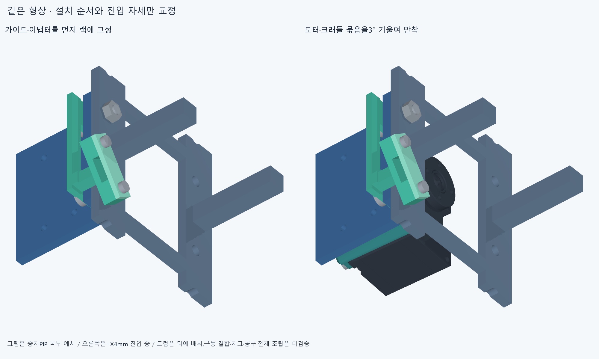
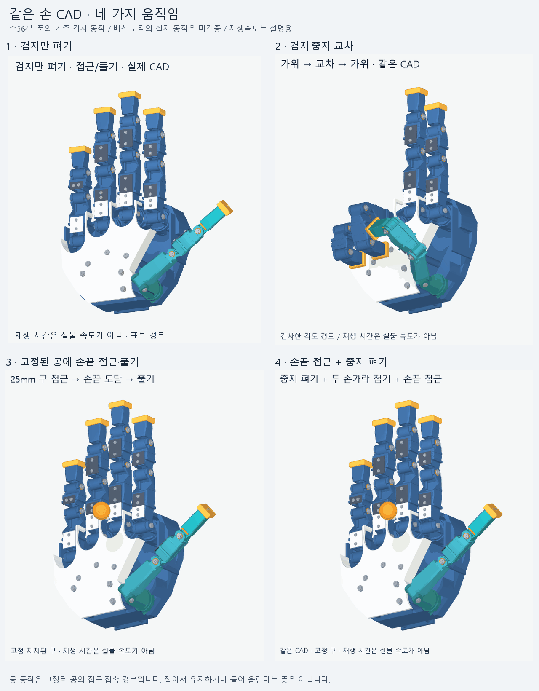

# 조립 순서 교정과 네 가지 손동작 · ASSEMBLY013

손364부품·모터·랙·전선48경로·가이드 형상을 그대로 유지했다. **가이드/어댑터부터 고정하고,나사를 미리 넣은 모터/크래들 묶음을 살짝 기울여 끼우는 순서**로6대표 위치의 표본 걸림을 풀었다. 전체20모터 설치·제작/실물 승인은 아니다.

## 확인한 실제 순서

1. 작업대에서 하부 M2나사를 크래들에 먼저 넣고,모터/로터/기존 몸체 나사 참고 묶음을 안착시킨다. 어댑터와 하부 너트는 아직 붙이지 않는다.6대표 모터의 안착을 각5표본에서 크래들/미리 넣은 나사와 대조했다. 나사 선삽입은 ASSEMBLY012의16나사 묶음5표본,동일 형상과 더 많은 장애물의 겹침0 결과에서 크래들만 남기는 포함관계를 확인해 승계했다. 모터 내부 몸체 나사의 최초 체결/실제 공구는 이 이동으로 검증하지 않는다.
2. 팔 밖의 랙에 가이드/어댑터 묶음을 먼저 넣는다. 오른쪽 열 먼저,그 열 안에서는 **뒤쪽 행→손 가까운 행**이다. 오른쪽은 X−15/Y+8/Z−20에서 들어 올리고→Y0→X0,왼쪽은 X−20→0이다. 아직 없는 앞쪽 행/왼쪽 열·모터 묶음·랙 체결품은 명시한 다음 단계에 들어간다. 각 단계의 실제/보수적 장애물과 나중 부품 이름은 JSON에 모두 남겼다.
3. 가이드/어댑터가 접촉한 위치를 지그로 유지하면서 M3볼트32개와 랙 너트32개를 먼저 넣는다. 모터 묶음이 없을 때 체결하는 순서다. 지그·클램프·실제 공구/토크는 미검증이다.
4. 왼쪽 모터/크래들 묶음은 +X6mm에서 **3° 기울인 채 아래20mm부터 들어 올리고**,기울어진 나사 축에 맞추어 Z도 함께 보정하며 X를 줄인다. +X1mm에서 곧게 편 뒤 안착시킨다. 피벗은 어댑터 접합면 중심선 `(cx−9.1,cy,−94.9)`,+Y축이고,보정은 `−(X+1.4)tan(각도)`다.2.8mm 어댑터 두께 중앙에서 나사 축을 맞추는 공학적 조립 후보이며 운전 관절각/생체 규격이 아니다. 오른쪽 모터 묶음은 그 뒤 +X8→0mm로 들어간다. 시작 자세가 어댑터에서 실제로 떨어져 있음도 거리로 확인했다.
5. 하부 M2너트16묶음(각4개)을 뒤쪽에서 넣는다. 구동 드럼은 모터 뒤에 별도로 배치한다. 드럼16개도 아래10mm→0의5표본을 대조했지만 기존 회전자와0.5mm 떨어진 참고 형상이다. **혼/허브 연결과 토크 전달이 완성된 드럼으로 세지 않는다.** 그 뒤 전선을 놓고 덮개를 다룬다. 랙-팔 설치는 별도다.

## 실제 검사 범위

일반/35° 가이드·좌우·중지/약지 행을 포함한6대표 가이드/어댑터 경로와6모터 묶음 경로,6작업대 안착,랙 M3/랙 너트/하부 너트·드럼의 **161표본**에서 보고 문턱0.001mm³ 초과 겹침0·연산 실패0이다. Boolean 허용오차1e−6mm이며 연속 충돌 증명은 아니다. 그중45표본은 이동·부품·장애물이 완전히 같은 완료 결과 재사용,116표본은 새 계산이다. 별도 나사 선삽입5표본의 포함관계 승계를 이 숫자에 더해 새 검사로 세지 않았다. [최종 수치](reviews/final_sequence.json) · [범위 요약](reviews/summary.json).

처음에는 앞쪽 가이드를 이미 채운 경로와 수평 모터 진입이 막혔고,기울임만 주고 수평으로 미는 후보는 나사/어댑터와 먼저 둔 드럼에 걸렸다. 이 실패는 [원래 순서](reviews/sequence.json),[기울임 후보](reviews/tilt_probe.json)에 보존했다. 드럼 배치 순서와 나사 축을 따르는 접근을 함께 교정한 [대표 탐색](reviews/entry_probe.json)이 새 경로의 근거다. 각도 제한이나 양의 관통 제외로 덮지 않았다. ASSEMBLY012의 원래 모터/가이드 통째 수직 삽입 실패도 보존한다.

조립 지지는 어댑터/가이드 접촉면과 긴 M3머리를 정렬·유지하고,모터 진입 +X와 하부 너트 접근 −X를 비우는 지그가 필요하다. 모터를 끼운 뒤 너트를 체결할 때까지 받쳐야 한다. 구체적인 지그 CAD·접촉·하중·공구·프린트/공급 체결품 공차/강도는 미검증이다. 아직 검사하지 않은 나머지10위치 경로·전체 모듈 설치·실물 승인을 하지 않는다. 손바닥 고정 모터8쌍·양방향 전달/텐던·허브·축 방향 당김 방지·버스/보드 임시 종단·팔/손목 동적 배선도 미완이다. 해결한 대표 진입과 손동작의 미세 여유 탐색은 닫고 이 큰 항목으로 간다.

## 요청한 움직임 네 가지

[검지만 펴기](previews/01_index.gif) · [검지·중지 교차](previews/02_cross.gif) · [고정 공 접근·풀기](previews/03_ball.gif) · [복합 손모양](previews/04_combined.gif)

현재와 같은364부품 손에서 이미 검사한79/37/33/45표본 경로의 기존 CAD영상을 모았다. 개별 원본은 바이트 그대로이고 비교본만27프레임/3.78초로 재생 주기를 맞췄다. 원본 그려진 프레임 수는27/19/17/23이며 검사 표본 수와 다르다. 새 동작을 만들거나 손 간섭을 다시 검사했다고 세지 않는다. 배선·모터까지 함께 움직이는 완성품 영상이 아니며 재생 시간이 실물 속도는 아니다. 공은25mm 고정 지지 물체,파지력·지지 없는 유지·들어 올리기는 미검증이다. [출처와 프레임 검증](previews/report.json).

정확SHA 새 깨끗한 clone에서 핵심 재현을 후속 기록한다. 같은 에이전트의 검토이며 독립 감사가 아니다.
