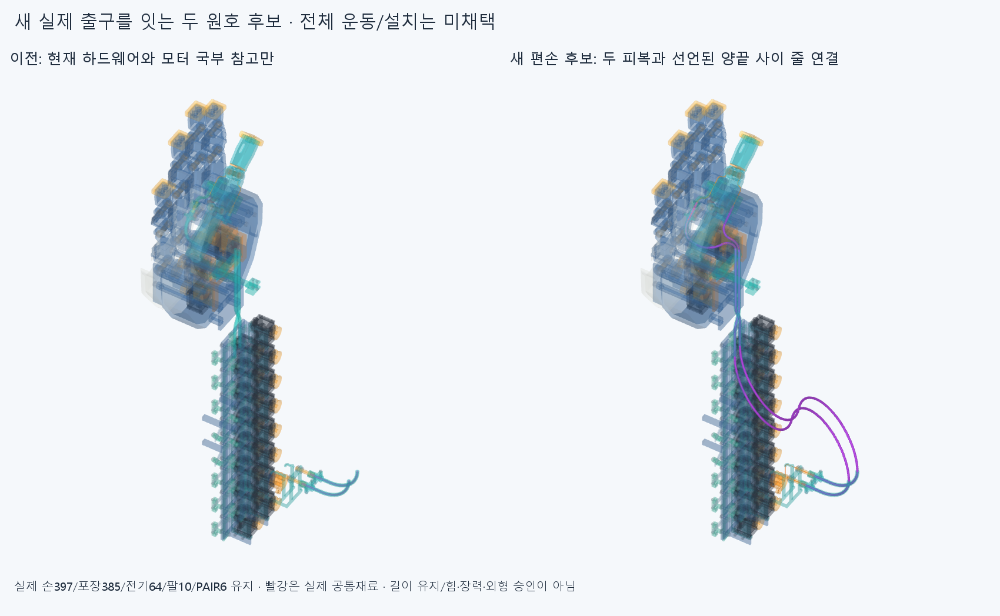
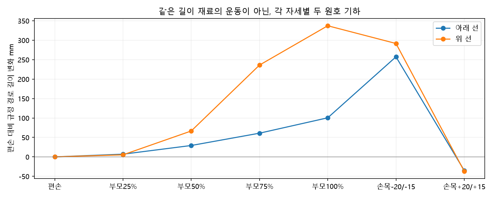
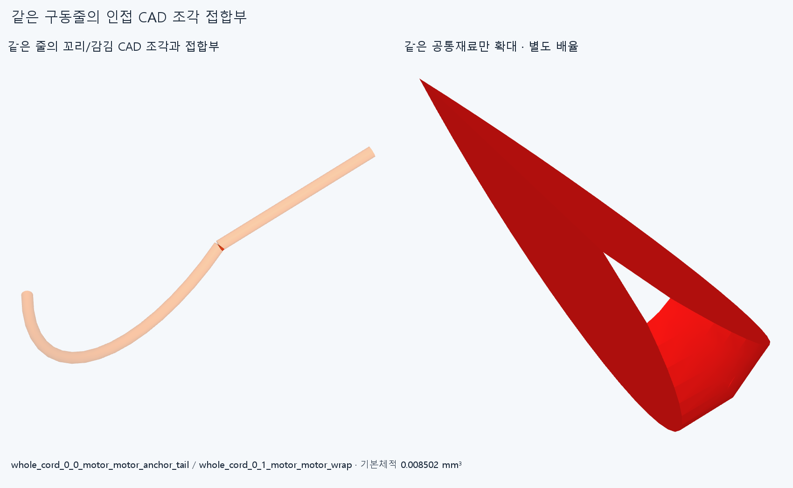

# BIARC039 새 출구의 편손 피복·구동줄 연결

**현재 실제 하드웨어를 유지하며 두 피복과 선언된 모터 고정꼬리~손가락 고정꼬리 사이의 두 줄을 편손 CAD로 연결했다. 손/모터·전기/팔/가이드와 서로다른 선 사이 겹침 보고는0이다. 원래 내부false의1기록은같은줄의인접CAD접합부이며보존한다. 자세별경로길이가달라운동/실제설치는미채택이다.**

## 실제 입력과 분석 방법

SUPPORT038의새모터출구(-1.1/18.9,-203.5,-227)mm/+Y→PAIR034뒤입구(90/110,-178.729833462,-3/2)/+Y와앞출구(100,-4,-3/2)/+Y→아래실제끝구/ENTRY035위입구를잇는다. 모터전완고정/PAIR034는H=P@Y/두엄지종단은H+MCP FK다. R40모터지지/PAIR176.428841mm/위R20통로와실제양끝좌표를쓴다. 손397/포장385/전기48선·16외곽/팔10/PAIR6/기본손364·축/길이·모터/랙/전기·끝구/죠·안내대는유지하고이전STEP/STL **5192해시불변**,새하드웨어0이다. [장면](generated/neutral/scene.json)의78행은피복2의26조각+선언된양끝사이줄2의52조각(아래24/위28)이며78지지/연결구가아니다. 옛짧은피복/Ø0.6축프로브/실패긴곡선/증거공통형상을중복설치하지않는다.

각자유구간은위치A,B/단위접선t0,t1에서양끝접선거리d가같은두원호를직접계산한다. v=B-A, a=2(1-t0·t1), b=2v·(t0+t1)에대해ad²+bd-|v|²=0의양의근,접속점J=(A+B+d(t0-t1))/2다. 각원호는실제끝접선과J로정해진다. 매개변수/길이/반경탐색·최적화/oldNewton·80회접촉최적화/옛곡선계수·목표재사용은없다. 접속점은설치가이드/텐셔너가아니고곡률이달라지는수학적분할점이다. EI/중력·비틀림/접촉정상력·마찰/장력·예압/실제평형은풀지않았다. G1연결/반경검사를실제유지/공급품굽힘·수명승인으로쓰지않는다.

기존부모0/25/50/75/100%와편손손목(-20,-15)/(20,15)의7독립분석표본에서4자유구간의최소반경은모두피복외반경1.5mm보다컸다. 새공급품허용반경이나관절각제한이아니다. 각자세마다새두원호를계산한것이며같은길이재료의이동/연속왕복해가아니다. 두선동시접촉제약이나길이폐쇄는없다.

## 양끝까지의 줄과 길이

모터쪽은TERMINAL022의실제selected18mm접선/R10감김/R5통로와Qy0입구를쓰고,가운데는모터굽힘통로/두자유구간/PAIR/엄지종단을통과한다. 위쪽은실제두R7오프셋을거꾸로거쳐기존라이너로들어가고,손끝은기존R7.7감김과자식고정꼬리까지간다. 모터피복어깨Qy5와줄입구Qy0의5mm차이,아래/위피복어깨와줄입구의-2/+1mm차이를명시했다. **50개조각접합의최대끝점오차4.02164403065e-14mm**이며모든줄접선이매끈하다는뜻은아니다.

편손피복기하길이는 **698.964345153791/761.108456948670mm**,감김/고정꼬리까지포함한모델줄길이는 **853.356663204892/932.491923574900mm**다. 모터감김각은0의명목시작상태이고실제절단/공급길이·끝매듭·신장·예압/구동허가가아니다. 옛723/785목표나730/791길이를고치거나승계하지않았다.

부모완성에서이독립두원호경로길이는편손보다 **+100.458595863176/+337.241863932648mm**다. 7표본의변화범위는각 **-34.972248975471~+257.335875448170 / -36.791723226162~+337.241863932648mm**다. 이것은이규정기하가일정길이운동이아님을보이는값이며필요슬라이딩/텐셔너/±2mm조절량규격이아니다. 전체길이변화는보어축슬라이딩만으로흡수됐다고쓸수없다. 다른자연스러운배치/손기능불가능의증거도아니다.

## 편손 한 자세의 실제 재료 검사

새78대현재손397/포장385/전기64/팔10/PAIR6와내부3003쌍의새전체연결검사다. **70239쌍/395AABB native후보/1기록/연산실패0**,보고기준0.001mm³초과/Boolean허용오차1e−6mm/OCC풀1이다. 외부5그룹은0,내부1기록은아래모터의같은물리줄꼬리조각0/감김조각1의 **0.008502357297mm³**다. [원래false](reviews/check.json)를삭제/검사제외/이름변경통과로덮지않았다. 서로다른물리선/손과의충돌0과원래모든CAD조각쌍의false를구별한다.

두줄의모터꼬리→감김중심선은끝점이연결되지만기존명목경로에서접선이각26.565051177078°꺾인다. 기록은같은줄/연속index0·1이고공통재료경계상자모서리는접속점에서최대0.444972079561mm안이다. [분류](reviews/seam_classification.json)는동일줄인접모델접합임을밝힐뿐실제줄의매끈한굽힘/힘·압착·장력승인이아니다. 작은기록을새손CAD결함이나비국부자기교차로바꾸거나,0을맞추려고고정부/줄/손을미세수정하지않는다. source의이한쌍공통만epsilon1e−10으로추가측정해[정밀기준](reviews/overlap_precision.json)과시각화STEP/STL1을저장했고원래6그룹재실행0/기본값수정0이다. 증거는설치부품이아니다.

부모/손목다른6분석표본의피복/줄SOLID/native·실제전체삽입/조립·줄끼우기/조절/예압/당김·끼임/모터전회전·동적전선/물체·손자체/힘·마찰·강도·제조·외형·실물을검사하지않았다. 기존100/220mm국부끝삽입을이번전체긴피복설치로승계하지않는다. 큰바깥루프외형도수용미정이며현재전체손은미완이다.

## 실행 이력과 다음

첫시도는JSON목록의CAD원호배열변환오류로STEP/native전에중단했다. 원래분석모델/오류를history에보존하고CAD edge함수의배열변환만고쳤으며나머지AST/7분석입력·수치는동일하다. 두번째는옛unselected15mm모터참고코드로3mm단절을만들어연결assert가STEP/native전에잡았다. 실제selected18mm코드로고친것이며모터를이동한것이아니다. 두실패는0완료native/0STEP저장이고삭제하지않았다. 원호역방향은시작/끝을명시한3점원호로만들었다. 첫렌더는전체전후그림뒤국부확대의프레임잘림을거부해중단했다. 원본코드/오류/첫그림을보존하고전체조각이보이는국부화면과별도배율공통재료확대로렌더만고쳤다. 뒤렌더는native/공통쌍재실행0이다.

이독립두원호자세족은일정재료길이운동으로닫고같은R/길이경계/독립곡선·옛Newton/80회최적화를자동반복하지않는다. 다음은새실제종단/지지와저장편손연결을사용해전체피복/줄끼우기의조립순서를명시하고,같은재료길이·실제축슬라이딩과두선/하드웨어접촉을함께만족하는자연스러운부모·손목잡기/풀기응답을다루는것이다. 허공waypoint/없는텐셔너·보상기를설치로세지않는다. 손/모터·랙/전기선절삭·이동/OD축소/각도제한·팔꿈치버스/끝낸미세틈으로돌아가지않고모든실물인증을다음CAD/요청영상의끝없는조건으로늘리지않는다.

LENGTH037/CONTACT036실패/검토복구,PAIR034두STEP포함관계false·3000점분류일치보류,OFFSET024면false/한점모순,HOUSING027/GUIDED030/ELASTICA033기본적분false·정밀보조는재검사/해소하지않았다. 형상측정서명은모든곡면식/trim/일치경계면Boolean동등성증명이아니고같은에이전트새사본검토는독립감사가아니다.
