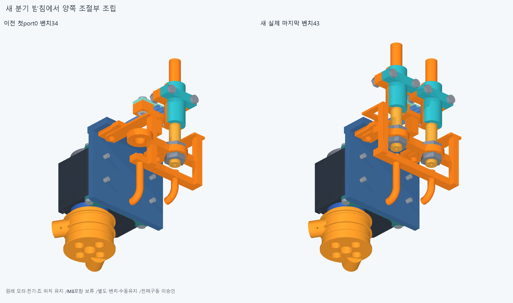
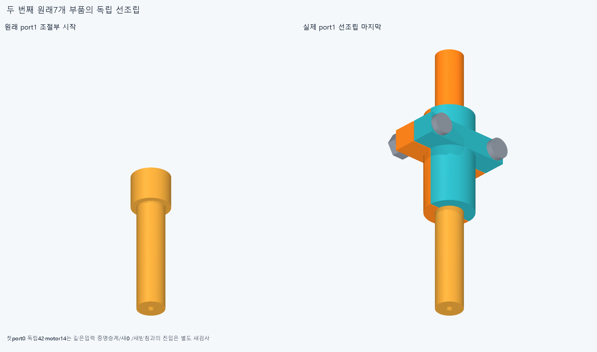
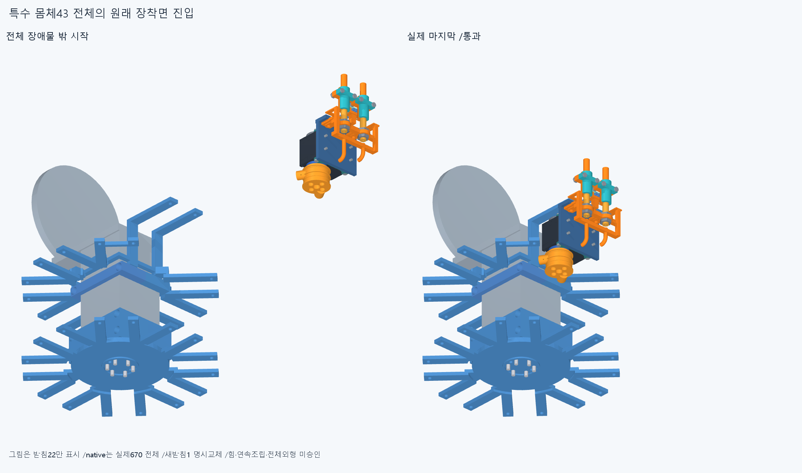
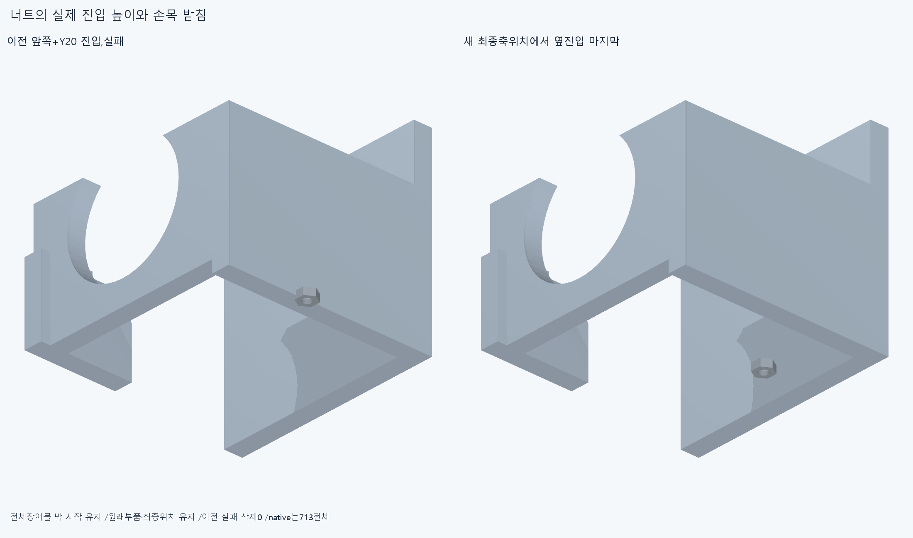

# ARM075 새 분기 받침의 양 조절부와 전체 모듈 조립

**새받침에서전기/양조절부몸체43벤치는성립했다. 초기첫랙너트는손목받침에막혔고,대안의실제최종범위는조건부714행/대기172행이다.**

## 실제 부품과 승계 범위

현재862/기본364·손397/손바닥4·16원격·빔전기·설치축길이명령clock유지,886/방사랙외형미채택이다. ARM074새받침1을명시교체한별도886후보이며이번설치기하변경0/다른885기하·위치유지다. 특수48=원래47+명시새받침1이며원래ARM059base를중복설치하지않는다.

ARM074의M3포함false/실제보어1·216IN모순은저장값만읽고같은차집합/점/정밀/15운동관계를반복하지않았다. 두포트Q·원래stockhorn/idler/retainer/tap6넷/tailclamp둘과모터/body나사의reference12를그대로쓴다. 내부조립·공급품mating은새검증0이다.

받침이모든present/moving집합에없는motorbench14와첫port0독립kit42만동일입력/등록경로를확인해56표본승계·새native0이다. 전체옛49/92를새받침에승계하지않았다. 두번째port1실제원래7은별도수동adjuster→innerjaw열린−X→반대죠+X→M2nuts둘−X→M2bolts둘+X의6경로42를새검사했다.

새받침을adapter에옆진입→referenceunit14+자기plug→열린전기홈3leads→뚜껑너트포켓아래Z/개방축4mm옆진입후2/0→뚜껑/M2→각port의양jamnut옆선조립→원래kit7전체+Y진입을검사했다. 각전체장애물AABB밖시작/부품설치누락/최종항등을저장했고몸체43벤치가완성됐다. 4mm/80mm/160mm는시험경로이지최소여유규격아니다. 벤치운반·중립등록/체결전수동지지·실제공구/나사산/토크·하네스변형/plugmating/captive는미검증이다.

## 세계 진입과 첫 실패

뒤8을포함한실제670을모두장애물로유지하고몸체43을최종normal0에서전체방사진입했다. 처음전체밖부터마지막20/15/10/5/0의13표본이통과해조건부world713이됐다. 곧첫랙너트의+Y20진입이X0에서Wrist_box_carrier와9.550077838035046mm³겹쳐중단했다. 초기 **170native/386529쌍/189AABB/1기록0오류/rawfalse**이며너트2/M3/base_nuts는그뒤미실행이다.

같은완료prefix161을원래목록·행렬·입력그대로승계/새0뒤너트를원래최종축높이에서전체밖+X로진입하는선택순서를새검사했다. 이후원래M3/4M2너트묶음은도달한경로만실행한다. 얇은받침을20mm간격이건너뛰는문제를막기위해도달시실제X평면과원래너트bbox중앙의교차위치/중간을전체진입경로의추가표본으로쓴다. 이는연속경로증명/임의설계여유/작은코너절삭이아니다.

선택새 **17native/12129쌍/8AABB/3기록/0오류**다. 합계새 **187native/398658쌍/197AABB/4기록/0오류**이며rawfalse와초기실패를삭제하지않는다. 보고>0.001mm³/Boolean1e−6mm/OCC1이다.

실제실패기록: `[{"report": "initial", "id": "rack_nut_thumb_ip_actuator_rack_nut_1_8", "record": {"lead": "thumb_ip_actuator_rack_nut_1", "part": "Wrist_box_carrier", "material_intersection_mm3": 9.550077838035046}}, {"report": "selected", "id": "rack_nut_final_axial_thumb_ip_actuator_rack_nut_2_7", "record": {"lead": "thumb_ip_actuator_rack_nut_2", "part": "arm059_straight_jaw_1", "material_intersection_mm3": 10.610581057343527}}, {"report": "selected", "id": "rack_nut_final_axial_thumb_ip_actuator_rack_nut_2_7", "record": {"lead": "thumb_ip_actuator_rack_nut_2", "part": "thumb_ip_barrel_adjuster_1", "material_intersection_mm3": 3.5699475537968914}}, {"report": "selected", "id": "rack_nut_final_axial_thumb_ip_actuator_rack_nut_2_7", "record": {"lead": "thumb_ip_actuator_rack_nut_2", "part": "motor_housing_clamp_1_jaw_1", "material_intersection_mm3": 1.44147946769965}}]`

마지막조건부world714/대기172·완전packet8/16/특수48전체복구=false이다. 몸체43의진입/부분체결과48완료를구분한다. 모든원래47+새받침1의최종위치/부품이갖춰진경우에만명시후보48복구로센다. 현재862/모터설치·외형수용은변경하지않았다.

## 실제 CAD와 재현 범위

대표공통2만새질의했고수치선저장뒤STEP-STL2증거로저장했다. 실제불투명6그림/고유이름·덮어쓰기금지,설치기하export0/기존12779STEP-STL·동결222·과거manifest불변이다.

정확SHA새깨끗한사본의핵심73native는새벤치시작끝/전체kit첫+마지막3/world첫+마지막5·실패경로실제도달전부다. 원래16packet408/명시1교체·원래47/886·뒤8/시작670→몸체713→실제최종목록/누락·전체밖시작·항등/56·161승계계약·도달한실제얇은rail면속성/표본을대조한다. 새대표공통만source/STEP유형별측정서명epsilon1e−10/절대1e−5로확인한다. 기존ARM074받침서명/4interface/보어1·216점/옛615PCD등은재검사하지않는다. 같은에이전트의실패포함한정재현이며독립감사/모든중간·연속전체공장·곡면trimBoolean/픽셀·팔시각단위증명이아니다.

## 다음

저장실제실패공통과마지막전체진입경로를읽고남은체결부의전체선조립/후조립순서를검토한다. 원래M2너트4묶음·M3스택·adapter/cradle·새받침/전기·양R5/죠를모두유지한다. 랙너트2개를양port kit보다먼저벤치에놓은뒤전체body45선조립/세계진입하는순서를성공가정없이검사하고,뒤쪽8과실제부분world목록을장애물로유지한다. 막힌뒤얕은시작/너트삭제/작은코너절삭/모터이동0이다. 현재조건부714/대기172/완전packet8/16이며전체공장·16모터설치완료아니다. 끝낸새187/벤치43·같은독립56/같은prefix161·ARM07415/4/보어1·216점/9평면·옛49/92/22/4/615PCD반복0. M3포함false/216점IN모순·윗돌출5.9mm/외형미채택을보존하고동일차집합/정밀을자동반복하지않는다.

ARM074위M3전체차집합19.195131113433646/1solidfalse와216IN/원인미확정·ARM059옛최종3/M3+13·ARM065common1edgevertex/corefalse·ARM072PNG바이트미복구/픽셀false·모든옛rawfalse/strictfalse/곡면포함보류유지. 빔반대뽑힘/출력12내부/mating·하네스/captive/공구fit·토크힘강도마찰예압장력/20구동·동적전기·전체팔상완/실물제조외형미승인. 손빔절삭/모터삭제·몰래이동/각도제한/ODR축소/가짜텐셔너/LINK·옛최적화/팔꿈치버스재개0.
