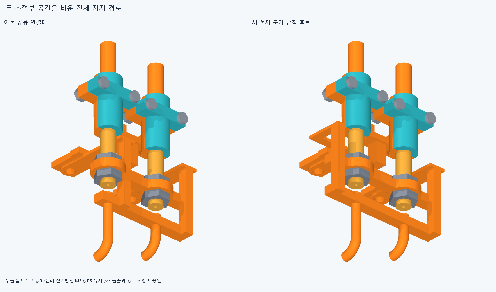
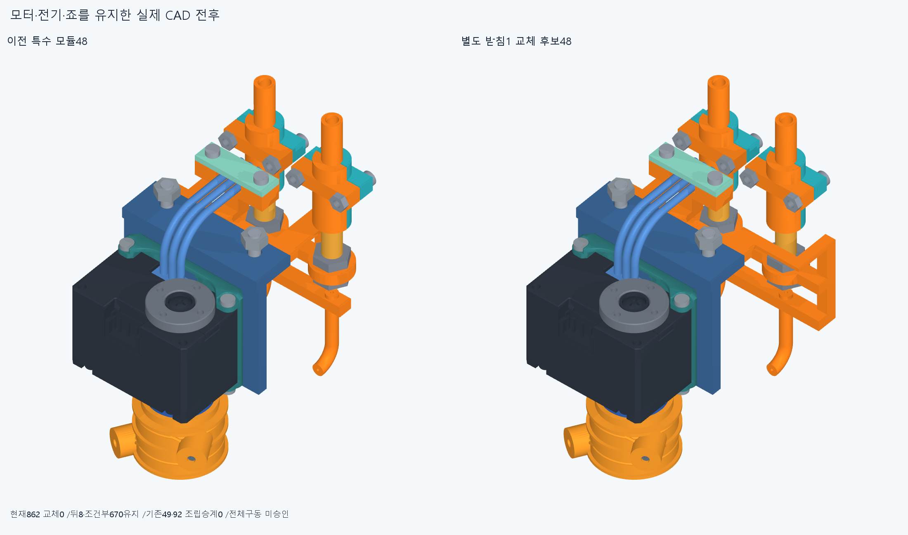

# ARM074 양 조절부를 비운 분기 받침 후보

**공용 연결대를 통째로 바꾼 별도 받침은 새15검사에서 주변 겹침0이다. 위쪽M3패드 전체포함false는남고,실제보어1면/216내부점과모순되어원인미확정이다.**

## 전체 구조의 명시 변경

현재862/기본364·손397/손바닥4·16원격·빔전기·설치축길이명령clock유지,886/방사랙외형미채택이다. 새받침1교체의별도886후보이며나머지885는원래기하/위치다. 뒤8/조건부670·원래216대기/새세계복구0,전체공장·16모터설치완료아니다.

ARM073의4STEP/pose연속성과ARM059의최종base/adjuster1 2.7955951125100102·양jamnut각2.2543445500914405/2.25434455009144mm³기록을읽었다. 옛3쌍native/common재실행0이다. 실제옛공유web의9평면속성과양조절부/죠경계를읽었다. X94.2..97.2/Z11.5..14.5의연결대가위조절부를침범하므로전체윗M3→R5반력경로를교체한다. 작은충돌코너만자른후보가아니다.

원래전기받침전체와열린사각홈/뚜껑M2·3리드/plug·두M3좌석X71/Z±13/Y[-127,-126],전기foot[-126,-124]/adapter[-124,-121]/carrier[-121,-118]의스택을유지한다. 양R5·조절부/죠·출력설치clock/명령은그대로다. 윗경로는전기외곽X87.1안쪽에서올라완성윗죠의실제최대Z25.9바깥의Z[25.9,28.9]분기로이어진다. 3mm는후보구조단면이지강도/최소여유규격이아니다. 아래반력경로는유지한다.

받침단독bbox는이전[67.4,-168,-18]..[98.7,-112.35,23],새[67.4,-168.0000001,-18]..[98.7,-112.35,28.9]mm다. **윗돌출+5.9mm이며외형미채택**이다. 현재862를바꾸지않았다.

## 검사 완료와 보류

첫check는전기재료보존/전기홈비침범/아래M3패드의3인터페이스0뒤위M3패드차집합19.195131113433646mm³/1solid로중단했다. 첫native그룹0은미실행이지통과0이아니다. 원본check.json/코드/로그를보존한다.

별도continuation은이포함false를유지한채새받침대모든885부품의중립검사1,실제output9의±90°2,팔꿈치55/110·roll±40/±80·손목-35/55·편위±20·복합2의상대몸체12를실행했다. **새15native/3633쌍/35AABB/겹침0·연산오류0**,보고>0.001mm³/Boolean1e−6mm/OCC1이다. 같은움직임/범위의옛전체부품쌍을반복한것이아니며새받침관계만이다. 새정적1은포트1조절부·양너트도실제장애물로포함한다.

저장새STEP의실제위M3보어R1.7원통면1과참고annulus의216내부점을읽었다. Y[-126.75,-126.5,-126.25]×반경[1.8,2.35,2.9]×24방향의216점은pad/새받침모두IN이다. 새비교Boolean0,참고pad생성의보어cut1을구분한다. **유한점/보어면은전체차집합false를덮지않고,포함원인확정·착좌fit/공차·강도승인아니다.** 적응정밀/문턱변경/옛Boolean반복0이다.

원래특수48중받침1을새이름으로명시교체한별도후보이며나머지885는원래형상/위치다. 바뀐받침에ARM073의49/92성공을무검증승계하지않았다. 새벤치조립/세계특수48/rackM3/base_nuts/앞7은미실행이다. 원래뒤8/670·216대기유지와새받침기하후보를구분한다.

## 실제 CAD와 한정재현

실제불투명2그림/고유파일이름·덮어쓰기금지/새받침1 STEP-STL,대표공통0(미생성·미실행)이다. 기존12777기하/동결222/과거manifest불변이다.

정확SHA새깨끗한clone에서새받침source/STEP유형별측정서명(적응적분epsilon1e−10/절대1e−5),4새인터페이스,8핵심native(중립885/output2/팔꿈치110·roll40·손목−35·편위20·복합a),실제보어1/216점·원래16packet408/886/명시1교체/885불변·뒤8/670/원래216·실제arm변환/원래port/M3계약을재현한다. 이는실패포함한정재현이며모든곡면trimBoolean/픽셀·팔시각단위/모든중간·연속운동·전체공장조립/실물승인이아니다. 같은에이전트이며독립감사가아니다.

## 다음

새분기받침의포함판정false와실제M3보어1면/216내부점의모순을보존하고같은전체차집합·정밀/코너탐색을자동반복하지않는다. 새받침1을명시교체한별도특수48후보의전체벤치선후관계를검사한다. 원래전기홈·뚜껑M2·3리드/plug·M3스택을유지하고양port의원래kit7+jamnut2씩을함께다룬다. 이전base에서의49/92를새받침에맹목승계하지않으며새입구·누락/설치/전체장애물밖시작·최종항등을저장한다. 그뒤세계특수48와앞7복구이며뒤8/670·216은유지한다. 포함보류가전체CAD/영상을무한정막는조건은아니나착좌/fit·힘승인으로덮지않는다.

ARM059옛최종3/M3+13·ARM072세실패/PNG바이트미복구·ARM065common1edgevertex/corefalse·모든옛rawfalse/strictfalse/곡면포함보류유지. 빔한방향끝/반대뽑힘마찰예압·출력12내부/mating·하네스/captive·공구fit/토크힘강도마찰예압장력/20구동·동적전기·전체팔상완/실물제조외형미승인. 손빔절삭/모터삭제·몰래이동/각도제한/ODR축소/가짜텐셔너/LINK·옛최적화/팔꿈치버스재개0. 지지조립운동일관뒤고정모터→H짧은입구→실제끝구긴재료연결.
