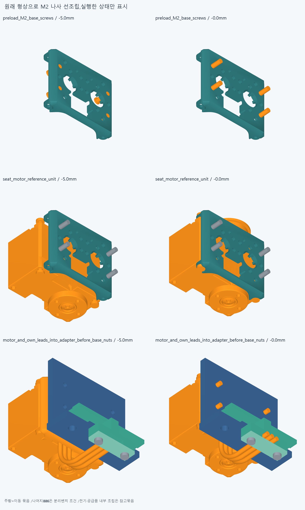
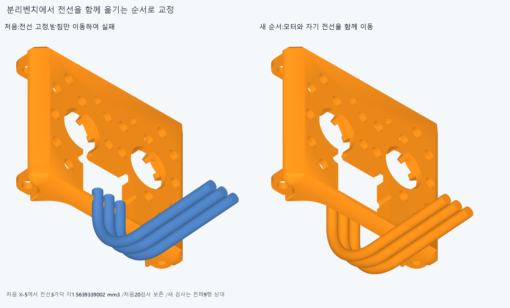
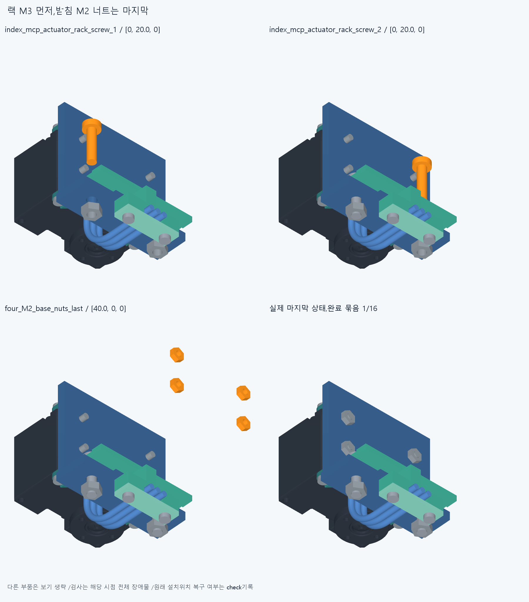
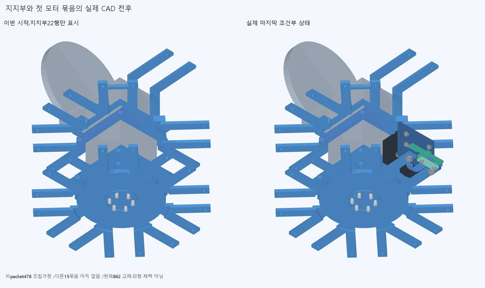
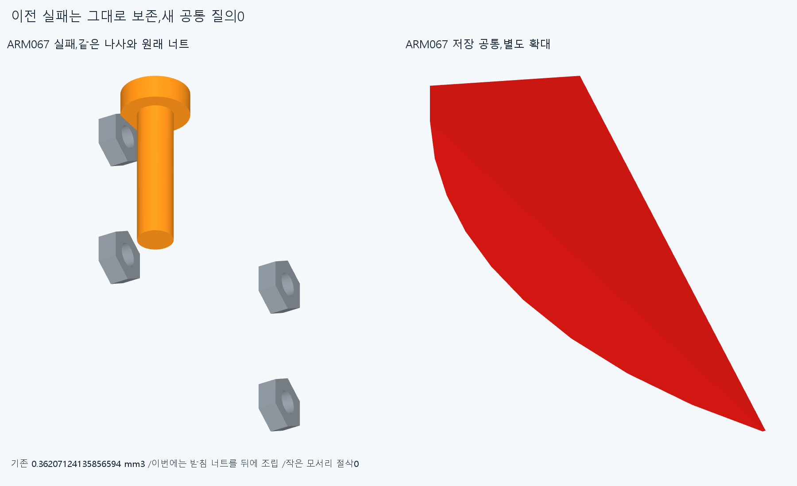
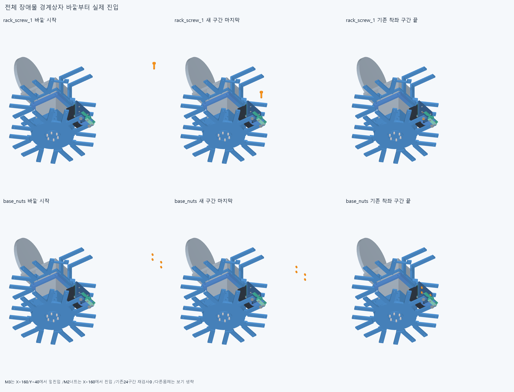

# ARM068 첫 모터 묶음의 나사 선조립과 원래 위치 복구

**형상을 바꾸지 않고 M3 랙 고정나사를 먼저 넣고 M2 받침 너트를 마지막에 넣어,첫 indexMCP 24행 묶음을 원래 위치로 조건부 복구했다. 전체16묶음 중1이며 다른15는 아직 검사하지 않았다.**

## 원래 부품과 첫 실패

현재862/기본364·손397/손바닥4·전완16/빔·전기·축길이명령clock은 유지한다. 별도886/방사랙·외형은 미채택이고 설치/하드웨어 기하변경0이다. 저장 ARM067의 나사/base_nuts 공통과 실제 부품의 원통면/경계상자를 읽었으며 이전 공통 Boolean을 반복하지 않았다. base_nuts는4개 M2너트를 한 CAD행으로 묶은 것이며 랙 M3너트2행과 다르다. 원래 adapter/cradle/base_screws/base_nuts/guide/M3스택을 모두 남겼다.

처음 분리벤치에서 cradle을 수동 유지하고 원래 M2base_screws 4개 묶음을 X−80/−60/−40/−20/−10/−5/0의7표본으로 먼저 끼웠다. 이어 motor/rotor/body_screws/spool 참고4행을 같은7표본으로 넣었다. 각각 초기X경계상자 분리68.2/75.99999999999517mm,14표본0이다. 공급모터 내부·body나사·스풀 연결은 참고 묶음이며 내부 조립/토크 전달을 새로 승인한 것이 아니다.

다음 그 unit6을 adapter/guide/전기 참고 carrier13에 넣을 때 X−5의 여섯째 표본에서 cradle이 고정한 lead1/2/3을 각각1.5639339002139638/1.5639339002139676/1.5639339002140442mm³ 침범했다. X0은 실행하지 않았다. **첫20native=531쌍/13AABB/3기록/연산오류0/rawfalse**를 check.json에 보존했다. 전선을 먼저 고정한 이 순서의 실패이며 손 결함/모든 조립 불가능으로 확대하지 않는다.

## 선택한 순서와 전체 진입

같은 motor unit6에 자기 전선3/plug4행을 함께 운반해10행,남은 adapter/guide carrier9와 비교했다. X−80/−60/−40/−20/−10/−5/0의7표본0,초기X경계상자 분리56.300000000000004mm이다. 전선의 상대 형태를 고정한 규정 CAD 이동이며 실제 유연변형/플러그 체결/공급 하네스 조립은 검증하지 않았다. 앞에서 끝낸 M2 선조립14표본은 동일 입력으로 재사용하고 새로 계산하지 않았다.

이19행에는 원래 base_nuts 한 행,즉 M2너트4개가 아직 없다. 분리벤치 후 원래 중립 세계좌표에서 비packet478행이 이미 조립돼 있다고 가정한 별도 조건으로 간다. 478에는 완료된 지지부22행이 포함된다. 실제 등록 운반/나머지 공장 조립은 검증하지 않았다. ARM067 실패500행을 분해한 경로가 아니라 명시적 새 조립 순서다.

몸체19의 복구11표본은 ARM067몸체20에서 base_nuts만 뺀 동일 형상/변환의 이동부분집합,장애물478은 같다. 랙너트2×3=6표본도 같은 이동체/변환에서 base_nuts만 빠진 장애물부분집합이다. 원래17표본의0 기록과 정확한 이름·입력·변환·집합 포함을 확인해 승계했으며 **새17native를 실행하지 않았다.**

그 뒤 원래 rack_screw_1/2를 각각 +Y60/40/20/10/0의5표본으로 넣었다. 자기 base_nuts만 뒤에 설치하고 나머지499·500행은 실제 장애물에 포함한다. 두 나사10표본0 뒤 원래 base_nuts4개 묶음을 +X80/60/40/20/10/5/0의7표본으로 넣어501행과 비교,모두0이다. +Y10만의 얕은 시작으로 실패를 숨기지 않았고 작은0.362모서리를 깎지 않았다. 처음 나사 +Y60은 자기 모듈의 Y최대−188.1보다 전체 이동나사 Y최소−175가13.1mm 앞이다. 전체 장애물 bbox는 여러 방향으로 퍼져 있어 전역 bbox분리 주장은 하지 않는다.

**selected 새24native=9132쌍/61AABB/0기록/0연산오류. 총 새44=첫20+선택24,9663쌍/74AABB/3기록/0연산오류**이다. 선택한 범위55는 새24+같은 벤치14+이전 부분집합17이며55새실행이나 총75실행이 아니다. 보고>0.001mm³/Boolean1e−6mm/OCC1이다. 첫 실패/rawfalse를 선택결과로 덮지 않았다.

첫 indexMCP24행이 모두 최종 항등변환/원래 위치로 복구됐다. **조건부478+24=502행/384대기,완료1/16**이며 다른15packet은 미실행이다. 원래 부품 누락/영구 모터 삭제/몰래 설치 이동0이다. 502행 전체 공장조립이나16모터 설치완료가 아니다. 수동 지지·captive나사 실제 유지/지그·공구·나사산/토크·예압/힘강도는 미검증이다.

## 실제 CAD 전후

기존 저장 STL과 정확한 실제 변환만 사용한 불투명6그림이다. 새 native/공통 Boolean/STEP·STL export0이며 이전 ARM067공통만 참고로 읽었다. 보기에서 생략한 다른 몸체를 검사에서 제외하지 않았다. 픽셀/메시·변환 일치는 모든 곡면식trimBoolean·팔 시각단위 증명이 아니다.

완성 근처 시작으로 잘못 읽히지 않도록,앞쪽의 미검사 진입만 별도로 검사했다. entry_extension.json의 새20표본0은 각M3를 X+160/Y+40에서 X140/120/100/80/60/40/20으로 옆진입한 뒤 기존 X0/Y40→Y20/10/0을 승계한다. 원래Y60표본도 보존하되 이 전체경로에는 넣지 않는다. M2너트는X160/140/120/100에서 시작해 기존X80..0을 승계한다. 초기 전체장애물 X경계상자 분리는 [37.15076611391001, 37.15076611391001, 35.90076611391001]mm이다. 기존 구간/24표본 재실행0,새20은9996쌍/0AABB/0기록/0오류다. 최종 총새64=20+24+20/19659쌍/74AABB/첫3기록/0오류,선택범위75=새44+벤치14+부분집합17이며75새실행이 아니다. 첫사진5개는재렌더하지않고 전체진입그림1만 추가했다.

## 재현·미해결·다음

정확 SHA의 새 깨끗한 별도 사본에서 첫20/선택24의 각 실행 경로 시작·끝과 새 진입 시작·끝20native,원래16packet408/최종886/body19·unit10/carrier9 분할,동일 벤치14/이전 부분집합17·일시누락·설치목록 연속성/최종 원래 위치를 대조한다. 새 하드웨어·증거기하가 없어 기하 재생성/새 공통 질의는 없다. 같은 에이전트이며 독립 감사가 아니다. 이전 기하 12761/동결222/과거manifest를 보존한다.

ARM065공통1edgevertex/corefalse·ARM066두실패·ARM067첫나사실패·failedM3+13/R5/strictfalse·곡면포함보류를 유지한다. 빔 한방향 끝받침/반대 뽑힘 마찰·예압도 미검증이다. 전체연속 조립/실제 전기체결·공급fit/도구/힘강도마찰예압장력/20토크·긴재료·동적전기/전체팔·상완·실물제조외형 승인은 없다.

다음은 원래 첫packet24행을 포함한 조건부502에서 나머지15묶음을 원래 위치로 복구한다. 각 방위의 실제 M2축/adapter/M3스택과 ARM054/ARM059 실제목록을 읽고,동일 형상·변환·부분집합으로 증명한 관계만 승계한다. 다른15세계좌표 진입이나 옛 배선/조립 통과를 승계하지 않는다. 특수 엄지의 R5·전기 일체부는 필요시 전체 벤치/서비스interface를 따로 검토한다. 끝낸64/24/진입20/14/17·지지부22/ARM067124·ARM06668/공통/앞unit/615면/PCD·작은 각도/반경/모서리 반복0이다. 손빔절삭/모터삭제·몰래이동/각도제한/ODR축소/가짜텐셔너/LINK·옛최적화/팔꿈치 전기버스 재개0이다.
