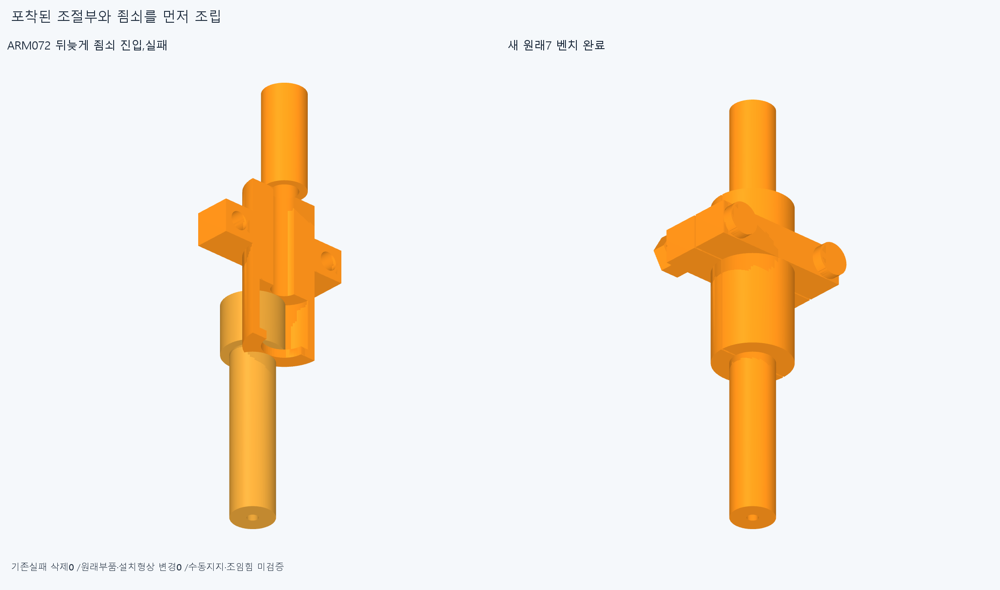
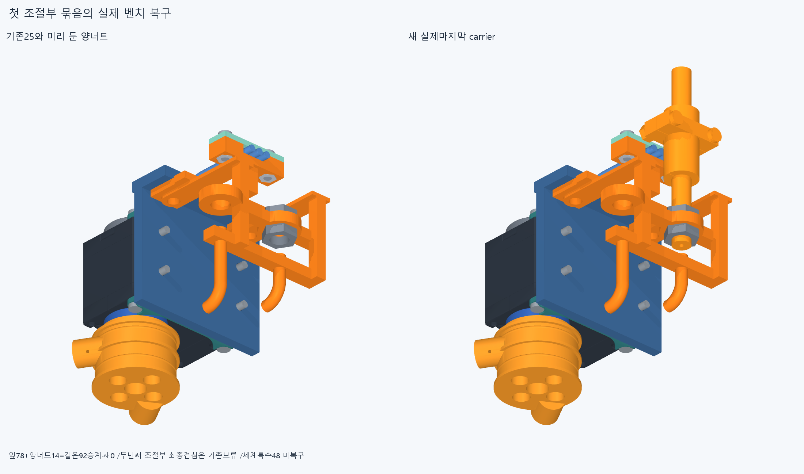
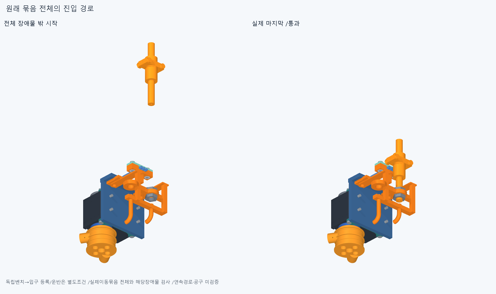

# ARM073 포착 조절부와 죔쇠의 선조립

**원래7개 부품을 먼저 묶어 넣는 첫port0의 외부조립은 새49검사에서 통과했다. 기존port1의 최종겹침3은 남아있어 원래48 전체복구는 아니다.**

## 실제 원래 포착부

현재862/기본364·손397/손바닥4·전완16원격/빔·전기·설치축길이명령clock기하변경0,886/방사랙/외형미채택이다. 뒤8/조건부670·216대기유지/새세계복구0이며670전체공장/16모터설치완료가아니다. 특수48=body44+rack4/base_nuts4M2묶음1행을뺀body43목표,이번carrier34는별도벤치의첫port0외부조립이고port1기계9가남는다.

저장ARM072의 마지막죠/adjuster공통32.85145666711312mm³를 읽었다. 새공통Boolean0이며 읽은STEP속성체적32.85145666710398mm³/포착frame경계X±3.059411708156,Y[0,7],Z[0.5172499999996978,2.5000000000004245]다. 원래+X5 실패자세를 다시검사하지 않았다.

실제port0 frameQ 원점(93.2,−117,−2.5),localY→세계−Y/localZ→세계+X다. 새죠18면=7원통면+11축방향평면과adjuster4평면의22속성을 읽었다. 죔쇠의머리포켓R3.5/localY[−0.001,6.001],축어깨R2.5/[6.001,7],피복홈R1.5/[−12,−0.001]와 닫힌직선관OD5/보어3.2/[−24,−12]가 구분된다. adjuster의 축방향면은localY0/5/6/26이다. 단순횡진입이막힌것과 원래포착어깨/열린반쪽을따른 선조립이 다르다. 이는 실제fit·압착힘/공급품공차 승인아니다.

## 원래7의 전체 벤치와 진입

ARM072의 같은carrier/전기78과 첫양barrelnut옆진입14=92를 입력·부품목록·행렬 그대로승계/새native0이다. 성공99에 포함됐던 adjuster단독7은 새kit입구로 무검증승계하지 않았다. 기존carrier27에는두jamnut이있고새kit7은아직없다.

독립작업대의수동adjuster1→안쪽죠를열린−X에서진입→반대죠+X→원래M2너트둘−X→원래M2볼트둘+X로 원래7을 묶는다. 각전체장애물AABB밖시작의7표본,6경로42새native다. 나사산회전/토크·수동지그·실제압착은미검증이다. 벤치는모듈기준좌표로표현했으며 벤치에서입구로의운반·중립등록은별도조건이다.

완성kit7 전체를 실제개방+Y에서carrier27의모든부품과대조해7새native로 넣었다. 전체바깥80/60/40/20/10/5/0mm는시험경로이며 설계최소여유아니다. 원래부품모두항등위치로복구되어 carrier34=기존25+양jamnut2+kit7이다. 세계특수48/뒤8에대한새진입을실행한것이아니다.

총새 **49native/1470쌍/29AABB/겹침0·연산오류0**,보고>0.001mm³/Boolean1e−6mm/OCC1,raw_new_tests_clear=true는이번범위만이다. 앞의92를새49에합산하지않는다. 각moving/present/absent·행렬·전체밖시작/최종항등을저장했다. 원래모터/output12·plug/리드와전기78의기존조건·내부/mating/하네스변형/captive보류도유지한다.

## 두번째port의 기존 최종겹침은 남아있음

ARM059의저장new4__moved16에서 원래base/adjuster1 **2.7955951125100102**,base/topnut1 **2.2543445500914405**,base/bottomnut1 **2.25434455009144mm³**가 이미보고됐다. 이것은이번에새로발견한3native가아니다.

base와위3부품의4STEP원본경로·해시와ARM059→현재886의등록행렬이같음을새로대조했다. STEP/pose연속성4·새native/common0이며끝낸31/3쌍/정밀검사를반복하지않았다. 최종위치가겹치는같은형상을 조립순서만으로해소했다고쓸수없다. 따라서 port1기계9/세계body43/rackM3/base_nuts/앞7은미실행,뒤8/조건부670·216대기를유지한다.

## 실제 CAD와 한정재현

실제불투명3그림/새대표공통0·기하export0이다. 새native겹침이없어공통은생성하지않았다. 예전실패는보존했고그림생략은native검사제외아니다. 새그림마다고유이름·덮어쓰기금지assert를썼다. 이전STEP/STL12777/동결222/과거manifest불변이다.

정확SHA새깨끗한별도사본에서 핵심16native(새벤치시작끝12+완성kitcarrier첫/마지막3의4),원래16packet408/886/start670/rear8/special48/kit7·양jamnut/같은92승계/실제포착면22/Q·옛공통속성읽기/4STEP·pose연속성/누락·설치/전체밖시작·최종항등을대조한다. 새기하/공통0은미생성으로실행0이지통과0이아니다. 모든중간/곡면trimBoolean·픽셀/팔시각단위·연속전체공장조립 증명이아니다. 같은에이전트이며독립감사가아니다.

## 다음

현재일체base/R5의 두번째port1 조절부·양너트와공유web의전체interface를 검토한다. ARM059에이미있는최종겹침3은같은STEP4/같은등록행렬로유지되어조립순서만으로해소됐다고쓸수없다. 실제원래M3좌석/패드(+13보류포함)·전기홈/뚜껑M2·3리드/plug·R5통로/양조절부/죠와반력·output회전공간을함께읽고필요한별도전체지지후보를전후비교한다. 작은충돌코너만깎기/기존base·리드삭제/모터이동·각도제한0이다. 완료port0kit49/같은92/새포착면22/연속성4·옛120/공통3/48경계축·615면PCD를반복하지않는다. 뒤8/조건부670·216대기를유지하고원래특수48전체복구·앞7을이어가되미해소최종겹침을검사제외하지않는다.

ARM059 M3+13/R5·포트1최종3·ARM072세실패/첫PNG원래바이트미복구·ARM065common1edgevertex/corefalse·모든옛rawfalse/strictfalse/곡면포함보류는 유지한다. 빔한방향끝/반대뽑힘마찰예압미검증·참고출력12내부조립새검증0·실제공구fit/공급품/mating/유연하네스/captive유지/나사산토크·힘강도마찰예압장력/20구동·동적전기·전체팔상완·실물제조외형미승인이다. 손빔절삭/모터삭제·몰래이동/각도제한/ODR축소/가짜텐셔너/LINK·옛최적화/팔꿈치전기버스재개0. 지지조립운동일관뒤고정모터→H짧은입구→실제끝구긴재료를연결하고실물완벽을CAD영상무한조건으로늘리지않는다.
