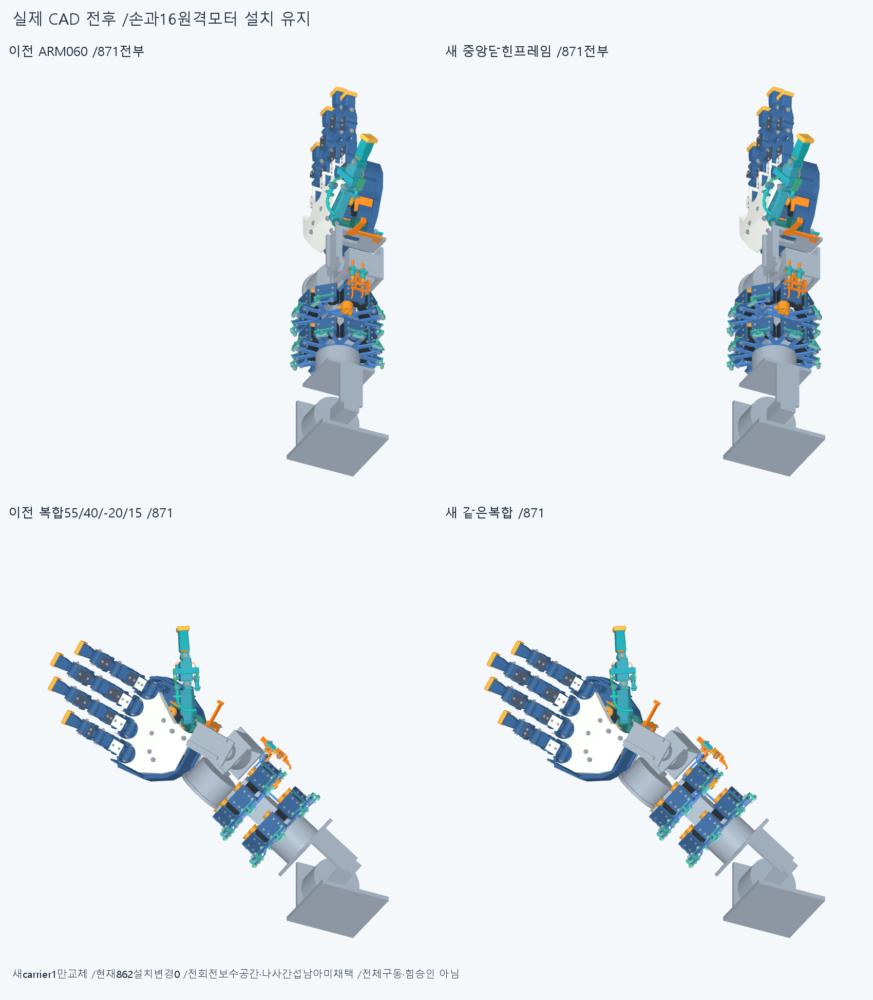
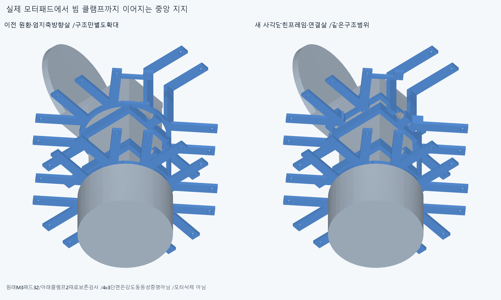
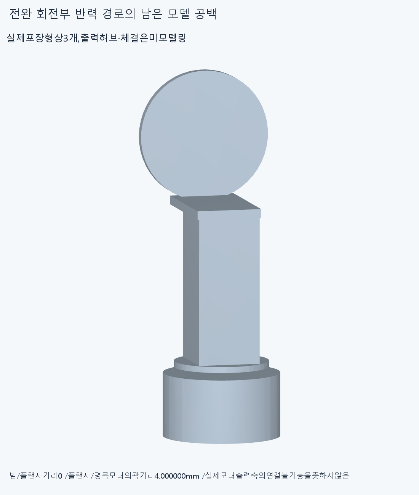
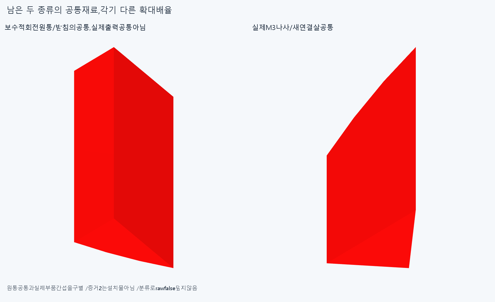
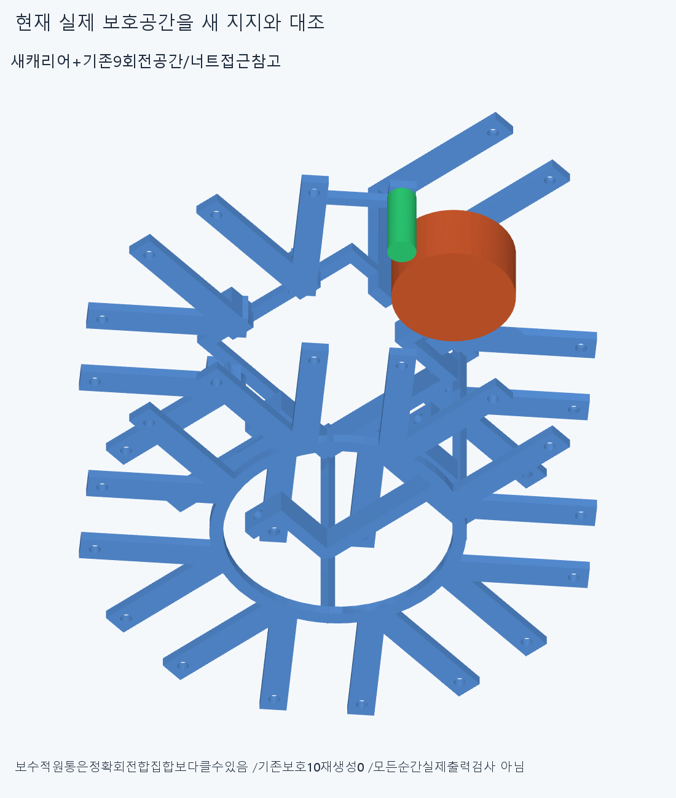

# ARM061 중앙 반력 프레임 후보,미채택

**드럼 ±90°의 기존 중앙 허브 걸림을 피했지만,보수적 전회전 공간의 기존 클램프 침범과 새 연결살의 나사 간섭이 남아 미채택이다. 실제 전완 회전 출력의 허브·체결 모델도 아직 없다.**

## 실제 변경과 유지

현재862/기본손364·손397/손바닥4·16원격모터와축/길이/전기위치/명령·출력clock은유지한다. 별도871=불변870+새carrier1이다. ARM060짧은손목입구와ARM059기계16배치는같으며그입구24관계를반복하지않았다. 현재방사형랙분포를수용안으로확정하거나설치교체하지않는다.

기존front원환R34..38/Y−162..−159와출력공간을차지한엄지축방향살을새닫힌사각프레임/연결살로대체했다. 프레임outer60×58/inner52×50/벽4/축방향3mm,Y−155.5..−152.5다. 기존frontcollar앞−158.5에서원래web두께3을더한한후보기준이며최소여유·조립규격은아니다. **원환만잘라지지부를떼어낸것이아니며유효한1solid로연결했다.**

엄지축방향web는X26..30/Y−162..−118/Z±13의8mm폭이며원래M3자리와연결한다. 나머지front정상모듈13web는radial28..38/Y−162..−152.5다. middle_dip−13은ARM060바깥가로연결을유지해짝+13받침살로간다. 두아래rail을Y−152.5까지연장하고원래뒤허브/두lowercollar를유지했다. 프레임4×3=12mm²명목단면이옛원환4×3과같다는사실은강도/비틀림강성동등성증명이아니다.

16모듈각두M3바깥패드32와두실제lowercollar의원래재료밖차집합34는모두0이다. 입력34는각선언영역과실제옛carrier의nativecommon이며따로센다. 모터패드→frontspoke/엄지web→사각닫힌frame→아래rail/뒤hub→분할collar/cap/M3→실제44×42/벽5전완beam의명목반력이다. 압착/예압·마찰·강성/나사산/공구·실제조립승인은아니다.

## 새 검사17그룹과 남은 두 종류

17native그룹6286쌍/366AABB후보/2기록/0연산실패,보고0.001mm³초과/Boolean1e−6/OCC풀1이다. **rawfalse를그대로보존**한다. 하나는실제부품간섭,하나는보수적회전공간침범으로서두독립물리결함으로세지않는다.

새carrier대불변870에서arm054_M3x12_envelope_1_0와0.036976287823302804mm³의실제공통이남았다. 기존9출력전회전보수원통을입력으로읽어새carrier와검사하면spool원통22.556148182608197mm³가남는다. 옛보호10형상재생성·옛13서명재검사0이며새관계만검사했다. 실제모터출력9의−90/+90°에서는새carrier겹침0이다. 이를전회전성공으로넓히거나출력각도를제한하지않는다.

12유한팔자세의새carrier대다른몸체현재부품관계는0이다. 팔꿈치55/110,roll±40/±80,손목굽힘−35/+55,편위±20,복합[55,40,-20,15]/[110,-40,20,-15]다. 너트접근참고대새carrier도0이다. **새carrier만의검사이며기존전체871/862자체운동·연속팔/실제상완·동적전기/긴재료·20구동토크승인이아니다.**

후속5질의의원통/carrier공통22.556148182608197은옛ARM060carrier밖0이면서원래frontlowercollar밖0이다. 실제공통bbox[34.277225726645476,-166.5,-3.04730933708872]..[36.000000000000014,-158.5,0]mm로,새사각frame가아닌**유지한front아래clamp**안이다. 원통은실제회전합집합보다클수있어이기록만으로실제전회전충돌을확정하지않는다.

실제나사/carrier공통0.036976287823154236에서옛carrier를빼도전부남는다. bbox[-32.041630560338,-162,7.778174593052]..[-31.597979746444,-161.1243473465868,8]mm이며**새추가연결재료의실제막힘**이다. 작은코너만깎아통과시키지않는다. 후속은5새질의/증거공통2이며17그룹/과거미세접합재실행이아니다.

## 전완 회전부의 실제 모델 공백

새carrier/Forearm_box_beam최근접0,실제beam/Roll_output_flange최근접0이다. 하지만beam/flange의native공통은체적0/면적0/면0으로저장됐으며접촉면적/결합을검증했다고쓰지않는다. 추가정밀·같은질의반복0이다.

Roll_output_flange/AK_forearm_roll명목모터외곽최근접은**4mm**이고native공통0이다. 원래build_candidate.py도넓은팔형상을포장용,AKflange볼트는미완으로명시한다. **실제출력축/허브·스플라인/볼트가모델링되지않아토크연결확인이없는것이다. 실제모터가연결불가능하다는판정은아니다.** 세거리/두nativeinterface질의와body소속만으로실제반력·구동을승인하지않는다.

## 실제 CAD

전체4장면은매871불투명부품,구조/회전interface는명시한별도부분확대다. 실제새carrier1/공통증거2만새STEP/STL이며증거2와기존보호10은설치물이아니다. 공급모터/부속을지우지않았다. 그림·행렬·팔시각단위/픽셀동등성을수치재현한것은아니다.

## 보존·재현·다음

ARM060의8기록은모두교체carrier와관련돼현재에자동승계하지않고새17결과를남겼다. ARM059통합base/R5조절부·너트접촉/같은줄접합과M3pad+13밖19.195131113433646실패·이전strictfalse/곡면포함보류는해소하지않았다. 이전기하12580와동결222·과거manifest를보존했다.

정확SHA새깨끗한사본에서17native/새3sourceSTEP서명(새carrier1+후속공통2,적응epsilon1e−10·절대1e−5)/34보존차집합(+34입력common)/세거리·두reactioncommon/후속5질의/몸체·설계계약만재현한다. 같은에이전트로독립감사·모든곡면식trim/Boolean동등성·실물승인이아니다. ARM06033/13/3/4/짧은입구24/옛M3실패·PCD/작은접합을반복하지않는다.

다음은front분할collar/cap/M3축·머리·너트와공구/진입공간을**한체결unit의실제보호공간**으로두고중앙root하중경로와함께설계한다. 기존clamp의보수공간침범과새web의실제나사막힘을함께다루며옛cap/작은나사모서리만다듬기·각도/반경족반복으로대체하지않는다. 관련배치를바꾸면명시적별도후보와옛세계좌표배선/조립승계불가를기록한다.

별도로설정된AK전완회전모터의기존출처/실제출력interface를확인하고beam/flange고정부터명시한실제hub/coupling후보를다룬다.4mm를임의solid로메우고토크연결이라고부르지않는다. 공급품·실물인증완벽을CAD/영상의무한조건으로늘리지않고모델interface와가정을구분한다. 수용손/16구동원·전기홈/뚜껑M2·3선/plug·M3스택유지,모터삭제·몰래재배치/손빔절삭/각도제한/ODR축소/가짜텐셔너/LINK·옛곡선최적화/팔꿈치버스재개0이다.

지지/운동공간이일관되면전완고정모터→손목H짧은입구→실제손끝구의긴재료를잇는다. 실제공구/조립·힘강도마찰장력예압·전체토크/전체팔·제조외형승인은없다.
