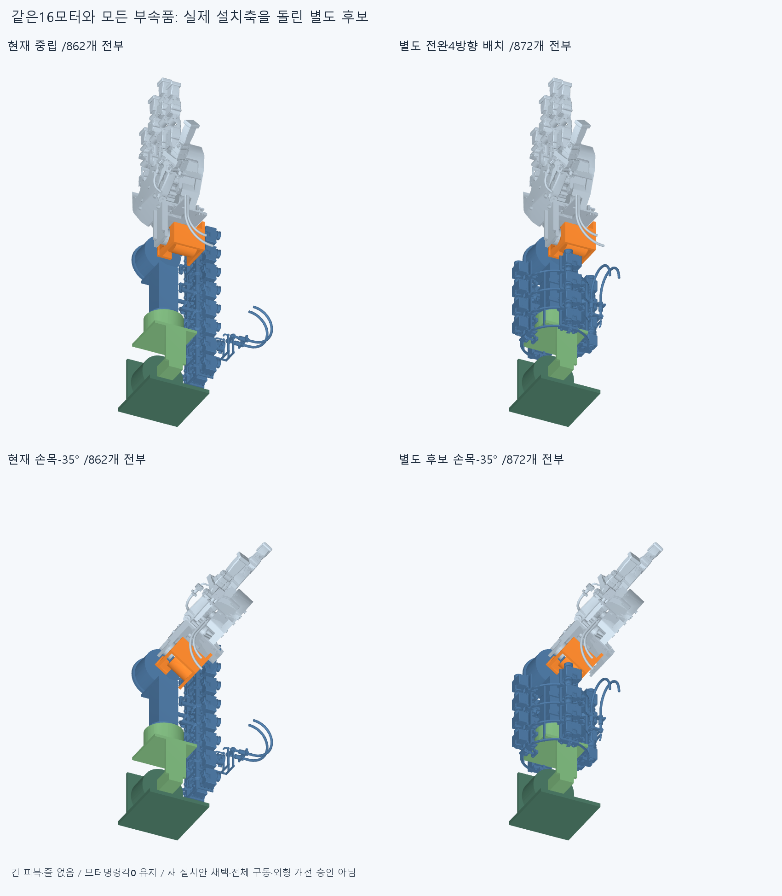
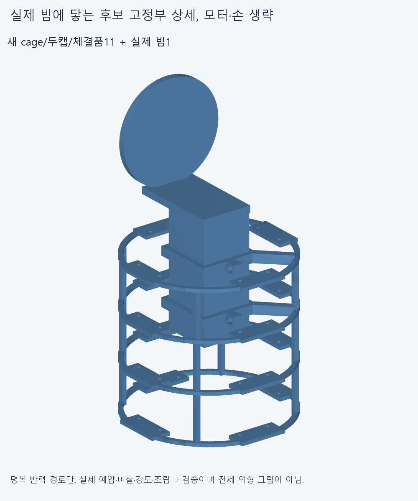
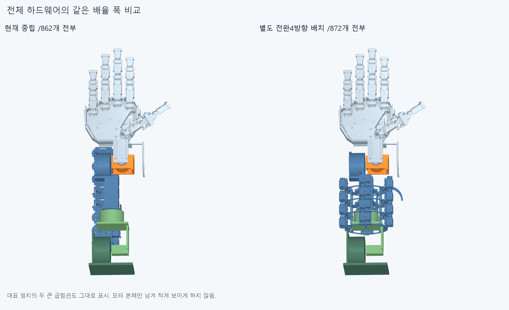
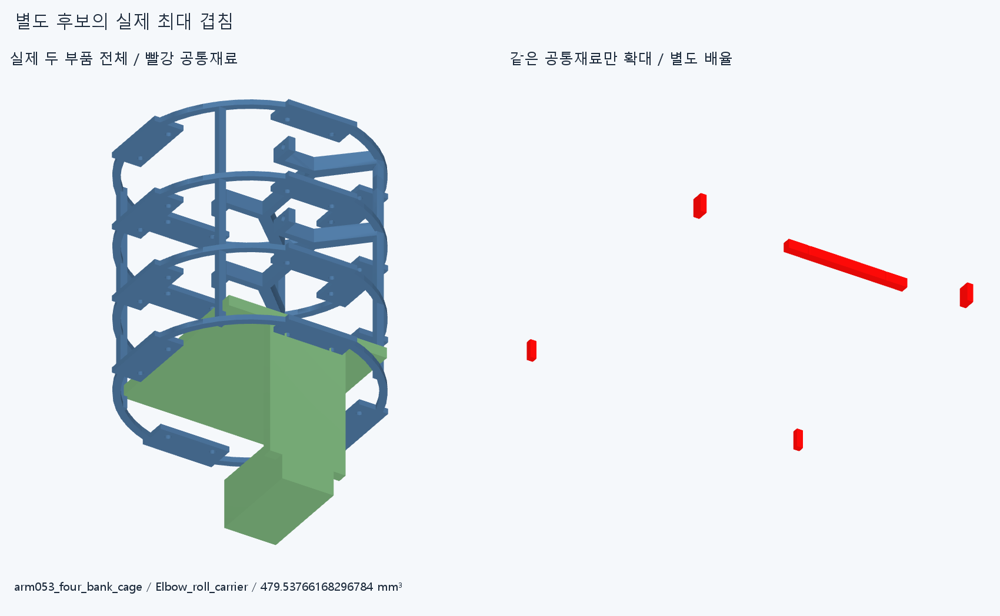

# ARM053 전완4방향·4행 배치, 미채택

**16모터의 설치축을 손 방향으로 돌려 전완 둘레에 나눈 별도 후보도 실제 부속품과 팔꿈치 캐리어/새 고정부 간섭으로 미채택이다. 현재862설치 후보와 수용한 손 본체·축·길이는 바꾸지 않았다.**

양쪽 현재862/별도872하드웨어를 모두 불투명 표시한다. 대표 엄지의 실제 두 굽힘관/고정부와 전기64행도 그대로 포함한다. 긴 피복·줄은 양쪽 모두 없으며 새 모습을 전체 구동·외형 개선으로 승인하지 않는다.

## 설치축과 명령각

같은 실제409행을16강체 묶음으로 옮겼다. 일반15묶음 각24행/대표 thumbIP49행이다. 현재 랙 하나 대신 cage1/캡2/M3×12볼트4·너트4의11개를 제안해872행이며 기존452행은 그대로다. 기존 손397/손바닥4모터/팔10/손목가이드6을 유지했고 공급 형상을 축소하지 않았다.

모터의 canonical+X 출력축을 원래 세계−Z에서 새세계+Y로 돌리는 **16설치축 변경**이다. 모터 명령각은0으로 유지한다. 두 개념을 섞지 않는다. 방위0/90/180/270°,모듈 중심반경71.6mm/축방향Y−268/−226/−184/−142mm,행간42mm의 별도 제안이다. 반경71.6은 실제 roll case39.5와 저장 부속묶음의 안쪽 투영32.1을 합친 명목값이다. 사각 팔꿈치 캐리어/모든 부속·운동 여유를 보장하는 최소반경이나 공급품 규격이 아니다. 실제 재료 검사에서 그 불완전한 원기둥 관점의 한계가 확인됐다.

## 실제 부착과 전후 공간

현재44×42빔을Y−204.5/−162.5에서 나눈 collar와 캡으로 감싼다. 기존 모터 flange/두M3→새 radial pad/outer link(R64~68)/길이방향rail4→대각연결/두collar·캡/M3→실제빔→기존Roll_output_flange가 명목 반력 경로다. carrier/두캡의 native 최근접 거리3개는0이며 명목 접촉이다. 축방향 유지/전단·실제 예압·마찰·강성·조립진입·공구·나사산/토크는 미검증이다.

원격 하드웨어 묶음 상자는 현재 폭94.81/길이338/높이185.5000001mm,제안 폭198.5/길이178.55/높이179.81mm다. 후보 min[−85.50000000000001,−298.65,−94.31]/max[113,−120.1,85.50000000000006]mm다. 전체 팔 실루엣이나 필요최소치가 아니며 더 넓은 둘레 다발을 외형 개선으로 세지 않는다.

## 실제 간섭

[check.json](reviews/check.json)의 새138native그룹은647994쌍/749AABB후보/169겹침 기록/연산실패0,rawfalse다. 보고기준0.001mm³ 초과/Boolean1e−6mm/OCC풀1을 유지했다.

| 새 검사 관계 | 기록 |
| --- | ---: |
|409이동행 대452유지행 중립|11|
|새11 대 기존861 중립|63|
|16묶음 사이120그룹 중12양성그룹|55|
|전완+40 대 팔꿈치 / 팔꿈치110 대 고정|30 /10|

새11 내부55쌍과 손목−35 대 손목/손,편위+20 대 손,전완+40 대 고정은0이다.4팔 자세는 독립 유한 표본이며 연속·복합운동/전범위 승인이 아니다. 같은 모듈 내부/변하지 않은 기존 상대관계는 재실행하지 않았다. 기존 팔꿈치110의 원래 캐리어/시험대받침 충돌도 해결하지 않았다. 시험대 받침을 실제 상완으로 보지 않는다.

중립에서 indexMCP 전선가이드/팔꿈치 캐리어376.49177445531194mm³,어댑터/캐리어335.53766168296846mm³다. 새 cage/기존Elbow_roll_carrier479.53766168296784mm³가 최대 기록이다. 42mm를 축방향 간격으로 승계한 이 안은 앞뒤 묶음의 부속품 사이도 실제로 겹친다.169기록은169독립 결함이나 모든 배치 불가능의 증명이 아니다. 작은 접촉을 깎아 성공으로 만들지 않았다.

두 부품 전체와 같은 빨강 공통재료 확대는 별도 배율이다. 공통재료 STEP/STL은 증거이며 설치물이 아니다. 원래138그룹을 다시 검사하지 않고 저장STEP의 해당 한쌍 공통만 별도 생성했다.

## 출력축이 손 방향이어도 실제 출구는 반대

실제 PACK049의 두 R40굽힘관도 대표 모터와 함께 돌렸다. 출력축은+Y지만 굽힘관 free port는(110.5,−176,−65.5)/(110.5,−176,−85.5)mm에서 **−Y**,즉 팔꿈치 방향을 향한다. 현재 손쪽 뒤입구로 향하는 직선방향과의 내적은−0.9654570227700061/−0.9256288106736744다. 모터 축만 손 방향으로 놓는 것으로 실제 줄 진입 방향까지 해결되지 않는다. 별도 굽힘 경로/같은 재료 길이는 아직 풀지 않았으며 처음 접선이 반대라는 사실을 모든 경로 불가능으로 확대하지 않는다.

이 값은 저장한 실제4포트/16설치변환의 기하 재계산이다. 가상 waypoint·없는 텐셔너나 새 전체 피복/줄을 설치하지 않았다. 옮긴 기존64전기행도 새 위치의 하네스 결합·가동 전선 검사를 승계한 것이 아니다.

## 오류/재현 범위

첫 실행은 새 파일을 bare model로 import해 옛 model/candidate2와 충돌했고 입력 로드/새CAD·native 전에 중단했다. 원래 코드/오류를history에 보존하고 유일한 이름/정확 경로로 읽는 부분만 고쳤다. model.py 바이트는 첫 원본과 같다. 실패를 지우거나 native 성공으로 합산하지 않는다.

첫 postprocess는 전체/폭/고정부3그림 뒤 팔 참고 metadata의 step키 부재로 공통재료 로드에서 중단했다. history에 원본/오류를 보존했다. recover_post는 원래check에서 이미 해시가 고정된 실제 팔 STEP을 읽어 미저장 두port값을 다시 계산하고 빠진 한쌍 공통재료/그림만 만들었다. 원래3그림 해시는 같고 전체 native/전체그림 재실행0이다. 최초post 완료false/종료입력가드 미기록과 복구 완료를 구별한다.

정확SHA 새 깨끗한 별도 사본에서 새11 source/STEP의epsilon1e−10 적응 측정/절대1e−5 서명,16설치변환/409소속,명목 접촉3거리/실제2출구를 대조한다. Native는 두중립/새carrier내부와다른내부 양성·실패그룹/6변경몸체 팔그룹/모든묶음 양성·실패그룹+각행첫인접쌍을 선별한다. 다른 빈그룹·그림행렬/픽셀·팔시각단위·모든곡면식trimBoolean동등성·ARM051/052/LINK050은 재실행하지 않는다. 같은 에이전트 검토이며 독립 감사가 아니다. 대상/완료는CHECKPOINT.json/docs/reviews/ARM053/외부logs/arm053-finish.json을 따른다.

## 다음

이4방향×4행/42mm축간격족은 미채택으로 닫는다. 실제 부속의 전체 축방향 크기·팔꿈치 캐리어와 손목 재료·실제 출구 방향을 먼저 읽고,별도8방향×2축방향 위치 분포를 준비한다. 이는 가능한지 검토할 대안이며 확정안이 아니다. 대표 thumbIP 전체 설치를 뒤집는 경우 실제 M3받침 자리와 두R40출구도 함께 설명해야 하며 모터 목표각만 바꿔 같은 일로 세지 않는다. 반경/OD임의축소·부속삭제·손절삭/각도제한·현재설치몰래교체·팔꿈치버스·옛 최적화/막대/허공지지/없는텐셔너·LINK050재개는 하지 않는다. 현재 원본 손/16구동원과 모든 이전 보류를 유지한다. 실제 전체줄·동적전기·20토크연결·힘·장력·예압·마찰/하중강도·연속복합팔/실물·제조·외형은 미승인이다.
