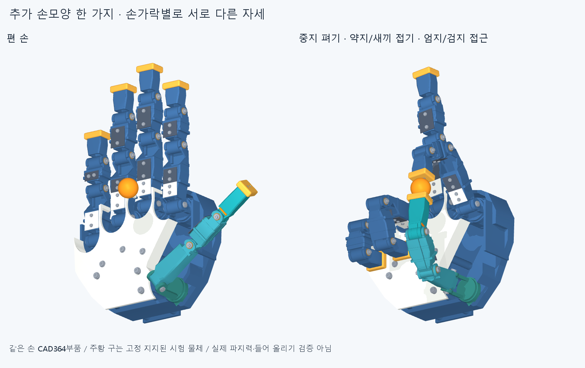

# EXAMPLE007 · 손가락별 자세를 섞은 추가 예시 한 가지

사용자가 사람 손으로 할 수 있는 다양한 손모양 예시를 하나 더 요청했다. 기존25mm 구의 손끝 접근을 유지하면서 중지는 펴서 바깥으로8° 벌리고, 약지와 새끼는 수용한 작성 주먹각으로 접는다. 검지와 엄지는 구를 사이에 두고 굽힌다. 한 예시 안에서 뻗기·벌리기·접기·대립을 함께 보여 주는 공학적 자세 후보이며 새로운 파지 분류 여러 개로 세지 않는다.

## 확인한 범위

손364부품 STEP/STL·축·길이를 바꾸지 않았다. 검지·엄지와 구의 위치는 PINCH006을 그대로 유지했고 나머지 세 손가락의 자세만 더했다. 모터 목표각의 조합이며 모터나 관절축의 설치 위치 변경은 아니다. 임의 생체 각도 표준이나 실물 관절 범위를 주장하지 않는다.

선택 경로는 편 손에서 모든 손가락을 함께 목표 자세로 움직인 뒤 정확한 역순으로 푸는 동작이다. 전진23개의 서로 다른 각도 표본, 왕복45표본에서 손364부품66066쌍과 손–구364쌍의 보고 기준 이상 관통0·연산 실패0이다. 각 관절 간격은 최대5°, 보고 기준은 겹침0.02mm³ 초과, Boolean 허용오차1e−6mm다. 반대 방향은 같은 전진 배열의 역순으로 정의한 기하 검사다. 별도의 동역학 시험이 아니다.

구는 외부에서 고정 지지된 직경25mm 시험 물체다. 두 끝캡은 구 표면에 도달하며, 접촉력·미끄러짐·들어 올리기·지지 없이 유지하는 파지 성능은 미검증이다. 표본 사이 연속 충돌·실물 공차·제작 승인도 아니다. 그림의 자연스러운 모습과 유한 검사 범위만으로 사람 손 전체 기능을 승인하지 않는다.

[동작 보기](images/example.gif). 실제 저장 CAD364부품과 기존 시험 구를 사용했고 물리 시뮬레이션 스텝은0이다. GIF 시간은 실제 모터 속도가 아니다. 전체 관절값·원본/파생 입력 해시·경로는 `generated/selected_posture.json`과 `reviews/audit.json`에 보존한다.

## 다음 단계

요청한 예시 하나를 추가한 뒤 여기서 멈춘다. 작은 여유 목표로 CAD를 절삭하거나 손동작 목록을 무한히 늘리지 않는다. 다음 목표는 그대로 실제 모터/커넥터 위치 확인과 배선 준비다. 전체20모터가 현재 손에 통합된 상태가 아니며, 외부 시험대와 과거 배치 연구를 설치 완료로 세지 않는다. 반대 밀착 교차·다른 물체·실물 성능은 기존 미해결 범위로 남긴다.

커밋·origin 정상 푸시 후 정확 SHA의 깨끗한 새 clone에서 핵심 경로점·접촉 거리·입력/동결 해시를 재검사하고 후속 커밋에 실제 범위를 기록한다. 같은 에이전트의 재현 검토이며 독립 감사가 아니다.
