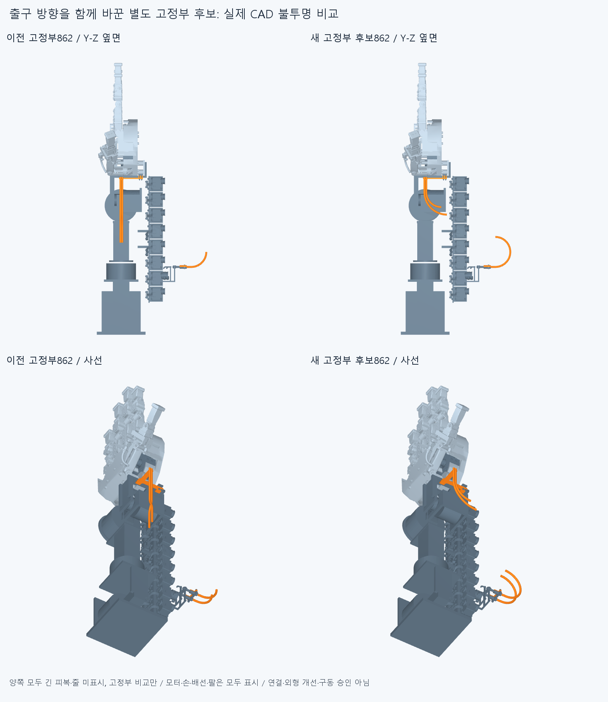

# PACK049 실제 출구 방향을 바꾼 별도 고정부 후보

**새 고정부3개는 4정적 자세와 70조건부 조립 표본에서 새 간섭0이다. 긴 피복·줄은 아직 연결하지 않았다.** 기존 손397/기본364, 비율·축·길이, 16전완모터·모터랙·배선 위치·OD는 유지했다. 큰 외부 루프가 필수라고 가정하지 않고 실제 모터 출구와 손목 뒤 접근을 함께 바꾸는 별도 후보를 만들었다. 외형 개선·수용/최적·전체 구동 완료 주장은 없다.

양쪽 모두 하드웨어862개를 불투명 표시한다. 두 그림 모두 긴 피복·줄은 제외한 **고정부만의 동등한 비교**이며, 새 연결에서 루프가 사라졌다는 근거가 아니다. 팔10참고도 모두 표시했다. [이전 전체 연결980행](../drive_packaging_review_v1/images/opaque_packaging_upright.png)은 그대로 보존한다. 새 외장/덮개나 숨긴 하드웨어는 없다.

## 실제 기구와 부착

현재 SUPPORT038 모터 굽힘죠2와 PAIR034 본체1만 각각 별도 후보로 교체한다. 추가 하드웨어0, 손397/포장385/전기64/팔10/손목안내대6=862행이다. 기존 파일을 덮지 않으며 원래 STEP/STL **11390개 해시 불변**이다.

모터 원래 죠·두M2·반대죠/포착조절부 머리·종단틀/두M3 좌석은 같다. 각 기존 어깨(-1.1/18.9,-243.5,-158)mm에서 R40/180° 되돌림관을 지나 새 자유출구(-1.1/18.9,-163.5,-187)mm/+Z로 향한다. 어깨~출구 명목 통로154.663706143592mm는 이전91.831853071796mm보다 길다. 전체 피복을 몰래 줄여 만든 결과가 아니다. 피복→보어→일체아래죠→두M2/반대죠→조절부머리→종단틀/M3→원래전완모터고정부의 명목 반력 경로다.

손목 새 본체는 같은 Palm_wrist_saddle 벽Y-6/0·X54모서리와 나사X59/Z-55,-49의 기존6부품 체결을 쓴다. 기존 긴 S관을 더 설치하지 않고 본체1개를 교체한다. 앞출구(100,-4,-3/2)mm/+Y는 같다. 뒤입구는 아래(100,-84,-43)mm/+Z, 위(100,-104,-58)mm/+Z이고 각각 R40/R60의 실제90° 보어와 40mm직선이다. 통로102.831853071796/134.247779607694mm는 이전각176.428840822733mm와 구별한다. 같은R40관을Z5만큼 평행이동하면 돌아선 입구가 한 축에 겹치므로 반경을 중첩해 분리했다. 자유곡선 최적화/임의 반경 축소가 아니다. 보어→일체관/브리지/세로판→기존뒤/앞클램프면·두M2→손목받침의 명목 경로이고 H=P@Y를 따른다. 모터는 전완고정이다.

안내관OD5/보어3.2·피복OD3/ID1.3·줄OD0.6은 유지한 명목 공간 가정이다. 실제 공급품 허용굽힘/마모·재료/강성/좌굴·예압/마찰·압착/빠짐저항·6자유도 고정/힘·장력·나사산/토크/공구·제작 인증이 아니다. 죠를 새 모터 설치각으로 해석하지 않는다.

## 실제 검사 범위

[check.json](reviews/check.json)의 새3개 대 나머지859 및 새3개 내부를 편손중립/기존부모잡기100%/편손손목(-20,-15)/(20,15)의 **4새유한자세**에서 검사했다. 10320쌍/95AABB 후보/0기록/0연산실패다. 다른 기존 부품끼리 전쌍이나 전체 모터 회전·피복·배선 동적운동을 다시 검사한 것이 아니다. 각도 제한을 새로 정하지 않았다.

[service.json](reviews/service.json)은 새70조건부조립이다. 모터 각각 자기6클램프 부품만 없는 별도 시작에서 아래죠-Qz14/7/2/0→반대죠+Qz14/7/2/0→너트각-Qz10/5/0→볼트각+Qz10/5/0의20×2이다. 다른 모터/끝구/손/전기/팔/새 손목안내대는 계속 있다. 손목은 자기본체/덮개/볼트2/너트2만 없는 별도 시작에서 본체Y-20/-10/-5/-1/0→덮개Y+12/+6/+3/+1/0→볼트각+Y20/10/5/1/0→너트각-Y20/10/5/1/0의30이다. 실제 누락/설치/장애물 및 끝의862목록을 저장했다. 세 연구를 하나의 전체 공장 조립으로 합치지 않는다. 긴 피복·줄은 전부 없고 느슨한 부품은 체결까지 수동유지 조건이다. 실제 손/공구·지그 접근·나사산·체결토크/하중은 미검증이다.

체결 후 새 각 모터 통로와 손목 보어에 놓인 **국부 피복4개**도 현재859·새3·국부피복사이6쌍을 검사했다. 이는 같은 향후 두 피복의 떨어진 끝 참고이며,4개의 전체 선이나 긴 피복 설치·전장선정·삽입힘·줄끼우기 성공이 아니다. 조립70+국부fit 합63541쌍/105AABB/0기록/0실패다. 정적을 합치면73861쌍/200AABB이며0기록/0실패다. 보고0.001mm³초과/Boolean1e-6mm/OCC1을 유지했다. 원래 끝낸 검사 재사용/재실행0이다.

## 실패 이력과 남은 일

첫 실행은 현재383포장목록에서 이미 교체되어 빠진 옛 아래죠를 찾는 입력선택 오류로 중단했다. 원래 코드/stdout/오류/status는history에 보존했다. 기존 현재부품 입력을 읽은 뒤이며 새형상 생성·STEP/STL export/native 전이다. 옛죠를 원래 RETAIN026 저장입력에서 명시적으로 읽도록 교정하고 기구를 바꿔 통과시키지 않았다. 실패를 성공표본에 합산하지 않았다. 후속 실행에서 새3형상 및 실제 검사를 처음 완료했다.

새 고정부가 실제 두 긴 피복·맨줄까지 연결되지는 않았다. 새 전체 재료길이/부모·손목잡기·풀기의 같은 재료 운동, 실제 보어 슬라이딩·두 선/하드웨어 접촉, 힘/고정·장력·예압·전기 동적운동·전체20모터·실물·제조·외형승인은 남아 있다. 이전 MOTION047 길이698.964345153791/761.108456948670mm와 줄853.356663204892/932.491923574900mm는 옛 후보 예산으로 보존하고 새 후보의 절단규격으로 쓰지 않는다. 이번 반경/고정부 변경으로 그 긴 루프가 해결됐다고 먼저 주장하지 않는다.

MOTION047초기corefalse/4접합목록차이와SLIDE045/CORD043/BIARC039false·FIX044미검증고정/SEAT041실패·이전 보류는 해소하지 않았다. 같은 에이전트 검토이며 독립 감사가 아니다.

## 다음

Continue from the new separate PACK049 rigid guide candidate, not the old large-loop layout. Read its real motor turnback ports and nested saddle inlets, opaque hardware comparison and conditional assembly/local bore-fit evidence. The accepted hand397/base364, proportions/axes/lengths, all16 forearm motors, current motor/rack/electrical positions and OD remain unchanged. New motor guide R40/180deg exits (-1.1/18.9,-163.5,-187) toward+Z. Saddle R40/R60 inlets are (100,-84,-43)/(100,-104,-58) toward+Z, front ports (100,-4,-3/2) toward+Y unchanged, same existing saddle clamp seats. The different nested radii prevent the two Z5-separated turned mouths from becoming collinear; they are actual fixed bores, not arbitrary free-path radius tuning. PACK049 establishes only three rigid replacement guides, four finite static poses, three separate conditional service starts and four local housing fits. It has no full flexible connections or new whole-material budget, no continuous/wrist/parent material movement or exterior improvement approval. Next establish one new, explicitly named constant housing/cord budget from this actual mechanism and the existing natural parent/wrist motion, then connect and follow the same material with actual bore sliding and two-line/hardware contact. Preserve the original MOTION047 budgets698.964345153791/761.108456948670 housing and853.356663204892/932.491923574900 cord as old-candidate evidence; never silently shorten them or reuse independent variable-length pose families as constant-material motion. No virtual supports/tensioners, arbitrary OD/R shrink, hand cutting, motor/rack/electrical relocation, angle restriction, elbowward bus or old Newton80/free curves/independent rods. Judge the resulting actually connected opaque CAD before accepting appearance or copying to other axes; removing old flexible lines from a hardware-only figure is not a successful compact connection. Do not repeat closed PACK049 static/service/local fits, PACK048980/19 baseline, MOTION04743/14/14 or tiny seams/tails/screws. Preserve MOTION047 initial corefalse/four same-cord seam-list differences and all older failures/holds. Do not make all supplier/physical certification a prerequisite for useful next CAD or requested movement illustrations.
