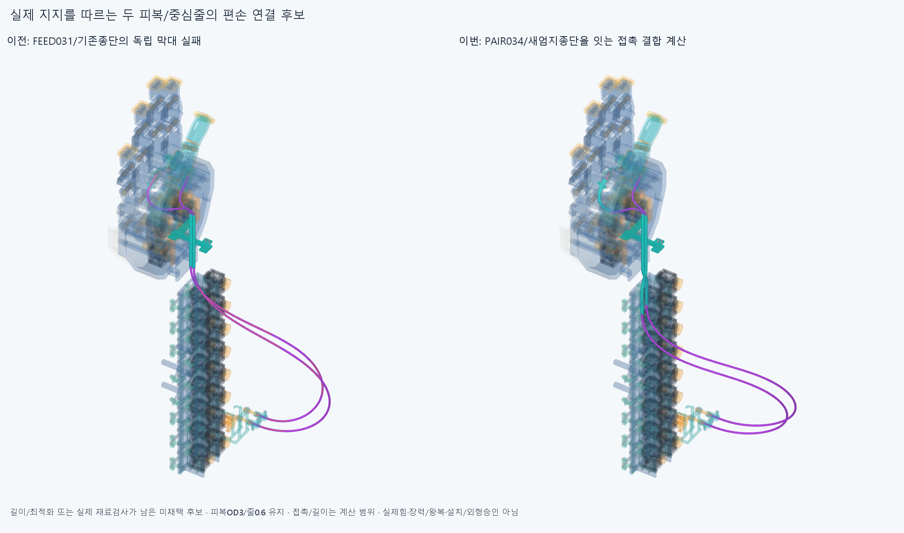

# CONTACT036 실제 지지를 통과하는 두 피복의 접촉 제약 후보

**실제 모터종단→PAIR034→기존 아래종단/ENTRY035 위종단까지 연결한 편손 CAD는 보고기준 이상 겹침0이다. 그러나 미리 정한 길이 목표보다 두 선이 각각 약7.16/6.70mm 길고80회에서 미수렴했다. 고정길이 후보는 미채택이며 실제 설치·탄성평형·잡기/풀기 성공이 아니다.**

## 실제 구성과 변경 범위

[장면](generated/neutral/scene.json)의 새68형상은 물리적 피복2/중간 중심줄2를 CAD 구간으로 나눈 것이다. 아래선은 각16구간(모터직선1/상류B-spline5/PAIR034실제통로4/하류B-spline5/종단직선1), 위선은 각18구간(같은앞15/ENTRY035실제통로2/종단직선1)이다. **새하드웨어0**이며68가이드/연결구가 아니다. 현재 손397/포장385/전기48선·16외곽/팔10/PAIR034하드웨어6을 썼다. 기본 손364본체·축/길이/모터·랙/전기/끝구·죠/안내대 형상은 유지했고 이전 STEP/STL **4754개 해시 불변**이다.

동일한 피복의 옛118mm/220mm/100mm 국부참고, 양끝 짧은피복4, 옛 실패 긴곡선, 시각화 공통재료는 중복 설치하지 않았다. 새선은 실제 기존 모터 피복어깨와 중심줄입구, PAIR034 뒤입구(90/110,−178.729833462,−3/2)와 앞출구(100,−4,−3/2), ENTRY035 위입구/기존 아래끝구의 실제 축을 따른다. 지지는 기존 두모터종단/죠, PAIR034 실제보어, ENTRY035/기존 아래끝구뿐이며 B-spline 제어점은 설치물이 아니다. 중간중심줄은 기존 양끝 국부줄과 이어지는 구간이며 모터 감김/손끝 고정까지 새로 조립·장력검사한 전체줄이라고 세지 않는다.

현재 코드는 **손·손목중립 한 자세만 허용**한다. 모터는전완고정/PAIR034는H/두엄지종단은H+thumb_mcp FK라는 실제 구분을 보존하며 향후 손목변환을 붙여야 한다. 장면의 body표시는 중립 렌더용이고 이를 그대로 손목운동에 적용한 승인은 없다.

## 새 접촉 제약과 한계

옛 독립막대 두선을 그대로 반복하지 않고, 이번에는 네 자유구간을 한 번에 계산하며 두물리선의 분리와 실제 모든 장애물을 함께 제약했다. 각 자유구간은 cubic B-spline 제어점8/5knot구간이며 끝점과 양의 접선handle로 실제 종단 진입축을 맞춘다. 전체56변수, 처음 새곡선으로부터 선별 상류+하류 합계만 길이 등식으로 묶었다. PAIR 앞뒤를 가상 재료고정점으로 나누지 않았고 옛650mm/460mm경계/614·583mm를 쓰지 않았다. 양의handle 하한0.001mm는0접선 방지이며 손관절 제한/요구 여유가 아니다.

862실제 STEP의 전체 경계를 deflection0.1mm/각0.15rad로 나누고 큰 삼각형을 세분화한 **5173517삼각형**에서 거리 후보를 찾았다. 전체 삼각형의 중심거리+최대삼각형반경으로 후보 누락을 막고 실제 점-삼각형 최근접거리를 계산하며, 부품 안밖은 native solid 분류를 쓴다. 근접부는 native 점-경계shell 거리로 교체했다. 0.2mm는 이 계산방식의 전환띠이고 임의 요구여유가 아니다. AABB는 검색 가속용이며 바깥상자만 피한 결과를 성공으로 세지 않는다.

각 자유구간41중심선표본에서 피복 중심~장애물≥외반경1.5mm, 두선 사이에는 전체 구간polyline의 선분-선분 최근접≥OD3mm를 동시에 제약했다. 같은 선의 비국부 자기접촉은 최적화제약에는 없고 최종 실제재료 내부2278쌍에서 검사했다. 유한표본 제약만으로 전체 곡선/관통0을 주장하지 않으며 아래 native 실제관검사와 구별한다. normalized 자연직선 굽힘적분을 최소화하지만 실제 EI/중력/비틀림/마찰/접촉정상력/클램프압착/예압·장력을 풀지 않았다. 이번 접촉제약은 실제 접촉역학이나 유지되는 탄성평형 증명이 아니다. 실제 공급품 허용굽힘/마모·수명 규격도 정하지 않았다.

## 미수렴한 길이 목표를 보존

[원래 solve](reviews/solve.json)는 **80회, solver_success=false, Iteration limit reached**다. 새초기곡선의 자유길이합을 목표로 쓴 값은 아래505.265256667362/위523.434514129974mm다. 실제 고정경로218.428840822733/261.844767358631mm를 더한 전체피복 목표는 **723.694097490095/785.279281488604mm**다. 이것은 확정 절단길이/공급품 선택/기존±2mm 조절범위가 아니다.

원래64점Gauss의 길이잔차는 **+7.163821391159/+6.700865274000mm**로 저장했다. [분리 적분 보조](reviews/length_supplement.json)는 같은 제어점에서5knot별 adaptive quad(epsabs1e−10/epsrel1e−12)를 새로 계산했다. 자유길이512.427450806816/530.133756987861mm, 같은 원래 목표에 대한 잔차 **+7.162194139454/+6.699242857888mm**다. 원래Gauss의 knot를 나누지 않은 적분과 약0.001627252/0.001622416mm 차이가 있고 초기곡선에도 약0.00135/0.00151mm 차이가 있었다. 원래 목표/코드/결과/실패를 바꾸지 않았으며 이 작은 적분차이는 약7mm 길이위반을 해소하지 않는다. 최적화/native/CAD를 다시 실행하지 않았다.

실제 저장CAD 중심선 길이는 아래/위 피복 **730.856291629548/791.978524346492mm**, 중간 중심줄723.856291629548/787.978524346492mm다. 고정경로와 자유구간의 실제 기하합이며 각줄이 피복보다7/4mm짧은 것은 기존 양끝 중심줄 입구 위치 차이다. 원래 실패 목표를 이 실제길이로 이름만 바꿔 통과 처리하지 않는다. 편손 기하길이가 있다는 것과 동일 재료길이로 부모·손목왕복이 된다는 것은 다르다.

종단의 극소수치 음수제약이 수렴중단 원인일 수 있다는 가설을 [별도6작은수치예제](reviews/numerical_probe.json)로 살폈다. −3.255e−14/0/+1의 고정 부등식을 둔 선형/이차 등식 예제6개가 모두 수렴했으므로 **이 가설은 지지되지 않았다**. 이를 원인확정/제약삭제 근거로 쓰지 않는다.

[곡률 보조](reviews/extrema.json)는 각cubic knot구간에서 곡률제곱의 다항식 임계점을 수치계산하고4097밀집표본과 대조했다. 아래상류/하류 최소반경66.336983666450/10.485430349631mm, 위상류/하류64.926424308567/10.780898883084mm다. 피복외반경1.5mm보다 큰 국부필요조건일 뿐 실제 공급품 허용굽힘/두께변형·수명/모든 자기접촉·실제평형 증명은 아니다.

## 실제 재료검사와 남은 범위

[check](reviews/check.json)의 편손1native자세는 새68대손397/포장385/전기64/팔10/PAIR6 및 내부2278쌍이다. **60894쌍/321AABB native후보/보고기준0.001mm³초과 겹침0·연산실패0**이며 Boolean허용오차1e−6mm/OCC풀1이다. 각피복은OD3/ID1.3, 중심줄OD0.6의 기존공간가정을 유지했다. 손자체·기존부품끼리/물체/모터전회전/부모·손목왕복/동적전기선은 새로 검사하지 않았다. native_candidate_clear=true와 candidate_admissible=false를 함께 보존한다.

그림은 실제 이전ELASTICA033실패형상과 현재 연결형상을 렌더했다. 현재 큰 전완밖 U루프와 기존 지지돌출의 **외형수용은 미정**이고 겹침0이 사람다운 외형/실구동 승인이라는 뜻이 아니다. 조립/긴피복삽입·꼬리평형/실제줄끼우기/장력조절·예압/마찰·좌굴/당김·빠짐·안쪽줄끼임/힘·수명·실물을 검사하지 않았다. ENTRY035/PAIR034 국부조립 성공을 이 전체선 설치로 승계하지 않는다. 새 하드웨어 수정은 없으며 지금 필요한 것은 긴선의 실제 설치·운동 검증이다. 현재 전체긴피복/전체줄은 미설치, 손전체는 미완이다.

다음은 저장된 편손 기하와 원래 실패 길이를 구별해 일정재료길이의 근거/정확한 길이 파라미터화·실제 축슬라이딩을 정리하고, 필요하면 별도명시한 새길이 후보에서 자연스러운 부모·손목 잡기/풀기를 제한된 표본으로 검사하는 것이다. 같은80회 접촉최적화/옛독립막대·자유곡선/임의길이·반경경계 탐색을 자동반복하지 않는다. 원래 목표를 덮거나 허공 지지·없는 텐셔너를 설치물로 세지 않는다. 한 후보 미수렴을 구조적불가능/손절삭 근거로 쓰지 않는다. 손/모터/랙·전기선 절삭·이동/OD축소/각도제한/팔꿈치버스·끝낸국부틈/자세재탐색은 하지 않으며 모든공급품·실물인증을다음CAD/요청3~4동작영상조건으로무한히늘리지않는다.

이전 PAIR034 core_initialfalse/끝삽입2STEP포함관계모순·3000점분류일치보류, OFFSET024면false/한점모순, HOUSING027/GUIDED030/ELASTICA033 기본적분false·명시정밀보조는 재검사/해소하지 않았다. 형상서명은 모든곡면식/trim/경계면 Boolean동등성 증명이 아니다.
