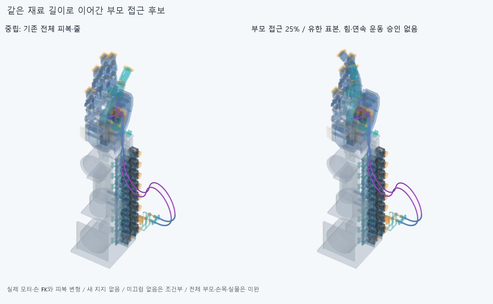

# CONT046 같은 재료로 이어간 부모 접근과 두 선 접촉

**첫 접근 구간의 유한 두께 검사 진행. 중심선 계산5증분과 실제 두께 native 5상태를 구별한다. 부모·손목 전체왕복/실제 힘·고정·구동 승인은 없다.**

## 실제로 바꾼 범위

설치 형상·축·길이는 바꾸지 않았다. 기존 PINCH 부모잡기 목표각의0→5/10/15/20/25%를 사용하고 손목은 중립이다. 엄지 IP도 기존 자연 협응의 목표각을 따르며 모터출력은0.77q다. 모터는 전완고정, PAIR는 H=P@Y, 엄지 종단은 H+MCP, 자식13은 실제IP FK다. 목표각과 설치축 변경은 다르다. 기존손397/기본364·포장385·전기64·팔10·PAIR6, 모터/랙·전기선·OD·외형비율을 유지했다. 이전 STEP/STL **6906해시 불변**, 새하드웨어0이다.

현재 두 피복/두 줄의 분할만 새 시간상태로 만들었다. 한 장면의 **118행**은 두피복46조각과 두줄72조각이며118새가이드/설치물이라는 뜻이 아니다. 옛중립피복/줄/축프로브·실패곡선/증거를 같은 선에 중복 설치하지 않았다.

## 새 계산과 분명한 한계

저장된 중립 자유원호를 정확히 상류8/하류6 원호로 나눈 뒤, 앞 증분의 상태에서 두 선을 함께 이어갔다. 중립 재분할4프로필·각73점, 총292점의 호길이/좌표를 기존경로와 대조했다. 기존독립두원호 자세를 새로 풀거나 옛650/460mm독립막대·자유곡선/80회접촉최적화/단일스칼라Newton을 반복하지 않았다. 새 반경·길이 경계와 허공가이드/텐셔너는 없다.

각 원호는 길이와 두 굽힘좌표로 적분한다. 한 물리선의 자유길이합은 고정하고 상류 길이를 미지수로 두며 하류길이를 나머지로 정한다. PAIR 앞뒤를 재료 고정점으로 묶지 않는다. 두 선의 끝점/접선과 실제 하드웨어 point/shell native접촉·반대선 표본 분리를 하나의 활성접촉 투영에서 맞췄다. 최소 증분좌표 변화 규칙이며 **탄성에너지 최소/실제 재료평형 해가 아니다**. 원호 분할점은 수치좌표일 뿐 설치지지가 아니다. 내부 신뢰영역 .12는 좌표 갱신의 수치 감쇠이며 관절 각도제한/기계여유가 아니다.

하드웨어862의 AABB로 후보를 고르고 근접점에서 native shell 거리/안밖을 계산했다. 피복외반경1.5에 더한0.2mm는 native계산 전환띠이며 요구여유가 아니다. 전체삼각거리장은 만들지 않았다. 각원호0/25/50/75%+마지막끝 표본을 사용했으므로 **표본 사이 재료관통/연속접촉 성공으로 쓰지 않는다**. 비국부 자기접촉은 새 두께 native에서 검사한다. 반대선도 표본점 필요조건이며, 그것만으로 전체 두 선 분리승인을 하지 않는다.5중심선 증분의 native point/shell 질의 1858는 반복 수치계산의 거리 질의이며 독립 운동표본/Boolean통과 수가 아니다.

첫 중심선 해의 모터9는 명목출력 위치였다. 각 두께검사 전에 명목/실제회전 모터9의18 AABB가 모든 자유구간 표본에서 native전환띠1.7mm 밖임을 확인했다. 따라서 그9부품은 원래 point접촉투영에 비활성이었다. **전체재료 native는 실제회전 모터9를 사용**했다. 이 한정 비활성 근거를 전체모터회전/전공간 승인으로 쓰지 않는다.

## 길이와 실제 축슬라이딩

피복 **698.964345153791/761.108456948670mm**, 줄 **853.356663204892/932.491923574900mm**를 유지했다. 길이잔차최대3.41060513165e-13mm, 조각끝점차최대3.24497377991e-07mm, 모터/자식 실제강체프레임 고정꼬리 끝점차최대6.39488462184e-14mm다. 부모운동에 맞춰 길이를 새로 늘린 독립자세족이 아니다. 상류/하류 길이분배와 PAIR 재료좌표 변화를 저장했다. 피복 양끝 착좌도 명목 경계이며 실제 죔쇠 압착·빠짐저항/하중 승인은 아니다.

실제 두께검사를 실행한 상태의4재료×5=20프로필, 같은재료9점씩180점과 PAIR뒤40mm직선보어의 같은재료증인20개, 합200점을 저장했다. 증인이 직선밖으로 나가면 밖으로 기록하며 통과를 강제하지 않는다. 모터R10 감김변화와 자식R7.7 감김변화는0.77q에서 상쇄된다. 양끝 미끄럼없음은 FIX044의 **미검증 마찰·예압 조건**이다. 실제양의스토퍼/매듭/압착·고정력·장력승인이 아니고 기존±2mm조절을 텐셔너로 쓰지 않았다. 공급/절단·신장·필요조절규격이 아니다.

## 실제 재료 검사와 보존한 실패

새 두께상태 5개에서 전체 피복·줄 대 현재5하드웨어그룹과 새재료 모든자기쌍을 검사했다. **543095쌍/2492AABB/10기록/0연산실패**다. 원래같은줄 모터꼬리/감김접합10기록을 raw그대로 구별했고 새차단0기록을 보존했다. 보고기준0.001mm³초과/Boolean1e-6mm/OCC1이다. 기존하드웨어끼리의 모든쌍·물체파지는 이번 새검사범위가 아니다. 첫새차단 뒤의 두께상태는 실행하지 않았다.5수치해를5실제두께통과로 합산하지 않는다.

[원시 결과](reviews/check.json), [처음 막힌 상태의 최대 새 실제공통재료](reviews/evidence.json)를 따른다. 같은줄 접합0맞추기/미세절삭·외경축소/모터이동·각도제한은 하지 않았다. 접촉투영 후보의 실패가 손결함/자연스러운 모든경로·손기능 불가능의 증명은 아니다.

첫 두께검사 진입은 JSON배열→수치배열 복원 누락 TypeError로 프로필/native/STEP 전에 중단했다. 정확한 첫코드·빈보고서·오류/stdout/status는 history에 보존했다. 상류/하류 배열읽기 한곳만 고친 뒤 새검사를 실행했고 원래 analysis코드/기하/목표각·기준은 그대로다. 첫실패0완료native/0STEP를 통과표본으로 합산하지 않는다.

그림은 실제 저장피복·줄CAD와 실제현재하드웨어의 같은 강체/FK변환이다. 기존 STL을 재사용하고 화면변환862개를 기록했다. 팔은 SEAT041의 정확 nativeSTEP기반mm메시다. 렌더는 native그룹 재실행0이며 그림/일부측정서명은 모든곡면식·trim·Boolean동등성 증명이 아니다.

## 남은 일

Close CONT046 first quarter of natural parent approach: five coupled constant-contour increments and their swept-material checks. Continue from the last stored state toward the remaining natural parent grasp/release and wrist motion, without independent refits or repeating completed five increments. Motor forearm fixed; PAIR H=P@Y; distal H+MCP and actual IP/rotor0.77q. Guide rear/front are not material anchors; exact whole housing/cord lengths and real-axis sliding must remain coupled to both-line/hardware contact. Incremental coordinate projection is prescribed geometry, not calibrated EI/gravity/twist/contact-force/friction/preload/tension/equilibrium. Tail no-slip remains unverified friction/preload condition. Keep hand397/base364/pack385/elect64/arm10/PAIR6/body proportions/axes/lengths/motor/rack/electrical/OD. No elbow bus, hand cuts, motor/rack/wire movement, angle limits, seam-zeroing, microgaps, closed screw/tail checks, old scalar Newton/80 optimization/independent rod/free curve/independent variable-length biarc family, virtual supports or absent tensioners. Preserve SLIDE045/CORD043/BIARC039 initial corefalse and all earlier failures/holds. Do not make all physical/supplier certification endless prerequisites for further CAD/requested3-4 motion previews.

이번에는 부모25%까지의 한 수치접근 후보만 만들었다. 복귀/나머지부모·손목/힘·장력·EI·중력·비틀림·좌굴·마찰·접촉정상력/예압·압착·실제꼬리고정·나사산·공구·손·지그·조임·토크·전기동적운동/모터전회전·전체손20모터·실물·제조·외형은 미완이다. SLIDE04515°위줄접합체적차 initialfalse, CORD043/BIARC039추가같은줄접합 corefalse, FIX044미검증고정, SEAT041운반실패와 과거보류는 재검사·해소하지 않았다. 같은 에이전트이며 독립감사가 아니다.

## 정확SHA 새사본 재검사

대상`3677e4418904712591cfa81b81570af42312153d`, 초기core=true, 12/12native·20/20프로필/200재료점·8/8형상 일치. [한정결과](../../docs/reviews/CONT046/README.md). 모든곡면/전체부모손목·힘·구동 승인아님.
