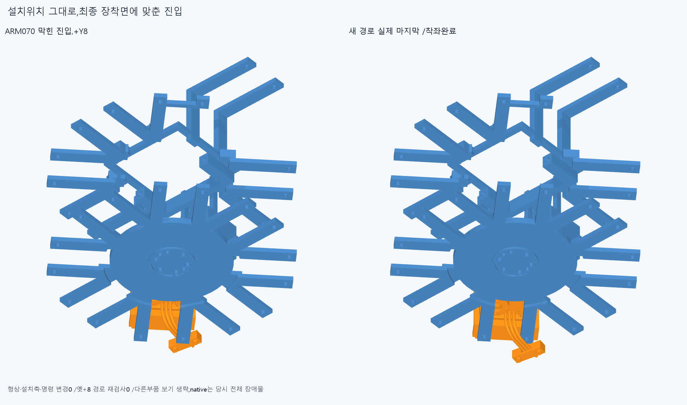
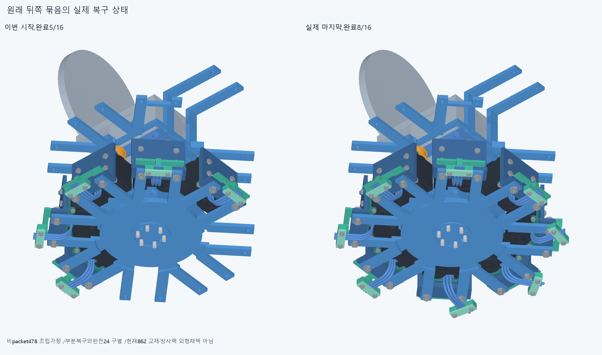
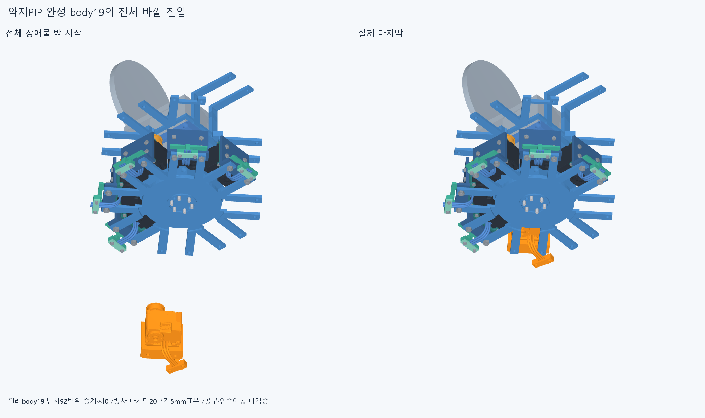
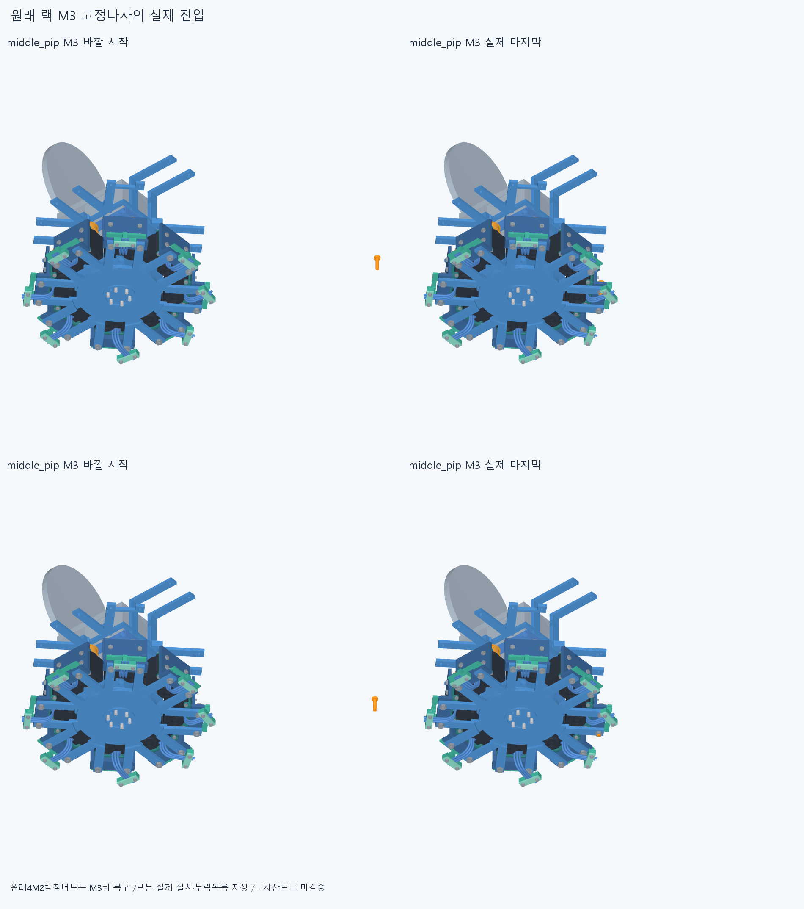

# ARM071 최종 장착면을 따라 모터 묶음 넣기

**형상·설치축을 바꾸지 않고 새3묶음을 원래위치로 복구했다. 총8/16·조건부670행/216대기이며 현재862/방사랙 외형은 채택하지 않았다.**

## 실제 면과 이전 막힘

현재862/기본364·손397/손바닥4·16원격/빔·전기·축길이명령clock설치형상변경0·886/방사랙/외형미채택이다. 조건부598는 비packet478의 선행조립과 원래완료5묶음을 포함하며 중립세계등록/실제운반·다른공장조립은 별도조건이다. 원래 모터/body나사/spool/전선/plug참고는 실제내부조립·mating/유연하네스변형/captive유지·공구fit/나사산토크/힘강도마찰예압장력·20구동/동적전기·전체팔상완·실물제조외형 승인이 아니다.

저장된 ARM070의 약지PIP lid/root 공통8.028125377469921mm³를 읽고 원래 body19와 중앙root20부품의 bbox/실제 평면을 읽었다. 원래 어댑터 장착면은Y−229mm다. 원래 덮개의Y범위는[−239.15,−237.65],기존 +Y8 진입 자세의 덮개는[−231.15,−229.65]이며 root뒤쪽 지지살[−232,−229]와 같은 축방향에 놓인다. 따라서+8은 설치에 필요한 변경이 아니라 막힌 조립 자세였다. 이 면/경계 읽기는 공급품 실제 fit/접촉면/고정력 승인이 아니다. 옛 공통Boolean/109native는 반복하지 않았다.

새 경로는 완성 body19를 원래 최종 장착면의 normal0에 놓은 채 전체 실제 장애물AABB밖부터 방사방향으로 넣는다. 마지막20mm는20/15/10/5/0의5mm표본으로 확인한다. 원래설치 위치·축·명령clock변경0이며,막힌뒤+4/0만 얕게 시작한 검사가 아니다. 실제 간섭은 전체 body19대 해당시점 모든 부품의 nativeBoolean으로 검사한다.

## 원래 부품과 조립 순서

ringPIP의 body19 벤치 범위92는 같은 M2선조립14/안내대-spacer21/전기전체경로14/너트·뚜껑M2체결43이다. 전기경로 안의 기존12부분집합 증명도 유지한다. 입력/형상·변환·부품/장애물목록을 그대로 승계하고 새92검사라고 세지 않는다. 원래base_nuts4M2묶음1행만세계랙M3뒤에 복구하며 body19에는 아직 없다.

남은뒤2의 시도한 범위는 자기 실제방위/3리드경로에서 새검사한다. 수동cradle→M2나사4묶음→모터/rotor/body나사/spool4→adapter/안내대옆진입/spacer→unit6+plug1→열린홈3전선→너트2옆진입후포켓→뚜껑/M2나사2다. 너트의 originalZ−4 조립평면은 받침을 우회하는 시험경로이고 공차/최소여유가 아니다. 공급품 내부/mating·전선변형/기구captive는 참고조건이다.

세계 body19→원래racknuts2→원래rackM3나사2→원래4M2받침너트묶음1순서다. 너트는 출력−20에서전체방사바깥→−10/0,M3는출력+40에서전체방사바깥→20/10/0,마지막받침너트는방사바깥→20/10/5/0이다. 각 전체바깥은 해당실제장애물AABB투영보다 밖으로20mm올림/최소160mm에서 시작하며 설계최소여유가 아니다. 모든 단계의 설치/이동/일시누락 목록·최종항등을 저장한다.

## 실제 완료 범위

새394native/563037쌍/681AABB/0겹침기록/연산오류0,보고>0.001mm³/Boolean1e−6mm/OCC1이다. raw_new_tests_clear=True. 새원래24복구=['ring_pip_actuator', 'ring_dip_actuator', 'middle_pip_actuator'],전체완료=['index_mcp_actuator', 'little_mcp_actuator', 'thumb_mcp_actuator', 'little_pip_actuator', 'little_dip_actuator', 'ring_pip_actuator', 'ring_dip_actuator', 'middle_pip_actuator']. 실제조건부598→670,원래216행대기다. 전체공장조립/8외나머지모터 설치완료가 아니며 영구삭제/몰래이동0이다. 첫새실패=None,기록=[]. 첫실패뒤 경로/모듈을 실행완료로 세지 않는다.

시도한새모듈의 실제M2base_screws/rackM3원통축만4개 읽었으며 끝낸ARM069축10/ARM070lid축1/615면PCD는 반복하지 않았다. 설치축을 바꾼 것이 아니라 실제 각 모듈의 방향과 선언진입 방향을 대조했다.

## 실제 CAD와 재현

불투명 실제CAD4그림이며 생략한 다른 부품도 해당native의 장애물이다. 새대표공통0은 저장한경우에만 새질의했으며 수치를export/그림전에 저장했다. 증거기하0는 설치물이 아니다. 이전기하12771개와 동결222/과거manifest는 불변이다.

정확SHA 새깨끗한별도사본에서 핵심132native(새벤치 시작끝,세계body첫/마지막5·nut/받침너트첫/마지막3·M3첫/마지막4와 첫실패)와 실제프레임/새축·adapter/root평면/덮개경계·이전bench92승계·원래16packet408/최종886/시작598·목록/누락/전체바깥시작·최종원래위치를 대조한다. 새공통형상서명은adaptiveepsilon1e−10/절대1e−5다. 모든중간표본/곡면trimBoolean·픽셀/팔시각단위·연속전체조립/실물 증명이 아니며 같은에이전트 검토로 독립감사가 아니다.

ARM070의4실패·ARM069lead/base·ARM068전선3·ARM067나사·ARM066두실패·ARM065common1edgevertex/corefalse·옛M3+13/R5/strictfalse/곡면포함보류를 보존한다. 빔 한방향끝받침/반대뽑힘 마찰예압은 미검증이다. 손빔절삭/모터삭제·몰래이동/각도제한/ODR축소/가짜텐셔너/LINK·옛최적화/팔꿈치전기버스재개0. 지지조립운동 일관뒤 고정모터→H짧은입구→실제끝구 긴재료를 잇고 실물완벽을 CAD영상의 무한조건으로 늘리지 않는다.

## 다음

뒤8의 원래부품/위치 복구를 유지하고 특수앞thumbIP48의 ARM059 실제 R5·전기일체/조절부·죠·M3스택과 전체벤치/serviceinterface를 읽는다. 일반24템플릿을 맹목적용하지 않고 원래특수48 복구순서를 검사한 뒤 다른앞7을 새검사한다.
