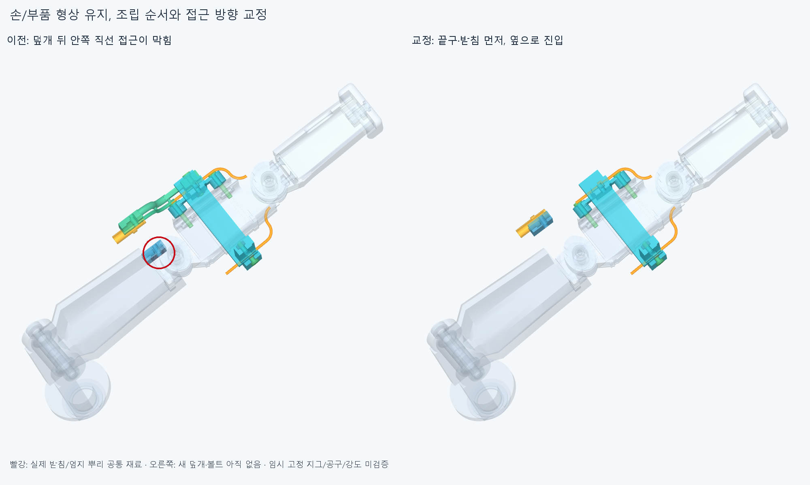

# ASSEMBLY025 손쪽 피복 종단의 조립 순서

**손/부품 형상을 바꾸지 않고 선조립·접근 순서로 걸림을 피했다. 손 안84표본과 별도 작업대4표본,총88유한 표본에서 보고기준 초과 겹침0·연산실패0이다.** 실제 지그/공구·나사산/토크/강도,긴 피복·빠짐방지·줄 끼우기/장력은 아직 미검증이다.

## 현재 입력과 유지한 것

OFFSET024의 [정적 후보](../thumb_sheath_terminal_v2/selected/generated/candidate_scene.json),새14+GUIDE021유지9+기존손362=**385손쪽행**과 TERMINAL022포장373/전기48선·16커넥터외곽/중립팔10을 썼다. 손364원본의 옛 덮개볼트2행은 GUIDE021 긴 볼트로 바꾼 기존 조건 그대로다. 관절축·길이/목표각·모터 설치배치/랙·받침·선/피복 끝구 형상은 전부 유지했다. 기존 덮개2/가정 피복2/시각화 증거를 설치 모터/전달부로 중복 합산하지 않는다. 실제20모터 설치·전체 구동 완료가 아니다.

이전 manifest의 **STEP/STL 4041파일 해시가 그대로**다. 새로 내보낸 STEP/STL은 실패 위치/공통 재료 그림용이며 설치품이 아니다. OFFSET024의 곡면 경계상자/한 점 거리 비교 보류는 그대로 보존한다. 이번에는 저장된 STEP를 재수입해 조립 경로를 검사했고 원본/STEP 형상 동등성을 다시 판정하지 않았다.

## 원래 실패

새 위 덮개를 먼저 넣고 원래 너트/볼트를 복구한 뒤 끝구를 끼우는 데까지는 통과했다. 그러나 안쪽 받침의 **12mm 안쪽 시작점이 이미 엄지 뿌리·부싱/와셔와 겹쳤다.** 실제 뿌리 공통 체적은 **8.968113581mm³**다. 첫4경로16표본 중 이 시작1표본의4부품쌍이 겹쳤고,나머지 접근 표본/완성 위치는0이었다. 빨강/원은 이 실제 공통 재료다. [첫 partial 결과](reviews/service.json)는completed=false로 보존하며 이후 경로를 검사했다고 쓰지 않는다. 그 시작 자세가 유효한 자유공간이라는 뜻도 아니다.

## 선택한 조립 순서

처음에는 원래 GUIDE021의 위 덮개/그 M2볼트·너트3행만 없다. 아래쪽은 원래 GUIDE021 상태이며 가는 안내관/끝마디/핀은 모두 유지한다. **작업대에서 위 끝구를 안쪽 받침에 넣어 둘을 먼저 맞추고,손의 바깥 X+20→0mm로 함께 넣는다.** 그 뒤 위 덮개를 바깥14→0mm로 닫고 원래 M2너트/볼트를 복구한다. 새 너트는+X에서 안쪽 것부터,두 너트를 놓은 뒤 새 볼트를 넣는다.

아래쪽은 원래 볼트→너트→덮개를 실제로 빼는 경로부터 확인했다. 가는 안내관은 남겨 수동 유지한다. **맨 끝구를 먼저 축 방향 −25→0mm로 끼운 뒤**,안쪽 받침을3mm안쪽 높이에서 X−20→0mm로 가져와 남은3mm를 방사 방향으로 앉힌다. 새 바깥 덮개를 닫고 원래 M2를 복구한다. 새 너트는−X에서 안쪽 것부터,그 뒤 새 볼트를 넣는다. 마지막에 양쪽 **각24mm 직선 피복 끝 참고**를 축 방향으로 넣는다. 긴 유연 피복 전체 설치나 줄 끼우기 검사는 아니다.

실제 이동/설치/아직 없는 부품 목록은 [selected_service.json](reviews/selected_service.json)에 단계별로 저장했다. 모든 손 본체/자식끝마디·핀은 처음부터 끝까지 있고 관절은 중립이다. 작업대의 끝구/받침 조립은 손 기준에서500mm 떨어진 별도 위치의 두 부품만 검사한 것이다. 손/모터를 임의 검사 제외해 성공을 만든 것이 아니다.

두 느슨한 부품과 가는 안내관은 해당 단계에서 **수동/임시 지지로 위치를 유지한다는 조건**이다. 플랜지 홈에 끝구를 앉힌 채 받침을 잡고,바깥 덮개/원래 M2가 체결될 때까지 상대 위치를 유지해야 한다. 그 지그/집게의 실제 CAD/접촉·공구/손잡이/작업자 접근·중량/강성은 미검증이다. 실제 체결 전 강체 배정만으로 고정됐다고 주장하지 않는다.

## 검사 수와 기록 오류의 구분

선택 순서의22손 안 경로 **84표본+작업대4표본=88**,전부 새 계산이며 첫 실패16표본이나 예전 OFFSET024덮개6표본을 더하지 않는다. 추가 끝구/받침이 실제 장애물로 생겨 위 덮개 경로도 새로 검사했다. 총 **73379쌍 범위 중384AABB후보 native계산**이다. 보고기준0.001mm³ 초과/Boolean허용오차1e−6mm/OCC풀1을 유지했다. [선택/집계](reviews/selection.json),[상세 판단](reviews/assessment.json).

최초 correct_order의 import경로 누락은 기하/native검사 전 중단했다. 이를 고친 order2는22경로 계산을 모두 마친 뒤 마지막 집합합산의set+set이 TypeError를 내 completion집계만 못 썼다. raw [corrected_service.json](reviews/corrected_service.json)은false로 보존한다. **finalize.py가 입력 해시·모든 단계 연속성·최종25가이드/종단/피복참고 행을 검증한 뒤 집계만 정리했다.** native재실행0/결과수정0이다. [이력](reviews/history.json). 실행기 종료 오류와 실제CAD걸림을 구별한다.

## 남은 범위와 다음

이 명목 조립 순서는 닫고 작은 틈/동일 경로를 자동 재계산하지 않는다. 다음은 **양 끝 피복의 실제 빠짐 방지/인장완화와 긴 모터→손목→엄지 피복 경로**다. 그 구조로 유지되는 두 줄의 길이 조절/예압,부모/손목 움직임·잡기와 풀기에서의 당김/끼임·마찰/장력을 확인한다. 조립할 때 아직 없는 구동줄은 이번 장애물에 넣지 않았으며 줄 끼우기/통과 가능성·전체 전기선 운동도 아직 없다. 주황은 가는 안내관이고 실제 구동줄 검사가 아니다.

피복/끝구/가이드·리브/기둥·M2명목 외곽의 실제 공급품/재료·제작법/공차·나사산/드라이브·토크·강도/풀림/마모·수명은 미확정이다. 선택 후보의 추가 돌출도 수용 외형 판정이 아니다. 실제보드/전원/실물운전·50/100ms 성능은검사하지않았다. 팔꿈치 전기버스는 보류한다.

코드·입력/첫 실패/선택 결과·실제CAD 그림을 저장하고 정확SHA 새 깨끗한 사본에서 저장 STEP/핵심 조립 표본을 재검사한다. 같은 에이전트 검토이며 독립 감사가 아니다. 이전 곡면 비교 false를 덮거나 전체 손 구동 승인으로 쓰지 않는다.
