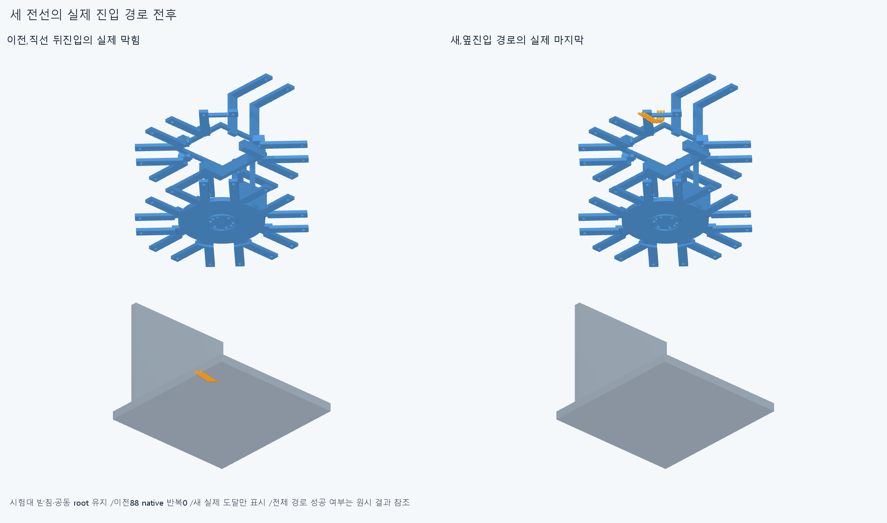
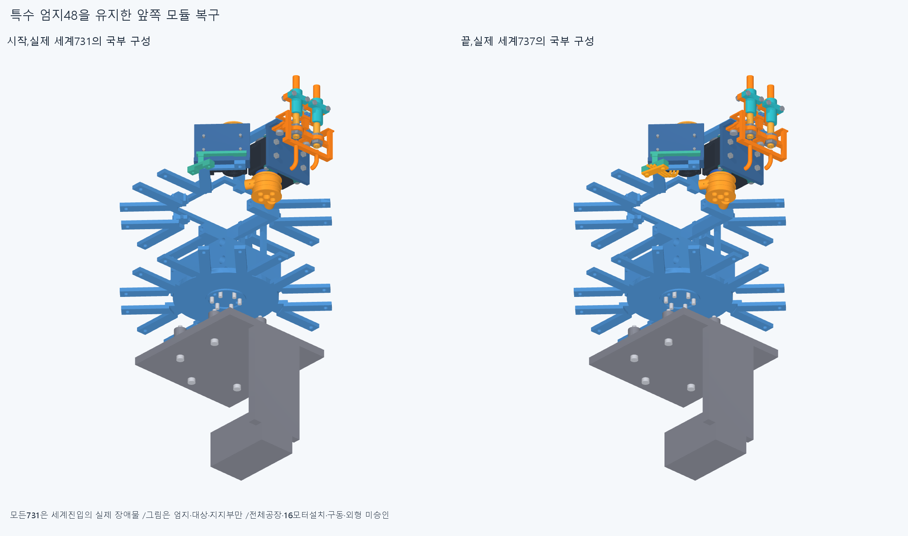

# ARM080 실제 경계에서 정한 꺾인 전기 진입

현재862/기본364·손397/손바닥4·16원격·빔전기·설치축길이명령clock유지,886/방사랙외형미채택. ARM074받침1명시교체의별도886/특수48=원래47+새받침1,다른885유지/이번설치형상변경0.

초기실행은네번째경로의완료기록파일교체에서WinError5로중단했다. 당시결과읽기가진행중이었으나원인은확정하지않았다. 원래코드/표준출력/오류/실행상태/마지막atomic JSON과완료90이들어있는partial원문을history에보존했다. continue_check.py는입력해시·네경로목록·각완료/계획수·항등·90원시값무간섭을확인하고그값을그대로승계·새native0,남은랙체결만새검사했다. reviews/check.json의completed=false를덮지않고reviews/final_check.json에최종집계를저장한다.

ARM079 실제731/열린몸체13·뒤8·특수48을 유지했다. 이전완료84=새너트벤치33+몸체13세계51과더이전69벤치는각입력해시·실제등록기하·moving/present집합·최종항등을대조해승계했고새native0이다. ARM079실패전선경로4/전체88·ARM078185/축14는재실행하지않았다. 원래plug·세lead·lid/M2·랙M3/M2전체24복구가목표다.

저장lead/cradle공통2속성·실제시험대받침경계와전기홈/lead/lid/M2경계를읽었다. 실제공동root face318의평면Y−162와세lead최대Y−151.2에서뒤면을피하기위한변위10.8mm를계산했다. 기존시험간격20mm의다음값20mm를선택해전체lead와해당평면의분리9.2mm로계획했다. 최소여유/제작공차규격이아니며전체root·cradle장애물은그대로다.

세lead는전체731장애물AABB밖방사시작→opening방향20mm를유지한옆진입→원래열린홈축15/10/5/0복귀를검사했다. lid와두M2도그꺾인경로뒤원래랙너트/M3/마지막M2너트순서를계획했다. 경로마다실제각moving/fixed부품AABB직교투영진입·중간·이탈사건을기본표본에추가했다. 유한표본/보수경계이며연속곡면통과·공구접근승인이아니다.

새110native/120261쌍/262AABB/2기록/0오류·rawFalse. 새완전0/총9/16·세계737/대기149. 실제첫막힘: [{"lead": "middle_dip_actuator_rack_nut_1", "part": "middle_dip_actuator_lead1", "material_intersection_mm3": 8.336652404063367}, {"lead": "middle_dip_actuator_rack_nut_1", "part": "middle_dip_actuator_lead2", "material_intersection_mm3": 5.962545566242333}]

완료뒤원래항등위치만복구하고명시부재/누적목록·moving-fixed중복0·전체밖시작을저장했다. 첫막힘뒤미실행은성공이아니며한경로여러전선기록을독립설계결함/전체조립불가능으로확대하지않는다. 전선은원래강체공간참고이며유연하네스설치/전기결합·압착·수동유지/운반·지그/공구·체결력은미검증이다.

새공통2만수치를먼저저장뒤STEP-STL증거2·불투명5고유그림을만들었다. 설치기하export0·기존12803기하/동결222/과거manifest불변. 공통0은미생성·미실행이다.

정확SHA핵심계획44native는각새세계경로시작끝/마지막5·실패경로도달전부다. 실제재현은docs/reviews/ARM080. 같은84/69승계증명·원래16packet408/886·명시받침1/실제731·특수48/원래24·누적목록/누락·전체밖/항등/실제face318·경계/derived20·투영사건prefix·새공통typed서명epsilon1e−10/절대1e−5를대조한다. 같은에이전트한정재현이며독립감사/모든중간·trimBoolean/픽셀/팔시각단위/연속전체공장·20구동/외형승인이아니다.

ARM074윗M3전체포함false19.195131113433646mm³/1solid·실제보어1/216IN모순/원인미확정·윗돌출5.9mm/외형미채택,ARM065edgevertex/corefalse·ARM072픽셀false·옛strictfalse/모든이전실패보류유지. 같은차집합/정밀/픽셀복구/615PCD반복0. 빔반대뽑힘·출력12내부/mating·하네스/captive/공구·토크힘강도마찰예압장력/20구동·동적전기·전체팔상완/실물제조외형미승인. 손빔절삭/모터삭제·몰래이동/각도제한/ODR축소/가짜텐셔너/LINK·옛최적화/팔꿈치버스재개0.

ARM080 실제737=이전731+세lead/lid/M2둘6과완료90전기진입을보존한다. 첫racknut1의(0,-3.25,0)mm에서lead1 8.336652404063367/lead2 5.962545566242333mm³로막힌새공통2·실제너트축/전선홈과선후관계를읽는다. 같은후삽입재반복대신원래자기전기6을명시부재로둔같은body13/world731의독립대안에서원래racknuts→M3둘→base_nuts를먼저복구하고세lead→lid/M2를뒤에넣는순서를성공가정없이검사한다. 737에서분리하는역분해·운반/수동유지는검증되지않았으며전체공장연속성으로쓰지않는다. 기존731/뒤8/엄지48/원래24/plug/모든M3M2·축길이명령clock은유지한다. 실제fixed집합이달라진경로는새검사하고ARM080완료90을새장애물에맹목승계하지않는다. ARM079완료84와이전69는입력/등록·moving-present집합동일성증명때만승계·새0이다. 완료110=첫저장90+새계속20/이번세계737·대기149(이번랙5+앞6×24)/완전9/16,첫너트21계획중20도달후나머지너트/M3/base_nuts·앞6미실행이다. 초기WinError5원문·completedfalse/partial90보존,final_check.json이최종집계이며90native반복0이다. 10.8→시험opening20mm·27/18/22/23전기표본/AABB사건·옛88/185/축14/68/106/162/216/615PCD반복0. ARM074윗M3전체포함false19.195131113433646mm³/1solid·실제보어1/216IN모순/원인미확정·윗돌출5.9mm/외형미채택,ARM065edgevertex/corefalse·ARM072픽셀false·옛strictfalse/모든이전실패보류유지. 같은차집합/정밀/픽셀복구/615PCD반복0. 빔반대뽑힘·출력12내부/mating·하네스/captive/공구·토크힘강도마찰예압장력/20구동·동적전기·전체팔상완/실물제조외형미승인. 손빔절삭/모터삭제·몰래이동/각도제한/ODR축소/가짜텐셔너/LINK·옛최적화/팔꿈치버스재개0.
