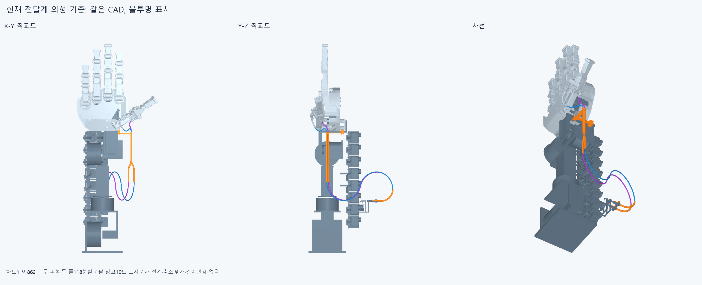

# PACK048 외형 지적을 반영한 전달계 배치 기준

**새 설계는 아직 없다.** 사용자가 2026-10-27 기존 그림을 보고 “모양새 이게 최선임? 좀 상당히 별로인 느낌인데..”라고 지적했다. 현재 외부 루프·돌출 지지를 그대로 다른 축에 늘리지 않고, 전체 전달계 배치를 먼저 검토한다. 손 본체 전체를 반려하거나 모터 재배치·손 절삭을 허용했다고 해석하지 않았다.

같은 중립 저장 CAD의 862하드웨어와 같은 두 피복·두 줄의118분할, 합980행을 전부 표시했다. 반투명 때문에 생긴 복잡함과 실제 돌출을 구별하려는 보기다. 팔 참고10도 표시했으며 새 외장/덮개를 만들거나 부품을 숨겨 개선으로 세지 않았다. [다른 축의 직교도](images/opaque_packaging.png)도 보존한다. 외형 수용·최적·포장 개선 완료 주장은 없다.

## 측정이 말하는 것과 말하지 않는 것

저장 STL980개의 삼각형 정점 경계와10개 그룹의 직교상자, 실제 저장STEP19개의경계를 처음 측정했다. STEP19는 두 선의 자유 상류 피복16조각+실제 모터 굽힘죠2+PAIR본체1이다. 새형상/새하드웨어/STEP·STL export0, 새native Boolean그룹0, 끝낸운동·작은접합검사재실행0이다. 원래 STEP/STL **11390해시 불변**이다.

| 표시용 그룹 | X/Y/Z 크기 mm |
|---|---|
| 현재 전완 포장346 | 93.84/338.00/185.50 |
| 자유 상류 피복16분할 | 114.10/101.70/232.00 |
| 현재 PAIR하드웨어6 | 67.50/182.93/64.00 |
| 전체980 | 281.00/723.72/294.50 |

숫자는표시용소수2자리이며정확한값/부품별경계는[baseline.json](reviews/baseline.json)에있다. 공급품 허용 굽힘·공차·요구 여유·제작 크기 규격이 아니다. 자유상류피복상자는전완346포장전체상자보다+X 83.789970398mm/+Z 47.498965502mm까지뻗는다. 이는서로다른영역의전체직교상자차이며지역외피까지최단돌출/운동여유/잘라낼길이가아니다. PAIR쪽입구로가는구간도포함하므로같은값을전완중간의루프돌출로부르지않는다.

전체980상자와862하드웨어상자는동일하다. 손 폭·팔 길이·기존 구조가전역최대값을이미차지해국부루프가전역상자를늘리지않기때문이다. **전역상자가같다는이유로현재외형이좋다고판정하면안된다.** 현재문제는모터출구/진입방향,멀리떨어진상류피복,긴PAIR접근과고정부가만드는국부실루엣과전체배치다. 더짧거나더밀착한유효경로가확보됐다는뜻도아니다.

현재고정모터자유출구는(-1.1/18.9,-203.5,-227)mm/+Y,PAIR뒤는(90/110,-178.729833462,-3/2)mm/+Y다. 기존모터피복어깨는(-1.1/18.9,-243.5,-158)mm다. R40모터굽힘과긴S안내대가실제부착구조로방향을정하고있으므로공중의자유곡선만짧게그리는것으로해결했다고하지않는다. 현재피복/줄길이도확정공급·절단규격이아니며새기구후보와운동여유를연결해별도로선정해야한다. 기존MOTION047길이·실패를덮지않는다.

## 실행 이력과 한계

첫실행은중립q의JSON목록에abs를적용한읽기오류에서중단했다. 메타데이터단계이며980메시/19STEP경계측정·그림/native Boolean/export전이다. 첫코드/stdout/오류/status를history에보존하고np.array읽기변환만고쳤다. metadata외함수AST는첫원본과같다. 첫실패를완료표본에합산하지않는다.

첫완료측정과X-Z/Y-Z/사선그림뒤, 추가X-Y/Y-Z/사선은세로로보기쉽도록그림만저장했다. 추가그림의측정·19STEP·native Boolean·CADexport재실행0이다. 첫게시준비는Windows기본cp949로UTF-8소스AST를읽은오류에서문서/체크포인트/manifest쓰기전중단했다. 원래준비코드/오류/status를보존후읽기UTF-8만명시했으며완료측정/그림재실행0이다. baseline경계는메시의표시경계이고19STEP경계는저장BRep경계이며양자를동일곡면/trim·Boolean동등성증거로쓰지않는다. OCC1이다. 물리 고정·힘·장력·마찰·예압·EI·중력·비틀림·좌굴/연속운동·전기동적운동·전체20모터·실물·제조·외형승인은없다.

MOTION047 36/40native/초기corefalse와위줄동일접합목록4건,SLIDE045/CORD043/BIARC039false·FIX044미검증고정/SEAT041실패·이전보류를해소하지않았다. 이것은포장기준재현이며이전운동성공으로승계하지않는다. 같은에이전트이며독립감사가아니다.

## 다음

Latest human feedback says the present appearance is unsatisfactory. Do not replicate the large outboard two-line loop to other axes. Prioritize one compact, actually supported transmission-layout candidate before further route proliferation. Preserve the accepted hand397/base364/body proportions/axes/lengths, all16 forearm remote motors, current motor/rack positions, local electrical geometry and OD. Read PACK048 opaque whole views, actual 19 saved STEP bounds and motor-outlet/PAIR approach frames first. Reconsider motor-side guide/outlet direction and PAIR rear approach together using real attachment seats and maintainable assembly access; no virtual waypoint/support/tensioner. A new hardware routing candidate must name actual mounting body, reaction path, installation sequence and constant material lengths across its natural grasp/release/wrist checks. Existing housing698.964345153791/761.108456948670 and cord853.356663204892/932.491923574900mm are preserved MOTION047 candidate budgets, not certified supplier/cut lengths or proof that this silhouette is necessary. Do not silently shorten the old model, rename its failed targets, arbitrarily shrink OD/radius or restrict angles for appearance; establish any distinct candidate length from the new actual mechanism and required movement before testing. No hand cutting, motor/rack/electrical relocation or elbowward bus extension. Compare actual opaque CAD before/after without hiding protrusions in transparency or an unbuilt cover. Global bounding-box sameness does not imply a good local silhouette; zero collision does not imply human appearance or physical operation. PACK048 is only an exterior baseline, with no redesigned geometry or new collision approval. Preserve MOTION047 initial corefalse/four seam-list differences and all older holds. Do not repeat closed43 increments/14 material/14 moving-hardware states or tiny seams/tails/screws, old Newton/80 optimization/independent rods/free curves/independent biarc length families. Do not postpone useful requested motion illustrations until all physical/supplier certification.

## 정확SHA 새사본 재현

대상`796d0901eb45c6d46b8da7ce810170fad42139de`초기core=true, 980/980메시경계·10/10그룹·19/19STEP경계일치. [한정검토](../../docs/reviews/PACK048/README.md). 외형개선/충돌·운동·실물승인아님, MOTION047false보존.
