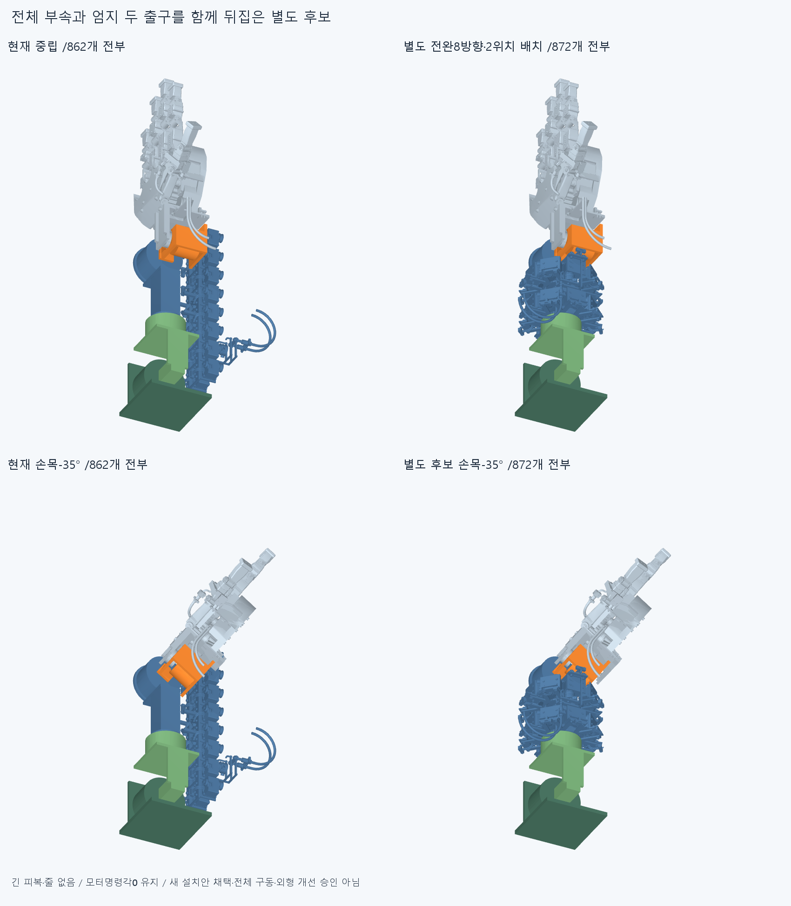
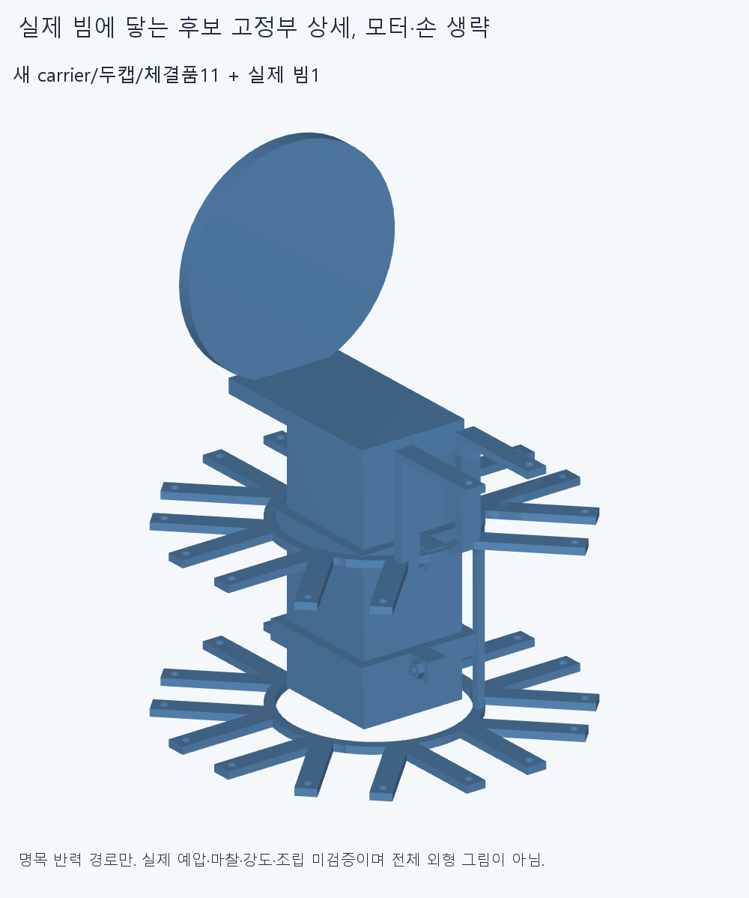
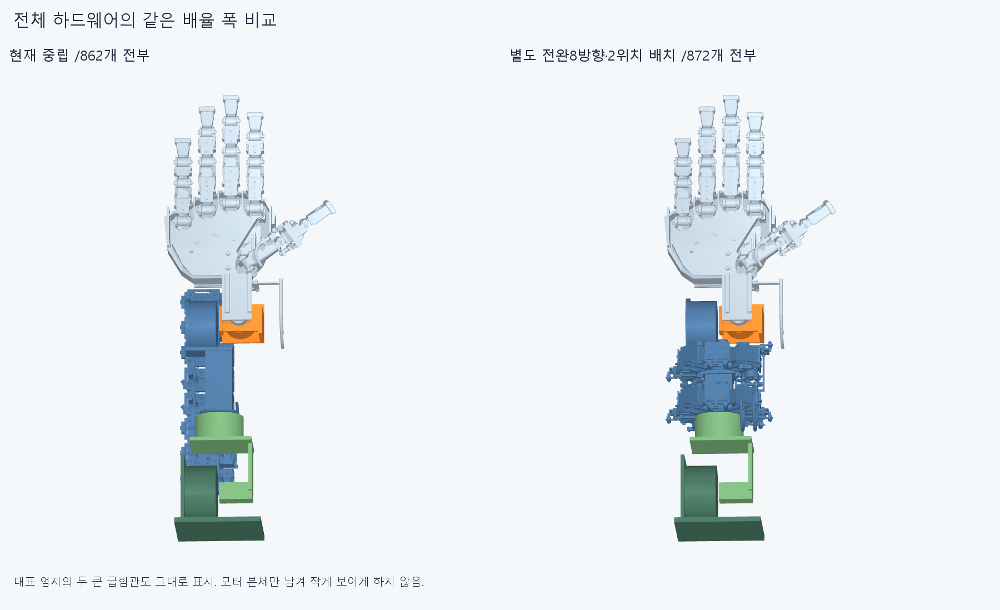
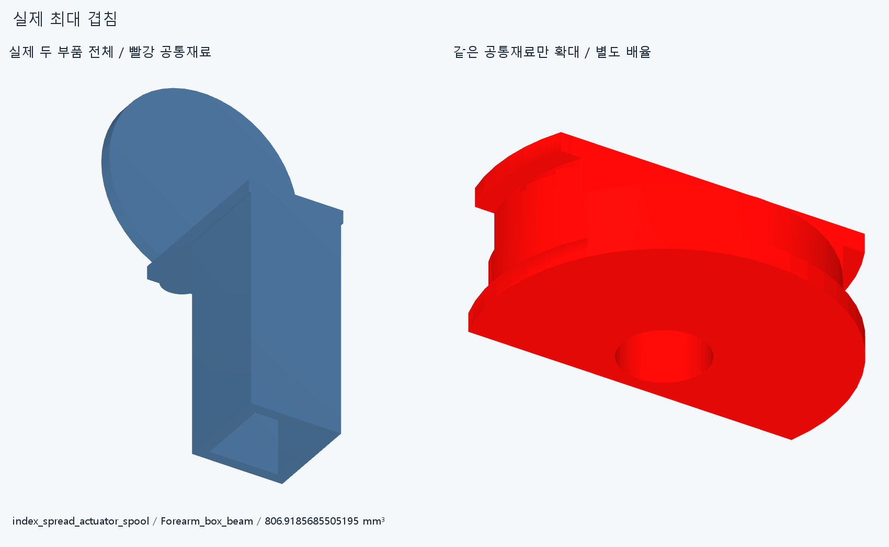
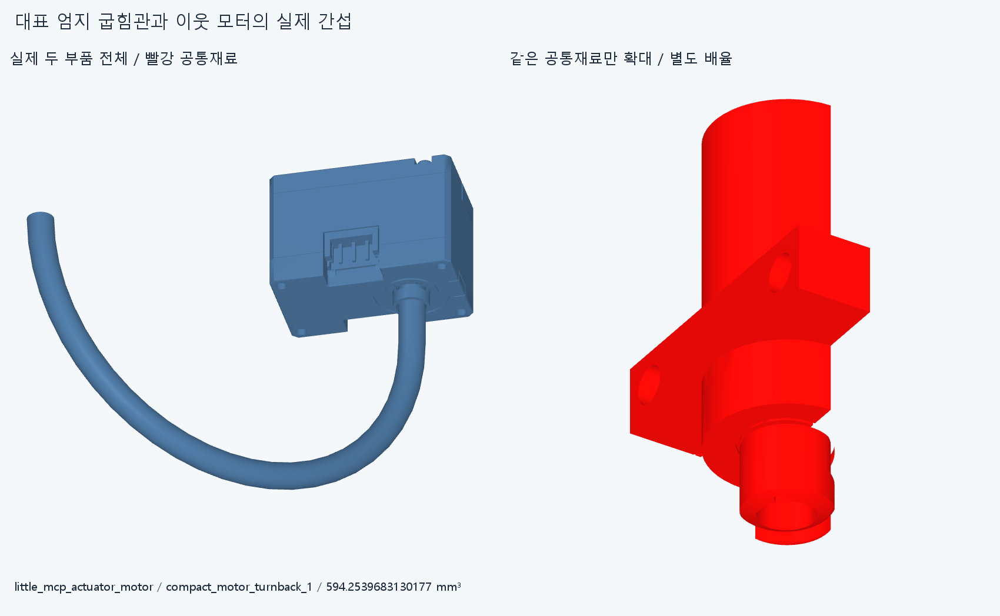

# ARM054 전완8방향·2위치 별도 배치

**현재862설치와 수용 손·16구동원을 유지한 별도872행 연구다. 새156native그룹에서 41겹침 기록/연산실패0이며 채택하지 않았다.**

현재862/제안872하드웨어를 전부 불투명 표시했다. 모터·굽힘관·고정부·전기64행을 숨기거나 축소하지 않았고 긴 피복/줄은 양쪽 모두 없다. 모양 개선·전체 구동 승인 그림이 아니다.

## 왜 이 배치인가

원래 임시 랙을 고정한 채 국부 안내관을 누적한 접근은 실제 팔 부착/전완회전·손목 공간을 먼저 충족하지 못했다. ARM051이 현재 그 간섭과 빔까지의 실제 공백을 확인했다. ARM053의4방향4행은42mm를 축방향 간격으로 쓰면 부속품끼리 겹치고 모터출력+Y여도 실제 두R40출구는−Y였다. 그 검사는 반복하지 않았다.

이번에는 일반 묶음 전체 축길이52.55mm,대표 엄지165.1500001mm 및 후방 사각캐리어Y−283~−277/실제 손목재료를 출발점으로 삼았다. 중심은 반경55mm,방위0/45/90/135/180/225/270/315°,Y−210/−140mm의 두 위치다. 일반15설치는 출력+Y/전기 가이드가 바깥쪽이 되도록 설치를 돌렸다. canonicalZ+10인 모터 경계는 반경41.1mm로 오며 이 수치만으로 실제 여유를 보장하지 않고 전체 native를 실행했다. 선택 반경·축간70mm는 공급품/최소규격이 아니다.

대표 thumbIP49행은 두R40굽힘관/모터 M3스택까지 통째로 뒤집어 출력−Y/관 출구+Y를 목표로 한다. 실제 M3받침도 다른15개와 반대인Y−121~−118mm로 만들었다. **설치축 변경16개,모터명령각 변경0개**다. 기존15×24+엄지49=409행을 강체 이동했으며 수용한 손397/기본364/손바닥4모터/팔10/손목가이드6은 그대로다. 옛 랙1만 제안에서 빼고 carrier1/캡2/명목M3×12볼트4·너트4를 더해872행이다.

## 실제 지지와 반력

기존 어댑터의 두M3→모터마다 두 받침spoke→R34~38 두 hub/아래 길이rail2→두44×42빔 collar/캡/M3→현재 빔→기존rollflange가 명목 반력 경로다. 엄지의 반대쪽 받침은 실제 길이방향 연결2개로 앞 hub에 붙였다. 별도 지지점/공중 텐셔너로 세지 않는다.

실제 빔과 carrier/캡3거리 및16어댑터까지 총19native 최근접 거리는 `[0.0, 0.0, 0.0, 0.0, 7.105427357601002e-15, 0.0, 0.0, 0.0, 0.0, 0.0, 0.0, 0.0, 7.105427357601002e-15, 0.0, 0.0, 0.0, 0.0, 0.0, 0.0]`mm다. 0거리는 명목 접촉이며 면적·체결 예압/마찰·축 미끄럼/전단 유지·강성/강도·조립진입·공구·나사산/토크 승인과 다르다. 느슨한 체결품/전체 carrier·모터 설치 순서는 이번에 검사하지 않았다.

같은 원격 하드웨어 묶음의 제안 상자는 min`[-87.1, -274.5000001, -87.1]`/max`[87.1, -109.35, 113.0]`mm,폭/축길이/높이`[174.2, 165.15000010000003, 200.1]`mm다. 원래94.81/338/185.5000001mm와 같은 범위의 비교이며 전체 팔 실루엣/필요최소/사람다운 외형 수용이 아니다.

## 실제 간섭과 검사 범위

[check.json](reviews/check.json):156새그룹/1403994쌍/701AABB/41기록/연산실패0,rawclear=false다. 보고0.001mm³초과/Boolean1e−6mm/OCC1을 유지했다.

- `moved409__unchanged452_neutral`: 4기록
- `new11__retained861_neutral`: 2기록
- `new_internal_0`: 5기록
- `flex_-35__changed420__wrist`: 2기록

16묶음 사이120그룹 중2양성그룹/28기록이다. 새11내부55쌍/두 중립 전체 변경관계/12팔 자세의24변경몸체 관계도 함께 검사했다. 12자세는 팔꿈치55·110/전완−80·−40·40·80/손목굽힘−35·55/편위−20·20/복합[55,40,−20,15]·[110,−40,20,−15]°다. 중립은 별도 앞 두그룹에 포함한다. 각도는 진단 표본이며 새 제한/연속 운동 성공이 아니다.

최대 기록은 `('moved409__unchanged452_neutral', {'lead': 'index_spread_actuator_spool', 'part': 'Forearm_box_beam', 'material_intersection_mm3': 806.9185685505195})`다. 기록 수는 독립 설계결함 수가 아니다. 같은 모듈 내부/변하지 않은 기존 관계·옛 ARM051/052/053는 재실행하지 않았다. 기존 팔꿈치110 캐리어/시험대받침 간섭은 그대로이고 받침은 실제 상완이 아니다.

실제 두부품 전체/같은 빨강 공통재료 확대는 별도 배율이다. 최대 한쌍과 묶음 사이 최대 한쌍의 저장STEP 공통만 별도 생성했으며156전체그룹을 재실행하지 않았다. 증거 형상은 설치물이 아니다.

## 실제 두 출구

- line0: 출구[61.1, -232.0, 110.5], 접선[0.0, 1.0, 1.2246467991473532e-16], 손입구 직선방향 내적0.6828223141859787
- line1: 출구[41.1, -232.0, 110.5], 접선[0.0, 1.0, 1.2246467991473532e-16], 손입구 직선방향 내적0.5827492776515024

위 값은 실제 기존 PACK049포트를 전체 설치변환으로 옮긴 값이다. 첫 접선이 손 방향이어도 실제 긴 재료의 굽힘·동일 길이·손목 통과·삽입조립·장력 성공을 뜻하지 않는다. 옮긴 전기64행은 기존 국부 형상이며 새 위치 결합/동적 하네스 승계를 하지 않았다. 다른15개까지 실제 토크전달을 복제하지 않았다.

## 실행 오류와 재현

첫 실행기는 문자열 편집 중 줄바꿈이 빠져 구문 분석 단계에서 중단했다. 입력 로드/새CAD/native/export0이다. 최초 코드·오류·stdout·status를history에 보존하고 줄바꿈만 고쳤다. 실패를 검사 완료로 합산하지 않는다.

정확SHA 새 깨끗한 별도 사본에서 두중립/새carrier내부·모든 양성/실패 내부그룹/24팔관계/모든 양성/실패 묶음과각행첫인접쌍을 선별 재현한다. 새11 source/STEP의 적응epsilon1e−10/절대1e−5 측정,16설치변환409소속/실제19거리/2출구도 대조한다. 측정서명은 모든 곡면식trim/일치경계 Boolean동등성 증명이 아니고 같은 에이전트 검토이며 독립 감사가 아니다. 실제 완료/범위는CHECKPOINT.json/docs/reviews/ARM054/외부logs/arm054-finish.json을 따른다.

## 다음

실제 막힌 부품·반력·전체 외형에서 다음 구체적인 기계 변경범위를 판단한다. 방향 수/반경만 바꾸는 자동 반복이나 작은 접촉만 깎는 반복을 하지 않는다. 필요한 경우 기존 두R40굽힘관/그 받침과 전기 가이드가 손목 전달 공간에 차지하는 재료를 기준으로 별도 변경안을 명시한다. 현재 설치는 교체하지 않고 손/16구동원을 유지한다. 손 절삭·부속삭제·OD/R임의축소·각도제한·팔꿈치버스·가짜지지/텐셔너·LINK050재개는 없다. 전체긴재료·동적전기·20토크연결·힘/장력/예압/마찰/강도·연속복합팔/실물·제조·외형 승인과 이전 strictfalse/곡면·포함 보류 해소는 없다.
