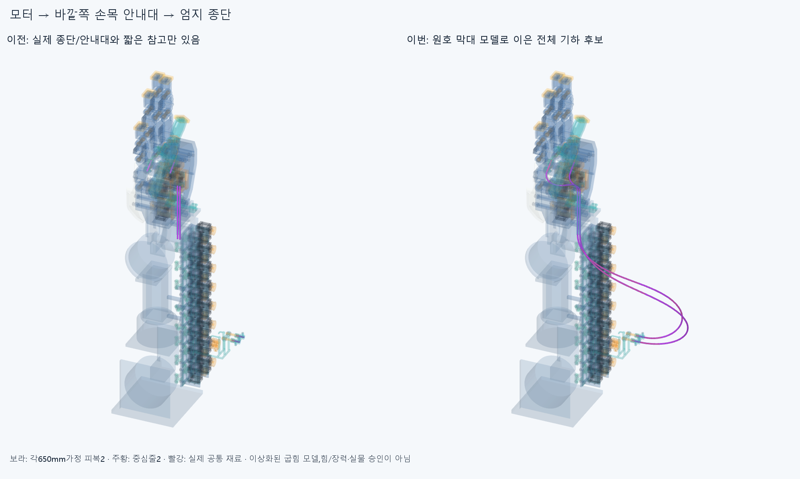
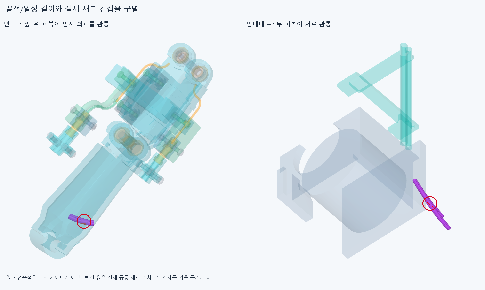

# ELASTICA033 실제 종단과 바깥 안내대를 잇는 원호 막대 후보

**새 실제 양끝/안내대 축을 따라 두 피복/중심줄을 연결했지만 편 손에서 엄지 외피5/두 선 사이14관통 기록으로 미채택이다. 일정 길이와 굽힘 모델의 수렴은 실제 유지 가능한 전달계 승인과 다르다.**

## 현재 부품과 새 연결

손397/포장385/전기48선·16외곽/팔10/FEED031하드웨어6을 유지했다. 손364본체/축·길이·모터/랙/전기선/끝구·죠/안내대 형상을 바꾸지 않았고 이전STEP/STL 4546해시는 불변이다. 새 설치 하드웨어0이다. [편 손 장면](generated/pose_0/scene.json)의92CAD형상은 물리적피복2/중심줄2를 각각23구간(모터직선1/상류원호12/실제안내대직선1/하류원호8/엄지직선1)으로나눈것이며92연결구/지지가아니다. 기존118mm가이드참고4와양끝짧은피복4는같은물리적두피복이므로중복장애물/설치물로더하지않았다.

모터 실제 어깨(−1.1/18.9,−243.5,−158)에서17mm직선으로출발,FEED031실제뒤입구(100,−100,−3/2)와앞출구(100,−4,−3/2)의96mm보어를지나현재thumb_mcp실제끝구의25mm직선끝으로연결했다. 중심줄은모터Z−163에서기존하류입구로이어지는새중간구간643/646mm다. 현재출력드럼~모터통로/엄지입구~IP고정부의기존국부줄을새로모터와함께움직이거나장력검사한것이아니다. 전체피복각650mm는이번공간모델의가정이며실제절단/구매길이·필요조절량/기존±2mm조절부의적합규격이아니다.

## 굽힘 모델의 근거와 한계

옛X26/GUIDED030의자유5차Bezier계수나614/583mm를다시쓰지않았다. 각유연구간을G1접선이이어지는3차원원호로적분하고,정해진전체길이에서자연직선/등방성막대의정규화굽힘에너지Σθ²/ℓ를줄인다. [Bergou등의1차논문](https://www.cs.columbia.edu/cg/pdfs/143-rods.pdf)의직선·등방성굽힘특수경우를참고했다. 이코드는그논문의전체재료프레임/비틀림/동역학구현이아니다. cubic곡선은첫접선초기값계산에만쓰고CAD/최적화형상은원호막대다.

실제지지는기존모터/엄지끝구·죠와FEED031보어뿐이다. 원호접속점은적분자유도이며설치가이드가아니다. EI=1정규화/중력0/비틀림0/마찰0의독립두줄모델이고접촉·줄끼리힘/예압/클램프변형·압착/실제재료를풀지않았다. 원호마다곡률은일정하지만접속점에서곡률이바뀌는유한근사이며메시수렴/정확물리평형/전역최소값은확인하지않았다. 상류길이300~460mm의수치범위를썼고4해는그경계에걸린다. 이는실제설치제약/허용범위나재료의장력평형이아니다. 같은자유계수/길이경계/반경탐색을재개해통과를만들지않는다.

OD3/ID1.3/중심줄OD0.6mm는기존공간가정이다. 22분석해의최소원호반경은13.645482874~30.172564739mm이며외반경1.5mm보다큰필요기하조건을확인했다. 공급품허용굽힘/내벽마찰/마모·수명이나충분조건이아니다. 기존손가락각/손목표본을새관절제한으로바꾸지않았다.

## 분석 길이와 실제 간섭은 별도

[분석](reviews/check.json)의11자세는부모0/25/50/75/100/75/50/25/0%9개와편손의손목굽힘·편위(−20,−15)/(20,15)2개다. 모터는전완고정,앞안내대는H=P@Y,엄지종단은H+thumb_mcp부모FK를따른다. 손/손바닥39포장은H,전완346포장/전기64는고정,캐리어·편위모터는P/손목받침은H다. 실제손-팔체결/강성승인은아니다.

22해의끝점/접선·총650mm조건은수치상맞았고보어에서앞뒤길이를가상고정하지않았다. 입구재료좌표는편손기준선0 -103.868714843~0.000000000mm,선1 -63.483737932~2.058836976mm다. 실제피복이마찰하에서이만큼왕복한다는검증이나필요예압/조절량이아니다. 같은부모각의정방향/풀기해중심선표본차이는최대0.000325810mm이며수치국소해차이이지물리히스테리시스검사가아니다. [길이/접속/슬라이딩](reviews/details.json).

실제native는편손1자세만실행했다. 새92대손397/포장385/전기64/팔10/실제안내대6+새4186내부쌍,**83490쌍/403AABB후보/19기록/연산실패0**이다. 보고기준0.001mm³초과/Boolean허용오차1e−6mm/OCC풀1이다. 모터/전기/팔/안내대대조0이지만위피복/줄이thumb_segment1_thenar_shell에5구간기록,두선사이에14구간기록이남았다. 대표공통체적은엄지외피15.899593885/두피복45.964303774mm³다. 반복구간을독립결함으로세지않는다. 같은선의인접/비인접과자기중심줄을포함한내부검사에서기록된관통은다른두선사이다. 원래GUIDED030의급한반경/자기줄침범을이번모델에서같은것으로세지않는다.

편손의실제걸림후나머지예정4native자세는실행하지않았다. 분석11자세를실제11왕복경로/전선운동/물체/손자체/전체드럼·텐던구동/장력승인으로세지않는다. 실제공통재료는[증거](generated/actual_common/scene.json)이며손전체를깎을근거가아니다. 두독립막대가접촉조건을위반했으므로이해를실제탄성평형/설치완료로주장하지않는다.

첫실행은계산한원호배열을JSON으로저장할때ndarray직렬화오류로멈췄고native검사/STEP생성전이었다. 원래코드/오류를history에보존하고배열을목록으로바꿔분석을다시실행했다. CAD결함이나완료표본으로세지않는다.

## 다음

이독립막대후보는미채택으로닫는다. 실제두선교차위치와엄지외피/현재종단의접근방향을읽고,필요한짝안내·분리지지/굽힘지지를실제고정·회전몸체/나사·접촉과연결해설계한다. 없는지지나임의움직이는점을설치물로세지않고,새지지가바뀌면관련정적/조립/피복삽입을다시확인한다. 같은독립곡선/길이·반경탐색을반복하거나손절삭/OD축소/각도제한/팔꿈치버스로숨기지않는다. 한후보실패는모든배치/손기능의구조적불가능증명이아니다. 물성/공급품·압착/당김·장력미검증은명시하되모든실물인증을다음CAD/3~4동작영상조건으로무한히늘리지않는다. 이전OFFSET024/HOUSING027/GUIDED030비교상태도그대로보존한다.
