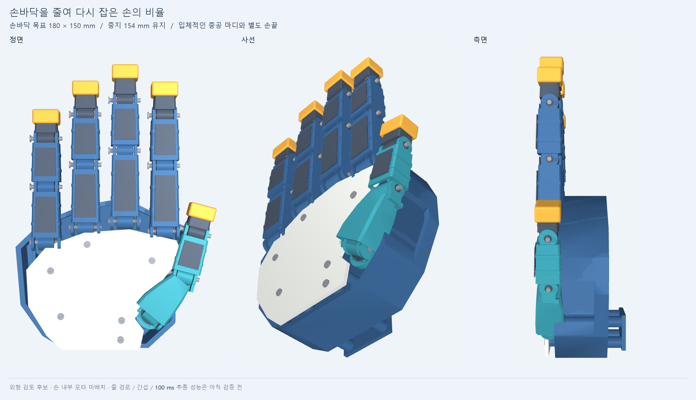

# 손바닥 비율을 다시 잡은 외형 CAD

현재 원격 구동 후보의 손바닥이 너무 크고 손가락 마디가 짧게 보인다는 사용자 피드백에 따라 만든 **새 외형 검토안**이다. 기존 그림의 색만 바꾼 것이 아니라 손바닥 윤곽, 뿌리 위치, 마디 단면, 관절 외피, 손끝과 엄지 배치를 새로 모델링했다. 제작용 설계나 지연 검증 완료안은 아니다.

| 항목 | V9 / 축소 전 remote 기준 | 이번 외형 후보 |
|---|---|---|
| 손바닥 외곽 기준 | 232 × 195 mm | 180 × 150 mm — 폭 약22%, 길이 약23% 감소 |
| 중지 관절 길이 합 | 70 + 50 + 34 = 154 mm | 그대로 유지 |
| 중지 길이 / 손바닥 길이 | 약0.79 | 약1.03 |
| 네 손가락 뿌리 좌우 간격 | 48 mm | 39 mm |
| 마디 | 원격 후보의 22 × 18 mm 직선 링크 | 폭28→26 mm, 두께22→20 mm의 중공 테이퍼와 실제 관절 eye/fork |
| 손끝 | 직선 링크와 유사한 끝단 | 어두운 중공 구조와 별도의 둥근 노란 캡 |
| 엄지 | 외부 가로대에 원위 모터2개 | 손바닥에 이어지는 넓은50mm 중수부와 바깥45/28mm 두 마디. 후단 관절은 검지 쪽으로25° 방향 전환 |

180 mm는 손바닥 폭이며 펼친 엄지까지 포함한 전체 손 폭이 아니다. 손바닥150 mm와 손가락154 mm는 공통 원점에서 재는 같은 길이가 아니므로 단순히 더한 값이 전체 손 높이가 되는 것도 아니다. 손가락0.9배는 이번에 채택하지 않았다.

## 실제로 만든 것과 아직 남은 것

새 손의 BRep 형상과 STEP, 그 형상에서 만든 STL 렌더를 제공한다. 마디 외피는 실제로 속이 비어 있으며 관절 보어와 눈에 보이는 분절을 갖는다. 짙은색 면판은 별도 얇은 CAD 부품이지만 고정 상세는 아직 없다.

첫 외형을 본 사용자는 손 전체 비율은 나아졌지만 엄지가 더 사람다워야 한다고 교정했다. 길고 곧은 세 마디 대신 손바닥과 이어지는 넓은 중공 중수부를 만들고, 바깥의 두 마디가 검지 쪽을 향하도록 바꿨다. 자식 링크만25° 돌리면 보어축이 어긋나므로 부모 중수부의 실제 후단 포크와 보어도 함께 회전시켰다. 손바닥 덮개에는 이 뿌리가 들어갈 윤곽을 냈다. 네 손가락 길이와 손바닥 목표 치수는 유지한다.

**손 안에 모터 배치를 끝내 놓은 그림이 아니다.** 이번 새 손 CAD에 설치된 구동 모터는0개다.20개 독립축을 목표로 뿌리10개는 손바닥·손목에서, 원위10개는 전완에서 공간을 검토할 계획이다. 축 수가 같아도 줄 경로·관절 간 보상·예압·마찰은 새로 설계해야 한다. 기존 모터·브래킷을 외형과 함께 축소하지 않는다.

팔10부품은 동결된 V9 중립 형상을 참고용으로 재사용한다. 새 손목 연결판에는 기존 네 체결 구멍 위치를 반영했지만 하중 전달과 체결 검증은 끝나지 않았다. 팔 모터도 기존 공칭 외곽 모델이다.

유효 솔리드와 STEP 재수입 검사는 형상이 저장되는지를 확인한다. 모터 수용, 전체 움직임의 간섭, 실제 체결, 강성, 질량·관성, 줄 경로와 구동 성능의 통과를 뜻하지 않는다. 새 형상에서50ms 목표·100ms 상한을 검증한 결과는 아직 없고 이전49ms 수치를 가져오지 않는다.

## 재현

CadQuery 환경에서 `build.py`를 실행한 다음 MuJoCo/Pillow 환경에서 `render.py`를 실행한다. 새 CAD와 STEP/STL 단위는mm이며 렌더는 이를m로 변환한다. V9 팔 STL은 이미m이고 중립 위치가 메시 안에 있어 재이동하지 않는다. Windows에서는 프로젝트의 숨김 실행 규칙을 따른다. 출력·임시 파일은D:에 둔다.

- 입력: `design.json`, `lightweight_digits.py`, `lightweight_thumb.py`, `build.py`
- 새 손 STEP: `generated/hand_form_candidate.step`
- 형상·팔 참고 장면: `generated/scene.json`
- 부품별 메시: `generated/meshes/`
- 형상 생성 검사와 제한: `generated/geometry_review.json`
- 사용자용 그림: `generated/robot_hand_new_proportions_hand.png`, `generated/robot_hand_new_proportions_whole.png`
