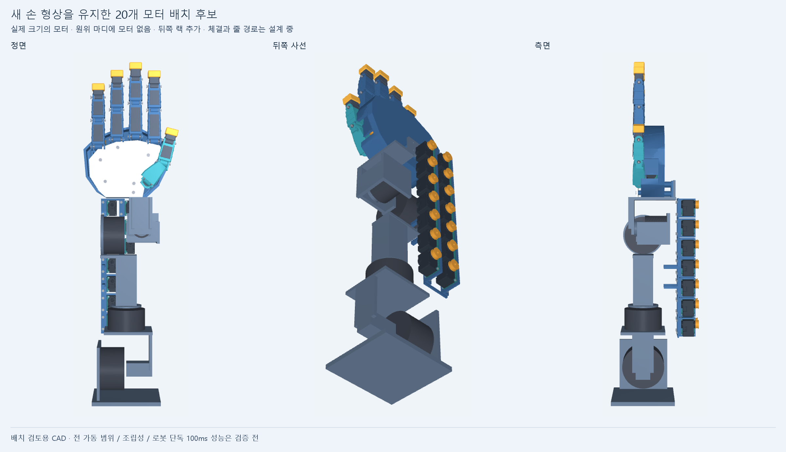
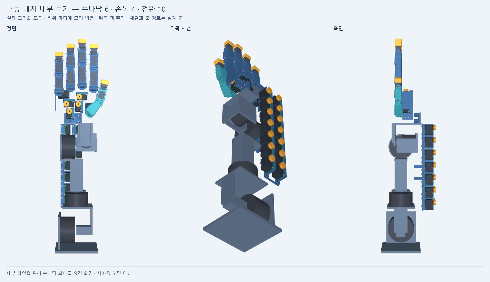

# 새 손 형상에서 이어가는 구동 설계

손바닥180×150mm·중지154mm와 다듬은 엄지를 유지하고, 움직이는 마디에서 모터를 제거하는 후보입니다. 기준 외형은 [form_candidate_v1](../form_candidate_v1/README.md)이며 원본 형상을 수정하지 않습니다. 이 폴더는 공간 배치와 전달 구조를 구체화하는 첫 회차입니다.

모터는 실제 크기의 XL330-M077 공급사 형상20개를 사용합니다. 손바닥6개, 손목 뒤 구역4개, 전완 뒤10개로 나누며, 뒤쪽14개는 모두 전완 랙에 고정하는 후보입니다. 모델 이름은 공간 비교용이며 최종 모터 선정이나 부하 성능 승인이 아닙니다. 손바닥 크기는 그대로지만 후면 랙 때문에 손목·전완 두께가 늘어납니다.

두 그림은 실제 CAD 메시를 렌더링한 중립 자세입니다. 팔은 V9 참고 형상입니다. 내부 그림은 보기 위해 손바닥 외피를 숨긴 것으로, 외피를 삭제한 설계가 아닙니다. 새 후면 구동부는 참고 손·팔 외곽보다 뒤로 약48.9mm 더 나오므로, 랙 두께와 손목 통과 경로를 줄이는 후속 개선이 필요합니다.

## 자료

| 파일 | 내용 |
|---|---|
| [조립 STEP 압축본](assembly.step.zip) | 외형120부품 + 신규 구동부217개 구성요소. 팔 참고 형상 제외, 완성 체결 조립 아님 |
| [layout.json](layout.json) | 20축 역할·위치·방향, 모터 크기, 지지부와 미완성 연결 |
| [배치 검사](generated/packaging/geometry.json) | 새 부품과 손·팔 참고 형상 사이의 중립 자세 체적 겹침. 공급사 모듈 내부 접촉은 별도 제외 |
| [부품별 배치와 질량](generated/packaging/placements_mass_inertia.json) | 공급사 원본과 새 지지부의 형상·질량 가정 |
| [외형 질량·관성](generated/exterior_mass_inertia.json) | 기존120개 BRep의 정확 체적·COM·관성에 가정 밀도를 적용 |
| [새 동역학 입력](generated/dynamics_contract.json) | 실제 새 관절 좌표·21개 강체·20개 독립 관절. 줄 전달행렬은 가정 |
| [줄 경로 선행 검토](generated/tendon_route_study.json) | 중지 PIP/DIP의 양방향 줄 끝단·유한 반경 풀리·85자세와 요구속도 비교 |
| [전체 손 추종 선별 계산](../../sim/form_drive_v1/README.md) | 작은 움직임, 큰 굽힘, 급반전, 독립 끝마디와 수렴 검사 |

## 줄 경로에서 확인한 것

원위 관절의 줄이 앞 관절의 회전을 그대로 합산하면 모터가 필요 이상으로 많이 회전해야 합니다. 외피 끝을 해당 관절의 부모 마디에 고정하는 Bowden 구성을 첫 후보로 검토했습니다. 반경8mm 풀리의 접선·원호 길이를 계산하고 수치 미분을 반복하여, 노출된 끝단 부분의 상위 관절 영향이 줄어드는 것을 확인했습니다.

가령 PIP와 DIP를 각각90°씩150ms에 움직이는 명령은 기존 합산식에서 DIP 모터 최고375rpm을 요구합니다. **외피 길이와 압축이 이상적으로 일정하다는 조건**에서187.5rpm으로 줄어듭니다. 이는 요구속도 산술 비교이며 실제 모터 속도·지연 결과가 아닙니다.

실제 모터 스풀에서 외피 입구까지는 아직 연결하지 않았습니다. 그려진 외피 곡선도 움직일 때 길이가 바뀌므로 실제 불신장 외피의 해가 아닙니다. 압축·마찰·유격·굽힘 반경·고정부가 남아 있어 전체 줄 길이와 실제 전달행렬은 결과 파일에 `null`로 남깁니다. 중지 결과를 벌림축·엄지·손목에 자동 적용하지 않습니다.

## 질량과 검사 범위

외형120부품의 질량은 가정 밀도에서 약0.656kg이며, 그중 움직이는 마디·뿌리 부품은 약0.290kg입니다. 이는 완성 손 무게가 아닙니다. 모터·지지 랙은 별도 집계하고, 움직이는 풀리·실제 체결·줄·배선 등은 아직 질량 입력에 빠져 있습니다. 손바닥을 고정한 시험 모델에서 모터는 마디에 탑재되지 않지만, 이후 손목·팔 평가에는 이 질량을 포함해야 합니다.

새 모터 받침·랙 형상이 있어도 전체 체결 하중 경로가 완성된 것은 아닙니다. 손바닥 받침→섀시, 후면 랙→팔, 모터축→스풀, 풀리→마디, 외피 종단과 예압 조절, 전 가동 범위 간섭·공구 접근을 다음 회차에서 확인합니다. 중립 자세 체적 겹침 검사는 공차·강성·연속 운동 검사를 대신하지 않습니다.

## 재현 순서

Python에서 CadQuery/OCP와 NumPy가 필요합니다. 렌더는 MuJoCo·Pillow, 동역학은 SciPy도 사용합니다. Windows 실행은 숨김 프로세스와 D: 임시 경로를 사용합니다.

1. `exterior.py`: 원본 외형을 재생성하고120부품 질량·관성 생성.
2. `build_contract.py`: 새 관절 프레임에 강체 질량·관성 집계.
3. `actuator_packaging.py`: 실제 모터20개와 새 지지부 생성, 중립 체적 간섭 확인.
4. `tendon_route_study.py`: 중지 끝단 줄 형상·미분·요구속도 비교.
5. `sim/form_drive_v1/test_adapter.py`와 `run_screen.py`: 입력 일관성과 추종 선별 계산.
6. 결과·미해결 항목을 저장하고 커밋한 SHA의 새 사본에서 핵심 검사를 재실행.
