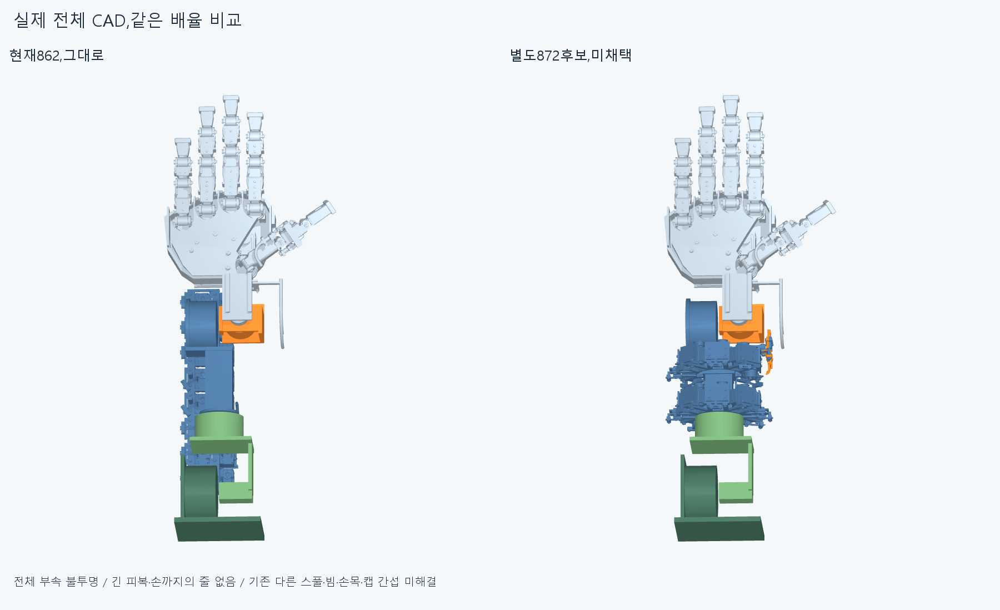
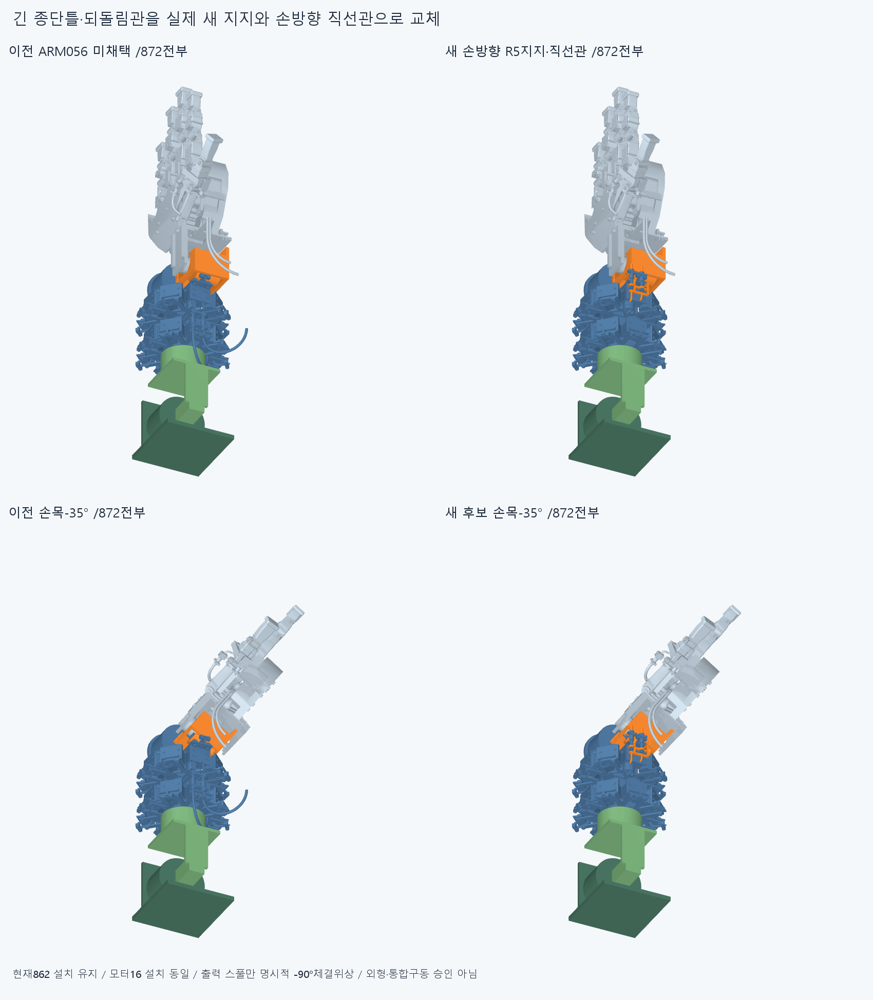
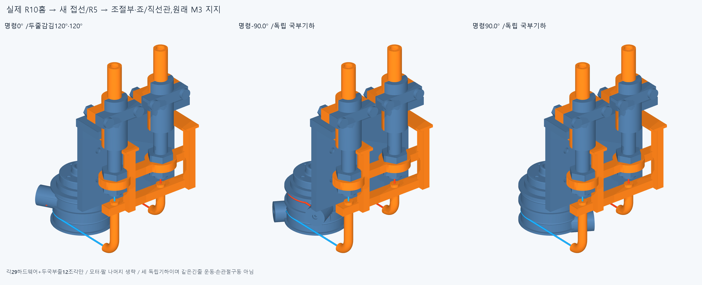
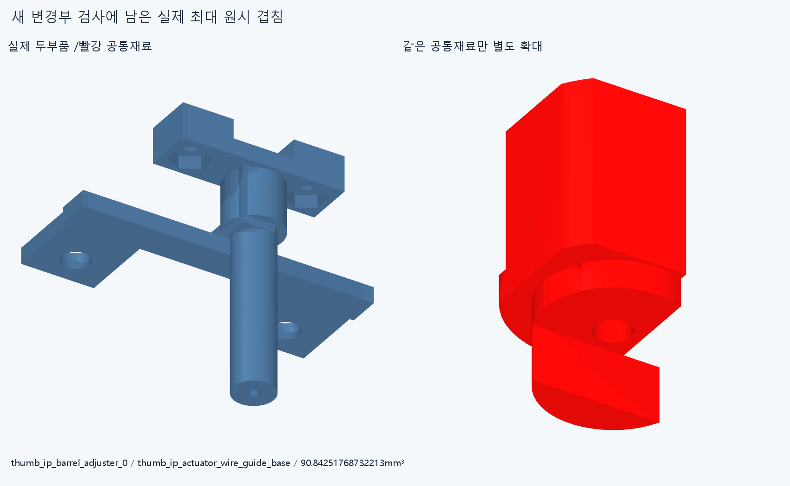

# ARM057 손방향 R5지지·직선관·스풀 체결위상,미채택

**긴 되돌림관을 없애는 실제 대체 구조를 만들었지만,기존 전선가이드·캐리어와 겹쳐 채택하지 않는다. 현재862설치는 그대로다.**

수용손364/현재손397·비율/축/길이·손바닥4/전완16구동원을 유지한다. ARM054~057의872행은 모두 별도 미채택 후보이며,전체 부속을 불투명 표시했다. 큰 루프가 줄어 보이는 그림만으로 사람다운 외형·전체팔/손목 가동을 승인하지 않는다.

## 실제 기계 변경

872=기존846+새틀1/아래죠·직선관2+조절부/너트/반대죠·M2의 실제16부속 이동+스풀/탭나사4/꼬리죠나사2의7출력 부속 체결위상 변경이다. 모터 설치/명령0은 ARM054와 같다. 스풀7부속만 stock horn에 대해 canonicalX -90°로 명시적 재조립하며 실제 PCD12 네 축이 서로 치환된다. stock horn/중앙retainer 설치는 그대로이고 명령각으로는 이2개까지 실제9출력부가 함께 회전한다. 부속 삭제·숨김/몰래모터이동0이다.

새틀은 옛 긴 종단틀을 유지하지 않는다. 원래1mm M3패드 두 자리(71,-126,-13)/(71,-126,13)에서3mm 바깥web와 두 rail이 새 R5통로·조절부받침으로 이어진 유효1solid다. 어댑터/캐리어 실제 최대X75.4+새방향 M2너트 안쪽투영6.1로 조절부X81.5를 정했다. 이는 그 두 부품의 명목 배치 근거일 뿐 전체 전기부속/최소 여유 증명이 아니며,실제로 더 바깥 전선가이드가 막았다.

두 기존 아래죠는 원래 재료 제거0/체결자리·OD5/보어3.2를 유지한 실제 직선슬리브 일체죠로 교체한다. R40을 더 작게 만든 것이 아니다. R5가 처음부터 손방향+Y로 굽으므로 옛 미채택 U반환관 기능을 직선으로 대체한 새 구조다. lead12mm/어깨→앞출구29mm,실제 앞출구(81.5,-93,-2.5)/(81.5,-93,17.5)mm/+Y다. 긴피복/손까지의 줄은 없다.

## 실제 체결 경로

[attachment.json](reviews/attachment.json)의 새6native거리와 원래패드링2개-새틀 차집합0이 원래 M3자리 재료 보존을 확인한다. 원래패드2개가 새틀 밖에 남는 solid/체적은0이다.

|새틀과 실제 부품|거리mm|
|---|---:|
|thumb_ip_actuator_wire_guide_base|0.0|
|thumb_ip_actuator_adapter|1.0999999999999943|
|thumb_ip_actuator_rack_screw_1|0.0|
|thumb_ip_actuator_rack_screw_2|0.0|
|thumb_ip_actuator_rack_nut_1|8.0|
|thumb_ip_actuator_rack_nut_2|8.0|

직선관/죠→반대죠·M2→포착조절부/너트→새 R5틀/rail/web→원래1mm M3패드/나사·**공유 전선가이드 받침**→어댑터/carrier/빔이 명목 반력이다. 어댑터와1.1mm 떨어졌는데 직접 착좌했다고 하지 않는다. 실제 예압·마찰·축유지·강성/강도·나사산·공구/토크/수명·제조법 승인은 없다. 원래 두 M3를 풀면 전선가이드도 같은 스택을 공유하므로,가이드받침과 새틀 키트의 선조립/수동지지 순서를 함께 설계해야 한다. 현재 서비스표본0이며 기존 조립 성공을 승계하지 않는다.

## 두 실제 스풀 홈에서 R5·조절부까지

R10홈 축4/12mm의 실제 접선각-180/0°를 사용한다. 접점(51.1,-158.4,-2.5)/(51.1,-166.4,17.5)→25.4mm +X직선→R5반경5의 +Y굽힘→새 직선통로→실제 조절부 보어/어깨(81.5,-122,-2.5)/(81.5,-122,17.5)까지 줄OD0.6의 두 국부줄을 그렸다. 추상끝점만 이동하지 않았다.

스풀 체결위상 -90°에 따라 실제 꼬리고정 위상이 -300/+120°가 되고 명령0° 감김은120/120°다. 독립명령 -90°는210/30°, +90°는30/210°다. [wrap_diagnostic.json](reviews/wrap_diagnostic.json)의 단일감김0<wrap<360 수학가지 line0(-240,+120)°,line1(-120,+240)°,공통(-120,+120)°는 **새 모터/손 관절제한이 아니다**. 이전 +30°에서 감김이0이던 가지와 다른 명시적 위상 후보지만 실제 가용 운동범위/전체구동 성공으로 쓰지 않는다.

각 상태12CAD조각은 물리적 두 줄의 국부분할이며36개 설치줄/가이드가 아니다. 중립 국부길이99.78810260165594/107.78810260165594mm/접합끝점차0이다. ±90°는 길이가 달라지는 독립 국부형상이며 같은 전체 재료의 슬라이딩·장력/평형·연속왕복·손 IP연결·기존0.77관계의 검사가 아니다. 기존 꼬리/감김26.565051177078° 꺾임도 남는다. R5/줄OD/피복OD3·ID1.3/직선관 OD5·보어3.2는 명목공간 가정이지 공급품/마모수명 승인아니다.

## native 결과와 실패 구분

[check.json](reviews/check.json)의 새36그룹171676쌍/277AABB/43기록/연산실패0,rawfalse다. 중립 변경26대846=28기록(전선가이드·덮개·리드/체결22,기존명목탭4,스풀/꼬리나사-carrier2),새3대이동16=3기록(새틀/조절부1·위아래너트),출력7대고정종단19/새3내부=0이다. 국부줄12대872는줄0의조절부통과구간/전선가이드받침1.9792033717615736mm³의1기록,줄내부는같은꼬리/감김접합2기록이다.

개별10·복합2의12비중립/24몸체관계는 새26하드웨어+명령0국부줄12만의0이다. 팔꿈치55/110,roll-80/-40/40/80,flex-35/55,편위-20/20,복합[55,40,-20,15]/[110,-40,20,-15]°유한진단이며 손자체/기존부품/전체팔·연속/상완·긴줄 운동 승인이 아니다. 중립부터 막힌 이 후보의 실제 팔이 잘 움직인다는 뜻도 아니다.

독립출력명령 -90/+90°는 실제 stock horn/retainer까지9출력부 대 나머지863을 검사했다. -90°에원래retainer/motor참고1, +90°에그참고와spool/carrier5.23798782381566mm³가 남는다. 각 국부줄대하드웨어에도 같은전선가이드1기록,내부2같은줄접합씩남는다.중립clockedspool/carrier18.05785261428357/꼬리나사-carrier0.7857790956859649mm³도남아 실제회전출력을확보한것이아니다.

최대는조절부0/기존전선가이드받침90.84251768732213mm³다. [classification.json](reviews/classification.json)의43=기하막힘후보31+저장명목탭접촉4+원래공급사retainer참고2+같은줄꼬리/감김접합6이며 **분류로 검사제외/전체0/성공처리하지 않았다**. 네 tap/horn의각2.8274333882307mm³,retainer/motor34.84649662623413mm³는과거저장baseline과절대1e-5안에서같은쌍/체적임을읽어구분했다. 과거축영역native증명은재실행0이며실제나사산/공급사내부의물리승인이아니다.

이전단계의보존/검사된하드웨어기록34중11은동일부품·변환으로보존/native재실행0,변경관련23은새형상에자동승계하지않았다. 기존다른앞스풀/빔·손목·carrier/캡실패도미해결이다.43을독립43결함/전체872조립의완전겹침개수로세지않는다.

## 최초 오류와 정확 커밋 재현

첫실행은입력로드·새틀생성뒤 valid2solid를단일solid검사가거부했다. 아래M3web가포트만포함한rail의Z범위밖이라분리돼있었다. history의정확코드/출력/오류/상태를보존했고그실행은native0/STEPexport0이며미저장CAD를저장했다고하지않는다. 현재새틀자체의rail범위에실제아래체결자리를포함시켜다시만든기하수정이다. 손/기존부속을깎은것이나입력읽기만교정한것이아니다. 완료36그룹은교정실행1회다.

기존기하12400/동결222해시를보존한다. 새정확SHA 깨끗한사본에서새36그룹43기록,새3/세국부상태36조각의39source·STEP측정(적응epsilon1e-10/절대1e-5),16이동/7출력위상·PCD네축/실제M3자리,3상태R10/R5경로·감김수식,6거리/2패드포함만재현한다. 모든곡면식trim/Boolean동등성·독립감사·그림픽셀/행렬/팔시각단위·전체서비스/긴재료/동적전기/20토크·물리힘/장력마찰예압·실물제조외형승인이아니다. 이전strictfalse/곡면/포함보류는해소하지않는다. 대상/실제결과는CHECKPOINT.json/docs/reviews/ARM057/logs/arm057-finish.json을따른다.

## 다음 기계 변경범위

현재두M3스택은전선가이드와R5지지가공유한다. 실제가이드받침/덮개·세리드/커넥터외곽과구동종단을한몸체로읽고,전기보어·덮개/체결자리·선경로를보존한**통합모터끝지지대**의변경범위를정한다. 어댑터bbox밖으로추상포트만더밀거나전선가이드/리드·너트를삭제이동하지않는다. 원래M3→가이드받침→어댑터/빔의반력과선조립/공구진입도함께다룬다.

별도로현재ARM054엄지받침spoke가실제회전스풀/꼬리보스공간을침범한다. 저장실제공통과M3받침→hub실재료를읽고필요한carrier지지변경을별도후보로정한다. 작은너트3개깎기/추가반경·방향수·묶음각도검색으로돌아가지않는다. 현재862/손/16원격구동원유지,손/빔절삭·각도제한·부속숨김삭제·OD/R축소·가짜지지텐셔너·LINK050/옛최적화/팔꿈치버스재시작금지다. 공급품인증을다음CAD/영상의무한조건으로늘리지않는다.
