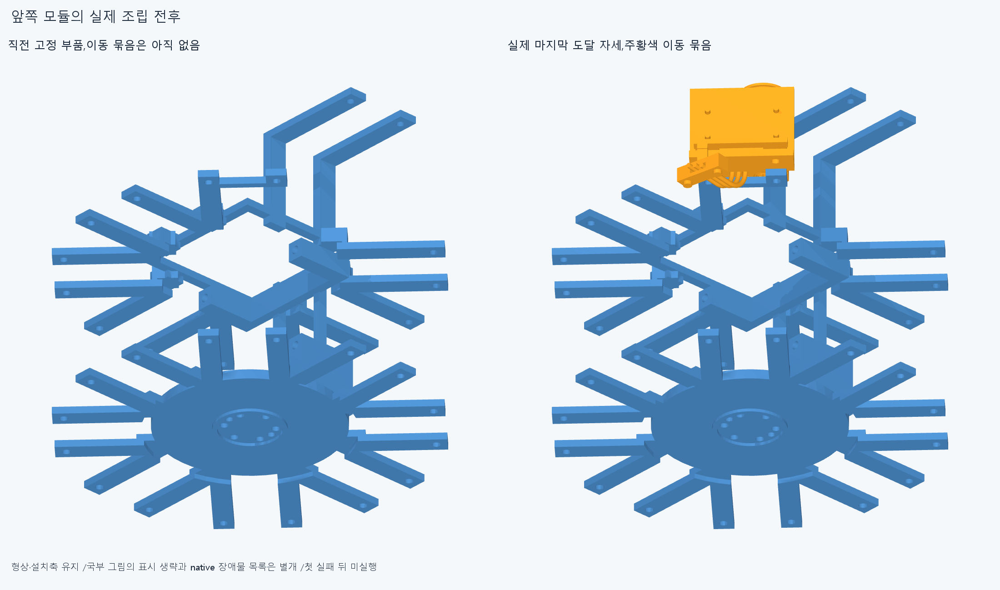
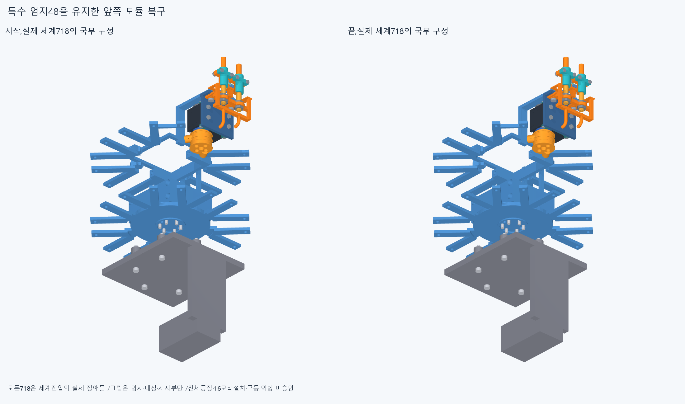

# ARM078 앞쪽 일곱 원래 모듈의 누적 조립 검사

현재862/기본364·손397/손바닥4·16원격·빔전기·설치축길이명령clock유지,886/방사랙외형미채택이다. ARM074받침1명시교체의별도886/특수48=원래47+새받침1,다른885유지/이번설치형상변경0이다.

ARM077에서복구한특수48과뒤8을포함한실제world718을시작장애물로유지했다. 원래16packet408중남은앞7×24=168을각실제방위에서벤치선조립→원래finalnormal0의body19세계진입→랙너트→M3두나사→원래M2너트4묶음순서로검사한다. 옛일반24의성공을새장애물에맹목승계하지않았으며벤치도새검사다. 자기moving/fixed중복0·누락/완료목록을경로마다기록하고완료때만원래항등위치의부품을고정목록에추가한다.

실제각모듈M2/M3의원통면축14개읽기와원래guideframe/배치변환을보존했다. 20mm기본표본및끝15/10/5/0등에각실제이동/고정부품AABB의직교투영겹침구간진입·중간·이탈을추가한다. AABB는보수경계이고이유한표본은곡면연속통과/선정공구·나사산/토크승인이아니다. 각경로는해당모든장애물의전체AABB밖부터시작한다. 4/20/40/80/160mm등은시험경로이지요구최소여유규격아니다.

새185native/575111쌍/721AABB/3기록/0오류·raw=False다. report>.001mm³/Boolean1e−6mm/OCC1이다. 새완전모듈0/7·총9/16·실제world718/대기168이다. 첫막힘뒤미실행은성공으로세지않으며한경로실패를독립설계결함수/모든개별조립불가능으로확대하지않는다.

실제새막힘: `[{"lead": "middle_dip_actuator_lead1", "part": "arm065_shared_output_beam_rack_root", "material_intersection_mm3": 1.543956092576693}, {"lead": "middle_dip_actuator_lead2", "part": "arm065_shared_output_beam_rack_root", "material_intersection_mm3": 1.5439560925766675}, {"lead": "middle_dip_actuator_lead3", "part": "arm065_shared_output_beam_rack_root", "material_intersection_mm3": 1.5439560925768068}]`

새공통2만별도수치선저장뒤STEP-STL증거2·실제불투명4고유그림을만들었다. 설치기하export0·기존12795기하/동결222/과거manifest불변이다. 공통0이면미생성·미실행이며통과로꾸미지않는다.

정확SHA새깨끗한사본핵심계획66native는각새경로시작끝·세계경로마지막5·실패경로도달전부다. 원래16packet408/886/명시받침1·특수48/실제718보존/앞7원래24/벤치·세계누적목록/누락/전체밖시작/항등/실제축14·프레임/투영AABB사건표본prefix/완료주장을대조한다. 새공통만source/STEP typed서명epsilon1e−10/절대1e−5로검토한다. 실제재현은docs/reviews/ARM078이며같은에이전트이지독립감사가아니다. 모든중간/곡면trimBoolean·픽셀/팔시각단위/연속전체공장증명이아니다.

가정nonpacket478/벤치내부참고부품·수동유지/운반·중립등록/출력내부/mating·유연하네스/captive/공구·나사산/토크·실제체결력/강도마찰예압장력은미승인이다. 조립표본을전체16모터설치·20구동/사람다운외형수용으로확대하지않는다.

middle_dip의세lead와arm065공동root의새실제공통·도달변위(7.204476835099143,0,7.204476835099143)mm/부품축·지지면을읽는다. body19전체방사진입재반복대신실제열린전기홈/뚜껑·M2의선후관계를읽어body13(세lead·lid·M2둘완성전)세계진입→세lead→lid/M2→랙체결대안을성공가정없이검사한다. 원래19/24를모두복구하고참고plug는유지한다. 새로운전체밖진입/실제718및완료부품장애물·실제사건표본을유지한다. 이미완료한벤치는실제입력/집합/등록동일성증명때만승계하고새세계진입은변경장애물을포함한다. 기존718/특수48·뒤8및이번부분상태를보존한다. 원래24전체·M3/M2스택을최종항등복구하며개별M2너트가필요하면원래솔리드참조후compound한행복구다. 막힌뒤얕은시작/삭제/작은코너절삭/모터이동0이다. 이번새185native/조건부world718/대기168/완전packet9/16이다. 완료경로/축14/투영사건·옛68/106/162/ARM07415·4·보어1/216·615PCD재실행0. ARM074윗M3전체포함false19.195131113433646mm³/1solid·실제보어1/216IN모순/원인미확정·윗돌출5.9mm/외형미채택,ARM065edgevertex/corefalse·ARM072픽셀false·옛strictfalse/모든이전실패보류유지다. 같은차집합/정밀/픽셀복구/615PCD반복0. 빔반대뽑힘·출력12내부/mating·하네스/captive/공구·토크힘강도마찰예압장력/20구동·동적전기·전체팔상완/실물제조외형미승인. 손빔절삭/모터삭제·몰래이동/각도제한/ODR축소/가짜텐셔너/LINK·옛최적화/팔꿈치버스재개0.
