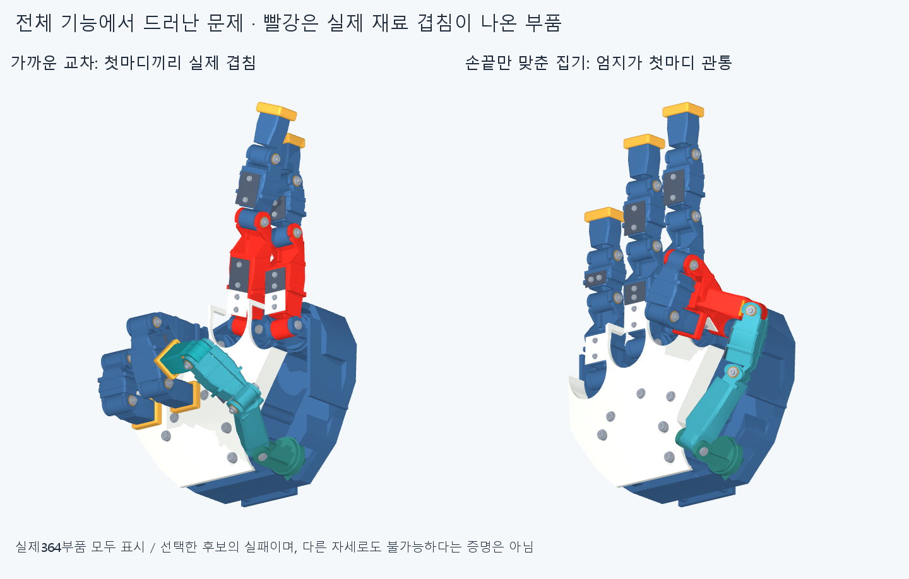
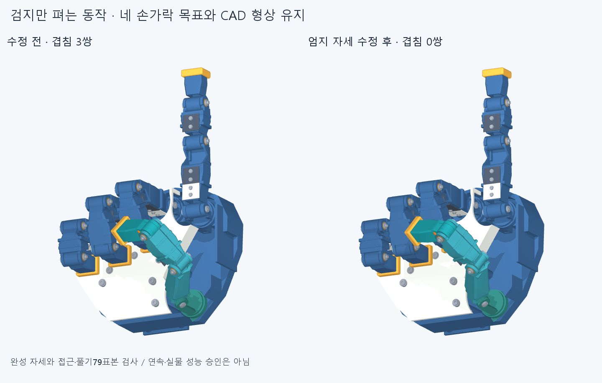

# FUNCTION003 · 전체 기능 우선 검사와 한 동작 수정

최신364부품의 형상·관절축·길이를 그대로 두고 기능 검사를 넓혔다. 작은0.5/1mm 간격 미달을 이번 기능 실패의 근거로 사용하지 않는다.

## 실제 검사와 수정

- 59개 끝자세를 현재364부품 전체66066쌍 범위에서 검사했다. 19개 끝자세에서 보고 기준 이상 실제 재료 겹침이 나왔고 연산 미확정은0건이다. 나머지 자세의 겹침0만으로 손모양·집기 성공을 선언하지 않는다.
- 경로12개 중 끝자세가 실패한8개는 실행하지 않고 실패 사유를 보존했다. 손가락별 순차 굽힘/풀기4경로는 합계100표본, 인접 관절 변화 최대5°에서 보고 기준 이상 겹침0이었다. 자유 공간 굽힘 검사이며 책상 탭의 접촉·힘 검사는 아니다.
- 검지만 펴는 수 표현에서 엄지 끝과 접힌 중지가3쌍 겹쳤다. 네 손가락의 목표각을 유지하고 엄지 sweep−6°·opposition+3°·MCP−8°로 바꾸어 끝자세 겹침을0으로 수정했다. 손가락을 접은 뒤 엄지를 접고 역순으로 푸는 경로 79표본에서 겹침0·연산 실패0이다. IP각·전체 CAD 형상은 변경하지 않았다.

## 우선 해결할 주요 실패

1. 양방향 가까운 교차10후보 모두 간섭했다. 중지 앞쪽18° 후보는 교차점 중심선 깊이차31.08mm·교차 부근 표면간격3.10mm까지 가까워지지만 첫마디 외피끼리85.23mm³ 겹친다. 손끝만 보아 통과시키지 않는다. 이전49.93mm 깊이차 후보는 참조로 보존하며 사람처럼 밀착한 교차 성공으로 쓰지 않는다.
2. 네 손끝 집기·OK·하트 후보는 표면 접촉점을 최적화해도 다른 부품을 관통한다. 검지 후보의 엄지 코어–검지 첫마디 겹침은506.92mm³다. 작은 틈의 문제가 아니다. 이 유한6시작점 탐색은 기능 불가능이나 필수 자유도 부족의 증명이 아니다. 다음에는 실제 전체 부품 간섭과 접촉 방향을 함께 고려해 후보를 다시 구하고 그 결과로 필요한 축/형상 수정을 판단한다.
3. 선택한 새끼 깊은 굽힘 후보는 손바닥 앞덮개와 끝마디가 겹치며, 편 벌림 후보는 새끼 첫마디와 프레임이 겹친다. 해당 후보의 실패이며 모든 굽힘·벌림이 불가능하다는 뜻은 아니다.

## 능동적으로 넓힌 범위와 남은 일

기존9손짓 외에 숫자 표현, L·샤카, 독립 curl/hook/tabletop/tip-curl, 네 손가락 갈고리·탁자·평주먹·반굽힘, 두 굽힘 수준의 벌림, 손끝별 대립, OK·하트, 두 교차 방향을 검사했다. 후보각·2mm/−0.8 표면 랜드마크 판정·5° 표본 간격은 공학적 선택이며 생체 표준이 아니다. 다른 자유도나 자연스러운 경로로도 불가능하다고 단정하지 않는다.

[GRASP33 커버리지](GRASP_COVERAGE.json)는 이름·목표 접촉·다음 물체를 모두 기록한 미완 목록이다. 원통·구·판·열쇠·필기·손안 굴리기·바꿔잡기는 물체 치수와 접촉 목표를 정의했으며 이번에 실제 잡기 검사나 유지 시험을 했다고 세지 않는다. GRASP는 정적 한 손 파지 분류이므로 교차·손짓·손안 조작을 별도로 더한다. [원 논문](https://www.eng.yale.edu/grablab/pubs/Feix_THMS2016.pdf), [대립·기능 기반 로봇손 평가](https://arxiv.org/html/2201.10883v1).

연속 경로·공차·줄/모터·힘·마찰·물체 유지·강도·실물 동작은 미검증이다. 보고 기준은 재료 겹침0.02mm³ 초과, Boolean 허용오차1e−6mm이며 작은 겹침까지 모두 없다는 증명은 아니다. 필요한 접촉과 재료 관통을 구별한다.

## 입력과 재현

CAD는 [현재364부품 목록](../motion_clearance_v2/generated/assembly_catalog.json), [현재 손 전체 STEP](../motion_clearance_v2/generated/hand.step.zip)을 그대로 참조한다. 이 단계에서 새 CAD 형상을 만들거나 기존 형상을 덮어쓰지 않았다. 별도 시험대33부품은 설치된 손 부품으로 세지 않는다.

- `generated/catalog.json`: 명시한59후보·12경로·6시작점별 접촉 탐색과 입력 해시.
- `reviews/audit.json`: 모든 끝자세·실행/건너뜀 사유·실제 부품쌍/겹침체적·4표본 경로.
- `reviews/motion_fix.json`: 원래 실패와 엄지 수정·접근/풀기 전체표본.
- `catalog.py`, `audit.py`, `motion_fix.py`, `render.py`, `render_findings.py`: 숨김 실행, 원본 STEP/STL 해시 가드.
- `checkpoints/FUNCTION003.manifest.json`: 저장 파일과 이전 CAD/동결 입력 전체 의존성의 새 스냅샷. 과거 manifest는 보존한다.

커밋·푸시 뒤 정확 SHA의 깨끗한 새 clone에서 주요 성공/실패와 중간 경로점을 재검사하고 별도 후속 커밋에 남긴다. 같은 에이전트 재검토이며 독립 감사나 전체 기능 승인은 아니다.
