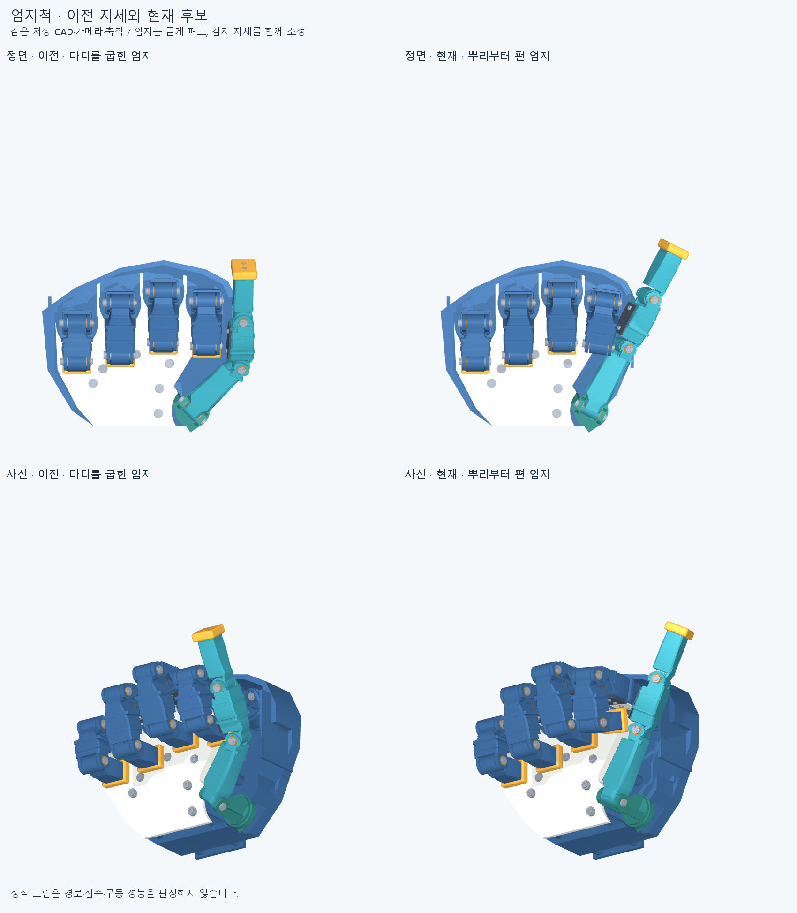
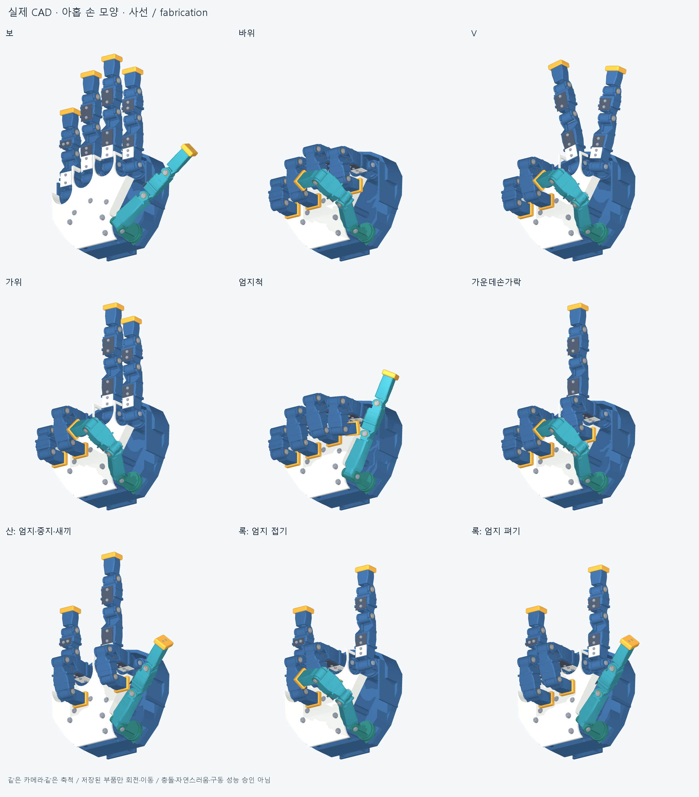

# FORM002 형상을 유지한 자세·전환 검토

수용한 [FORM002](../accepted_form_v1/README.md)의 손바닥 180×150 mm, 엄지 65 / 50 / 52.6033 mm와 네 손가락의 길이·뿌리 위치·20개 관절축을 유지한다. GESTURE002는 GESTURE001의349개 부품 형상을 바꾸지 않고, 사진처럼 엄지를 뿌리부터 곧게 펴는 자세와 세 정방향 전환을 검토하는 한 단계다. 결과와 같은 커밋의 재검토를 보여준 뒤 추가 개선은 멈춘다.



[보 → 바위 GIF](generated/motion_review/open__fist.gif) · [보 → 엄지척 GIF](generated/motion_review/open__thumb_up.gif) · [바위 → 엄지척 GIF](generated/motion_review/fist__thumb_up.gif)

[대표 프레임 정면](generated/motion_review/core_paths_front.png) · [대표 프레임 사선](generated/motion_review/core_paths_oblique.png) · [렌더 입력·프레임 기록](generated/motion_review/render_report.json) · [전체 STEP](generated/hand.step)

## GESTURE002: 새 엄지척과 세 전환

이전 엄지척은 엄지 중간 관절을40° 굽힌 모습이었고, 사용자가 보내준 사진의 곧게 편 엄지와 달랐다. 새 목표는 다음과 같다. 값은 모두 도 단위다.

| 부분 | 관절 순서 | 새 목표각 |
| --- | --- | --- |
| 엄지 | 기저 벌림 · 대립 · MCP · IP | [-28, 0, 0, 0] |
| 검지 | 벌림 · MCP · PIP · DIP | [8, 90, 109.97777233225946, 90] |

엄지의 MCP·IP를0°로 펴고, 검지는 원래 주먹에서 벌림을8°로, DIP를70.02222766774054°에서90°로 바꿨다. 중지·약지·새끼는 원래 주먹각 그대로다. 손가락 길이·외피·핀·관절축을 바꾼 결과가 아니라 자세를 조정한 결과다. 이전 엄지척의 [-10, 20, 40, 0]°와 원본 FORM002 주먹은 참고 기록으로 보존한다.

새 목표각은 [poses.json](poses.json), 이번에 검사한 세 정방향 경로는 [core_paths.json](core_paths.json)에 분리해 기록한다. 경로는 보→바위, 보→엄지척, 바위→엄지척이며, 경유점 사이를 관절각으로 선형 보간한다. 최종 검사는 이웃 표본 사이의 관절별 최대 변화가2.5° 이하가 되도록 나누어 수행했다.

**최종 표본 검사 결과: 세 정방향 경로 228표본의 보고 기준 이상 겹침0건·연산 실패0건, 입력 해시 일치.** 아래 값은 완료된 [세 경로 검사 보고서](reviews/core_transitions.json)의 관측→자세 결과를 연결해 집계했다.

| 정방향 경로 | 표본 수 | 겹침이 보고된 표본 수 | Boolean 연산 실패 | 입력 해시 일치 |
| --- | ---: | ---: | ---: | --- |
| 보 → 바위 | 74 | 0 | 0 | 일치 |
| 보 → 엄지척 | 91 | 0 | 0 | 일치 |
| 바위 → 엄지척 | 63 | 0 | 0 | 일치 |

이 범위는 전체20개 전환, 역방향 실행, 모든 가동 범위 또는 표본 사이의 연속 충돌 보증이 아니다. GIF는 실제 CAD를 같은 카메라와 축척으로 그린 **각도경로 미리보기**다. 경로의 `fraction`은 위치이며 시간이 아니고, 재생시간은 실제 로봇 속도나100ms 추종 지연을 나타내지 않는다. 원래 경유점은 GIF와 렌더 보고서에 보존하며, 다섯 대표 프레임은 전체 검사 표본을 대신하지 않는다.

### 현재 아홉 끝자세와 국부 여유



새 엄지척을 포함한9개 끝자세에서349개 저장 STEP 부품쌍의 보고 기준 이상 겹침0건·연산 실패0건을 확인했다. [현재 끝자세 보고서](reviews/gesture_endpoints.json) · [정면](generated/gestures_front.png) · [현재 공칭 체결](reviews/fabrication_interfaces.json)

현재 엄지척의 선택된8개 부품쌍 최소 거리는 **2.130950mm**다. 이8쌍은 국부 참고값0.5mm를 모두 넘었다. 전체 손의 최소 간극 또는 제조 공차 통과를 뜻하지 않는다. 검지 MCP·DIP는 명목 상한90°에 있어 실물 가동 범위·조립 공차·하중 시 여유가 미확정이다. [선택 부품쌍 거리](reviews/thumb_up_clearance.json)

349개 STL의 바이트 해시와 관절 정의가 GESTURE001과 일치하며 부품 체적·질량·관성 비교도 선언 허용치 안이다. [형상 비교 기록](reviews/geometry_identity.json)은 STEP 위상 동등성 증명과 구분한다.

## GESTURE001 기록: 아홉 끝자세

이전 단계는 실제 관절·체결 형상을 다듬고 아홉 목표 자세의 저장 CAD에서 기준치 이상의 부품 겹침0건을 확인한 정적 검사다. 아래 그림과 표의 엄지척은 이전 [-10, 20, 40, 0]° 자세이며 새 엄지척의 검사 결과로 대신하지 않는다.


[정면 비교](https://raw.githubusercontent.com/ckh7488/robot_hand/73cbc99cde3b2aa94034d211ddb17a9b445858f2/cad/gesture_hand_v3/generated/gestures_front.png) · [수용 외형·주먹과 비교](https://raw.githubusercontent.com/ckh7488/robot_hand/73cbc99cde3b2aa94034d211ddb17a9b445858f2/cad/gesture_hand_v3/generated/reference_comparison_oblique.png) · [전체 STEP](https://github.com/ckh7488/robot_hand/blob/73cbc99cde3b2aa94034d211ddb17a9b445858f2/cad/gesture_hand_v3/generated/hand.step)

### 당시 자세별 결과

| 자세 | 첫 통합 검사 겹침 쌍 | 수정 후 겹침 쌍 |
| --- | ---: | ---: |
| 보 | 6 | 0 |
| 바위 | 10 | 0 |
| V | 7 | 0 |
| 가위 | 7 | 0 |
| 엄지척 | 22 | 0 |
| 가운데손가락 | 7 | 0 |
| 산: 엄지·중지·새끼 | 7 | 0 |
| 록: 엄지 접기 | 10 | 0 |
| 록: 엄지 펴기 | 7 | 0 |

산 모양은 엄지·중지·새끼를 편 자세다. 록앤롤은 검지·새끼를 펴고 엄지를 접은 모습과 편 모습을 각각 검사했다. V는 검지·중지의 끝 방향 차이24°, 가위는2°로 구분한다. 표는 목표 자세의 정적 검사 결과이며 이동 중 경로의 통과 판정이 아니다. 수정 전에는 모든 자세에 공통으로 포함된 조립 간섭도 있었으므로 각 행의 수를 서로 더하지 않는다.

### 당시 실제 수정

- 다섯 뿌리 관절의 지지·핀 유지·손바닥 체결을 구성하고, 엄지 받침과 바닥 너트의 겹침을 수정했다.
- 원위 힌지10개의 실제 핀·부싱·클립, 덮개 체결6개, 외피 판12개와 손끝 캡5개의 체결 구조를 추가했다. 타원으로 변형된 시각용 핀을 실제 원형·D형 부품으로 대체했다.
- 엄지 부싱·와셔의 국부 여유와 약지 끝에 닿던 덮개 나사를 수정했다. 손가락·손바닥의 큰 비율을 바꾸어 충돌을 숨기지 않았다.
- 주먹·엄지를 접은 록앤롤의 엄지 위치를 조정했다. 엄지척은 뿌리를 바깥으로 빼고 다음 관절을 굽혀 끝을 세워, 접힌 검지와 분리했다.

GESTURE001 주먹의 엄지 네 각도는 [-2.224, 58.952, 50.415, 78.626]°, 당시 엄지척은 [-10, 20, 40, 0]°였다. 주먹은 이번 단계에도 유지한다. 원본 FORM002의 각도·33개 참고 프레임은 그대로 보존하고, 수정된 목표와 후보 경로는 `poses.json`에 별도로 기록한다. `design.json`의 원본 `fist_deg`/`fist_path`와 현재 `gesture_candidate_pose_catalog`를 구분한다. [국부 구조와 재료 가정](https://github.com/ckh7488/robot_hand/blob/73cbc99cde3b2aa94034d211ddb17a9b445858f2/cad/gesture_hand_v3/FABRICATION_REPAIRS.md)

### GESTURE001에서 확인한 범위

최종 조립은 유효한 연결 단일 솔리드 349개다. 검사기는 저장 STEP을 다시 읽어 해시·부품 체적·경계·조립 순서를 대조하고, 같은 강체와 다른 강체의 부품 쌍을 모두 포함했다. 재료 교집합0.02 mm³ 초과를 겹침으로 보고하며 Boolean 공차는0.000001 mm다. 이 실행은 근접 거리 계산을 생략했으므로 전체 최소 간극을 보증하지 않는다. [자세 검사](https://github.com/ckh7488/robot_hand/blob/73cbc99cde3b2aa94034d211ddb17a9b445858f2/cad/gesture_hand_v3/reviews/gesture_endpoints.json)

선언된 공칭 체결 검사도 통과했다: 원통 구간 20개 중 실패 0개, 접촉 좌면 192개 중 실패 0개, 회전방지 평면 40개 중 실패 0개, 실제 부품 통로 16개 중 실패 0개, 덮개 체결 6개 중 실패 0개, 외피·손끝 체결 34개 중 실패 0개. 뿌리 관절의 선언 인터페이스와 너트 좌면도 따로 통과했다. 실제 부품의 맞닿는 좌면·핀 통로·유한 원통 구간을 검사한 결과이며, 조립 공차·강도·피로·나사산·클립 탄성·모든 공구 접근까지 승인한 것은 아니다. [체결 검사](https://github.com/ckh7488/robot_hand/blob/73cbc99cde3b2aa94034d211ddb17a9b445858f2/cad/gesture_hand_v3/reviews/fabrication_interfaces.json)

**GESTURE001의 끝자세 검사에는 중간 동작과 전 가동 범위를 포함하지 않았다.** GESTURE002에서는 위의 세 정방향 표본 경로를 별도로 다루며 이전 정적 판정을 경로 통과로 승계하지 않는다. 모터·줄·배선·전완을 통합한 구동계와 실물 시험도 남아 있다. 이전 후보의 동역학 결과를 승계하지 않으며 로봇 단독100 ms 이하 지연을 이번 결과로 주장하지 않는다. 렌더는 저장된 실제 CAD 부품을 움직여 만든 것으로 모양 확인 자료다.

## 재현

저장소 루트에서 해당 CAD Python 환경을 사용한다. Windows에서는 AGENTS.md에 따라 숨김 실행·D: 임시 파일을 사용한다.

```text
python cad/gesture_hand_v3/build.py --stage fabrication
python cad/gesture_hand_v3/audit_gestures.py --cad-root cad/gesture_hand_v3 --poses cad/gesture_hand_v3/poses.json --mode endpoints --skip-proximity --output <새 결과.json>
python cad/gesture_hand_v3/audit_gestures.py --cad-root cad/gesture_hand_v3 --poses cad/gesture_hand_v3/core_paths.json --mode full --max-joint-step-deg 2.5 --skip-proximity --output <새 전환 결과.json>
python cad/gesture_hand_v3/audit_fabrication.py --output <새 결과.json>
python cad/gesture_hand_v3/render_gestures.py --output <저장소 밖 새 폴더> --compare-reference
python cad/gesture_hand_v3/render_motion_review.py --output <저장소 밖 새 동작 폴더>
```

동작 렌더는 기본적으로 `core_paths.json`과 `reviews/core_transitions.json`을 읽는다. 검사 보고서가 없으면 `audit_attached=false`로 남기고, 있으면 같은 경로 파일과 입력 해시인지 확인한다. 결과를 검토한 뒤 `generated/motion_review/`에 보존한다. GIF를 만들기 위한 렌더 실행 자체는 충돌 검사나 동역학 계산이 아니다.

`baseline` 생성 단계는 원본 솔리드를 시각 형상에 맞게 변형한 비교용이며 제작용이 아니다. `roots`는 뿌리 모듈까지, `fabrication`은 이번 국부 제작 수정을 포함한다. 원본 native 입력127개 파일과 FORM002 입력은 해시로 확인한다. [입력 출처](source_native/README.md) · [수정 전 검사 기록](reviews/history/README.md)

커밋 후 정확한 SHA의 깨끗한 별도 사본에서 전체 manifest를 확인하고349개 부품의 형상·질량·관성을 재생성하며 보·바위·엄지척 및 공칭 체결을 재검사한다. 전환 재현에서는 원래2.5° 전량의 경로·각도를 산술 대조한다. 실제 CAD는 세 경로 각각의 경로 위치0·0.25·0.5·0.75·1에 가장 가까운 기존 검사 표본과, 경유점을 둔 두 엄지 경로(보→엄지척·바위→엄지척)의4개 경유점 전부를 선택해 재검사한다. 정확히 같은20축 각도는 중복 제거한다. 33프레임 주먹의 모든 구간 첫·끝·중간 또는 전체 전환 CAD를 다시 실행한 것으로 쓰지 않는다. 후속 기록의 대상 SHA와 실제 실행 범위는 저장소 `CHECKPOINT.json`을 따른다. 외부 독립 감사나 제조 출고 승인이 아니다.
