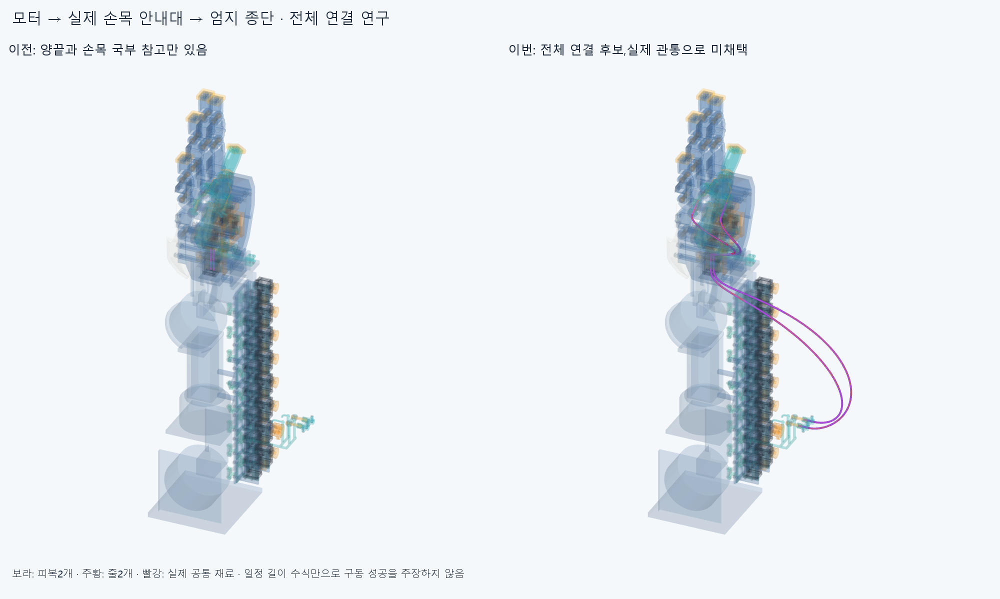
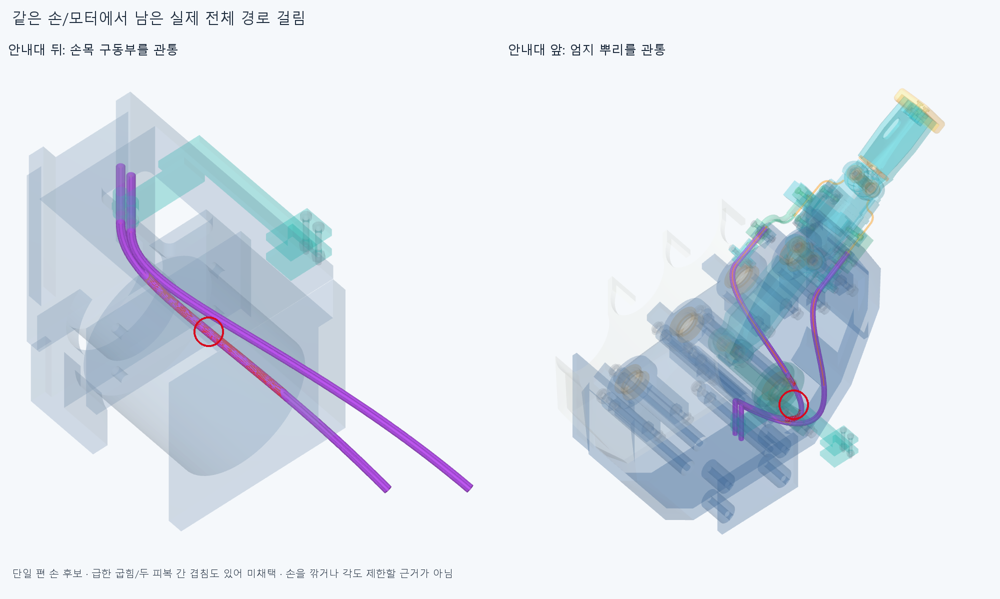

# GUIDED030 실제 양끝과 손목 안내대를 잇는 전체 경로 연구

실제 양끝과 손목 안내대를 이은 후보는 **편 손부터 실제 관통과 급한 굽힘이 있어 미채택**이다. 기존 손397/포장385/전기64/중립 팔10과 손목 하드웨어6을 유지했다. 긴 피복은 아직 설치된 구동계가 아니다.

## 실제 연결과 고정의 차이

TERMINAL022/RETAIN026의 모터 종단 축,OUTLET029의 X26/+Y 두 안내관,OFFSET024/RETAIN026의 실제 thumb_mcp 종단과 FK를 사용했다. 모터 어깨→모터 직선→상류 곡선→실제 안내관 축→하류 곡선→엄지 어깨까지 연결했다. 중심 줄은 기존 모터 줄 끝과 엄지 줄 입구까지 이어진 기하이며 기존 국부 줄과의 native합체/끼우기 성공을 검사한 것은 아니다.

새36형상은 물리적 피복2/줄2를 각각9구간으로 나눈 CAD조각이며36개 연결구/가이드가 아니다. 새 하드웨어0개다. 실제 끝 죔쇠4/손목 안내대6을 장애물에 포함했다. 기존 짧은 끝 피복4/손목 국부참고4/옛 실패 긴곡선은 같은 피복을 중복 설치한 장애물로 더하지 않았다. 이전STEP/STL 4454파일 해시가 같다. 손364본체/축·길이/모터·랙·전기선은 바꾸지 않았다.

손목 안내대는 축방향으로 미끄러질 수 있으므로 앞뒤 곡선 길이를 별도로 고정하지 않았다. 실제 양끝과 안내관 접선에 맞춘 **한정된 곡선족의 전체 길이**를 두고 상류 굽힘 계수 하나로 길이를 맞췄다. 곡선 계수는 허공에 설치한 지지점이 아니다. 피복 물성/EI·중력/접촉·마찰·장력 평형은 풀지 않았다. 새 중간 지지나 자동 텐셔너도 없다.

## 계산만 성립한 길이

기존 구접근 부모각의0/25/50/75/100/75/50/25/0% **9분석 표본**이다. 중립 손목이며 새 자연 손동작을 만들거나 기존 자체 손/물체 경로를 다시 검사하지 않았다. 같은 역순 길이 계산은 실제 마찰/풀기 검사가 아니다.

두 전체 피복 후보 길이는 614.260840216/582.715543899mm,이 곡선족에서 안내관 입구의 재료좌표 변화는 각각 -49.300830268~0/-4.883524124~0mm였다. 각 길이는5부모 표본의 기준 굽힘 중 가장 긴 것을 골라 정한 기하 후보이며 선정/절단길이/필요 조절범위가 아니다. 조절부±2mm나 TENDON019 가상 텐셔너 수치로 승계하지 않는다. 실제 설치 가능한 굽힘 형상이 먼저 필요하다.

## 실제 정적 실패

편 손1자세의 새36 대 손397/포장385/전기64/중립 팔10/손목 하드웨어6와 내부630쌍,**31662쌍/311AABB후보**에서 **45기록(외부36+내부9),연산실패0**이다. 보고기준0.001mm³초과/Boolean허용오차1e−6mm/OCC풀1을 유지했다. 포장/전기/손목 가이드 자체는0이지만 팔·손 쪽과 내부가 막혔다. 이0을 전체 통과로 쓰지 않는다. 나머지4예정 native부모 자세와 역방향은 실행하지 않았다.

상류는 AK_wrist_deviation과 피복 최대351.314435124mm³/손목 캐리어48.078627747mm³에 걸린다. 하류는 thumb_root_fixed_housing 최대88.566590073mm³와 손바닥/뿌리 회전부·부싱/체결품/첫외피에 걸린다. 이는 이번 전체 경로 후보 실패이며 손 기능의 구조적 불가능이나 손/손목 절삭 근거가 아니다. [실제 공통형상](generated/actual_common/scene.json)과 아래 그림을 따른다.

하류의 표본 최소 곡률반경은 0.504157758/0.466534157mm로 피복 외반경1.5mm보다 작다. 공급품 허용반경을 선언한 것이 아니다. 실제 native검사에서도 피복/자기 중심 줄이9.070129284/9.241544542mm³ 겹치고 두 피복 간94.186783622mm³가 나왔다. 유효한 BRep/접선 연속/길이 수식만으로 사용할 수 있는 굽힘이 되지 않는다. 이 자유 굽힘족은 여기서 닫는다.

## 보존한 중단과 남은 일

첫 실행은 편 손 길이를 모든 부모 자세에 그대로 쓸 수 있다고 가정해 길이근 찾기에서 중단했다. 기하/native검사 전이며 손 결함이 아니다. 입력 코드/오류를 history에 남겼다. 첫 그림은 실제 공통2개를 저장한 뒤 name/shape전용 손 목록에서 mesh키를 찾다 중단했다. render_saved가 원래 mesh장면으로 그림만 완성했으며 native그룹 재실행0이다.

다음은 실제 손목 구동부/캐리어의 **뒤쪽 진입 재료와 엄지 뿌리 통로·종단 방향**을 읽고 유지 가능한 지지/접근 형상을 설계하는 것이다. 없는 지지/텐셔너를 설치로 세거나 같은 자유 곡선 계수/반경만 다시 탐색하지 않는다. 실제 긴 피복 설치·줄 끼우기/길이조절/예압·부모/손목 잡기/풀기·전기선 동적운동/강도·공급품/실물은 미검증이며 전체 손은 미완이다. 모든 실물 인증을 다음 CAD/3~4동작 영상 조건으로 무한히 늘리지는 않는다.

정확SHA 새 깨끗한 clone에서 편 손5장애물+내부630의6native그룹,새36원본/STEP측정서명과9분석×2줄의 실제FK끝점/길이/구간 접선·위치를 재검사한다. 같은 에이전트 검토이며 독립 감사가 아니다. 측정서명은 모든 곡면식/trim/일치경계면Boolean 동등성 증명이 아니며 OFFSET024/HOUSING027의 기존 비교 보류도 해소하지 않는다.
