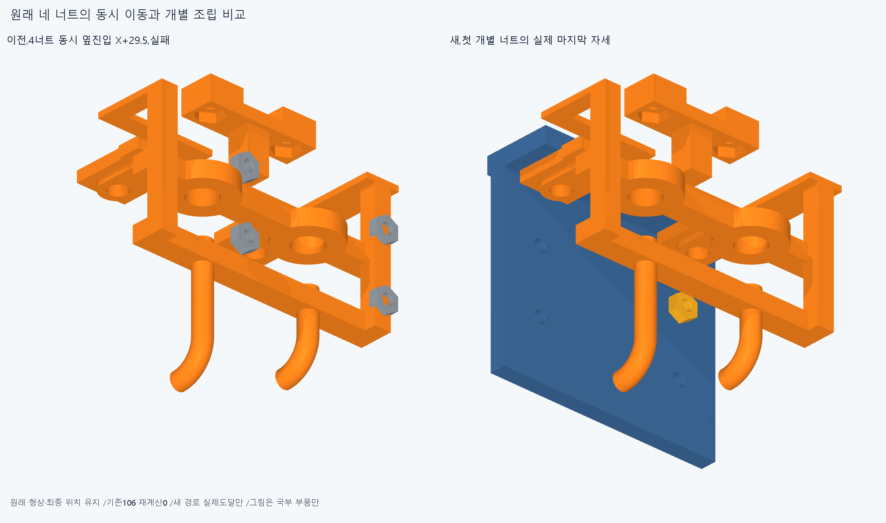
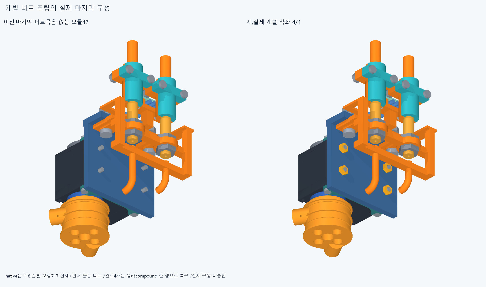

# ARM077 원래 M2 너트 네 개의 개별 조립

현재862/기본364·손397/손바닥4·16원격·빔전기·설치축길이명령clock유지,886/방사랙외형미채택이다. ARM074받침1명시교체의별도886/특수48=원래47+새받침1,다른885유지/이번설치형상변경0이다.

## 원래 네 솔리드와 실제 스택

원래thumb_ip_actuator_base_nuts는솔리드4개이며base_screws도4개다. 각너트R1보어와나사R1축은−X,너트착좌면X66.9/바깥면68.5·shaft끝68.9,adapter보어R1.1/착좌면X66.9를실제저장STEP에서읽었다. 두Y축위치는−134.24314575051/−145.5568542494,각Z±13.1568542494근처이며정확값/면번호는survey.json에보존했다. adapter/cradle의실제보어·평면도읽었다. 원래compound의Solids를참조할뿐새하드웨어/절삭/위치변경은0이다.

ARM076의동시4너트강체진입X29.5실패공통13.088827791000892mm³/3솔리드는속성만읽고옛Boolean/native0이다. 그경로실패를네독립너트모두의조립불가능으로승계하지않았다. 이전714/717부분결과를보존했다.

## 개별 진입과 실제 결과

실제717을그대로장애물로유지하고각너트하나를X+4mm에서자기Z부호의위/아래전체장애물AABB밖부터넣어원래Z축높이로맞춘뒤X+2/+1/0으로나사축을따라착좌했다. X4는한시험경로이며최소여유·제작공차규격아니다. 전세계장애물중해당X/Y를겹치는AABB의진입·중간·이탈위치를추가표본으로사용했다. 이유한표본은연속경로/공구접근승인이아니다.

각단계에는앞서완료한원래너트도있다. 원래compound한행은아직없고moving/fixed이중설치0이다. native고정형상수는717→718→719→720으로늘지만추가하드웨어행수가아니다. 원래4개가모두항등위치로복구된경우에만그4솔리드를원래compound한행으로되돌려canonical718로기록한다. 개별참조4개와compound를동시에설치하지않는다.

새68native/48858쌍/98AABB/0기록/0오류,report>.001mm³/Boolean1e−6mm/OCC1이다. 실제완료너트4/4·원래compound복구=True·world718/대기168/완전packet9/16·특수48복구=True다. 이는부분전제에서의원래48복구이며전체공장·16모터설치완료/실제체결력승인이아니다. 실패가있으면첫도달뒤경로는실행하지않았다.

새실패기록: `[]`

## 실제 CAD와 검토 범위

원래4솔리드의개별STEP-STL은이번표시/재현용추출증거4개이며새설치물0이다. 새대표공통0만수치선저장뒤추가하고미생성이면공통export/native0이다. 총새증거기하4/실제불투명3고유그림/덮어쓰기0·이전12787기하/동결222·과거manifest불변이다.

정확SHA새깨끗한사본의핵심계획32native는각새경로시작끝/단계경계/실제장애물투영사건및실패도달전부다. 원래4너트/4나사·adapter/cradle속성,원래솔리드추출4source/STEP typed서명epsilon1e−10/절대1e−5와새공통만비교한다. 원래16packet408/886/명시1교체·특수48/717보존·원래compound부재/개별완료너트/누락·전체밖시작/최종항등/최종원래compound한행복구·대기목록/완료주장을대조한다. 실제재현은docs/reviews/ARM077을따른다. 같은에이전트한정재현이지독립감사·모든중간/trimBoolean·픽셀/팔시각단위·연속전체공장증명이아니다.

느슨한너트수동유지/지그·공구/캡티브·나사산/토크·강도마찰예압장력/실제하네스/mating·출력12내부승인은없다. 옛106/162/9rail면7사건·ARM07415/4/보어1·216점/615PCD는재실행하지않았다.

## 다음

새특수48복구와실제world718을유지하고앞7×24의168을실제각모듈방위별벤치/세계진입·M3/M2순서로검사한다. 새엄지모듈을장애물로포함하고기존일반24/670/716목록의성공을변경장애물에맹목승계하지않는다. 실제모터·전기·출력·adapter/cradle·누락/전체밖시작/최종항등을보존한다. 일반모듈M2너트묶음도필요하면원래개별솔리드로조립하되전체최종compound를복구한다. 현재조건부718/대기168/완전packet9/16/특수48=True이며전체공장·16모터설치완료아니다. 끝낸이번68/4너트·4나사/포켓속성·옛106/162/9rail면7사건·ARM07415·4·보어1/216·615PCD재실행0. ARM074윗M3전체포함false19.195131113433646mm³/1solid·실제보어1/216IN모순/원인미확정·윗돌출5.9mm/외형미채택,ARM059옛최종3/M3+13·ARM065edgevertex/corefalse·ARM072픽셀false·옛strictfalse/모든이전실패보류유지다. 같은차집합/정밀/픽셀복구/615PCD반복0. 빔반대뽑힘·출력12내부/mating·하네스/captive/공구·토크힘강도마찰예압장력/20구동·동적전기·전체팔상완/실물제조외형미승인. 손빔절삭/모터삭제·몰래이동/각도제한/ODR축소/가짜텐셔너/LINK·옛최적화/팔꿈치버스재개0.
