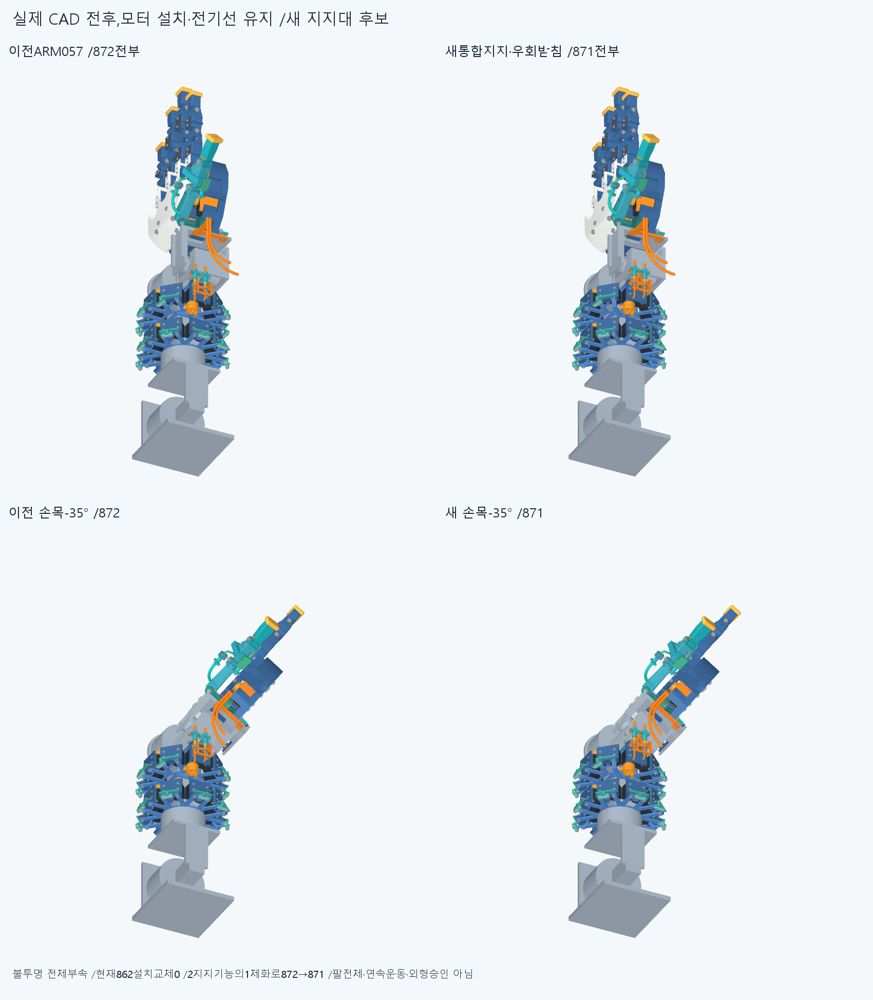
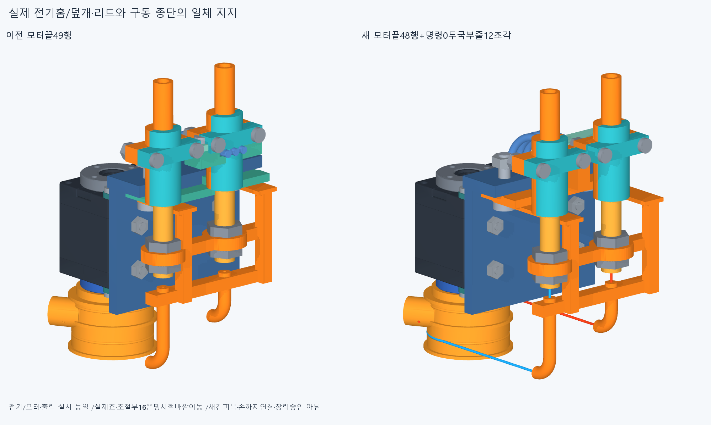
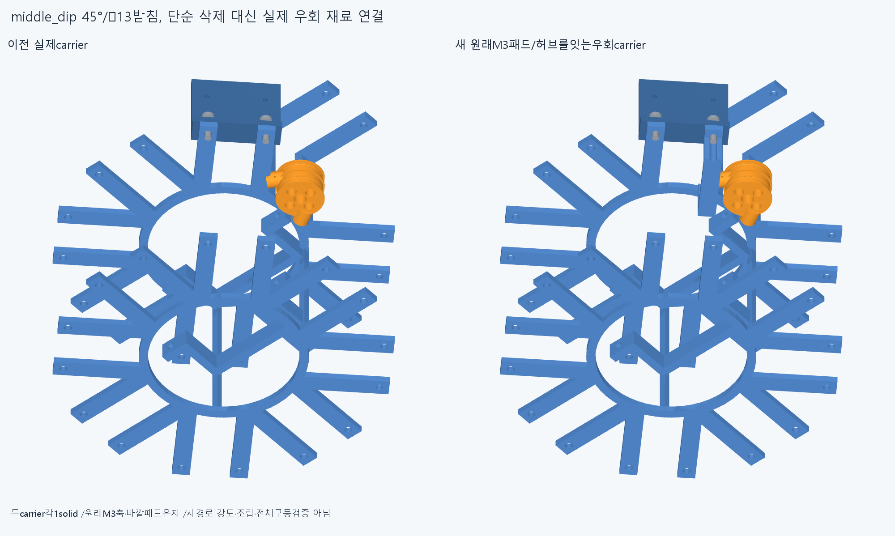
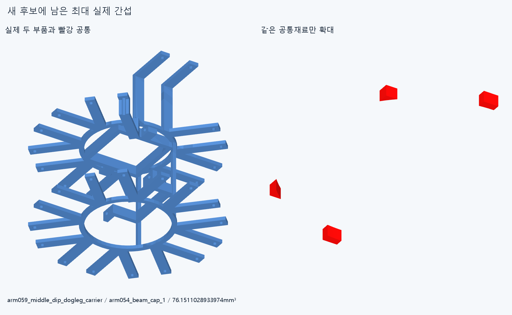
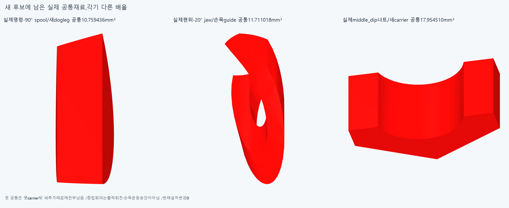

# ARM059 전기/R5 일체 지지와 실제 이웃 받침 우회 후보,미채택

**전선 통로와 중립 스풀 간섭은 피했지만,출력 회전·손목 편위·체결부에 간섭이 남아 채택하지 않는다. 현재862설치/손/16원격구동원은 그대로다.**

## 실제 새 형상과 부품 수

별도871=불변851+새일체base/R5틀1·직선죠2·carrier1+명시적바깥이동16이다. 원래guidebase1과R5틀1의 두 지지기능을 한 실제1solid로 통합해872→871이다. 모터나 전기부속을 지운 것이 아니다. 모터 설치/명령0·출력 체결위상은 ARM057과 같다.

실제14보호전기몸체(3선/plug/덮개·M2/M3/기존base)의최대X87.1과 실제 죠·M2/조절부의 안쪽 투영−6.1에서 기계축X93.2를 잡았다. 기존81.5보다11.7mm바깥이며 여유 목표를 더하지 않았다. **이는 한 후보의 기준일 뿐 바깥이 빈공간·최소폭·외형수용이라는 증명이 아니다.** 통합 지지의 긴 바깥 하중살과 실제 체결 반력을 함께 추가했다.

두실제R10홈 접선은37.1mm로 늘고R5/OD5·보어3.2/lead12·어깨~출구29mm는 같다. 새출구(93.2,-93,-2.5)/(93.2,-93,17.5)/+Y,어깨Y−122/입구Y−117이다. 실제조절부·너트/반대죠·M2의16행과 아래직선죠2를 명시적으로X+11.7했다. 전기홈/리드·plug/뚜껑·M2와원래모터·혼·출력은 움직이지 않았다.

실제국부 두줄12조각의 명령0길이는111.48810260165592/119.48810260165592mm,기존꼬리/감김120°·120°를 같은저장STEP에서 읽었다. 새접선/R5/조절부 끝점차0이다. 전체긴줄/피복길이·0.77손관절연결/재료보상·장력·부모손목운동을 새로 연결했다는 뜻이 아니다.

이웃middle_dip45°/tangent−13받침의 radial38..66.5구간을 대체한 실제3mm우회재료는Y−175.5000001..−172.5000001이다. 원래바깥M3축(59.39696961967,-162,41.01219330882)/패드와허브를 연결하고 축구멍을 다시 냈다. 이Y기준은 실제9출력부의축방향하한−172.5000001에서 정했다. **뒤쪽 수평재료가 축방향 범위 밖이라는 사실은 그곳까지 이어지는 두 web의 회전공간 회피를 보장하지 않는다.**

## 실제 실패와 한정 성공

새31native그룹114176쌍/460AABB후보/14원시기록/0연산실패다. 분류는새변경막힘7+기존carrier/cap·체결쌍을새carrier로다시검사한5+같은줄꼬리·감김접합2이며 **rawfalse를 유지**한다. 14독립결함/전체조립의14쌍으로 세지 않는다.

중립새20대851은 새carrier/middle_dip실제너트2의17.954510074921885mm³와기존cap76.1511028933974·주변체결4의5기록이다. 전기3선·뚜껑/체결과 실제spool/꼬리보스의 중립 새간섭은0이나,기존모든부속 전쌍을새로검사한 것은 아니다. 새4대이동16은기존R5지지/조절부1·위아래너트의2.7955951125100102/2.2543445500914405/2.25434455009144mm³가남았다. 국부줄12대871은0/내부는2같은줄접합이다.

실제9출력부를−90/+90°로 움직여새20과검사하면spool/carrier10.759436068703176/5.237987823941943mm³가남는다. 기존factoryretainer/탭영역native를반복하지않았다. 명령−90의실제공통10.759436068704654mm³에서옛carrier를빼도같은체적이남아,이한정공통은 **새로추가한우회web의실패**다. ±90끝자세는전체회전승인/새각도제한이아니다.

12유한팔자세의24변경관계(새20+명령0국부줄12)중편위−20°에서고정전완죠0/손목을따르는compact_saddle_nested_turns의11.71101817216265mm³가남았다. 다른23관계0은전체팔/연속·복합공간승인이아니다. 손/빔·모터를깎거나각도를막아성공으로세지않는다.

원래guidebase밖재료0/실제보호전기홈침범0/엄지M3패드−13밖0/이웃middle_dip원래M3좌석밖0의한정근거를얻었다. 하지만 **엄지M3패드+13밖은19.195131113433646mm³·1solid로포함검사실패**다. 전체annulus값이며원인미확정,기하누락/도구문제로단정하지않고두패드착좌승인으로쓰지않는다. 같은실패의추가정밀/반복0이다. 5질의와별도원래이웃좌석입력생성common1을구별한다.

기존ARM057하드웨어기록42중불변10만메타동일승계/native0,32는새형상에자동승계하지않는다. check.json의earlier_unchanged11은옛출처목록이며현재승계판정은assessment.json을따른다. 바뀐carrier의옛cap기록도형상동일승계로꾸미지않고새native기록을남겼다.

## 실제 CAD

새4하드웨어/국부12줄/원시최대공통1/후속공통4는저장기하21행이며증거5행은설치물이아니다. 최초실패보관의하드웨어4/부분줄1도설치물에중복하지않는다. 서비스검사는0,작업대수동지지·뚜껑열어선놓기→기존공유M3착좌→모터/출력→긴기계줄은제안순서다. 실제공구·나사산·예압/마찰/강도·장력검사는없다.

## 저장 오류 보존과 정확 커밋 재현

첫실행은새4하드웨어STEP/STL/scene저장후,옛줄STEP의step/mesh해시를새export에중복전달해첫줄STEP/STL1행뒤중단했다. native0/부착질의0이며부분줄scene은없다. history/attempt1에정확코드·생성파일·stdout/stderr/상태를보존했다. 저장키만제거했고모든기하build앞부분/줄route뒷부분과check코드는동일하다. 두번째31검사만완료다. 초기4재생성을통과8개로합산하지않는다.

이전기하12502/동결222해시·과거manifest를보존한다. 정확SHA새깨끗한사본에서31그룹/5부착질의(+1좌석입력common)/4후속질의와새4+국부12+후속공통4의20sourceSTEP적응epsilon1e−10·절대1e−5서명,16이동/두R10R5경로/우회기준·분류만재현한다. 그림의원시최대공통1은그림용추가native1이며20형상비교에는없다. 같은에이전트이며독립감사·모든곡면식trim/Boolean동등성증명이아니다. ARM05812/ARM05736·과거PCD/감김/미세접합·strictfalse/곡면포함보류를재실행/해소하지않는다.

## 다음 설계

같은축을더바깥으로밀거나세너트/옛cap/작은접합만다듬지않는다. **실제9출력의회전점유공간과M3너트/공구진입을먼저보호한새받침하중경로**가필요하다. 실제−90공통의새web위치와기존DRIVE018전체출력공간근거를읽고축방향뒤쪽막대만옮긴설계를반복하지않는다. 모터/너트/부속을지워빈공간으로만들지않는다.

손목쪽은전완고정죠와손목H를따르는compact가이드의실제−20공통에서종단/가이드진입방향을함께설계한다. 같은port-only X확장/ODR축소/각도제한/손절삭을하지않는다. 고정전기홈/뚜껑M2·3선/plug/원래M3스택과기존손364를유지한다. 관련새지지형상이바뀔때실제M3좌석을확인하되현재+13포함실패를지우거나이도구비교만으로다음CAD를무한히막지않는다.

현재862/871채택·전체긴재료/20토크·동적전기·전체팔/상완·실물제조외형과힘강도마찰예압장력승인없음,LINK/옛최적화/팔꿈치버스재개0이다.

## 첫정확SHA 입력목록오류와 새manifest

최초대상64b350d1718f387e21028d6af4a7b0e729967473의입력목록에Git이무시하는임시assessment.pyc1개가포함돼깨끗한clone의guard에서중단했다. CAD재생성/native/부착질의0이다. 원래ARM059.manifest.json과clone을변경하지않고history/review_attempt1에정확검토코드/오류/상태를보존했다. 새ARM059R.manifest.json에서그임시cache만빼고새검토코드가그목록을읽는다. 실제기하/충돌검사제외·문턱변경0,수정커밋의새깨끗한사본에서처음핵심재현을진행한다.
