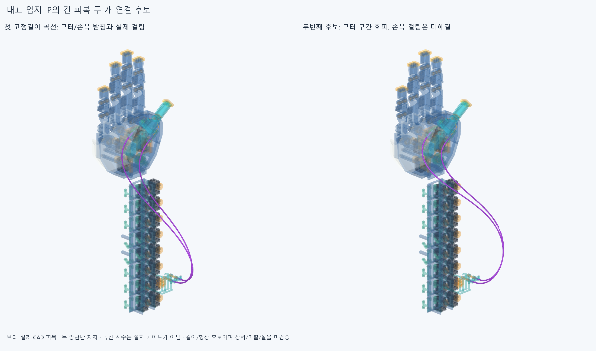
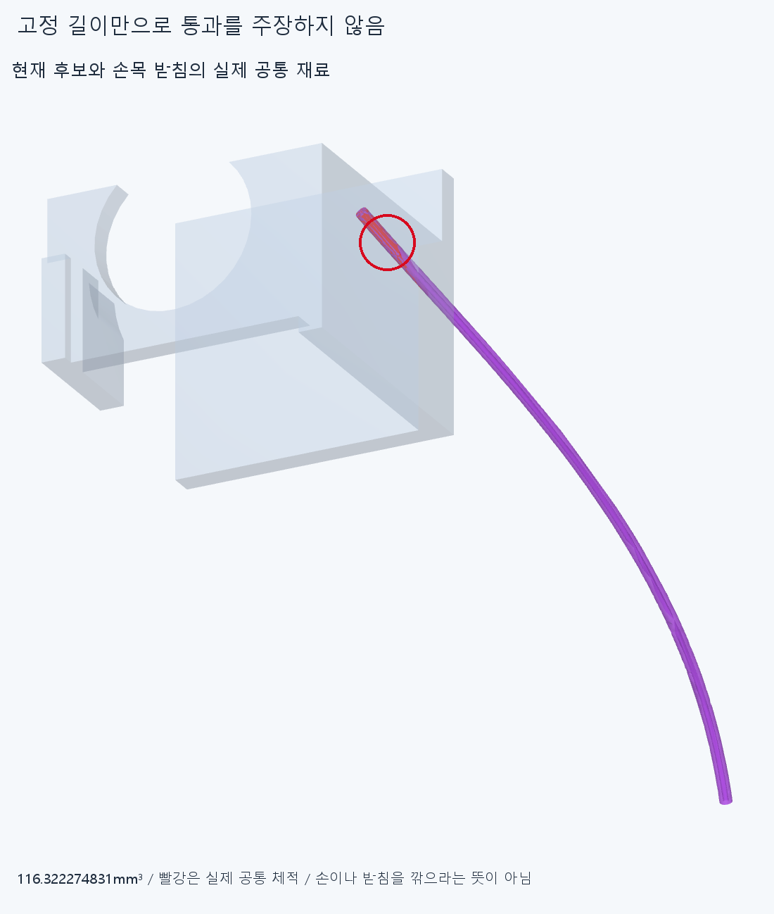

# HOUSING027 대표 엄지 IP의 긴 피복 연결 연구

**모터 종단에서 손목을 거쳐 엄지 종단까지 두 피복/줄의 CAD 연결 후보를 만들었으나,편 손부터 손목 지지 참조에 걸려 미채택이다. 피복 길이 조건을 만족한 것을 움직임/구동 성공으로 세지 않는다.**

## 현재 입력과 실제 지지

현재 RETAIN026의손397/포장385,기존48전기선·16외곽/중립팔·손목참조10을 모두 장애물로 썼다. 손364원본/축·길이·모터 설치·랙·기존 전기선/끝구·죠 형상은 그대로이며 이전STEP/STL **4159파일 해시 불변**이다. 팔꿈치 전기버스/새보드는 확장하지 않았다. 기존 전완 대표엄지IP모터에서 손목/손가락으로 가는 전달계 연구다. 옛4짧은피복 참고는 같은 두피복의 양끝구간이므로 새로운긴피복과 중복 설치물/장애물로 더하지 않았다. 현재 종단/죠의마찰·실제빠짐방지/체결하중미검증은 그대로다.

**물리적 피복2/줄2를 각각5CAD구간(모터직선+곡선3+손쪽직선),총20형상**으로나눴다. 20커넥터/가이드를추가한것이아니다. 모터쪽어깨~자유구간은17mm,손쪽자유구간~어깨는25mm,그사이곡선500mm로두피복의명목길이는각542mm다. 실제절단/공급품선정길이가아니다. 새중간줄은기존모터줄끝Z−163mm부터시작해아래가는안내관입구/위오프셋곡선입구에닿도록정의해각535/538mm다. 기존양끝줄/상류21.991148575mm부분을±2mm조절로흡수한다는뜻이아니다. 전체기존줄과의합체/native/끼우기·실제접촉선/예압은새로승인하지않았다.

실제지지는기존모터조절부/죠와엄지MCP끝구/죠뿐이다. **중간에는새지지/가이드/텐셔너가없다.** 6개Bezier제어점은곡선계수이며허공의고정가이드로세지않는다. 양끝의실제FK위치/축에끝접선을맞추고곡선길이를500mm로묶은8변수5차Bezier족에서적분곡률제곱을최소화했다.192점Gauss와별도scipy quad로길이를대조했다. 이는그곡선족의기하후보이며EI/물성/중력·마찰·접촉·장력·동역학으로보정한탄성평형이아니다. 외경3/내경1.3·줄0.6mm와표본곡률반경은가정/계산값이며공급품의허용굽힘/수명이아니다.

## 첫 실제 걸림과 두번째 후보

첫편손후보는새20형상대손397/포장385/전기64/중립팔10과새190내부쌍의**17310쌍/459AABB native**에서포장15쌍/팔·손목4쌍,총19겹침기록·연산실패0다. 중지벌림모터28.809728561mm³,손목Palm_wrist_saddle80.520649732mm³등의실제관통이다. [원래 partial](reviews/check.json)의completed=false를보존했다. 9자세예정중편손1자세만완료/저장했고,확정된첫걸림뒤중복후속을중지했다. 두번째자세의일부계산/불완전내보내기가남아도완료표본으로세지않는다.

두번째는그실제첫걸림8부품의AABB로41곡선표본의중심선거리를피복반경1.5mm이상으로제약했다. 임의의추가설계여유가아니며실제중간하드웨어도아니다. 이후native검사는기존부품전체를그대로포함했다. 모터/포장겹침은0이됐으나Wrist_box_carrier/Palm_wrist_saddle에**6쌍**,대표공통체적**116.322274831mm³**가남았다. 두번째6구간겹침기록은같은물리적피복/줄의이웃구간중복을합치면4물리적줄-부품쌍이다.6개독립결함으로세지않는다. 같은 **17310쌍/208AABB native**와연산실패0이며[두번째](selected/reviews/check.json)도미채택이다. 41점의보수적상자조건만통과한것이전체곡선의물질간섭0이라는뜻은아니다. 첫상자목록에없던손목캐리어와표본사이/실제커널관통을native로검출했다.

두후보의손397/전기64와새190내부쌍은각편손위치에서기준이상겹침0이었다. 손자체운동/물체접촉/기존줄전체/끝구조립/동적전기선승인은아니다. 모든재료대조의보고기준0.001mm³초과/Boolean허용오차1e−6mm/OCC풀1을유지했다. 반복이나다른피복/줄을서로독립된손기능결함수로합산하지않는다. 같은족의두실패는다른연결/자연스러운손기능의구조적불가능증명이아니다.

## 미실행과 다음

편손부터막혀두번째후보의5예정자세중1자세만native완료하고나머지를실행하지않았다. **부모관절/손목의잡기·풀기경로와길이유지·장력은미검증**이다. 끝점좌표/길이제약을계산한것을전체왕복운동성공으로쓰지않는다. 중심줄은피복중심의명목선이고실제당긴줄의내벽접촉/마찰·하우징압축/늘어남/변형·죠압착/빠짐저항·수명/실물은없다. 제작/20모터설치/전체손구동승인이아니다. 추가피복의외곽/루프도수용외형판정이아니다.

다음은두원래종단/손/모터를먼저깎거나옮기지않고,**현재손목캐리어/받침의실제재료경계와부착가능한방향을읽어손목통과경로·필요한실제안내/지지를설계**하는것이다. 같은자유곡선/불완전상자목록을반복하거나반경/OD를줄여통과시키지않는다. 필요지지가어느고정/회전몸체에붙는지와실제조립/구속을명시한다. 중립손목참조를유지할때이연결후보가막힌것이며참조의설치/전체손기능불가능까지확정한것은아니다. 실제양끝하드웨어/지지로유지되는연결을정리한뒤부모/손목운동·줄길이/예압과요청3~4동작을이어간다. 모든공급품/실물인증을영상조건으로무한히늘리지않는다.

코드/입력/두실패/전후그림을정상커밋·푸시한뒤정확SHA새깨끗한사본에서핵심native/20형상·끝점길이를재현한다. 같은에이전트검토이며독립감사가아니다. 원본/STEP비교는새곡선의전역및면적/면중심·모서리길이/중심·꼭짓점측정과끝점/길이제약에한정하며모든곡면식/형상동등성증명이아니다. OFFSET024의기존위덮개TORUS/한점거리false를이번에재검사/해소하지않는다.
