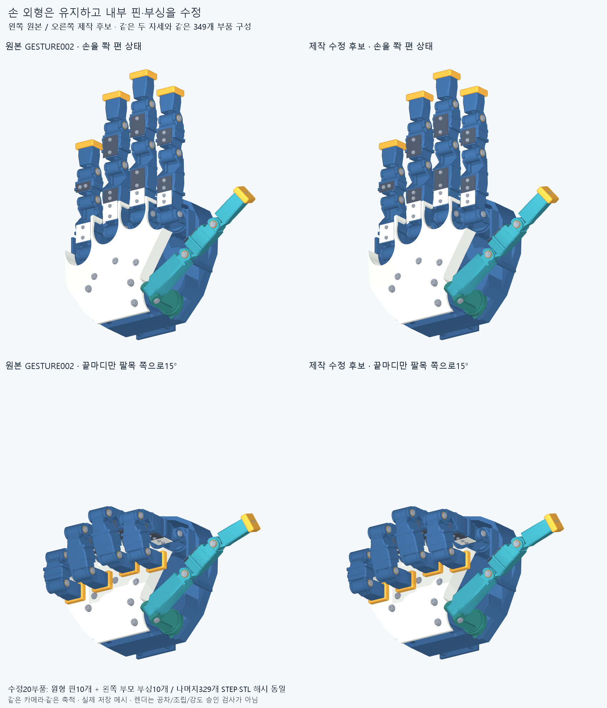
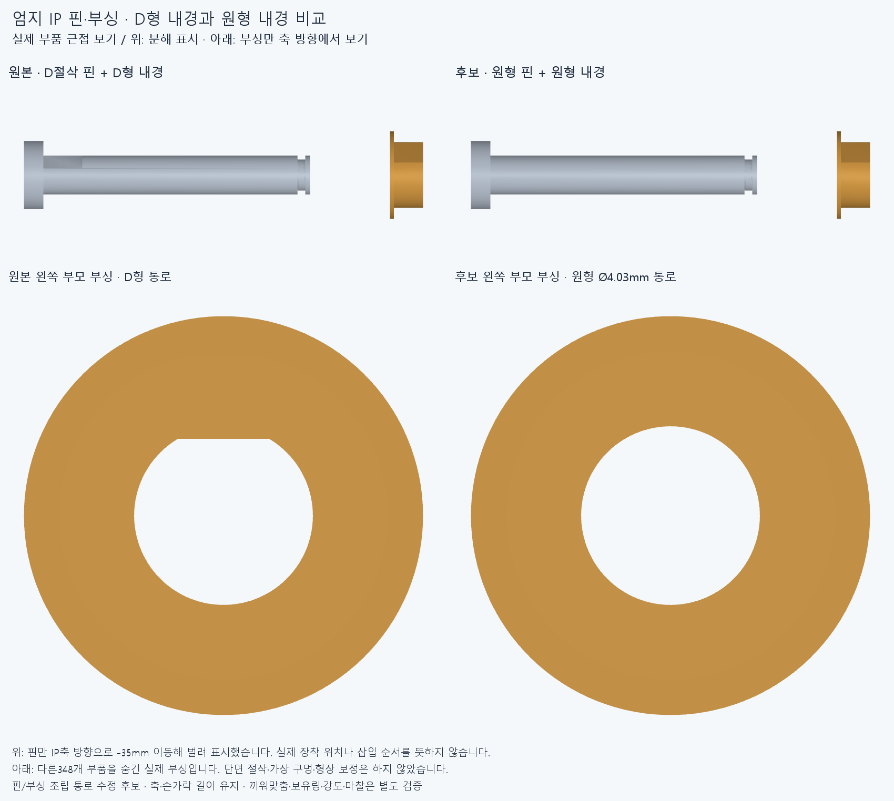

# 제작 개선 1 — 관절 핀 삽입

수용한 손 비율과 최신 엄지 자세를 유지하면서 **실제로 부품을 끼울 수 있는 구조**로 고친 첫 후보입니다. 제작 완료나 구동 성능 승인은 아닙니다.

왼쪽은 이전 형상, 오른쪽은 이번 후보입니다. 링크 길이·관절축·부품 외곽은 유지했습니다. 349개 중 원위 관절 핀10개와 왼쪽 부모 부싱10개를 수정했고, 나머지329개 STEP·STL은 원본과 바이트가 같습니다. 엄지척은 펼친 엄지를 유지하고 끝마디만 팔목 쪽으로15° 젖힌 `thumb_wrist_v1`의 자세입니다.

## 발견한 문제와 수정

기존 핀은 짧은 구간에만 D자 평면이 있고 그 앞은 원형이었습니다. 왼쪽 부싱은 닫힌 D자 구멍이어서, 완성 위치에서는 맞지만 **원형 선단이 구멍을 통과하지 못했습니다.** 반대쪽에서는 일체형 핀 머리가 막습니다. 실제 저장 STEP에서 원래 핀의30mm 직선 삽입 경로와 부싱이10곳 모두 약1.24594mm³ 겹치는 것을 재현했습니다.

이번에는 Ø4 원형 핀과 Ø4.03 원형 부싱 내경을 사용합니다. 부싱 외부의 D자 회전 방지 형상, 핀 머리·클립 홈·와셔·축 위치는 유지했습니다. 이 핀은 자유 회전하는 수동 힌지 핀입니다. 모터의 토크는 핀이 아니라 **움직이는 자식 링크나 그 링크의 풀리**에 연결해야 합니다. 질량표의 부모 강체 소속은 위치 계산 기준이며, 핀이 부모에 회전 고정됐다는 뜻이 아닙니다.

위 확대도는 저장된 실제 부품 메시를 사용합니다. 핀만 보기 좋게 축방향35mm 이동시킨 분해도이며, 다른 부품은 숨겼습니다. 아래는 부싱 구멍을 축방향으로 본 모습입니다. 이 그림 자체가 조립 검사는 아닙니다.

## 검사 결과

근거: [빌드 보고서](generated/build_report.json), [전체 조립 검사](reviews/assembly_audit.json), [렌더 입력 기록](generated/render_report.json).

| 검사 | 실제 결과와 범위 |
| --- | --- |
| 저장 부품과 전체 STEP 재수입 | 유효한 단일 솔리드349개. 전체 STEP도349개이며 부품 순서·부피·외곽 대조 통과 |
| 변경 범위 | 핀10개+왼쪽 부모 부싱10개. 나머지329개 형상 파일 불변 |
| 원래 삽입 실패 재현 | 10곳 모두 D자 부싱에 막힘 |
| 새 핀의 부싱·관절 내부 삽입 | 10곳 모두30mm 연속 직선 경로에서 보고 기준 이상 겹침0건 |
| 손 전체를 편 상태에서 핀 삽입 | 5곳은 옆 손가락 때문에 막힘. 아래 조립 순서 필요 |
| 정적 자세 | 보·바위·V·가위·최신 엄지척·중지·산·록앤롤2종·엄지를 편 채 네 손가락만 접기, 총10자세에서 보고 기준 이상 겹침0건 |
| 클립 회전 | 원위 클립10개를 모든 회전 방향을 포함하는 원환 포락체로 확대해 위10자세 검사. 탄성 설치는 제외 |
| 연산·입력 일관성 | 연산 실패0건, 검사 전후 입력 해시 일치 |

핀 삽입은 핀의 축방향 각 일정 단면을30mm 이동시킨 정확한 합집합으로 검사했습니다. 이동하는 핀 자신과 **마지막에 끼울 해당 클립만** 제외했으며, 다른 부품은 그대로 남겼습니다. 삽입 겹침 기준은0.0001mm³, 정적 자세 겹침 보고 기준은0.02mm³입니다. 최소유격은 측정하지 않았고 공차·변형·마찰을 포함하지 않았습니다.

정적 검사에서 `thumb_up` ID의 실제 각도는 최신 `[0,0,0,-15]`°로 대체했습니다. 보고서의 이전 카탈로그 설명 필드가 아니라 `angles_deg`가 검사한 자세입니다. 이전 엄지척 검사를 그대로 승계한 결과가 아닙니다.

## 확인된 조립 순서 제약

| 핀 삽입 위치 | 손 전체 조립 후 경로를 막는 부품 |
| --- | --- |
| 검지 첫째·둘째 원위 관절 | 중지 첫째·둘째 마디 |
| 중지 첫째 원위 관절 | 약지 둘째 마디 |
| 중지 둘째 원위 관절 | 약지 손끝 |
| 약지 첫째 원위 관절 | 새끼손가락 둘째·셋째 마디와 관절 부품 |
| 나머지5개 원위 관절 | 이번 중립 자세·삽입 방향에서 막힘 없음 |

따라서 손가락 모듈에서 부싱·링크·와셔를 정렬하고 핀을 왼쪽에서 먼저 삽입한 뒤, 유지 클립을 끼우고 손바닥에 장착하는 순서가 출발점입니다. 전체 검사에서 막힌 부품은 모두 다른 손가락 소속이므로 **자기 손가락만 남겼을 때의 핀 삽입 경로는10곳 모두 확보됩니다.**

이 결과는 핀의 경로에 한정됩니다. 부싱·와셔·클립 자체의 삽입 경로, 클립을 끼우는 공구 공간, 손가락 모듈을 손바닥에 장착하는 경로까지 완료한 조립 승인으로 쓰지 않습니다. 특히 현재 맞춤 클립은 탄성 설치와 유지력을 검증하지 않았습니다.

## 남은 제작 문제와 다음 단계

1. **핀 유지 클립:** 현재 맞춤 클립을 실제 규격품과 비교하고 홈 폭·핀 끝 여유·설치 공구·인발력을 함께 맞춥니다. 현재 홈 폭0.8mm와 끝 여유0.5mm는 검토한 DE-3.2 E링 규격에 맞지 않습니다. [규격 대조와 다음 수정안](reviews/RETENTION_NEXT_STEP.md). 클립 회전 공간 확인은 탄성 설치나 빠짐 방지 검증을 대신하지 않습니다.
2. **실제 체결품과 접근:** M2 등 이름만 있는 단순화 부품을 실제 공급 규격과 대조합니다. 드라이버·너트·와셔의 접근과 조립/정비 순서를 확인합니다.
3. **공차와 제작 방식:** 핀/부싱 반지름 여유0.015mm, 부싱/외피0.02mm, 축방향 스러스트 여유0.05mm/쪽은 명목값입니다. 프린트 구멍에 그대로 적용하지 않습니다. 금속 핀·부싱과 후가공 기준, 축방향 누적 공차·마모를 정해야 합니다.
4. **실제 구동계:** 현재 손 조립에 통합한 모터·줄·배선·관절 계측은0개입니다. 자식 링크에 결합하는 풀리와 양방향 줄, 가이드·예압·모터 고정부터 설계합니다. 핀 옆의0.05mm 틈에 별도 두꺼운 풀리를 넣을 수는 없습니다.
5. **강도와 지연:** 하중·충격·피로·마찰·전류·열은 아직 검증하지 않았습니다. 새 구동계와 질량/관성을 연결한 계산, 실제 관절각을 측정하는 단일 관절 시험이 필요합니다. 로봇 단독50ms 목표·100ms 상한은 요구사항이며 달성 결과가 아닙니다.

이번 검사는10개의 정적 자세와 핀의 직선 삽입입니다. 이전 후보의48개 손 동작 표본 검사를 새 형상에서 다시 실행한 결과가 아니며, 모든 자세 전환·역방향·연속 충돌·전 가동 범위를 보증하지 않습니다. 엄지 IP[-20,85]°는 후보 범위이며 하드 스톱이나 실물 허용 범위 승인도 아닙니다.

## 파일과 재현

- 전체 손: [hand.step](generated/hand.step). 수정20부품의 STEP·STL은 `generated/parts`, `generated/meshes`에 있습니다. 불변329부품은 `gesture_hand_v3`를 참조합니다.
- 입력: [design_patch.json](design_patch.json), 생성된 [관절·형상 입력](generated/design.json), [scene](generated/scene.json), [질량·관성](generated/mass_inertia.json).
- 생성: `build.py --repo <저장소>`. 새 작업 사본의 빈 `cad/manufacturing_v1/generated` 위치에만 생성하며 기존 결과를 덮어쓰지 않습니다.
- 검사: `audit_assembly.py --repo <저장소> --output <새 보고서.json>`.
- 그림: `render.py --repo <저장소> --output <새 출력 폴더>`.

실행에는 CadQuery/OCP, NumPy, trimesh, MuJoCo, Pillow와 기존 저장소 검사 코드가 필요합니다. 숨김 실행·단일 계산 스레드·D: 임시 폴더를 사용합니다. 저장한 입력과 결과 해시는 `manifest.json`에 묶고, 커밋 후 해당 SHA의 별도 사본에서 핵심 조립 검사를 다시 실행합니다.
