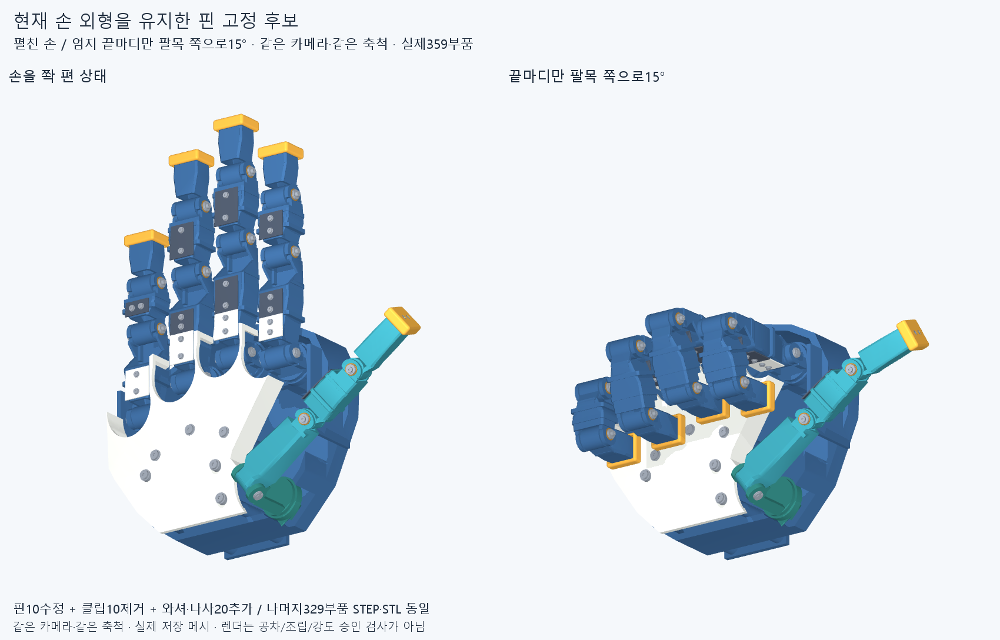

# 손 형상을 유지한 원위 관절 체결 개선

수용한 손의 길이·비율·관절축과 최신 엄지척을 유지하면서, 원위 관절 핀을 **M2×4 나사와 규격 와셔**로 고정하는 후보입니다. 나사는 와셔를 핀 끝에 조이고, 회전하는 관절 부품을 압착하지 않습니다. 왼쪽 핀 머리의 열린 홈은 조립 중 핀이 같이 돌아가지 않도록 잡는 곳입니다.

[전체 조립 STEP](generated/hand.step) · [체결부 확대](generated/retention_assembly.png) · [선정 근거와 가공 조건](RETENTION_DECISION.md) · [원시 검사 결과](reviews/assembly_audit.json)

## 실제로 바꾼 것

이전 `manufacturing_v1`의 핀10개를 수정하고 임의 형상의 클립10개를 제거했습니다. 규격 와셔10개와 나사10개를 추가해 전체 부품은359개입니다. 나머지329개 부품의 STEP/STL은 같은 파일이며, 손가락 길이·외피·관절 프레임을 변경하지 않았습니다. 기존 핀 삽입 문제를 고친 원형 부싱도 유지합니다.

| 항목 | 이번 후보 |
| --- | --- |
| 핀 | Ø4 금속 가공품. 왼쪽 Ø7 머리와 폭1.0·깊이0.8의 공구 홈 |
| 끝 고정 | DIN9021 M2 대형 와셔(외경7·내경2.2·두께0.8)와 M2×4 육각구멍 나사 |
| 회전부 틈 | 축방향 공칭0.15mm. 부품 공차와 실제 틈은 아직 미확정 |
| 기존 좌우 와셔 | 축방향으로 움직일 수 있는 범위를 검사에 포함. 반경 이동·기울기는 별도 과제 |
| 엄지척 | 엄지는 펼친 위치를 유지하고 끝마디만 팔목 쪽으로15° 젖힘 |
| 실제 구동계 | 현재 손 조립에 모터·구동줄·관절 센서는 아직 통합하지 않음 |

**완료 결과:** 저장359개 부품과 전체 STEP 재수입 대조, 손가락별 접근50건,10개 정적 자세와 한 정방향 경로48표본에서 선언한 기준 이상 겹침0건·연산 실패0건입니다. 같은 각도 중복을 제외하면50개 자세이며 총58관찰을 기록했습니다. 관절별 표본 간 최대 변화는5°입니다. 크기를 일부러 키운 공구20건도 모두 걸리는 것으로 검출돼 검사기가 간섭을 보고하는지 확인했습니다. 이미지나 정상 솔리드라는 사실만으로 제작 완료를 판정하지 않습니다.

| 접근 종류 | 손가락 모듈에서 막힘 | 전체 손 중립 자세에서 막힘 |
| --- | ---: | ---: |
| 핀 삽입 | 0 / 10 | 5 / 10 |
| 새 와셔 삽입 | 0 / 10 | 6 / 10 |
| 나사 외곽 접근 | 0 / 10 | 6 / 10 |
| 오른쪽 육각 공구 접근 | 0 / 10 | 6 / 10 |
| 왼쪽 일자 공구 접근 | 0 / 10 | 6 / 10 |

따라서 원위 관절은 손가락 모듈에서 먼저 조립해야 합니다. 이 결과로 손바닥 장착과 모든 부품의 조립·정비 순서까지 완료됐다고 보지는 않습니다.

## 검사 범위

- 저장된359개 STEP의 솔리드·체적·경계와 전체 조립 STEP 재수입을 대조합니다.
- 각 핀 세트에 대해 핀→와셔→나사 순서의30mm 접근 공간을 확인합니다. 나사의 간이 외곽 접근이며 실제 나선 체결을 계산한 것은 아닙니다.
- 오른쪽 육각 공구와 왼쪽 일자 공구의 정렬된 접근 및 동시에 놓을 공간을 확인합니다. 공개 치수와 명시한 끝단 가정으로 만든 게이지이며 실제 공구 CAD의 장착 승인은 아닙니다.
- 핀·새 와셔·나사와 기존 좌우 와셔를 포함한5부품의 동축 회전·축방향 이동 범위를 하나의 보수적인 검사 형상으로 만듭니다. 내부 접촉과 형상 포함을 따로 검사하고, 나머지309개 부품을 함께 검사합니다. 검사 형상319개가 실제359개 부품을 덮습니다.
- 보·바위·V·가위·최신 엄지척·중지·산·록 두 종류와 엄지를 유지한 네 손가락 주먹의10개 정적 자세, 보에서 네 손가락을 접고 엄지 끝을 젖히는 한 정방향 경로 표본을 확인합니다.

자세 겹침 보고 기준은0.02mm³ 초과, 접근·체결 내부 겹침 기준은0.0001mm³ 초과입니다. 표본 사이 연속 손 운동, 자유로운 모든 관절 조합과 실물 공차를 보장하지 않습니다. 정렬된 접근은 핀 머리와 기존 와셔를 예정 좌면에 붙인 조립 자세에서 검사합니다.

## 조립과 가공 전달 조건

1. 손가락 모듈을 손바닥에 모두 붙이기 전에 원위 관절을 조립합니다. 기존 좌우 부싱·와셔를 제자리에 두고 핀을 왼쪽에서 넣습니다.
2. 핀 끝에 새 와셔와 나사를 넣습니다. 왼쪽 홈을 잡고 오른쪽에서 조여 **와셔가 핀 끝에 착좌**하게 합니다. 관절 스택을 압착하거나 나사 끝이 먼저 바닥에 닿으면 안 됩니다.
3. 실제 제작 시 회전 저항과 축방향 틈을 측정합니다. 체결 토크·풀림 방지·반복 사용 조건은 아직 확정하지 않았습니다. 남은 부품의 장착/정비 순서까지 완료됐다는 뜻은 아닙니다.

**조립 STEP의 Ø2 구멍은 탭 드릴 지름이 아닙니다.** 나사산을 단순화한 외곽 표현입니다. 별도 [탭 전 가공 형상](generated/machining_blanks/)10개에는 Ø1.6 선행 구멍과 드릴 선단·입구 모따기가 있습니다. 이10개는 완성 부품이나 조립 질량에 포함하지 않습니다.

가공 기준은 핀 로컬X축입니다. Ø1.6 원통 드릴 깊이는6.0mm이고118° 선단은 그 뒤입니다. 입구 Ø2.4 모따기는0.4mm 깊이까지 내나사 산봉우리를 잘라내므로, 완전산4.0mm 구간은 **X12.75에서8.75까지**입니다. 나사와의 공칭 겹침은2.8mm이며 나사 끝 불완전산·가공 공차를 빼기 전 값입니다. 조립용 단순화 형상에 보이는0.2mm 모따기로 완전산 길이를 역산하지 않습니다. 정확한 좌표와 탭 공구 여유는 [설계 입력](design_patch.json) 및 선정 문서를 함께 전달합니다.

## 남은 일

금속 핀 재질·저널 마감·탭 가공, 실제 구매품 공차, 부싱 끼워맞춤, 와셔의 반경 이동/기울기, 체결 토크·풀림·강도를 확인해야 합니다. 공구 끝단 실제 형상과 사람 손이 작업할 공간도 실물 또는 공급품 형상으로 확인해야 합니다.

이번5부품 포락체에는 **안쪽 추력 와셔20개와 자식 링크의 축방향 이동**이 포함되지 않습니다. 이들은 저장된 공칭 위치로 검사했습니다. 자식 링크를 공칭 위치에 둔 국부 스택에서는 좌측 추력 와셔가+0.05mm, 우측이−0.05mm 움직일 공간이 있고, 자식 링크/부싱 묶음 자체도 양쪽 합계0.1mm의 국부 여유가 있습니다. 실제 이동 한계는 주변 구속을 포함해 다시 확인해야 하며, 다음 한 관절 구동 후보에서 지지부와 함께 다룹니다. 강체 소속 이름은 물리적으로 고정됐다는 근거가 아닙니다.

다음 구동 단계는 **엄지 끝관절 하나의 실제 토크 전달 경로**부터 연결합니다. `thumb_segment3_tip_core`는 움직이는 자식 링크지만 `thumb_joint_pin_2`는 자유 회전 지지핀입니다. 따라서 지지핀에 스풀만 붙여서는 자식 링크를 구동할 수 없습니다. 자식 링크의 관절 눈에 양쪽 줄용 홈과 고정점을 넣고, 부모 링크에는 가이드와 장력 조절부를 마련하는 후보를 별도로 검토합니다. 외부 시험대의 모터1개와 실제 허브·스풀 체결까지 이어야 한 관절의 구동계가 됩니다.

기존 자식 부싱 플랜지와 추력 와셔 사이의 축방향 틈은 각0.05mm라, 이전의 두꺼운 측면 풀리를 그대로 끼우지 않습니다. 홈을 만들고도 부싱 지지·벽 두께가 남는지, IP −20~85° 탐색 범위에서 양쪽 줄이 감김을 유지하는지 먼저 확인합니다. 이전 모터 배치의 스풀도 로터와 실제 혼/스플라인/볼트 연결이 완성된 부품은 아니므로 그대로 승계하지 않습니다. 모터·줄·실제 관절각 계측이 없는 현재 결과는 50ms 목표나100ms 상한을 통과했다는 근거가 아닙니다.

## 재현

`build.py`는 이전 후보와 공급 치수 근거를 해시로 묶고 새로운 출력 폴더에 조립을 만듭니다. `audit_assembly.py --repo <사본> --output <새 보고서>`는 저장된 STEP를 다시 읽습니다. `render.py`는 저장 메시를 사용합니다. 실행 환경과 정확 커밋 재검사 기록은 체크포인트의 manifest 및 `docs/reviews`에 남깁니다. 기존 생성 폴더나 동결 manifest를 덮어쓰지 않습니다.
