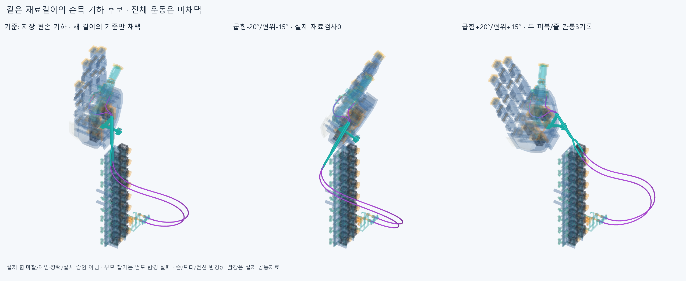
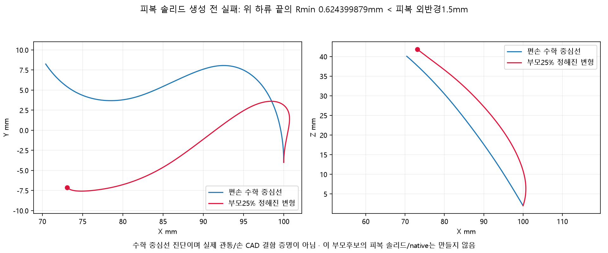
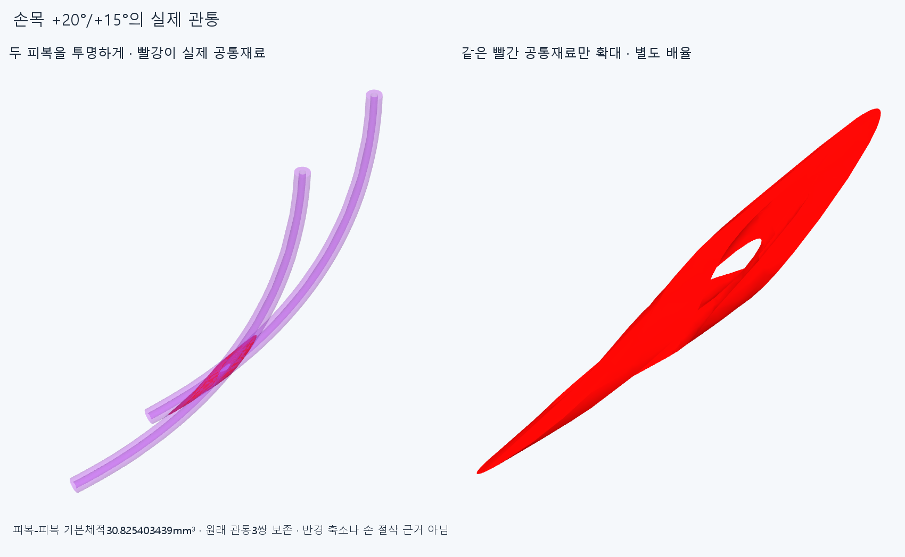

# LENGTH037 일정재료길이와 규정 운동 후보

**현재 실제 종단·안내대를 잇는 편손 기하로부터 별도 길이 후보를 정의하고11분석표본에서 같은 재료길이를 맞췄다. 그러나 부모 잡기25%의 급한 굽힘과 편손 손목+20°/+15°의 두선 교차로 전체 후보는 미채택이다. 손/모터/전선·하드웨어는 바꾸지 않았다.**

## 별도 후보의 길이 근거

CONTACT036의 원래 목표723.694097490095/785.279281488604mm와80회미수렴·약7mm초과는 그대로다. 그 실패를 이름만 바꾸어 성공 처리하지 않았다. 이번 별도 LENGTH037은 CONTACT036 저장 편손 중심선의 실제기하를 재료길이 기준으로 정하고, 그 길이를 유지하는 운동 가정을 새로 검사한다. 길이 기준은 **730.856291629548/791.978524346492mm**, 각자유구간의5knot별 adaptive quad(epsabs1e−10/epsrel1e−12) 합과 실제고정 통로길이의 합이다. 확정 절단길이/공급품·실제±2mm조절량 승인이 아니다.

편손 제어점은 원래 저장값과 동일하다. 기존 CONTACT036편손1native의 공간검사를 그동일기하 범위에서만 재사용했고 같은6native를 반복하지 않았다. 옛국부 피복4/양끝짧은피복4/옛긴실패곡선/증거공통재료는 동일한 피복과 중복 설치하지 않는다. 이번 새136CAD행은 손목2표본×물리적피복2/중간중심줄2×각16/18구간의 저장이며136가이드/연결구·물리선136개가 아니다. 증거 공통재료3행은 설치물이 아니다. 손397/포장385/전기48선·16외곽/팔10/PAIR034하드웨어6, 기본손364본체·축/길이·모터/랙·전기·끝구/죠·안내대는 유지하고 이전STEP/STL **4890해시 불변**, 새하드웨어0이다.

## 정해진 변형과 재료좌표

접촉최적화/5173517삼각형거리장/옛독립막대·자유곡선 길이·반경탐색을 다시 실행하지 않았다. 저장된 각8제어점의 양끝운동을 w=[0,0,.2,.4,.6,.8,1,1]로 선형 혼합해 옮긴다. 모터쪽은전완고정, PAIR034는손목H=P@Y, 두엄지종단은H+thumb_mcp FK다. 양끝두제어점은 각실제진입축을 그대로 따르고 손/모터설치각·축을 바꾸지 않는다. 상류곡선 안쪽4제어점에만 [0,0,1,1,1,1,0,0]의 한스칼라 bulge모드를 더한다. 방향은 원래 상류제어점중심에서 양끝중점을 뺀 기존루프방향이다. 이는 수학적인 정해진 변형 자유도이며 허공 지지·텐셔너·실제고정물을 뜻하지 않는다.

한 선마다 상류+하류 자유길이합 등식만 Newton(최대12회)으로 맞추고 PAIR보어 앞뒤를 가상재료고정점으로 묶지 않는다. 각5knot별32점Gauss로 길이와 그스칼라미분을 계산하고 위분리adaptive quad로 확인했다. 부모0/25/50/75/100/75/50/25/0%의9표본과 편손의손목(−20,−15)/(20,15)2표본, **11분석×2피복=22길이폐쇄**의 최대잔차는 **4.25723101216e-09mm**다. 기준1e−5mm 이내이며 이것은 물리적 유지/접촉·장력 평형이 아니다. 공급품 EI/중력/비틀림·마찰/정상력/압착/예압/좌굴·수명을 풀지 않았다.

모터어깨를 재료좌표0으로 두면 PAIR뒤입구의재료좌표는17+상류자유길이, 앞출구는그값+176.428840822733mm다. 앞뒤의재료점이 움직일 수 있고 총길이만 고정한다. 각표본의각선9동일재료좌표점(총198점)을 전체실제중심선의 호길이로 역산해 저장했다. 부모완성의 계산상 입구재료좌표변화−63.226020060228/−52.379898474159mm는 **아래의 실패한 변형에서 나온 값**이며 실제필요슬라이딩·절단/조절/장력규격으로 이식하지 않는다. 편손손목2표본에서는 하류가H로강체이동해 길이가 같으므로 입구재료좌표변화는 약1e−11mm의수치0이다. 실제마찰하의 미끄럼/끼임 승인이 아니다. 정방향/복귀 동일각의 같은제어점도 메모리없는 규정기하의 결과이며 실제히스테리시스·동적왕복 증명이 아니다.

## 부모 잡기는 피복 솔리드 생성 전에 실패

각cubic구간 곡률제곱의 다항식임계점을 수치계산했다. 부모25%의 위하류 끝에서 **Rmin0.624399879396mm<피복외반경1.5mm**, 부모완성에서는 최소0.065305831638mm다. 공급품허용굽힘을 임의로 정한 것이 아니라 두께있는 피복의 국부필요조건부터 위반했다. 중간/복귀를 포함한7부모표본은 길이만 닫힌 **부적합 수학중심선**이다. 그7개의 피복SOLID/native는 만들지 않았고 그림도 수학중심선임을 명시한다. BRep유효/중심길이만으로 쓸수있는 피복이라고 쓰지 않는다. 한정된 이선형혼합 변형의 실패이며 자연스러운 다른 배치나 손기능의 구조적불가능/손절삭 근거가 아니다.

## 새 손목2표본의 실제 재료검사

편손손목(−20,−15)/(20,15) 두표본은 최소국부반경10.485430349631mm 이상이라 실제OD3/ID1.3피복·OD0.6중간줄을 만들었다. [새검사](reviews/check.json)는 각각 새68대손397/포장385/전기64/팔10/PAIR6 및내부2278쌍이다. 손·손바닥39포장은H, 전완346포장/전기64는고정, 손목캐리어/편위모터는P, 손목받침은H를 쓴다. **121788쌍/670AABB native후보/3관통기록/연산실패0**이다. 모든장애물5그룹은두표본모두0이지만 내부3재료쌍이양의손목표본에남았다. 반대손목표본은내부까지0이다. 보고기준0.001mm³초과/Boolean허용오차1e−6mm/OCC풀1이며 이각은새관절제한이아니다.

양의손목표본은 상류같은위치에서 피복0_2/피복1_2 **30.825403439401mm³**, 피복0_2/다른줄1_2 **2.771077787828mm³**, 줄0_2/피복1_2 **2.774086751188mm³**가겹쳤다. 3독립설계결함이라고세지않고 동일한 두선교차의3재료쌍으로 구별한다. 최대공통재료범위는X88.711320~112.311279/Y−237.183322~−234.091409/Z−261.774061~−258.888614mm다. 저장source4조각에서이3공통쌍만별도로생성해[evidence](generated/actual_common/scene.json)와[적응적분값](reviews/actual_common.json)을저장했다. epsilon1e−10의피복-피복체적30.827566585238mm³는같은기하의정밀적분이며기본30.825403439401을덮지않았다. 원래그룹재실행0/보고·Boolean문턱변경0이다. 빨강은 실제공통재료이고 두번째패널은같은재료만별도배율확대했다.

손자체/기존부품끼리/물체·모터전회전/전기선동적운동/연속손목왕복/긴피복끼우기·줄끼우기/조절·예압·장력·당김/마찰/지그·공구·제작/강도·실물은 새로검사하지않았다. 이전국부 조립/끝삽입성공을 이긴선전체에 승계하지 않는다. 큰U루프·기존지지돌출의 외형수용도 미정이다. 현재전체긴피복/전체줄은미설치이고손전체미완이다.

첫분석은 길이미분식 괄호의배열→스칼라오류로 결과/native/STEP전에 중단했다. 원래코드/오류를history에보존한후고쳤다. 첫details실행은3실제공통재료를저장한뒤name/shape전용손목록의mesh키오류로그림전에멈췄다. render_saved는실제장면메타데이터로그림만완성했고native/3공통쌍재계산0이다. 첫그림은history/images_attempt1에보존하고마이너스표시/투명도/공통재료확대를그림만고쳤다. history/render_revisions.json에원래렌더코드해시를묶었고실패/기존결과를삭제하지않았다.

## 다음과 기존 보류

이규정선형혼합/한스칼라길이폐쇄 후보는닫는다. 같은Newton/임의길이·반경경계/독립막대·자유곡선/80회접촉최적화를자동반복하거나각도/OD를줄여성공으로만들지않는다. 다음은 저장된상류실제교차와위종단의진입접선회전을읽고, 필요한두피복상대구속/자연스러운끝굽힘을 실제모터쪽·thumb_mcp쪽의어떤몸체·부착/접촉이유지하는지정하는것이다. 현재부모실패를모든자연스러운배치불가능으로확대하지않고, 새실제지지후보가필요하면그조립/끼우기/관련운동을새검사한다. 손/모터/랙·전기선을먼저깎거나옮기거나팔꿈치버스/끝낸국부틈으로돌아가지않는다. 모든실물·공급품인증을다음CAD/요청3~4동작영상조건으로무한히늘리지않는다.

CONTACT036원래길이실패/정확SHA검토JSON오류의한정복구, PAIR034두STEP포함관계모순·3000점분류일치보류, OFFSET024면false/한점모순과HOUSING027/GUIDED030/ELASTICA033기본적분false·명시정밀보조는그대로다. 이번은그문제의재검사/해소가아니며형상서명은모든곡면식/trim/일치경계면Boolean동등성증명이아니다.
