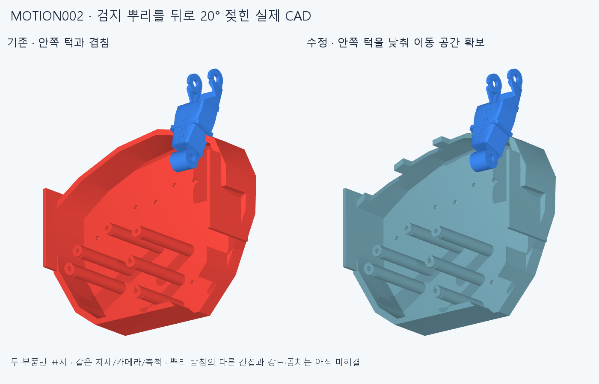

# MOTION002 · 손바닥 프레임의 뿌리 젖힘 공간

**손가락 뿌리를 뒤로 젖힐 때 막던 손바닥 프레임의 안쪽 턱을 낮췄다. 다른 뿌리 받침 간섭은 남아 있으므로 전체 손 가동은 아직 불합격이다.** 최신 손 364부품 중 프레임 한 부품만 바꿨으며 다른363부품의 STEP/STL·몸체·관절축·길이·최신 엄지척을 보존했다.

같은 검지 −20° 자세·카메라·축척이며 두 부품만 표시한다. 다른 받침을 숨겨 전체 손이 통과한 것처럼 해석하면 안 된다.

## 저장 CAD와 제작 관점

- [364부품 전체 native STEP 압축](generated/hand.step.zip) · [수정 프레임 STEP](generated/parts/Palm_tapered_chassis.step) · [출력용 STL](generated/meshes/Palm_tapered_chassis.stl)
- [현재 공개 부품 목록](generated/assembly_catalog.json)의 hand만 조립에 포함된다. motor_bench33부품은 별도 보존 참조이며 손에 설치된 모터가 아니다. 모든 자산 경로와 해시를 확인했다.
- generated/scene.json은 운동 감사용 원본 템플릿이다. hand 경로는 저장소 상대 경로이며, 복사된 외부 시험대 메타데이터의 지역 경로는 원래 thumb_ip_drive_v1/generated를 기준으로 한다. 일반 열람·다음 통합에는 경로를 모두 정규화한 assembly_catalog.json을 사용한다.
- 프레임은 유효한 연결 단일 솔리드이며, STL은 경계·비다양체·퇴화 삼각형이0개다. 전체 STEP을 다시 읽어 유효 솔리드364개, 정렬 체적 최대 차이 0.000531715mm³를 확인했다.
- 바닥 Z≤−40.5mm와 네 뿌리 뒤쪽 체결 발판의 원본 재료를 그대로 보존했다. 프레임 체적 감소는 6958.657840mm³, 약3.704%다. 차집합에서 직접 계산한 제거 부피는 6958.642510mm³이며, 두 Boolean 계산 방식의 작은 수치 차이를 그대로 남긴다.
- 이는 보존된 지지 형상의 확인이다. 턱을 낮춘 뒤의 강성·층간 강도·공차·피로·전체 조립/공구 접근은 미검증이다. 제작 출고 승인이 아니다.

## 움직임 검사

네 첫마디–프레임 쌍에서 벌림0°, MCP −25…0°, 다른 관절0°만 확인했다. 일반 −20° 젖힘에 추가5° 여유를 둔 국부 경로다. 아래 하한은 실제 STEP 거리 표본 사이에 점속도 상한을 적용한 값이다. native 거리 계산의 절대오차가0.00001mm 이내라는 가정을 차감하며, 실물 공차를 포함하지 않는다.

| 손가락 | 표본 최소 간격 mm | 구간 전체의 공칭 하한 mm |
| --- | ---: | ---: |
| index | 0.700000 | 0.506017 |
| middle | 0.700000 | 0.538775 |
| ring | 0.700000 | 0.504378 |
| little | 0.700000 | 0.509518 |

별도로 −20° 끝자세의 기존 실제 겹침을 재현하고 새 형상을 다시 계산했다.

- index: 기존 겹침 362.165553mm³ → 수정 겹침 0.000000mm³, 수정 간격 1.088470mm.
- middle: 기존 겹침 343.063440mm³ → 수정 겹침 0.000000mm³, 수정 간격 0.700000mm.
- ring: 기존 겹침 372.932267mm³ → 수정 겹침 0.000000mm³, 수정 간격 0.700000mm.
- little: 기존 겹침 412.145868mm³ → 수정 겹침 0.000000mm³, 수정 간격 0.700000mm.

기존72자세와36전환의108중간 자세에서 프레임 관련363쌍을 매번 새로 검사했다. 다른 쌍은 양쪽 저장 형상·몸체·동일 자세가 유지된 경우만 승계했다. 새 −25° 끝자세4개는 각각364부품의66,066쌍 전체를 다시 검사했다.

- 이번 수정으로 새로 보고된 프레임 간섭은0건이다. 기존9손짓의 끝자세 결과도 유지된다.
- 전체 손은72자세 중25자세,36전환 중12조합에서 여전히 간섭한다. 이전 연산 미확정1건을 삭제하지 않았다.
- 네 손가락의 −20° 자체 간섭은 각각3쌍→2쌍이다. 프레임 쌍만 해결했고 회전 받침·고정 하우징 간섭은 남는다. −25°에서는 각각 다른 지지부3쌍이 겹친다.
- 벌림이 섞인 운동, −35° 탐색, 새끼 벌림, 깊은 PIP/엄지 MCP, 다른 손짓 전환, 전체 줄·모터·배선·실측 지연은 이 국부 결과로 승인하지 않는다.

## 다음 단계와 재현

다음은 뿌리 첫마디와 회전 받침·고정 하우징의 간섭이다. 베어링/축 지지면과 체결 단면을 확인하며 수정한다. 각도 제한이나 검사 제외로 감추지 않는다. [선정 기준](REVIEW_PLAN.md), [전체 원시 검사](reviews/audit.json), [저장 CAD·전체 STEP 재수입](reviews/saved_geometry.json)을 함께 보존한다.

환경은 requirements-cad.txt, 그림은 requirements-render.txt를 따른다. 모두 숨김 pythonw와 스레드1로 실행한다. 아래 출력 경로는 매번 새 경로여야 한다.

~~~text
python build.py --output NEW_CANDIDATE_OUTPUT
python audit.py --output OUT/audit.json
python package.py --work OUT/native --output OUT/geometry.json
python check_result.py --audit OUT/audit.json --geometry OUT/geometry.json
python write_catalog.py --output OUT/assembly_catalog.json
python render.py --output OUT/images
~~~

build의 출력은 저장소 안의 새 폴더를 절대 경로로 정해야 한다. 감사·패키징 도구는 이 체크포인트에 저장된 generated 입력을 읽는다. 새 생성 결과를 채택할 때는 별도 후보·다음 체크포인트에서 입력 위치와 해시를 고정한다. 기존 후보를 덮어쓰지 않는다.

커밋·푸시 뒤 정확한 SHA의 깨끗한 별도 clone에서 review_core.py와 package.py, 동결 증거 검사를 재실행한다. 핵심 재검사는 선택한 전체 손 자세와 손가락별5개 거리 표본, 저장된 모든 구간 하한의 산술을 다시 확인한다.180자세와 모든 적응 거리 표본을 전부 재계산하는 절차는 아니다. 후속 검토는 docs/reviews/MOTION002에 대상 SHA·실제 범위·미해결 항목을 남긴다. 같은 에이전트의 재검사이며 독립 감사가 아니다.
