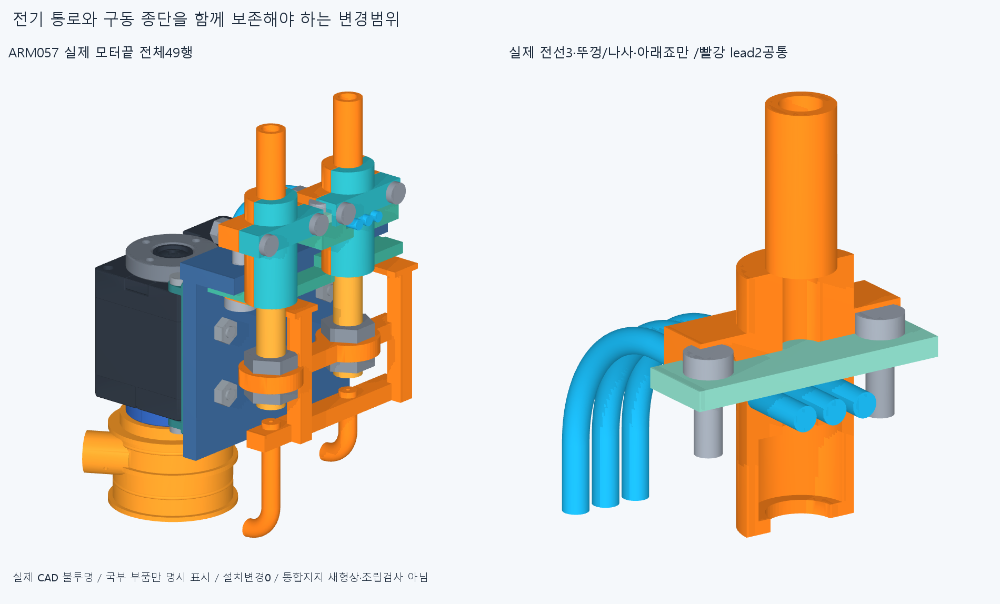
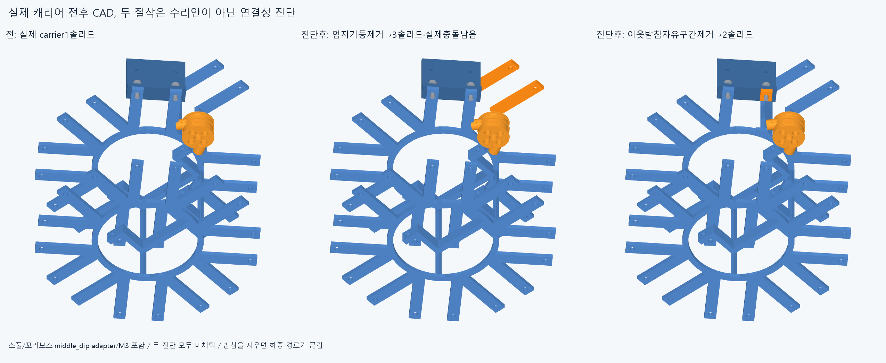
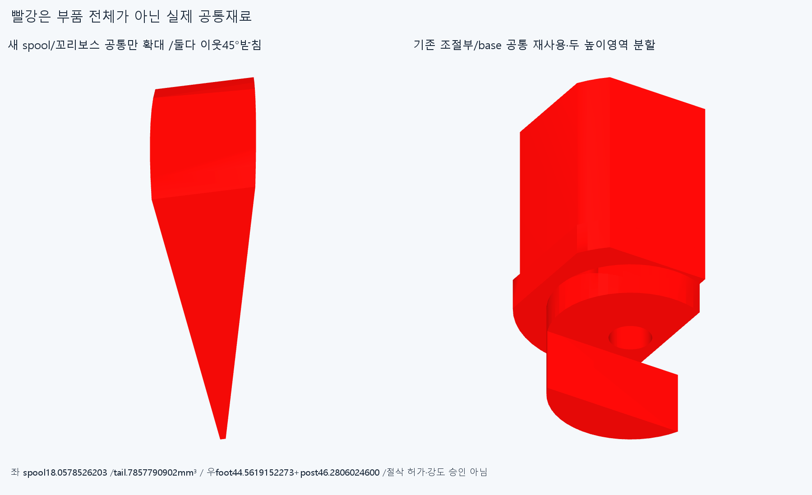

# ARM058 전기·구동 종단의 통합 변경범위와 이웃 캐리어 받침

**현재 설치862개는 그대로다. ARM057의 전기 통로 침범은 지지대만 합쳐 해결되지 않으며, 스풀을 막는 재료는 엄지 연결기둥이 아니라 이웃 middle_dip 받침이다.** 새 통합지지 형상을 완성하거나872후보를 채택한 단계가 아니다.

## 전기 통로를 보존해야 하는 이유

실제 ARM057 모터끝49행을 한 묶음으로 읽었다. 아래죠0/실제lead2 공통은 **9.70063882298162mm³**이며, 실제 전기 통로의 닫힌 내부와 아래죠 공통은 **31.692223898967907mm³**다. 옛 ARM057의다른 lead1·3/뚜껑/M2간섭 기록은 읽기만 승계했고22기록/36그룹을 다시 실행하지 않았다.

현재 전기 안내대는 독립된3보어가 아닌 **뚜껑으로 닫는 한 사각 홈**이다. 원래 guide-frame 내부 `[-3,-3.75,-69.75]..[3,3.75,-67.35]mm`,6×7.5×2.4mm를 보호 공간으로 썼다. 실제3선은OD1.9/R10/각38.70796326794897mm의 명목 공간 경로다. 실제 공급선/플러그 결합·인장완화·수명 승인은 아니다.

ARM057에서 저장한 조절부0/base 공통STEP 하나를 재사용했다. 원래 guide-frame 높이−77/−71.75의 좌표 띠로 나누면 foot/bridge44.561915227324775+post46.2806024599963+groove-block0mm³,합90.84251768732107mm³다. 두번째 띠는2solid이며, 띠는 제조 부품 분할이 아니다. 받침재료 수정 가능 범위와 실제 전선 통로 침범을 구별한다. **base의 받침살만 다시 만들어도 죠/전선 침범이 남으므로 실제 죠·조절부·R5 지지 위치를 함께 바꿔야 한다.** 전선/뚜껑·나사를 지우거나 죠에 임의 홈을 파서 성공 처리하지 않는다.

원래M3두축(71,-126,±13)/+Y와패드1mm를 보존할 전제다. 명목 스택은 terminalpadY−127..−126→guidefoot−126..−124→adapter−124..−121→carrierseat−121..−118이다. 이 원래 스택/부속을 읽은 계약이며6DSS/두패드검사를 다시 돌린 것이 아니다. 실제 강도·예압·마찰·공구 진입 승인은 없다.

## 실제 스풀 간섭의 소유 부품 교정

새 국부 공통은 clockedspool/carrier **18.05785262026932mm³**,tailclamp1/carrier **0.7857790902474455mm³**다. **둘 다 front row1/bank1/45° middle_dip의 tangent−13mm 받침 안에 전부 포함**된다. 각 공통에서 그 실제 소스 받침상자를 뺀2차집합은0이다. 받침은 source radial box`[34,-162,-17]..[75.4,-159,-9]`를Y축−45°회전한 재료이며,원래M3자리/허브를 지지한다.

처음 엄지 자신의 axialbridge가 원인이라는 가설은 기각했다. 실제 spool공통 전체18.05785262026932mm³가 두 엄지 bridge밖에 남았다. 그 bridge의 freeY−159..−121구간만 제거한 진단은 carrier를3solid로 분리하고 엄지M3받침2개가 떨어진다. 원인이 되는middle_dip받침의 free radial38..66.5구간만 제거해도2solid로 나뉘어 바깥 M3패드가 떨어진다. **두 절삭은 모두 미채택 연결성 진단이며,실제 지지대를 지우거나 설치한 것이 아니다.** 이웃받침을 우회 연결하는 새 지지형상이 필요하다.

`reviews/survey.json`의 최초 `required_changes.carrier` 추론은 **`carrier_followup.json`이 대체**한다. 처음8진단/추론·코드와 후속4진단을 그대로 보존한다. 틀린 추론을 읽기 교정이나 성공 설계로 숨기지 않는다. native연산오류/코드실패는0이다.

## 구체적인 다음 설계 범위

통합 모터끝 후보는 실제 전기홈/뚜껑·M2체결/3선·플러그/공유M3스택을 고정 입력으로 두고,guidebase의 하중살과R5틀을 일체 지지로 다시 만들며 실제 조절부/죠 위치와 두R10 접선을 함께 정한다. 작은너트3개 수정·추상포트만 밀기·adapter밖을 빈공간으로 취급하는 반복을 하지 않는다. 전기부속을 몰래 이동하지 않는다.

별도carrier후보는 middle_dip의 원래M3축·바깥패드와허브를 보존하고 tangent−13받침의 하중경로를 엄지 출력 공간 밖으로 우회한다. 엄지 자신의 bridge를 잘라 해결했다고 하지 않는다. 이웃 모터/adapter/전체부속과 관련팔운동·조립을 새 형상에서 검사해야 한다. 이 단계는 우회받침CAD를 만들지 않았다. 다른 앞spool/빔·손목·cap간섭도 해소하지 않았다.

공유M3를 풀면 guidebase/R5kit를 작업대에서 수동 지지해야 한다. 뚜껑을 열어 기존 홈에3선을 놓고 기존M2로 닫는 선조립→기존M3스택 착좌→모터/출력→긴구동줄 순서는 **제안**이다. 실제 경로·지그/공구·체결토크·예압/강도 검사는0이다. 플러그를 닫힌 홈에 통과시켰다고 하지 않는다.

## 실제 CAD와 검증 범위

새8+후속4=**12focused native Boolean**/0연산실패다. 설치부품 전쌍 검사나12독립결함이 아니다. 새11개 증거CAD(여러solid공통1행 포함)는 공통/분할/미채택 절삭상태이며 설치물이 아니다. 현재862/손397·기본364/축길이/손바닥4/원격16과기존기하12480/동결222해시를 보존했다. 팔자세/연속운동·전체긴재료/장력·20토크·동적전기·상완/실물제조외형 승인은 없다.

새 정확SHA 깨끗한 별도사본에서12진단/11source-STEP적응epsilon1e−10·절대1e−5기하,전기frame/3선 끝·OD/R·길이/보호목록/M3스택과middle_dip받침축 계약만 대조한다. 이 측정은 모든 곡면식trim/Boolean동등성 증명이 아니다. 원래ARM05735/36strictfalse/source43STEP42·과거비교보류를 반복하거나 해소하지 않는다. 같은에이전트 검토이며 독립감사가 아니다.
