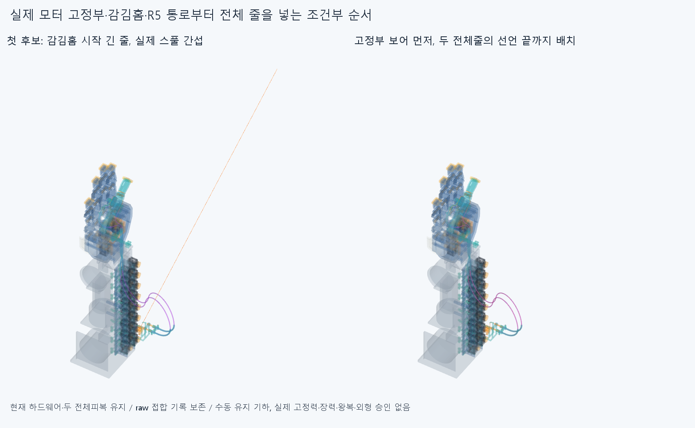

# CORD043 실제 모터 통로를 포함한 전체 맨줄끼우기 후보

**고정부 보어를 먼저 통과시키는 새 순서는 두 전체 줄의 선언된 끝까지 도달했다. 다른 부품/다른 줄·비국부자기교차의 보고 기록은 0이지만, 같은 아래줄의 모터 고정꼬리/감김 모델 접합 23반복 기록 때문에 raw 전체 native=false를 보존한다. 실제 고정력·장력·실물·연속 삽입/왕복 승인은 아니다.**

## 실제 시작 조건과 순서

FORM042의 두 전체피복이 중립 편손에서 원래 모터 어깨까지 놓이고 원래 죔쇠를 복구한 CAD 상태를 읽었다. 손397/포장385/전기48선·16외곽/팔10/PAIR6, 총862하드웨어와 **저장된 두 전체피복26조각**을 매 검사에 포함한다. 처음 맨줄은 없고 하드웨어 삭제0이다. 피복을 이동시키거나 양의 모터 정지어깨를 관통시키지 않았다. 옛 짧은 피복/축프로브/전체줄·실패곡선/증거를 중복 설치하지 않았다.

첫 후보는 실제 R10감김 시작점에서 열린 감김홈→18mm접선→실제 R5/조절부/전체피복→손쪽 통로로 보내며, 뒤에 남은 전체 줄을 시작 접선 직선으로 유지했다. **첫 시작상태 한 개부터 긴 줄 motorfeed_cord_0_0이 실제 thumb_ip_two_tail_spool과1.348726436306mm³ 겹쳐 중단했다.** 다른 손·모터·전기·팔을 깎거나 이 실패를 삭제하지 않았다. 첫 후보의 꼬리 뒤회전/이후 삽입은 실행하지 않았다. [첫 후보 원시결과](reviews/check.json).

현재 스풀에는 줄 전용 닫힌 사선 고정부 보어도 있다. 대안은 **선단을 그 보어 바깥 선언꼬리 출구에서 먼저 넣고**, R10감김홈을 따라 수동으로 놓아 실제 선택18mm접선/R5고정보어/조절부/현재 전체피복/PAIR/엄지 종단·라이너/열린 R7.7감김/자식 선언꼬리 끝까지 보낸다. 이미 감은 긴 줄을 닫힌 고정부에 옆으로 돌려 넣는 가정을 쓰지 않는다. 아래줄 전체를 마지막 위치에 유지한 뒤 위줄을 넣는다. [대안 원시결과](reviews/anchor_check.json).

모터 보어 바깥 시작점은 아래(21.018675028192,-271.050285094045,-117.509968943800), 위(-3.218675028192,-271.050285094045,-125.509968943800)mm다. 보어 모델 길이는 각9.190169943749mm이며 실제 고정꼬리→감김 접선 꺾임은 두 줄 모두26.565051177078°다. 기존 selected18mm 모터 소스를 사용했다. 보어/감김의 선언 모델 연결이지 부드러운 물리 굽힘/실제 정상력 승인이 아니다. 작은 접합을0으로 만들려고 스풀·고정부·줄·손을 미세 수정하지 않았다.

모든 현재 모터 고정나사와 자식쪽 하드웨어는 명목 위치 그대로 있다. 실제 나사가 느슨한지, 줄을 압착해 잡는지, 구멍/나사산/공구·토크가 적합한지 풀지 않았다. 최종 줄끝이 선언 위치에 도달한 것과 **줄 고정/매듭·빠짐저항/인장력·예압 승인**은 다르다. 감김홈 밖/긴 들어오는 꼬리는 작업자가 유지하는 규정 기하이며 공중선을 설치 지지/텐셔너로 세지 않는다.

## 같은 전체 재료 길이와 실제 검사

모델 줄 전장은 **853.356663204892/932.491923574900mm**다. 기존 BIARC039 편손에서 선언한 길이를 별도 끼우기 후보의 입력으로 사용했으며 실제 절단/공급·신장·매듭/±2mm조절 필요 규격이 아니다. CONTACT036 목표 미수렴/LENGTH037 변형 실패/BIARC039 독립7자세 길이 실패를 성공으로 덮지 않는다. 두 피복 길이698.964345153791/761.108456948670mm는 그대로다.

고정된 실제 통로·선언된 열린 감김 경로의 호길이에서 선단t와 같은 재료L의 **[t-L,t]**를 자른다. 경로 앞 음수 좌표는 실제 고정부 바깥 보어축의 직선 자유꼬리다. 매 표본 L 전체를 검사했고 줄이 들어간 길이만 검사하지 않았다. 두 선의 각 경로조각 경계에서 아래25/위29, 합 **54새 유한 표본**을 계산했다. 전체 길이 잔차 최대 1.13686837722e-13mm, 조각 끝점 차 최대 4.68971662657e-14mm다. 첫 실패1을 포함한55프로필/동일재료좌표495점을 저장했다. 새 곡선·길이/R경계·Newton/접촉최적화/거리장·독립막대 탐색은 없다.

각 대안 표본은 현재5하드웨어그룹/두 전체피복/앞서 넣은 전체줄/자기조각쌍을 모두 새 검사했다. **대안 690128쌍/4022AABB native후보/23기록/연산실패0**다. 원래 보고0.001mm³초과/Boolean1e-6mm/OCC1을 유지했다. 총23기록은 아래줄의 같은 물리선·경로연속0/1인 고정꼬리/감김 조각의 반복이며, 23서로 다른 결함이나 두 줄 관통으로 세지 않는다. 원래 첫 실패의 888쌍/13AABB/1기록은 별도 후보 기록이고 대안 통과 표본에 더하지 않는다.

**raw false와 다음 유한 순서 진행을 구별했다.** 모든 자기쌍을 계산했고 접합을 검사 제외하거나 전체 native0이라고 쓰지 않았다. 분류는 명시한 동일줄의 연속 모터 꼬리/감김 조각에만 적용했다. 끝점은 연결되고, 마지막 아래줄 공통재료 bbox 모서리는 그 접속점에서 최대0.444972079588mm 안이다. 이것은 모델 접합 위치 분류이며 실제 같은 재료 굽힘/부드러움·힘 승인이나 원래 source/STEP 비교 보류 해소가 아니다. 다른 부품·다른 줄/다른 자기쌍의 보고 기록이 생기면 중단하도록 했다.

마지막 **52줄 CAD조각은 같은 두 물리줄**이며 시간별 복제/피복26조각/증거를 설치 연결구·가이드 수로 세지 않는다. 하드웨어 추가·수정0, 이전 STEP/STL **6308해시 불변**이다. 첫 실패와 대안/각 시작·모터보어 통과 끝/전체 줄끝의 저장STEP를 구별했다. 대안 원시결과의 첫/보어끝/마지막6장면만 CAD로 저장하고 중간48은 기하·재료점/원시native를 남겼다.

## 증거와 범위

[유한 공통재료 진단](reviews/evidence.json)은 첫 실패 최대1쌍과 각 선 마지막에 실제 기록된 차단쌍 또는 명시한 같은줄 접합만 대상으로 했다. 이번에는 첫 실패와 아래 접합2쌍을 source공통에서 epsilon1e-10으로 측정했다. 기본값을 덮거나 native그룹을 다시 실행하지 않았다. 실제 공통재료는 증거이지 설치물 아니다. 팔표시는 SEAT041 실제 native STEP 기반 mm메시를 사용했다. 외부 큰 루프 외형 수용은 미정이다.

54표본을 실제 연속 삽입/슬라이딩·힘·장력하 성공으로 확대하지 않는다. EI·중력·비틀림·좌굴·압착/마찰·정상력·장력·예압·실제 평형/히스테리시스, 실제 손·공구/지그 접근·나사산/토크, 모터/손 고정꼬리의 실제 체결, 모터 전회전/동적 전기선/부모·손목 잡기·풀기·전체손/20모터·실물·제조·외형 승인은 없다. 본체·축·길이/모터·랙·전기 위치를 유지한 조건부 기하 조립 후보다.

Close CORD043 finite anchor-bore-first whole-cord feed candidate, preserving raw same-cord motor-tail/wrap junction records and original direct-groove entry failure. Two modeled whole cords reach declared motor-tail and distal-tail endpoints through current actual motor anchor bores/R10 groove/selected18mm tangent/R5fairlead/adjuster/wholehousing/real distal channels. Not physical threading, fixation, elastic equilibrium or force approval. Next inspect actual motor pinch-screw and distal child-tail bore/clamp contact/assembly sequence and declared no-slip constraints; do not confuse nominal tail endpoint or screw pose with real fixation/preload. Then constant-material length/contact/sliding-aware natural parent/wrist grasp-release with motor fixed to forearm, PAIR H and distal H+MCP;not old independentvariablelengthposes. Do not make fullphysical/supplier certification an endless prerequisite for subsequentCAD/requested3-4motionpreviews. Keep hand397/base364/pack385/elect64/arm10/PAIR6/body proportions/axes/lengths/motor/rack/wires/OD;no elbow bus/handcuts/anglelimits/microgap or same-cord seam zeroing. Preserve raw native false/23repeatedsamephysicaljoint records, earlier SEAT041 failure and BIARC039 source1STEP2 corefalse and all inherited comparison holds. No automatic repeat of CORD04354/FORM04218+32+44/SEAT041/THREAD04056+4+84 or oldNewton/80optimizer/independentrod/freecurve/biarcposefamily/virtualsupport/tensioner.

SEAT041 원래 받침 운반실패, BIARC039 source1/STEP2동일줄 인접접합 목록차이 core_initialfalse/명시재현false, CONTACT036 검토저장 복구·LENGTH037 실패, PAIR034 두STEP포함관계false·3000점 분류일치 보류, OFFSET024 면false·한점모순과 HOUSING027/GUIDED030/ELASTICA033 기본적분false·명시정밀보조는 재검사·해소하지 않았다. 형상서명은 모든 곡면식·trim·Boolean동등성 증명이 아니고 같은 에이전트 새사본 검토는 독립감사가 아니다.
