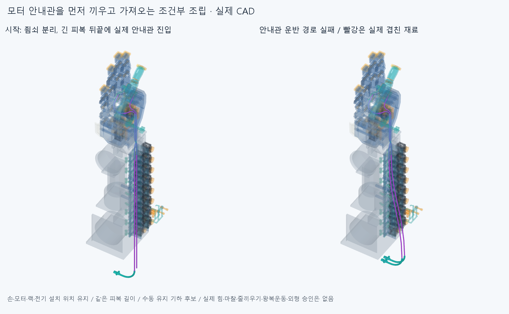

# SEAT041 모터 안내관 선끼우기·운반 조립 후보

**전체 길이 피복을 먼저 끼운 뒤 분리한 실제 닫힌 모터 안내관을 자유 피복 끝에 끼우고, 두 안내관을 함께 원래 고정부로 가져오는 조건부 순서를 검사했다. 후보 전체 clear=false, 실패 상태=carry_0. 실제 전체 설치·줄끼우기·힘·장력·왕복운동 승인은 없다.**

## 실제 시작 상태와 순서 변경

THREAD040의두피복이PAIR뒤에서엄지어깨까지들어간뒤,아직맨줄을넣기전상태를쓴다. 기존THREAD040의줄끼우기성공표본을취소하거나이번모터통로완료로승계하지않고 **맨줄작업을나중으로미룬새조립순서**다. 모터/랙/전기선설치위치·손397/팔10/PAIR6/기본손364본체·축·길이는같다. 양쪽모터의아래죠/실제닫힌굽힘관2와반대죠2·M2너트4·볼트4의 **12클램프부품이분리된조건**에서시작한다. 나머지850하드웨어는존재한다. 실제분리/창고에서옮겨오는과정·수동접근/작업자손·집게/지그·공구는검사하지않았다. 다른부품을무조건빼고전체공장조립이됐다고하지않는다.

각하우징뒤에자유롭게남은길이450.718799714381/457.936843217780mm는처음-Y직선이다. 분리한해당실제아래죠/안내관을이끝에서시작시켜피복을통과시키며안내관을+Y로옮긴다. 고정된모터양의어깨를뚫고긴피복을통과시키지않는다. 움직이는안내관에는원래모터의M5어깨가없으므로마지막피복끝은원래어깨에해당하는선언위치에서작업자가유지한다. 실제양의어깨에닿는것은안내관이원래모터고정부에도착할때뿐이다.

먼저아래안내관,그뒤위안내관을끼운다. 자기실제R40굽힘/12mm직선과원래죠구간17mm를포함한91.831853071796mm상대스트로크다. 선단표본은0/20/40/60/62.831853071796/74.831853071796/84.831853071796/91.831853071796mm다. 남은꼬리전체와다른피복/먼저끼운실제안내관까지각순간함께검사한다. 완료된새선끼우기표본은 **16**다. 기존SUPPORT038의100mm국부피복참고검사를재사용하지않았다.

## 같은 길이로 두 안내관을 가져오는 기하

각선의저장BIARC039편손상류두원호를거꾸로읽어PAIR뒤에서모터쪽으로향하는기준으로삼는다. 새biarc끝점풀기/옛7독립자세/길이목표·반경경계/독립막대·Newton/접촉최적화·거리장탐색을하지않았다. 같은원호호길이L을유지하면서변형되지않은원호곡률κ0에대해 **κλ=λκ0, θλ=λθ0, Rλ=R0/λ**로놓는다. λ=0은직선,λ=1은저장된한편손상류형상이다. 프레임을각원호끝에서평행운반하며실제피복길이는늘리거나깎지않는다. 변형하는것은두지지사이의자유피복구간이며실제안내관R40은그대로다.

각자유곡선끝의변환으로 **해당실제아래죠/닫힌안내관도같이옮긴다.** 곡선만고정관벽을옆으로통과시키거나허공지지/없는텐셔너를놓지않는다. 두피복과두실제안내관은같은λ로함께가져오는수동유지후보다. λ=0은직전선끼우기끝,새검사표본은0.125/0.25/0.375/0.5/0.625/0.75/0.875/1이며실제실행된운반표본은 **1**다. 남은λ표본은실패후자동실행하지않았다. 물리탄성평형·EI/중력·비틀림/정상력·마찰/좌굴·압착·장력·예압·히스테리시스를풀지않았고분할점은설치지지가아니다.

전체피복재료길이는기존별도조립후보의 **698.964345153791/761.108456948670mm**다. 완료표본전체길이잔차최대 **1.13686837722e-13mm**,조각끝점차최대 **1.56480805526e-13mm**,각상태각선9개의동일재료좌표위치를저장했다. PAIR뒤입구의재료좌표는각자유꼬리길이로같고이번끼우기에서는작업자가그쪽재료를유지하는조건이다. 실제마찰하축슬라이딩/정지력·인장완화승인이아니다. 줄은없으므로모터조절부/R5통로끼우기·감김·고정/전체줄연결을이번에했다고쓰지않는다. 기존길이를확정절단/공급길이나±2mm필요조절규격으로쓰지않는다.

## 현재 결과

새선끼우기/운반 **17상태**,반대죠·M2복구 **0표본**,최종전체하드웨어피복검사 **0상태**를실제로완료했다. 전체 **334088쌍/1175AABB native후보/1겹침기록/연산실패0**,보고기준0.001mm³초과/Boolean허용오차1e-6mm/OCC풀1이다. 재료분할기록을독립설계결함수로세지않는다. [원시검사](reviews/check.json),[첫실패공통재료](reviews/overlap_evidence.json).

**16선끼우기는모두0겹침이지만첫운반λ=0.125에서아래피복seat_housing_0_3과기존Elbow_fixed_cradle이21.448557507491mm³겹쳐중단했다.** 손/포장·모터/전기/PAIR와이동형상내부기록은0이다. 이실제구간은긴자유꼬리의운반경로이지팔꿈치전기버스를추가하는작업이아니다. 나머지7운반/32복구/최종검사는실행하지않았다. 손/팔·모터를깎거나움직여해결한것이아니며한후보실패가모든조립/손기능불가능의근거가아니다.

첫실패겹침목록: `[{'lead': 'seat_housing_0_3', 'part': 'Elbow_fixed_cradle', 'material_intersection_mm3': 21.448557507490612}]`. 후보전체 clear와길이유지/국부조립을구별한다. 실패후아직실행하지않은운반/복구를성공표본으로세지않고,저장된중립연결이곧조립도달가능이라는뜻으로쓰지않는다. 실제전체손/20모터·전기·전달계운동/힘·마찰/공급품굽힘/제작법·공차·강도·나사산/토크·외형수용승인은없다. 큰전완바깥루프외형은미수용상태다.

모든검사에서전체현재고정5그룹과명시한누락/이동/복구부품,두전체피복과새이동형상내부를포함했다. 복구는반대죠+Qz14/7/2/0→너트각-Qz10/5/0→볼트각+Qz10/5/0이며그때설치된실제안내관과두피복도있다. 실행된범위만기록했다. 새설치하드웨어0,기존부품의조건부조립이동만있고최종설치축/위치를변경하는후보가아니다. 이전STEP/STL **5566해시불변**이다. 옛짧은피복/Ø0.6축프로브/BIARC039줄·장면과증거/과거긴실패곡선을중복설치하지않는다.

## 저장 오류 이력

첫시도는첫자세의외부5/내부native계산뒤기존모바일하드웨어의step/mesh키를새출력경로와중복전달해export에서중단했다. 두번째도첫자세계산뒤assembly_transform의NumPy배열을JSON으로직렬화하지못해중단했다. 두시도판정/원시native는저장되지않았으므로새값으로복사·통과승계하지않았다. 원래코드/오류·stdout/status는history에,첫부분CAD는generated/feed_0_0와generated/checked/feed_0_0에그대로남긴다. 두실패를0native실행이라하지않고완료표본수에도합산하지않는다.

교정은기존파일정보/배열의export중복을제외하고검사판정값을CAD저장보다먼저기록한것이다. 실제변환행렬은검사보고서각line에유지한다. **seat_model.py는첫원본과해시가같아형상/기하함수변경0**이다. generated/verified만이번완료검사장면이며앞부분CAD를검사완료설치로세지않는다. 실패를삭제/이름변경성공처리하거나Boolean/보고문턱을바꾸지않았다.

## 팔 참조 그림의 단위 교정

첫그림은기존공통렌더도우미가팔참조STL10개의m단위를mm처럼읽어받침이실제크기로보이지않았다. 첫그림/보고서와그정확코드해시의원본을history/images_attempt1·render_attempt1.py.txt에보존했다. 현재그림은 **native검사와같은10팔STEP를직접읽어mm STL로내보낸별도시각참고**를쓴다. 이10메시는추가팔부품/설치물이아니고기존팔STEP/STL은수정하지않았다. 공통재료의두상대부품은투명하게해실제빨간재료가보이게했다. native그룹/공통쌍재실행0인렌더교정이며원래mm STEP기반간섭검사에는영향이없다. 이전BIARC039/THREAD040그림의팔참조크기를이번팔표시승인으로승계하지않고옛그림도덮지않았다.

## 다음

Close this SEAT041 loose-guide prethread/paired curvature-carry assembly candidate after actual reported interference. Read saved actual common/failed movinghardware+fullhousings,retain bothmateriallengths; no source geometry/tolerance changes and nohanddefectclaim. Resolve with a genuinely different actual assembly access/order/temporary-part condition first; do not repeat this intrinsic-curvature scale family or arbitrary radius/length search. Motor seats/fastener restoration not reached if skipped; original BIARC neutral geometric target is not an assembled state. Keep hand/motor/rack/wires/axes/lengths/OD;noelbowbus/microgap/oldNewton/80optimizer/independentrod/freecurve/biarcposefamily/virtualsupport/tensioner. Initialcondition both12clamp partsdetached,only2actualguidesmove,cordsabsent; detachment/fromstorage/unfixedmanualhold notapproved. Allphysicalcerts not prerequisites for furtherCAD/requested3-4previews. Preserve inheritedBIARC039source1STEP2samecordcorefalseandotherholds. Do not replay completed THREAD04056/4/84 or SEAT041closed states automatically.

THREAD04056/4/84와끝낸국부삽입은이번재검사가아니다. BIARC039source1/STEP2같은줄인접접합목록불일치의core_initial=false/명시재현false,CONTACT036/LENGTH037실패와검토복구,PAIR034두STEP포함관계false·3000점분류일치보류/OFFSET024면false·한점모순/HOUSING027·GUIDED030·ELASTICA033기본적분false·정밀보조는재검사/해소하지않았다. 작은동일줄접합0/손절삭을다음조건으로하지않는다. 같은에이전트새사본검토는독립감사가아니고서명일치는모든곡면식·trim·Boolean동등성증명이아니다.

## 정확 SHA 새사본 재검사

대상`11365b0268cc07a4b5436164778f286170de2ddf`의새깨끗한clone에서30native/6대표형상/34프로필306재료점·2경계/1공통쌍정밀5값/10팔시각단위bbox를대조했다. 초기core=true,명시한정재현=true,차이=[],의존7063/동결222/OCC1이다. [실제한정범위](../../docs/reviews/SEAT041/README.md). 실패재현이며운반/설치/실물·힘·전체운동·외형승인이아니다.
