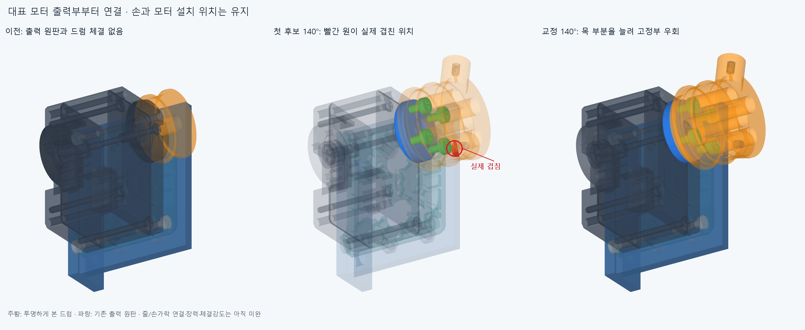

# DRIVE018 대표 모터 출력부의 실제 체결 후보

**현재 엄지 IP 원격모터 한 곳의 출력 원판과 드럼을 나사4개로 연결한 CAD 후보다.** 손364부품·관절축/길이·모터 위치·기존 전선48개는 유지했다. 손가락까지 연결된 전체 구동계는 아직 미완이다.

주황은 내부 체결을 보이기 위해 투명하게 렌더한 실제 드럼,초록은 명목 체결나사4개,파랑은 기존 출력 원판이다. 첫 후보140°의 빨강은 **실제 공통 재료 4.036823728mm³**다. 부품 전체를 제거 대상으로 칠한 것이 아니다. 그림은 현재 한 모터의 형상이며 손 전체가 구동되는 영상이 아니다.

## 무엇을 연결했나

기존 출력부3솔리드(출력 원판/중앙 고정나사/뒤쪽 아이들러)를 모양 그대로 분리해 참조한다. 새 두 홈 드럼·PHS M2x6 TAP 명목 외곽4개·기존 규격의 줄 누름나사2개를 넣었다. 금속 혼으로 바꾸거나 미확정 중앙 고정나사를 만들어 설치한 것은 아니다. 첫 후보는 회전 중 줄 고정 돌출부가 기존 어댑터에 걸렸다. **드럼에 반경9mm·길이2mm의 일체형 연결 목을 추가하고 돌출부를 축 방향2mm 옮겼다.** 모터/받침/손을 움직이거나 깎지 않았고 각도도 제한하지 않았다.

체결 웹 전체3.5mm,나사 길이6mm와 공칭 원판 진입2.5mm는 유지했다. 나사는PCD12mm,드럼의 관통공 반경1.1mm와 머리 통로 반경2.3mm에 배치했다. 반경7.9mm 원 안에서 확인한 받침면의 부분 면적은 약 **147.669655mm²**,드럼/원판 거리0·공통 솔리드 체적0이다. 단순히 참고 드럼을 원판에 붙여 놓은 구조가 아니다. 실제 나사산/공급 나사 머리·드라이브·체결 토크/강도는 미검증이다. [출처와 가정](references.json).

## 확인한 범위

새7개 맞춤 부품의 모든 출력 회전각을 포함하는 보수적 회전 공간3형상을 만들었다. 회전하면 축 방향 좌표와 축까지의 거리가 유지되는 성질을 이용한다. 뒤쪽 나사축은반경5~7mm의 환형 공간,연결 목은반경9mm 원통,앞쪽 드럼/줄 고정부는 실제 국부 경계상자로부터 구한 큰 원통으로 감쌌다. 수치 패딩1e−5mm다. 이 **전 회전각 공간 대 현재 남은358포장/고정부·기존48선/16커넥터 외곽·중립 팔10**에서 보고 기준0.001mm³ 초과 겹침0·연산 실패0이다. Boolean 허용오차1e−6mm다. 이 근거는 새 맞춤 부품의 강체 회전 공간에만 적용되며 손 전체·줄·기어 내부의 연속 운동 승인으로 넓히지 않는다.

0/110/140/180/270/360°의6실제 끝자세도 새7부품 대 같은 장애물과 함께 회전하는 원본3솔리드를 대조했다. 처음 실제로 걸렸던110/140/180°를 포함했다. 원판의 반경0.8mm 파일럿 구멍과 명목M2외피가 겹치는4접촉은 **X−2.5~0mm·PCD12의 반경1mm 영역 안**임을 실제 공통 형상으로 확인해 기록했다. 이를 일반 부품 충돌에서 숨기지 않았으며 실제 태핑/체결강도 검증으로 쓰지 않는다.

드럼+누름나사를 축 방향20→0mm로 넣는6표본,체결나사의 시작/완성2표본과 전 구간의 원통 외피·동축 구멍 포함관계를 확인했다. 나사 외피의 통로 여유는반경1→1.1mm/머리2.1→2.3mm이며 수치는 명목 가정이다. 임시 공구는반경1.05mm·길이18mm 직선 스템만 대조했다. **실제 나사 머리/드라이버·손잡이·체결 힘·작업자 접근은 미검증**이다.

손의 편 자세/엄지척/교차/25mm고정구/복합5끝자세는 전체364저장 STEP의 경계상자를 변환해 위3회전 공간과 분리됨을 확인했다. 입력 해시는 확인했지만 손364형상을 모두 새로 native수입하거나 자체 손 경로를 재계산하지 않았다. 원래 손동작 검사의 범위를 유지한다.

## 실패와 남은 일

원래 [첫 검사](reviews/check.json)는0~360°의37출력 표본을 완료하고 드럼/어댑터 걸림을 확인했다. 실패가 확정된 뒤 불필요한 나머지 조립 계산을 중단해 **completed=false**인 원본을 보존했다. 일부 조립 표본만 있으며 전체 조립을 통과했다고 쓰지 않는다. 원본 코드/기하·입력/부분 결과와 [별도 내보내기 기록](reviews/initial_export.json)을 남겼다. [개발 이력](reviews/history.json).

원래 모터의 중앙 나사와 자체 모터는 축 내부에서약34.846497mm³의 참고 나사/내부 재료 접촉이 기록된다. 원래3솔리드 복합체에서도 같은 접촉이며 [원본 분류](reviews/assessment.json)에 그대로 남긴다. 이 접촉을 새 드럼 결함으로 세거나,모터 내부 나사 구조/실물 조립을 새로 승인하지 않는다. 원래 전 부품 겹침0 판정은 false로 보존했다.

**선택 후보는 [selected/generated/scene.json](selected/generated/scene.json)의 새10+유지358=368행**이다. 이 중3행은 기존 회전자 복합체를 분리한 참조이며 새 모터가 아니다. 교체된 옛 회전자/참고 드럼2행을 다시 더하지 않는다. 공통체적 시각화 형상도 설치 부품이 아니다. 기존20모터 전체 설치 완료가 아니며 새 체결부는 후보 단계다.

다음은 이 대표 모터의두 홈/줄 고정부에서 손목·엄지 부모 가이드를 거쳐 기존 엄지 IP 줄 고정부까지 두 줄을 실제로 연결하는 것이다. 부모 관절 움직임에 따른 길이 변화·장력 조절·이탈/쓸림·정방향/풀기,실제 케이블 치수/고정이 남는다. 줄은 전기선과 다르다. 기존3~4손동작을 이 전달계까지 통합한 구성으로 갱신하되,이번 [출력부만 회전한 영상](images/output_rotation.gif)을 손이 모터로 구동되는 증거로 쓰지 않는다. 재생시간은 설명용이다. 팔꿈치 전기 배선 확장은 보류한다.

코드는model.py/첫build_check.py와교정candidate2.py/check2.py,검토는review_core.py다. 정확SHA 새 깨끗한 clone 핵심 재현은 후속 기록이며 같은 에이전트 검토다.
