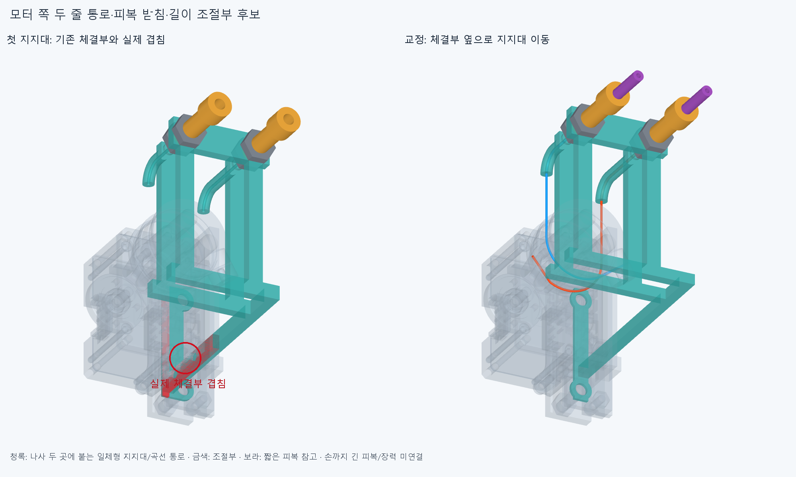

# TERMINAL022 모터 쪽 구동줄·피복 종단 후보

**엄지IP 모터 한 곳에 두 줄 안내 통로와 피복 받침·길이 조절부를 연결한 CAD 후보다. 손가락까지 이어지는 긴 피복과 전체 장력은 아직 미완이다.** 손 본체/관절축·길이·모터 배치·랙·기존 전기선과 GUIDE021 가이드는 유지했다.

## 실제로 추가한 연결

기존 엄지IP 원격모터의 M3 나사 두 곳에서 1mm 스페이서2행을 빼고, 같은 두께의 받침과 일체형 곡선 통로를 가진 지지대1개로 대체했다. M5×0.8 명목 조절부2개·양쪽 잠금너트4개를 더한 **새7+기존366=373포장 행**이다. 현재 조합은 [assembly_scene.json](selected/generated/assembly_scene.json)이다. 원래 스페이서2개를 다시 더하지 않는다. 손은 기존362+GUIDE021새11=373행이며 별도다. 실제20모터 설치 완료가 아니다.

모터의 R10 두 홈에서 줄이 접선 방향으로 나와, 고정부의 R5 곡선/직선 통로를 지나 조절부 안으로 들어간다. 곡선 통로는 새 지지대에 실제 솔리드로 연결되어 있으며 허공의 가이드 점을 설치 부품으로 센 것이 아니다. 피복 끝은 조절부의 실제 어깨에 닿고, 조절부→양쪽 너트→받침→기존 M3 체결부로 반력을 전달하는 명목 구조다. 원래1mm 체결 스택/나사 위치를 유지했다. **나사산·축력·강도/마찰·실물 하중을 검증한 것은 아니다.**

보라색은 외경3/내경1.3mm를 가정한 **각17mm 길이의 짧은 피복 참고**다. 실제 긴 케이블이 선정/설치됐다는 뜻이 아니다. 주황/파랑12조각은 물리적 두 줄의6구간씩이며 중간 커넥터12개가 아니다. 모터 쪽 종단까지만 연결했다. [실제 연결 끝점과 한계](selected/reviews/interfaces.json).

## 첫 실패와 형상 교정

첫 지지대는 기존 모터의 하부 나사/너트·어댑터와 각각18.849555922/22.744413424/266.754956979mm³ 겹쳤다. 지지대를 기존 체결부 옆으로 옮겼으며 손/모터를 깎거나 재배치하지 않았다. 드럼의 기존 보수적 전 회전 공간과의7.679889361mm³ 겹침은 실제 회전 부품의 관통 증명과 구별한다. 같은 보수적 포락체를 피하도록 새 안내구 진입을 모터 접점 앞15→18mm로 배치했다. 운영 각도를 제한하지 않았다. 첫 [실패](reviews/check.json)와 입력 오류를 [이력](reviews/history.json)에 보존했다.

## 검사 범위

선택한 새7부품의21내부쌍과 현재366포장/64전기선·커넥터 외곽/중립 팔10,DRIVE018의3보수적 전 회전 공간을 대조했다. 새 줄과 짧은 피복도 새/기존 부품에 대조했고, 편 손과 기존 구 접근 완성각의 **손373행을 두 자세에서 native로 대조**했다. **보고 기준0.001mm³ 초과 겹침0·연산 실패0**, Boolean 허용오차1e−6mm다. 손 자체 운동이나 전체 손/손목의 연속 충돌 검사는 아니다. [정적 검사](selected/reviews/check.json).

조립은 현재 모터의14행 묶음(모터/크래들/몸체·사전 하부 나사4행과 기존 출력부10행),하부 너트1행·M3볼트2행과 자기 모터 전기선/외곽4행이 아직 없는 단계에서 시작한다. 어댑터/전선 가이드는 수동 지지한다. 지지대 아래25→0mm 삽입→기존 M3 나사→벤치 선조립한 모터/출력부를 X+8→0mm로 안착→하부 M2 너트→조절부 위 너트를 옆에서 놓고 조절부/아래 너트를 밑에서 넣는 순서다. 실제 공구·지그/내부 벤치 조립·연결 커넥터 삽입·랙-팔 설치는 미검증이다. 각 단계에 없는 부품을 [보고서](selected/reviews/selected_service.json)에 열거했다.

원래 뒤35mm 진입은 이웃 새끼MCP 모터의 M3 나사/스페이서에 걸렸다. 형상을 바꾸지 않고 아래 진입만 새로 계산했다. 최종 필수 **40유한 표본은 새5/동일35재사용**, 겹침0·연산 실패0이다. 원래40표본의 [service.json](selected/reviews/service.json)은 전체 통과=false로 보존한다. 반복 표본을 독립 결함 수로 세지 않는다.

조절부의 **±2mm 후보 범위**는 각3자세×2개 및 전체4mm 이동을 덮는 보수적 외피로 확인했다. 이것은 나사를 풀고 돌려 다시 잠그는 정적 길이 설정이며 자동 장력 보정기가 아니다. 실제 필요한 조절량을 선정한 규격도 아니다. M3 받침의 위/아래,너트/판,피복 어깨에서 **22위치의 거리0과 양쪽 재료 분류**를 확인했다. 단순 몸체 배정만으로 고정됐다고 주장하지 않는다.

현재 모터 R10과 엄지IP R7.7의 실제 CAD 길이식으로, IP−15/0/45/85°에 대응하는 모터−11.55/0/34.65/65.45°에서 모터 쪽 줄의 간섭·두 줄 사이/비인접 같은 줄의 겹침0을 확인했다. **전체 피복 길이가 일정하다는 미래 가정 아래의 길이 균형**만 계산했다. 외부120mm 시험대의0.77비를 통과 근거로 승계하지 않았고 현재 두 반경에서 비를 다시 유도했다. 긴 피복/엄지 부모 움직임/압축·마찰/예압/힘 평형은 아직 없다.

피복 끝은 압축 방향 어깨에 닿는 구조다. **반대 방향 빠짐 방지용 콜릿/고정 캡과 인장완화는 아직 없다.** 예압이 항상 피복을 앉혀 준다고 가정하지 않는다. 긴 피복/손쪽 종단을 설계할 때 양 끝의 실제 유지도 함께 확인한다. [유지 범위](reviews/retention_assessment.json).

## 크기와 제작 한계

이번 후보는 대표 모터의 기존 최저점보다 **아래로 약35.50mm 더 돌출**한다. 손 본체는 그대로지만 이 추가 부피가 수용된 외형은 아니다. 실제 피복 경로가 잡힐 때 전체 포장과 함께 판단한다. 작은 틈을 다시 최적화하는 승인 근거로 쓰지 않는다.

닫힌 Ø0.8mm 곡선 통로·1mm 받침·M5 조절부의 가공/출력 방식·재료/마감,나사 공급품/실제 나사산·토크·강도·줄 마모/수명은 미확정이다. 외경3/내경1.3 피복,R5,±2 조절량은 공간/기구 후보이며 공급품 허용 굽힘이나 수명 규격이 아니다. 원래 모터 줄 고정부의26.565° 접선 변화도 유지하며 힘/마모 승인으로 쓰지 않는다.

## 다음

**GUIDE021의 끝단은 외경1.2mm 구동줄 안내관이며,3mm 피복의 반력을 받는 종단은 아직 없다.** 다음은 그쪽 실제 피복 받침과 부착/구속을 설계한 뒤 모터 종단→손목→엄지 뿌리→해당 종단을 일정 길이의 피복으로 연결하는 것이다. 끝점 직선거리359.00/380.52mm는 하한일 뿐 선정한 케이블 절단 길이가 아니다. 기존 TENDON019 자유 곡선의 실패/가상18.705669mm 보정기를 새 설계로 승계하지 않는다. 팔꿈치 버스와 끝낸 손 자세의 작은 틈 탐색은 재개하지 않는다.

코드·입력·실패/결과·그림을 함께 저장하고, 정확SHA의 새 깨끗한 사본에서 핵심 범위만 재현한다. 같은 에이전트 검토이며 독립 감사가 아니다. 전체 손 구동/실물/50·100ms 성능 승인은 없다.
