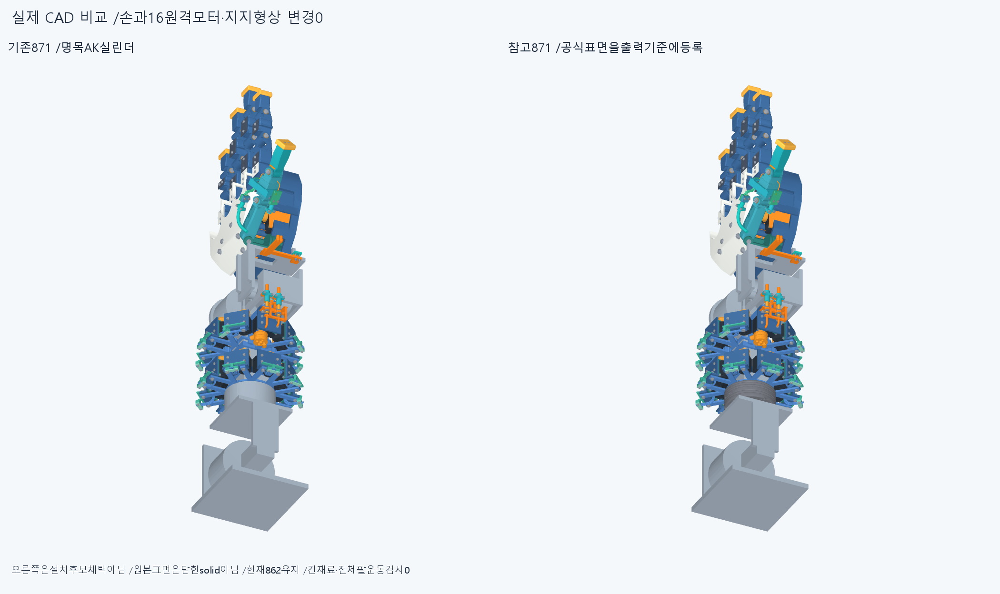
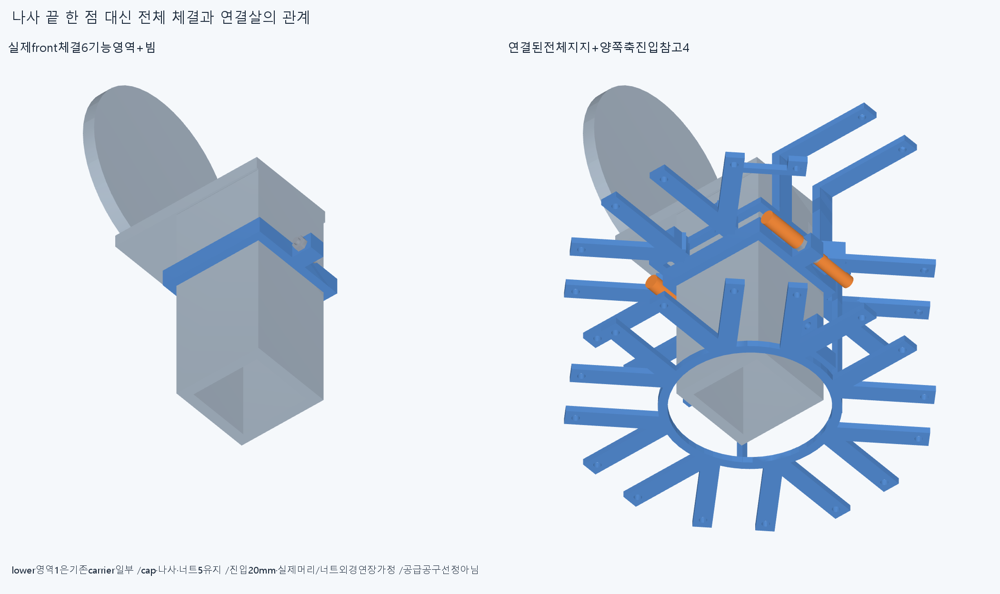
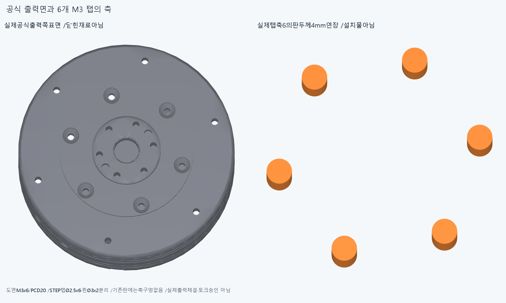
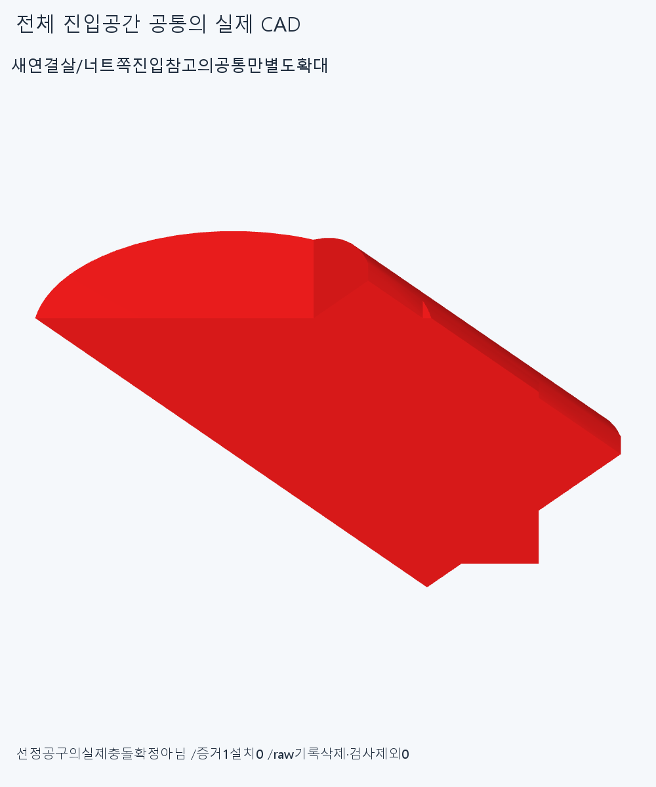

# ARM062 전체 체결 공간과 실제 전완 출력면의 근거

**기존 팔 모델에는 실제 회전 출력의 체결이 빠져 있었다. 공식 출력면을 기존 회전축 기준에 등록하면, 명목 모터 외곽에서 측정한 4mm를 메울 부품이 필요하다고 볼 근거는 없다. 대신 현재 연결판에 실제 출력 탭 6개의 축 구멍이 없다는 점을 확인했다.**

## 변경 범위

현재862, 기본손364·현재손397, 손바닥4·전완16구동원, 설치축·길이·전기·모터 명령과 출력clock은 그대로다. ARM061의 별도871도 미채택이다. 실제 설치 하드웨어 변경은0이다. 새18개 CAD는 기존 체결기능 영역6, 진입 참고4, 출력축 참고6, 열린 공식 표면1, 공통 증거1이다. 새 지지대18개가 아니다.

## 앞쪽 체결을 한 묶음으로 읽기

기존front lowercollar는carrier의 일부이며, cap1·M3나사2·너트2의 별도5행과 함께6기능 영역이다. lower형상 보존은 ARM061의 기존 결과를 근거로 삼았으며 같은 차집합을 반복하지 않았다. 두나사 축은X−31/+31,Y−162.5, shaftZ−4..8/head−6..−4/nut4..6.4mm다.

head와nut의 실제 최대 반경2.85/3.175mm를 각각 축방향20mm 연장한4개의 진입 참고를 만들었다. headZ−26..−6, nutZ6.4..26.4mm다. **선정된 소켓·비트·손잡이의 외형이나 필요한 공구 길이가 아니다.** 원형의 꽉 찬 참고체이므로 너트 밖으로 나온 볼트 끝과의 공통은 의도된 동축 공간으로 분류하며, 실제 공구2개가 막힌 것으로 세지 않는다. 이후 실제 공구를 정하면 바깥 치수와 내부 빈 공간을 함께 반영해야 한다.

새 진입4 대 기존871은3484쌍/10AABB/6기록, 기존9회전 보수공간과의 관계는36쌍/2AABB/1기록이다. carrier와의4공통은96.5202618440636/123.3261144050046/95.91640478980248/29.71755440113315mm³다. 돌출볼트와의2공통은각11.309733552923253mm³이며, 너트+X진입과spool보수원통은31.092181538002144mm³다. **참고 진입 공간 충돌을 실제 선정공구 충돌로, 보수원통 공통을 모든각 실제출력 충돌로 확정하지 않는다.** 분류 때문에rawfalse를 지우거나 검사에서 제외하지 않았다.

최대carrier공통 하나만 그림용으로 저장했다. source123.326114404963mm³이며 전체 진입공간 증거다. 기존 작은M3코너를 재검사하거나 깎는 작업이 아니다.

## 공식 출력 자료와 첫 분류의 교정

[공식 제품 페이지](https://www.cubemars.com/product/ak60-6-v3-0-kv80-robotic-actuator.html), [2D 도면](https://www.cubemars.com/data/cms/202602/ak60-6-v3-0-robotic-actuator-2d-drawing.pdf), [3D 원본](https://www.cubemars.com/data/cms/202602/ak60-6-v3-0-robotic-actuator-3d-drawing.zip)을2026-10-28에 다시 읽었다. 페이지의 상대다운로드 경로는404였고 root/data 경로의 파일은 정상이다. 다운로드PDF/ZIP/STEP는 저장소 기존AK60.pdf/.zip/.step과 SHA256가 모두 같다. 원래 파일을 고치거나 덮지 않았다. PDF1쪽을 렌더해 직접 읽었다.

공식STEP는615면/108shell/0solid이며valid=false다. 기존sewing실패도 남겼다. 표면의 해석적 원통축과 도면을 인터페이스 근거로 읽었고, 닫힌 실제 재료처럼 부피Boolean에 넣거나 임의로 봉합하지 않았다.

**첫 check.json의 vendor_interface.output_M3_cylinder_axes라는 이름은 잘못 붙었다. 그2개는 Ø3위치맞춤 구멍이다.** 원래model.py/check.py/결과/참고export는 보존했다. **최신 분류는reviews/interface_followup.json**이다. 도면의M3탭6개는STEP에서R1.25/PCD20의 원통6개로, 위치맞춤 구멍2개는R1.5로 구별된다. 실제 탭의 나사산은 없다. 도면의 유효M3깊이6mm와 STEP 원통 trim길이7.0000002mm를 구별하며, 뒤 값을 실제 물림 길이로 쓰지 않는다. 이 교정은 끝낸 진입2그룹·CAD를 반복한 것이 아니다.

도면에는출력pilotØ25, 출력M3 6개/PCD20/깊이6, 위치맞춤Ø3+0.02/깊이3의2개가 있다. case체결은PCD68의 앞M3깊이6/뒤3.5다. 출력쪽의 식별은 돌출pilot와 도면을 함께 읽은 공학적 추론이며, 실제 모터의clock·stator부착은 아직 정하지 않았다. case쪽 나사와 output쪽 나사를 혼동하지 않는다.

## 4mm를 채우는 대신 실제 축으로 연결판 검토

실제 출력면source Z−15.5000000000004를 기존roll관절Y−230에 등록했다. 첫 참고export는bbox의수치pad 때문에 실제 평면보다−1.0001182637608963e−7mm차이가 있으며, 그export는 보존하고 정확평면의 새변환을interface_followup에 저장했다. 이는 두 번 설치하거나 모터를 몰래 움직인 것이 아니다. 기존 출력축 기준에 공식표면을 대응한 **미채택 참고 등록**이다.

이 가정에서 출력면과 기존Roll_output_flange의 뒤면은Y−230으로 같다. ARM061의명목case/flange거리4mm는 실제 출력coupling길이가 아니다. 거리0이나 평면의 좌표 일치가 접촉면·예압·토크 연결의 증명은 아니다. 기존plate·beam·stator의 실제 체결은 여전히 미완이다.

실제STEP의6탭축/Ø2.5를 기존판 두께4mm만큼 연장해Roll_output_flange/Forearm_box_beam과 새1그룹으로 검사했다.12쌍/6AABB/6기록·연산실패0, plate와각19.6349540849362mm³가 공통이고beam은0이다. 현재판에는 이 축의 구멍이 없다. 이것은원본탭축의최소공간이며, 선정된through-hole공차·볼트길이·유효물림·완성coupling이 아니다.

총 새3native/3532쌍/18AABB/13기록/연산실패0, 보고0.001mm³초과/Boolean1e−6/OCC1이다.13독립물리결함이 아니며rawfalse를 보존한다. 기존ARM061의17그룹/34보존/세거리·반력interface/±90와ARM060짧은입구24관계는 반복하지 않았다.

## 실제 CAD 그림

전체비교는각871표시행이며 오른쪽은모터설치변경/채택이아니다. 나머지는표시한실제부분의별도확대다. 불투명render4개를직접확인했다. 픽셀·행렬·팔시각단위의동등성을수치재현한것은아니다.

## 보존·재현·다음

정확SHA새깨끗한사본에서새3native,17solid참고source/STEP서명,열린615면의면적·중심서명1개(부피계산0),공통1질의,최초/교정구멍분류와체결계약을대조한다. 적응epsilon1e−10/절대1e−5이며모든곡면식·trim/Boolean동등성증명이아니다. 같은에이전트이며독립감사가아니다. 기존기하와동결222·과거manifest를보존한다. ARM059의failedM3+13/R5접촉·이전strictfalse/곡면포함보류는해소하지않았다.

다음CAD는전체front체결6기능·선언진입공간·출력회전공간을함께보호하는연결된root/클램프후보다. 전체unit의station/방향변경이필요하면cap·두나사·두너트·root반력을함께명시한다. 작은볼트모서리만자르기·기존cap만수정·각도/반경족반복으로대신하지않는다. 현재방사형랙분포는여전히미채택이다.

별도로실제출력기준과6M3/PCD20/pilot25를사용해연결판·빔고정·stator부착/clock을명시한다. 임의4mm메움이나구멍6개만추가한판을토크연결완료로부르지않는다. 빔/손절삭·모터삭제/몰래이동·각도제한/ODR축소는없다. 공급품인증·열린STEP봉합성공을다음CAD/영상의무한조건으로늘리지않는다. 지지/운동공간이일관되면고정모터→H짧은손목입구→실제손끝구의긴재료를잇는다. LINK/옛곡선최적화·팔꿈치전기버스재개0이다.

실제공구·조립·강도/힘마찰장력예압·20토크·동적전기/연속팔/상완·실물제조외형승인은없다.
