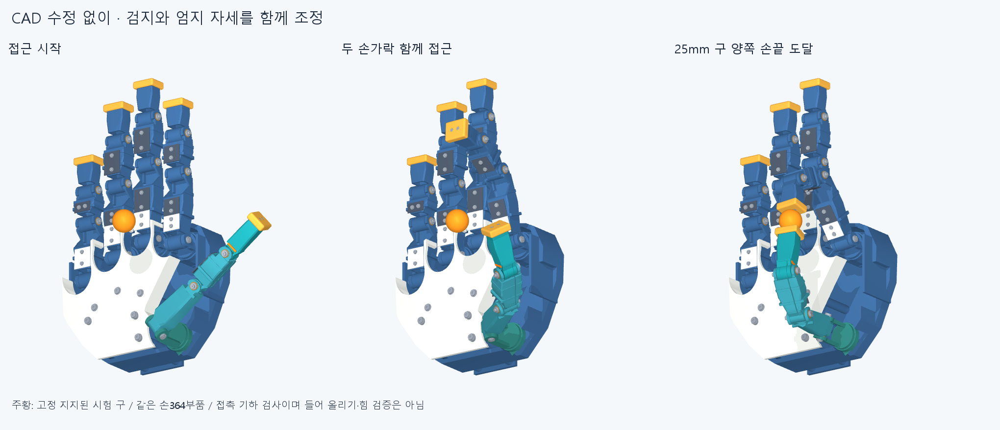

# PINCH006 · 같은 손 CAD에서25mm 구에 접근하고 풀기

손364부품의 STEP/STL·관절축·길이를 유지했다. 빈손 끝을 약0.25mm까지 모으던 POSTURE005에서 실제 크기의 물체를 사이에 두는 과제로 확장했다. 검지와 엄지의 각도·협응만 변경했다. 모터 설치 위치나 외피를 변경하지 않았다.

## 실제 과제와 결과

직경25mm의 완전한 구를 고정 지지된 시험 물체로 둔다. 외부 지지장치의 형상은 모델링하지 않았고, 물체를 손의 힘만으로 떠받치는 시험이 아니다. 편 손에서 검지와 엄지를 함께 움직여 서로 마주 보는 둥근 손끝 앞면으로 접근한 뒤 같은 자세 배열을 역순으로 풀었다. 이전 연구의 중앙 지문면 접촉과는 다른 접촉 위치이며 같은 과제를 이름만 바꿔 성공으로 세지 않는다.

- 실제 저장 STEP의 손364부품66066쌍과 손–구364쌍을 표본마다 검사했다. 구는 STEP 재수입 후 완전한 구의 체적·중심을 대조했다.
- 검지/엄지 끝캡과 구의 최종 표면 거리는 각각 1.59e-14mm, 7e-14mm다. 두 선택 표면의 바깥 방향 내적은 -1.000000000로 서로 마주 본다.
- 접근17표본, 정확 역순 풀기를 포함한33표본에서 보고 기준 이상 자체 관통·물체 관통0, 연산 실패0이다. 관절 표본 간격은 최대5°다. 보고 기준은 겹침 체적0.02mm³ 초과, Boolean 허용오차1e−6mm다. 의도한 표면 접촉은 간섭 실패와 구별한다.
- 검지 굽힘은 MCP37.14°/PIP72.52°/DIP56.43°, 벌림-5.00°다. 엄지 목표각은 58.52, 77.04, 57.53, 52.24°다. 역굽힘이나 축·길이 변경에 기대지 않는다. 자세는 엔지니어링 후보이며 실물 모터 가동 범위 측정이 아니다.

[접근과 풀기 동작](images/approach_release.gif). 그림은 실제 저장 CAD와 구이며 물리 시뮬레이션 스텝은0이다. GIF 시간은 실물 속도가 아니다.

## 여기서 마무리하는 것과 남는 것

이25mm 구의 기하학적 접근·손끝 도달·풀기는 자세로 해결했으므로 추가 공칭 여유를 이유로 CAD를 깎거나 같은 과제를 반복 최적화하지 않는다. 접촉력·마찰·미끄러짐·들어 올리기·파지 유지, 표본 사이 연속 충돌과 실물 공차는 미검증이다. 고정 물체 접근 성공을 실제 파지 성능으로 승격하지 않는다.

반대 방향의 밀착 교차, 다른 크기·형태의 물체, 열쇠/필기/손안 조작 등은 확장 과제로 남긴다. 미실행 또는 실패한 후보를 모두 구조 결함으로 간주하지 않는다. 기존 일상 손모양과 이번 결과를 바탕으로 움직임 미세 조정은 여기서 중단하고 다음 회차는 모터·커넥터 실배치 확인 및 배선 준비로 전환한다. 전체 기능·제작·실물 승인은 아니다. 중요 필수 동작의 구조적 걸림이 이후 확인되면 그 근거로 재검토한다.

현재 손364부품에는 손 전체 모터20개가 통합된 상태가 아니다. 외부 모터 시험대와 과거 모터 재배치 연구를 실제 손에 설치된 모터로 세지 않는다. 다음 배선 단계에서 실제 모터 위치·출구·커넥터 치수부터 확인하고 보드 종단은 임시 공간으로 둔다. 보드 없는 배선 CAD는 가능하지만 최종 전기 연결/전원 검증과 구별한다. 전기 배선과 구동용 텐던은 별도 경로다.

## 저장 근거와 재현 범위

6시작점의 유한 접촉 탐색과3경로의 메시 가이드는 `generated/search.json`에 있다. 유사한3경로는 동일 직선 경로를 다른 간격으로 표본화한 것이며 서로 다른 회피 전략이나 독립 성공3건으로 세지 않는다. 선택1자세·1경로를 실제 형상으로 확인했다. 캡슐/뿌리 간섭 보간/메시는 탐색용이고 최종 native 검사에서 부품쌍을 제외하지 않았다. 같은 CAD에서 이 과제가 풀렸다는 결과이며 임의 가동 범위 전체 승인이 아니다.

`reviews/audit.json`에 실제 관통/접촉과 표본 경로를 보존한다. 소스·형상·그림은 새 PINCH006 manifest에만 동결하며 이전 manifest는 변경하지 않는다. 커밋/푸시 후 정확 SHA의 깨끗한 clone에서 끝자세와 핵심 경로점·실제 구 접촉 거리를 재검사하고 별도 후속 커밋에 기록한다. 같은 에이전트의 재현 검토이며 독립 감사가 아니다.
