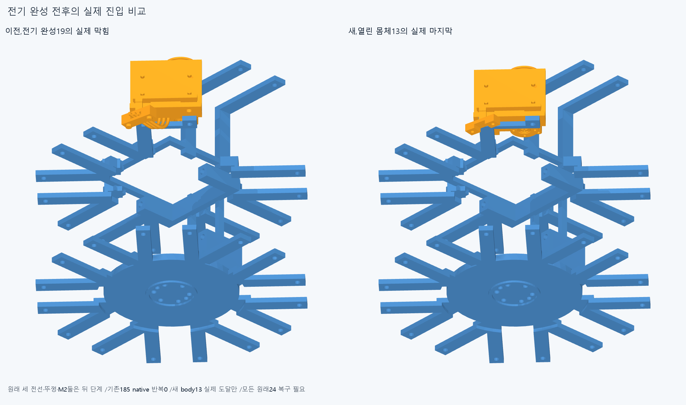
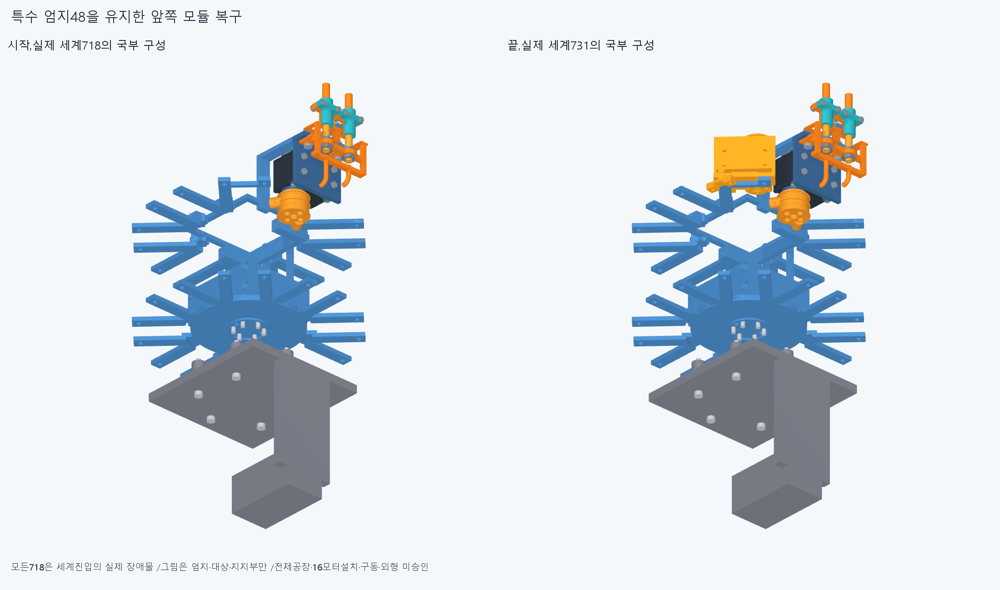

# ARM079 열린 전기 홈 상태에서의 세계 조립

현재862/기본364·손397/손바닥4·16원격·빔전기·설치축길이명령clock유지,886/방사랙외형미채택이다. ARM074받침1명시교체의별도886/특수48=원래47+새받침1,다른885유지/이번설치형상변경0이다.

ARM078첫실패의저장실제공통2와세lead/guidebase·lid/M2·공동root의해당지지면속성을읽었다. 옛공통은속성읽기만/oldBoolean0·옛185/축14재실행0이다. 모터·출력·전기부품형상/최종설치위치변경0이며원래24전체복구가목표다.

이전벤치첫6경로69표본은같은입력해시/실제등록·moving-present집합/항등완료를대조해승계·새native0이다. 이는143전체승계가아니다. carrier11에서세lead없이lidnuts두개를넣는변경집합11/12는새검사해body13을만든다. 실제718을장애물로전체밖에서body13을원래finalnormal0에넣은뒤세lead→원래lid/M2둘→racknuts/M3둘→원래M2너트4compound의순서다. plug는몸체와함께유지하고각복구전부품은명시부재/완료뒤원래항등위치만추가한다.

새88native/485185쌍/469AABB/3기록/0오류·rawFalse다. report>.001mm³/Boolean1e−6mm/OCC1이다. body13벤치=True·새완전모듈0/총9/16/world731/대기155이다. 첫막힘뒤미실행을성공으로쓰지않으며같은한경로의여러기록을독립설계결함수/전체조립불가능으로확대하지않는다.

실제새막힘: `[{"lead": "middle_dip_actuator_lead1", "part": "Elbow_fixed_cradle", "material_intersection_mm3": 25.998081275102404}, {"lead": "middle_dip_actuator_lead2", "part": "Elbow_fixed_cradle", "material_intersection_mm3": 25.9980812750961}, {"lead": "middle_dip_actuator_lead3", "part": "Elbow_fixed_cradle", "material_intersection_mm3": 25.998081275101473}]`

전체밖시작과각이동·고정부품의실제AABB직교투영진입중간이탈사건을추가했다. 보수경계/유한표본이며연속곡면통과·공구/나사산/토크승인이아니다. 4/20/40/80/160mm등은시험경로이지최소여유규격아니다. 수동유지·벤치운반/중립등록·내부mating/유연하네스/captive/힘강도마찰예압장력·전체공장은미검증이다.

새공통2만수치선저장뒤STEP-STL증거2·실제불투명5고유그림을만들었다. 설치기하export0·기존12799기하/동결222/과거manifest불변이다. 공통0은미생성·미실행이다.

정확SHA핵심계획14native는각새경로시작끝/세계마지막5·실패경로도달전부다. 원래16packet408/886/명시받침1/718·특수48/13+전기6+랙5=24·누적목록/누락/전체밖/항등/실제새면속성·투영사건prefix/같은69승계·새공통typed서명epsilon1e−10/절대1e−5를대조한다. 실제재현은docs/reviews/ARM079이다. 같은에이전트한정재현이며독립감사/모든중간·trimBoolean/픽셀/팔시각단위/연속전체공장·20구동/외형수용승인이아니다.

열린body13의세계진입51통과/실제731을보존한다. 새세lead의전체뒤진입(0,-260,0)mm가Elbow_fixed_cradle에각25.998081275102404/25.9980812750961/25.998081275101473mm³로걸린새실제공통·받침경계/전기홈진입축을읽는다. 세계전체밖방사시작→실제공동root뒤면을피한opening방향오프셋옆진입→원래열린홈축복귀의꺾인전기참고진입대안을성공가정없이검사한다. 오프셋은실제root/세lead경계로정하고최소여유규격으로쓰지않는다. 전체밖시작을빼고받침뒤쪽의얕은시작으로성공처리하지않는다. 실제718및이번완료부품을보존하고원래24전체/전기홈·덮개·세lead/자기plug·M3/M2스택을모두복구한다. 같은69승계는입력·등록/moving-present집합동일성증명만허용하고변경집합은새검사다. 기존185경로/새실패경로자동반복·막힌뒤얕은시작/삭제/코너절삭/모터이동0이다. 이번새88native/조건부world731/대기155/완전packet9/16이다. 완료경로/같은69·투영사건·옛185/축14/68/106/162/ARM07415·4·보어1/216·615PCD재실행0. ARM074윗M3전체포함false19.195131113433646mm³/1solid·실제보어1/216IN모순/원인미확정·윗돌출5.9mm/외형미채택,ARM065edgevertex/corefalse·ARM072픽셀false·옛strictfalse/모든이전실패보류유지다. 같은차집합/정밀/픽셀복구/615PCD반복0. 빔반대뽑힘·출력12내부/mating·하네스/captive/공구·토크힘강도마찰예압장력/20구동·동적전기·전체팔상완/실물제조외형미승인. 손빔절삭/모터삭제·몰래이동/각도제한/ODR축소/가짜텐셔너/LINK·옛최적화/팔꿈치버스재개0.
