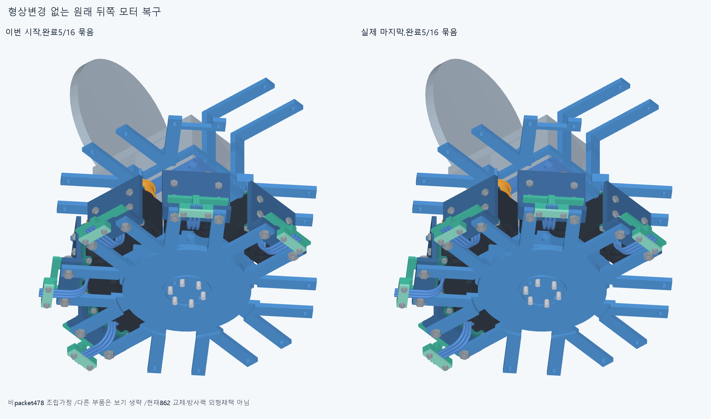
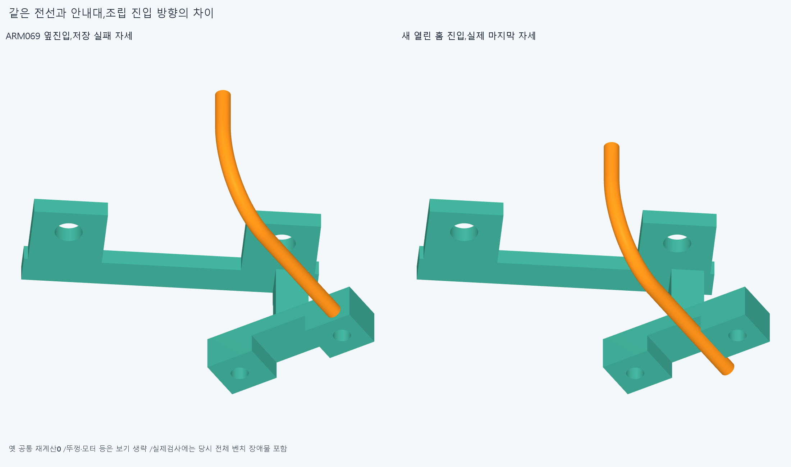
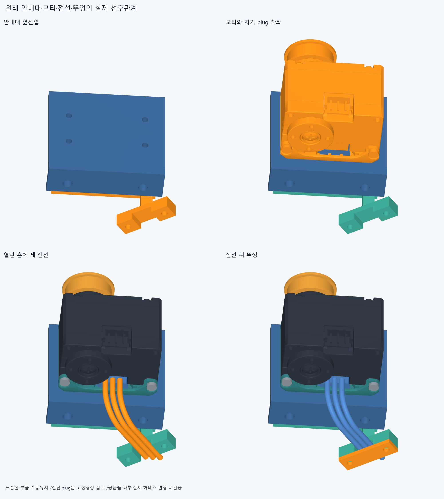
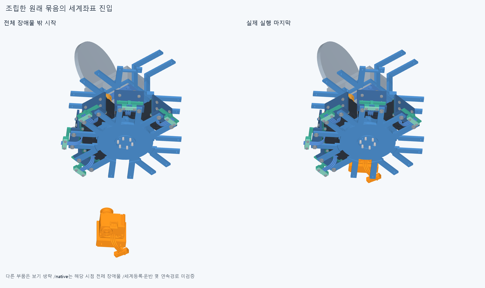
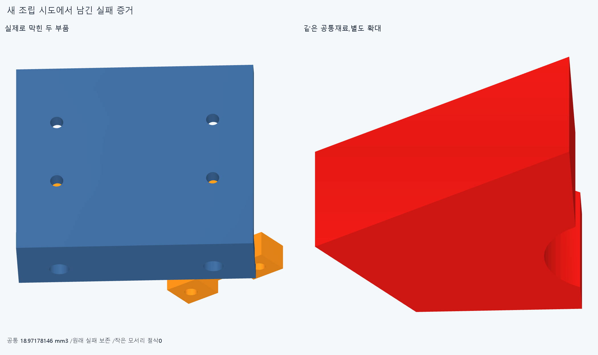
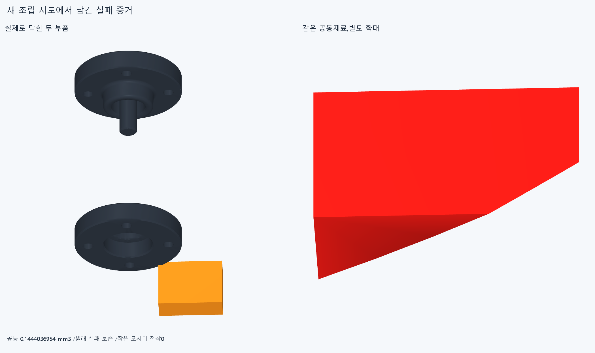
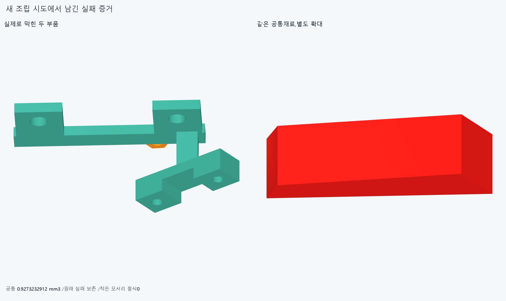
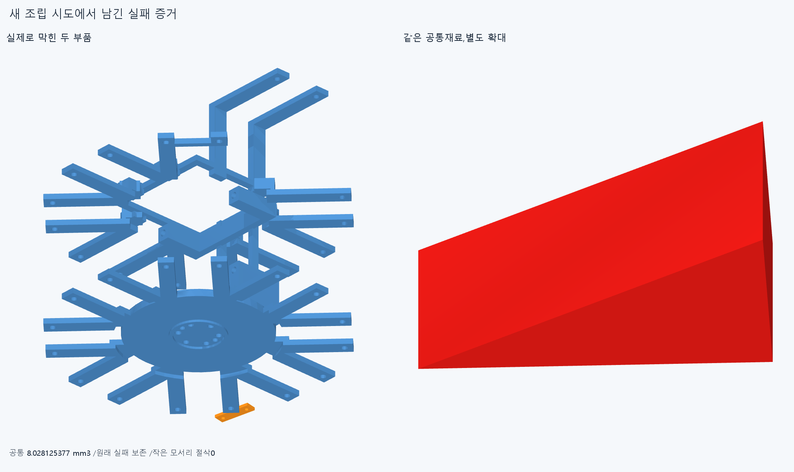

# ARM070 열린 전선홈의 모듈 조립 순서

**설치 형상변경 없이 새0묶음을 원래위치로 복구해 총5/16,조건부598행/288행 대기다.**

## 범위와 관찰

현재862/기본364·손397/손바닥4·16원격/빔·전기·축길이명령clock설치기하변경0,886/방사랙/외형미채택이다. 비packet478조립·중립세계등록/운반은 별도조건이며 실제공장 전체조립이 아니다. 원래 전선/plug·공급모터/body나사/spool은 참고형상이고 실제 mating/유연하네스변형/captive유지·공구fit/나사산토크/힘강도마찰예압장력/20구동·동적전기·전체팔상완/실물제조외형은 미승인이다.

ARM069의 실제598행/완료5묶음에서 시작한다. 원래16packet408/최종886 목록과 이미 복구한 indexMCP/littleMCP/thumbMCP/littlePIP/littleDIP를 유지한다. 뒤쪽 남은 ringPIP/ringDIP/middlePIP 각24가 이번 계획이며 앞8은 후속이다. ARM069의 저장 lead1/guidebase 공통과 원래 리드경로·홈/덮개·M3스택을 읽었다. 저장 공통은 실제 안내대 좌표의 bbox/체적만 읽고 옛 Boolean은 재실행하지 않았다. 원래 source의 순서는 안내대/공유M3·spacer→전선→뚜껑/M2다. 현재 실제 ARM054변환과 guideframe을 사용하며 옛 세계배선 조립결과를 승계하지 않았다.

## 세 번의 실패와 실제 교정

1. 안내대를 아래에서 수직으로 끼우는 첫5표본은 +normal10에서 어댑터와18.971781463330263mm³로 막혔다. 원본 check.json을 보존한다.
2. 원래 안내대의 옆진입7→spacer2각7→motorunit6진입7은 통과했다. 다음3전선/plug4를 열린 홈 방향으로 내리는 다섯째10mm에서 plug_outer/rotor .14440369540912512mm³로 막혔다. selected_check33은 원본이며 연결상자 참고교차를 손 결함이나 실물 mating 실패로 확대하지 않는다.
3. plug는 모터와 함께 둔 unit7로 넣고3전선만 열린 홈으로 놓으면 통과했다. 다음 첫 뚜껑너트를 아래에서 수직10mm 올리면 guidebase .9273232912470403mm³로 막혔다. final_check19를 보존한다. 작은 코너를 깎지 않았다.

continuation_check는 너트를 실제 hex포켓 아래4mm의 조립평면에서 signed guideY방향의 전체 장애물 밖부터 옆으로 가져오고,포켓 아래2/0으로 끼운다. 4mm는 받침을 지나 포켓에 접근하는 시험 경로이며 설계공차/최소여유가 아니다. 원래 너트2→뚜껑→M2나사2를 복구한다. ringPIP의 M2벤치14/안내대-spacer21/모터와전선 경로14는 동일 입력/변환/부품·장애물 목록으로 승계하며12개 쿼리 부분집합의 전체 쌍 덮임을 검토한다. motorunit6 관계를 재실행하지 않고 새 plug관계7만,전선 첫5는 기존전선부분집합+새plug관계5만,나머지2는 전체새관계를 검사했다. 이를 전부 새검사라고 세지 않는다. 다른 모듈은 실제 각각의 방위/리드경로를 새검사한다.

## 결과와 원래 위치 복구

네 실행의 새 native는 총109그룹/103528쌍/185AABB/8겹침기록/연산오류0,보고>0.001mm³/Boolean1e−6mm/OCC1이다. 앞세 시도57은 실패를 포함한다. 이어선 실행은 새52이며 clear=False,완료된 경로만 실제로 인정한다. 선택 경로 범위는 새52+같은경로49=101표본이며 전부 새실행이 아니다.

새 복구=[],전체 완료=['index_mcp_actuator', 'little_mcp_actuator', 'thumb_mcp_actuator', 'little_pip_actuator', 'little_dip_actuator']. 조건부598→598,대기288행이다. 모든 원래 부품·위치와 최종 항등변환을 복구하며 영구 모터/너트/전선 삭제0이다. 마지막 실패=ring_pip_actuator__body19_side_then_normal_8,기록=[{'lead': 'ring_pip_actuator_lead1', 'part': 'arm065_shared_output_beam_rack_root', 'material_intersection_mm3': 0.7990918896891049}, {'lead': 'ring_pip_actuator_lead2', 'part': 'arm065_shared_output_beam_rack_root', 'material_intersection_mm3': 0.7109686840712125}, {'lead': 'ring_pip_actuator_lead3', 'part': 'arm065_shared_output_beam_rack_root', 'material_intersection_mm3': 0.25677808619810366}, {'lead': 'ring_pip_actuator_wire_guide_base', 'part': 'arm065_shared_output_beam_rack_root', 'material_intersection_mm3': 0.6330451661382925}, {'lead': 'ring_pip_actuator_wire_guide_lid', 'part': 'arm065_shared_output_beam_rack_root', 'material_intersection_mm3': 8.028125377469921}].

완성한 body19는 원래 base_nuts4묶음 한 행만 일시 누락한다. 각 세계진입은 실제 해당시점 전체 장애물 AABB밖에서 방사방향으로 들어온다. body는 출력+8로 옆진입→+4/0,racknut는−20로 옆진입→−10/0,M3는+40옆진입→20/10/0이다. 마지막 원래 M2받침너트4묶음을 방사바깥에서20/10/5/0으로 복구한다. 느슨한 부품 수동유지/벤치 중립세계등록·운반과 비packet478의 다른 공장조립은 별도조건이다. 598행 전체 공장조립이나16모터 설치완료가 아니다.

## 실제 CAD와 재현

불투명 실제CAD8그림이며 다른 부품의 보기 생략은 native검사 제외가 아니다. 새공통4의 수치는 export/렌더 전에 저장했고 증거STEP/STL은 설치물이 아니다. 새 뚜껑M2축읽기1,옛 M2/M3축10/615면PCD 재분류0이다. 이전기하12763/동결222/과거manifest는 보존한다.

정확SHA 새 깨끗한 사본에서 각 새벤치 시작끝/세계 body·nut 마지막3/M3마지막4와 첫실패를 포함한 핵심32native,원래16packet408/886/시작598·유지5,실제홈/리드변환·뚜껑축/일시누락·목록연속성·전체 장애물밖 시작·같은경로/부분집합 승계를 대조한다. 새공통 sourceSTEP형상서명은 adaptiveepsilon1e−10/절대1e−5다. 모든중간표본/곡면trimBoolean·픽셀/팔시각단위나 연속전체공장/실물 증명은 아니며 같은에이전트 검토로 독립감사가 아니다.

ARM069lead/base3.522실패·ARM068전선3·ARM067나사·ARM066두실패·ARM065common1edgevertex/corefalse·옛M3+13/R5/strictfalse/곡면포함보류를 보존한다. 빔 한방향 끝받침/반대뽑힘 마찰예압은 미검증이다. 손빔절삭/모터삭제·몰래이동/각도제한/ODR축소/가짜텐셔너/LINK·옛최적화/팔꿈치전기버스재개0. 지지조립운동 일관뒤 고정모터→H짧은입구→실제끝구 긴재료를 잇고 실물완벽을 CAD영상의 무한조건으로 늘리지 않는다.

## 다음

약지PIP의 원래body19 벤치조립은 완료했지만 세계진입의 방사0/출력+8에서3선·guidebase·lid가 중앙 arm065_shared_output_beam_rack_root에5기록으로 막혔다. 저장실제공통/중앙root와 원래 장착면·출력축방향을 읽고 전체바깥진입/축맞춤 순서를 검토한다. 같은body19벤치/너트옆진입·109전체를 반복하지 않고 새변경관계만 검사한다. +4/0만 얕게 시작해 성공으로 쓰거나root/리드/lid삭제·코너절삭·모터설치축/명령변경0이다. 완료5/조건부598·288대기를 유지하고 rear3/front8을 이어간다.
