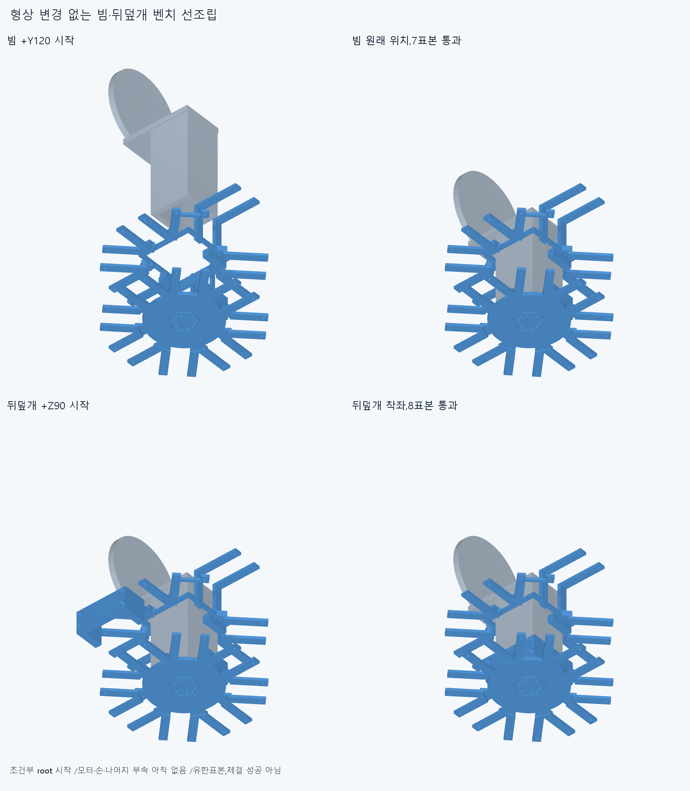
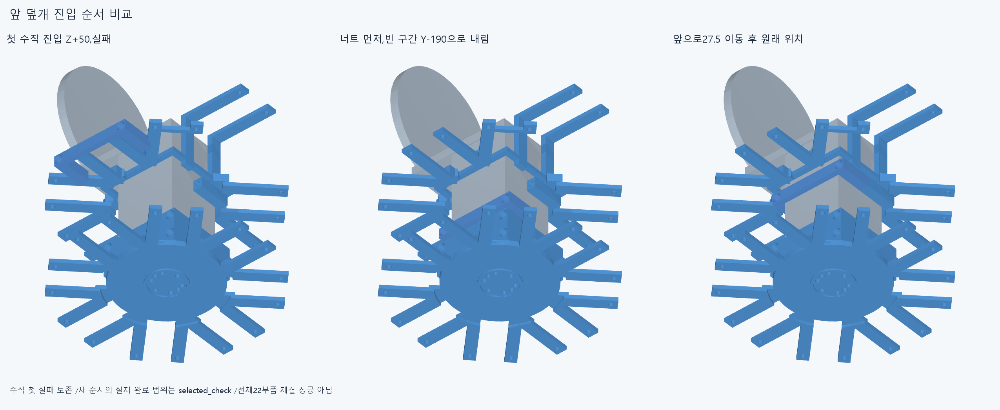
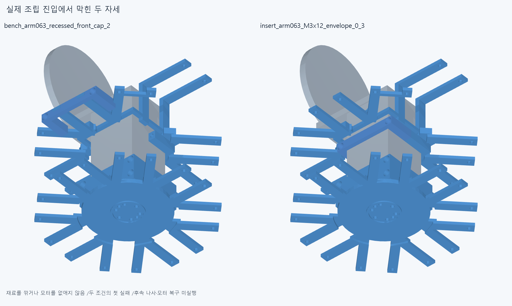
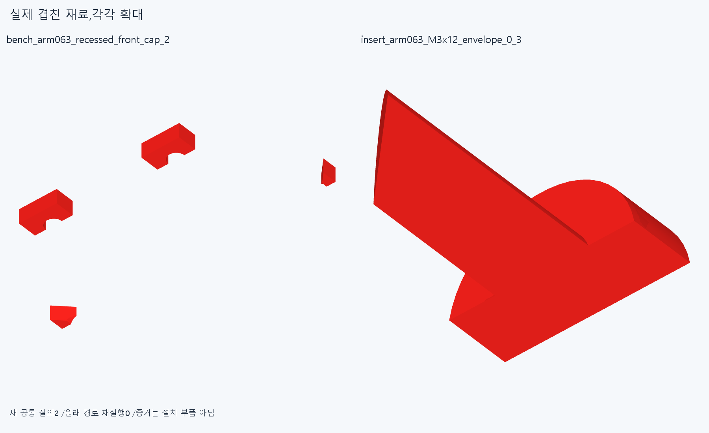

# ARM066 선조립 순서와 체결 진입,미완

**빔과뒤덮개는선조립표본을통과했다. 앞덮개도빈구간으로내린뒤미는순서로진입했지만,앞M3나사를아래에서넣는경로가같은root에걸려중단했다. 모터16개복구는아직실행하지않았다.**

## 유지한 형상과 조건

현재862/기본364·손397/손바닥4·전완16/빔/전기·설치축길이/명령clock을유지했다. 별도ARM065886도미채택이며새설치·하드웨어기하변경0이다. ARM054원래모듈목록에서현재남은부품과ARM059엄지지지·죠대체3을묶어16packet/408행을확인했다. 기존세계좌표배선·조립통과를새순서로승계하지않았다. 각packet의rack나사2/너트2는몸체진입후별도체결계획이다.

첫조건은root1만있는벤치로다른885행이없다. 빔→뒤덮개→앞덮개/나사너트→output6볼트로22행을선조립하고,그22를원래중립세계좌표에등록한뒤다른비packet478행이조립돼있다고가정한두번째조건에서16packet을복구할계획이었다. 등록운반/나머지공장조립·작업자/지그는검사하지않았다. 느슨한부품은체결전수동유지다. 두조건을한전체공장조립성공으로합치지않는다.

## 첫 경로와 실패

첫18native=32쌍/20AABB/1기록/0연산오류다. 빔은+Y120/100/80/60/40/20/0의7표본,뒤덮개는+Z90/70/50/30/10/14/7/0의8표본이0이다. 뒤덮개의10→14는원래선언한왕복표본이며이를단조·연속진입증명으로쓰지않는다. 빔시작의전체root경계상자Y분리12mm,뒤cap시작Z분리14.7mm로얕은완성근처시작을전체진입근거로쓰지않았다.

앞덮개를수직+Z90/70/50으로내리는세번째표본에서root와191.70796945066422mm³겹쳐중단했다. 이후나사·모터복구는실행하지않았다. 이한수직경로실패를전체앞unit조립불가능/손결함으로확대하지않는다.

## 앞 덮개 순서 교정과 남은 나사 진입

별도selected는완료빔7+뒤cap8의15표본을입력/부품목록그대로재사용하고native재실행0이다. 앞cap만있는별도벤치에서두너트를각Z+40/20/10/0의8표본으로먼저넣었다. cap/너트3행을Y−190위치로옮겨Z90/70/50/30/14/7/0으로내린뒤Y−182.5/−172.5/−162.5로미는10표본이통과했다. 최종cap·너트형상과설치위치는그대로다. 두분리작업의운반/실제지그는미검증이다.

뒤너트4개는각Z+100/80/60/40/20/10/0의28표본이통과했다. 다음앞M3x12_0을Z−100/−80/−60/−40으로넣는네번째표본에서root와31.75217294931784mm³겹쳐중단했다. 새50native=352쌍/89AABB/1기록/0연산오류다. 총실행은첫18+새50=68그룹/384쌍/109AABB/2기록이며재사용15를더해83실행이라고쓰지않는다. selected범위는재사용15+새50=65표본,rawfalse다.

벤치는현재10행까지만있고앞/뒤나사나머지·output6볼트진입은미실행이다. 계획22행체결/16packet복구성공이아니다. 16/408행은대기목록이며영구모터삭제가아니다. 첫check의packet_final_present_names478행은두번째조건부시작을그린목록일뿐,실행복구장면이아니다. reporting>0.001mm³/Boolean1e−6mm/OCC1/검사제외0이다.

## 실제 CAD 증거

두공통은저장실패자세의실제translation을쓴새질의2다. 원래68경로native재실행0,증거2형상은설치물이아니다. 저장STEP만쓰는조립검사와이두공통의source/STEP적응epsilon1e−10·절대1e−5측정서명을구별한다. 이전기하12751/동결222/과거manifest를유지했다.

## 재현 범위와 다음

정확SHA새깨끗한사본에서각새경로의실제실행시작/마지막22native와공통2/그형상2·16packet408/최종886목록·재사용15계약을대조한다. 중간나머지표본/연속궤적·전체공장조립·공급공구/나사산토크/강도마찰예압장력/20모터구동·긴재료/동적전기/전체팔상완·실물외형승인은없다. 모든곡면식trimBoolean/픽셀/팔시각단위증명이아니며같은에이전트검토다.

ARM065공통1의edges/vertices개수불일치·초기corefalse와모든이전strictfalse/failedM3+13/R5·곡면포함보류를보존한다. ARM06512/12/16pad/2보존/2공통·앞unit형상/615면/PCD/작은접합재검사0이다. 빔끝Y−226은한방향받침이며반대뽑힘은미검증예압/마찰이다. 현재방사16랙·외형은미채택이다.

다음은저장된앞나사공통과실제머리·축/아래counterbore를읽고,빈구간으로나사를기울여진입한뒤축을맞추는자연스러운전체진입자세를검사한다. 얕은시작/작은나사코너절삭으로대체하지않는다. 자연스러운순서도막히면전체clamp/cap/체결의서비스interface를별도후보로다루고손·빔을깎지않는다. 통과한빔/뒤cap/앞너트·gap진입/뒤너트와68/공통2는닫는다. 벤치22일관후원래16packet복구를이어서검사한다. 모터삭제·몰래이동/각도제한/ODR축소/가짜텐셔너/LINK·옛곡선최적화/팔꿈치전기버스재개0이다.
