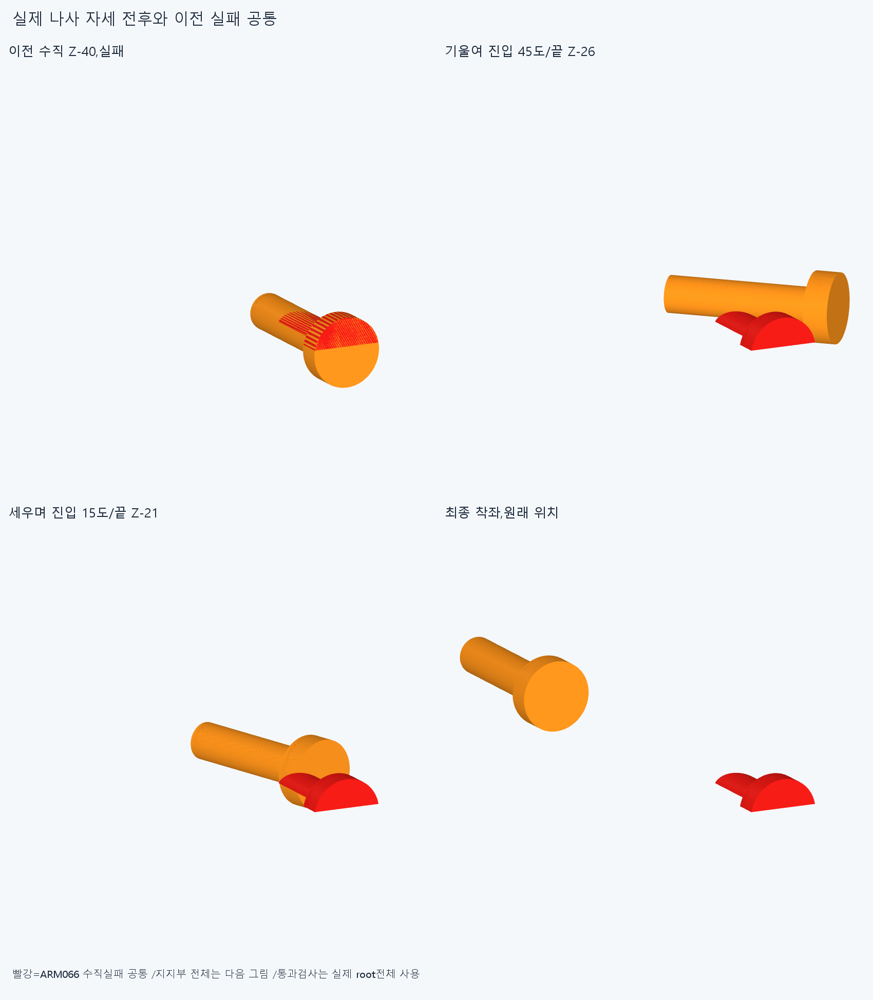
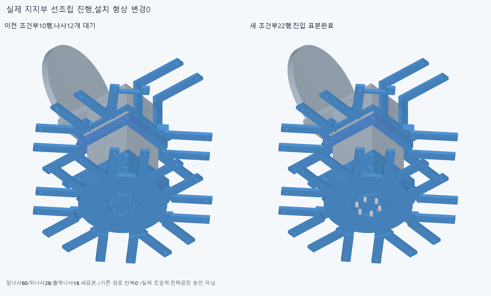
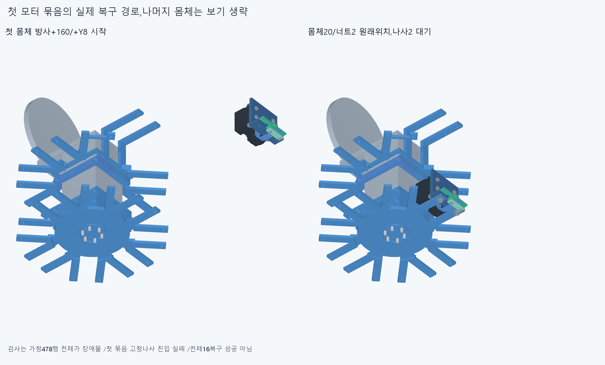
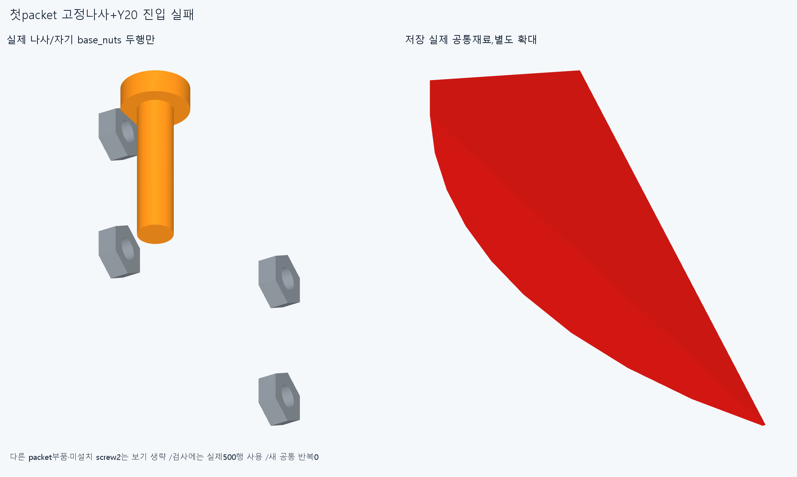

# ARM067 나사를 기울여 넣는 순서,지지부 선조립 완료·모터 복구 미완

**기존 형상 그대로 앞나사 두 개를 기울여 넣는 60표본이 통과했고, 뒤나사·출력나사까지 지지부22행의 조건부 선조립을 마쳤다. 첫모터 몸체와 너트 복구 뒤 고정나사 진입이 자체 base_nuts에 걸려,전체16묶음 복구는 미완이다.**

## 형상 유지와 실제 진입 근거

현재862/기본364·손397/손바닥4·전완16/빔·전기·축길이명령clock은유지했다. ARM065886은미채택이며새설치/하드웨어기하변경0이다. ARM066벤치10행을같은입력/명시목록으로승계하고기존68native/2공통을반복하지않았다. 모터를삭제하거나영구재배치하지않았다.

실제앞M3두볼트의원통면을읽어shaftR1.5/Z−4..8,headR2.85/Z−6..−4,axisX±25.5/Y−162.5를확인했다. 아래counterboreR2.85/Z−26..−4는기존ARM063소스의구성선언이며새접촉/공급fit승인이아니다. 저장된ARM066앞볼트실패공통STEP를읽었고그쌍Boolean을다시계산하지않았다.

한나사당먼저Y축45°로기울여꼬리를바깥쪽지지살사이빈틈으로향하게했다. tipZ−26에서진입축거리120/100/80/60/40/20/0을전진한다. 다음각도/tipZ는45/−26→35/−25→25/−23→15/−21→5/−19→0/−18의각구간4등분이다. 마지막tipZ−10/0/8에서원래위치로착좌한다. 반대쪽나사는반대방향기울임이며마지막변환은둘다항등행렬이다. 조립자세가바뀌며모터설치축·명령각을바꾼것이아니다.

앞2×30=60표본은기존root/beam/cap/너트10·11행전체대조0이다. 처음모든장애물보다아래Z경계상자분리는34.392153570605885/34.39215357060587mm여서얕은완성근처시작이아니다. 한자연스러운경로이며각도/반경족탐색·미세모서리절삭0이다. 유한표본이므로연속스윕/공급공구/실제조임토크승인은없다.

뒤M3x12네개각Z−100/−80/−60/−40/−20/−10/0의28표본과출력M3x8여섯개각Y+20/+10/0의18표본도0이다. **새106벤치표본으로원래22행의조건부선조립을마쳤다.** 빔끝Y−226의한방향받침/반대뽑힘의미검증예압마찰가정은유지한다. 출력나사검사는6탭/PCD/clock/615면재분류나실제나사산·공급fit/토크승인이아니다.

## 첫 모터 묶음 복구의 실제 중단

다음은선조립22행을원래중립세계좌표에등록하고다른비packet478행이이미조립돼있다고가정한별도조건이다. 실제등록운반/다른공장조립·지그/손공구는검사하지않았다. 478에는위22가포함된다. packet내부20행은기존형상의벤치묶음조건이며새내부조립성공으로쓰지않는다.

첫index_mcp몸체20행은+Y8/방사+160에서20mm씩안으로들어간후원래방사위치에서Y8→4→0의11표본을검사했다. 초기전부품경계상자투영분리10.100766113909998mm,새관계0이다. rack너트2개의각−Y20/10/0의6표본도0이다. 다음rack_screw_1의+Y20첫표본이자기index_mcp_actuator_base_nuts와0.36207124135856594mm³겹쳐중단했다. 다음+Y10/0/나사2/나머지15packet은미실행이다. 작은겹침을전체불가능이나손결함으로확대하지않는다.

실제전체새124native=109992쌍/225AABB/1기록/0연산오류,reporting>0.001mm³/Boolean1e−6mm/OCC1,rawfalse다. 벤치106+첫packet18이며이전ARM06668을반복하거나합산하지않았다. 가정478+새복구몸체20/너트2=조건부500행,packet386행이남는다. 완전복구packet은0/16이다. **500행전체조립/16모터설치완료가아니다.** 현재862설치교체0이며일시누락을영구모터삭제로꾸미지않는다.

## 실제 CAD와 렌더 오류 보존

첫렌더는임시실행나사자세2/첫packet실패공통1의STEP/STL을저장한뒤,첫국부화면에서전체root가잘리는것을borderguard가거부해이미지저장전에중단했다. 코드·오류·3저장형상/history/render_attempt1을보존했다. 첫공통Boolean1은실행됐으나그직후계산된별도scalar수치는JSON에저장되지않았고복구했다고쓰지않는다. 원래check의native체적0.36207124135856594를비교기준으로유지하고저장STEP체적은새속성읽기로기록했다.

render_saved는저장3CAD를재사용하고native/공통Boolean/STEPexport재실행0으로4그림만만들었다. 첫그림의빨강은ARM066수직실패공통참고이며전체root는그림에서생략했다. 실제통과검사는전체root를썼다. 마지막그림은이동나사/실제base_nuts의2행만표시하며나머지packet은보기에서생략한다. 첫코드가뒤에계획했던미설치rack_screw_2포함표시는실행되지않았으며새구성에서는포함하지않는다. 실행하지않은recover_render.py도재검사/복구횟수에세지않는다. 증거형상은새설치물/공구가아니다.

## 재현과 다음

정확SHA새깨끗한사본에서41native(앞나사각실행phase시작끝12·뒤/출력20·packet경로4·너트4·첫막힘1),2실행자세/1새공통의sourceSTEP측정서명3·공통1,앞60/첫packet11변환·승계10/벤치22/16packet408·최종886/500조건부/386대기·설치목록연속성을대조한다. epsilon1e−10/절대1e−5측정서명은모든곡면식trimBoolean·픽셀/팔시각단위증명이아니다. 같은에이전트이며독립감사가아니다. 이전기하12755/동결222/과거manifest보존이다.

이전ARM065공통1의edgevertex불일치/corefalse·ARM066두실패·failedM3+13/R5/strictfalse·곡면포함보류는미해소로보존한다. 전체연속조립/공급공구·나사산토크·힘강도마찰예압장력/20구동/긴재료·동적전기/연속전체팔·상완·실물제조외형승인없다. 현재방사16랙/외형도미채택이다.

다음은저장된첫packet나사/base_nuts공통과원래module의실제M3스택조립선후관계를읽는다. captive rackbolt·adapter/cradle/base체결의전체벤치순서로풀고,일시누락/원래최종부품·위치복구를명시한다. +Y10같은얕은위치부터시작해진입성공으로쓰거나base_nuts를삭제/0.362모서리를깎지않는다. 필요하면전체기능서비스interface의별도후보다. 완료벤치22/106·124/공통1·앞60변환은닫고원래16packet복구를이어서검사한다. 손빔절삭/모터삭제·몰래이동/각도제한/ODR축소/가짜텐셔너/LINK·옛곡선최적화/팔꿈치전기버스재개0이다.
